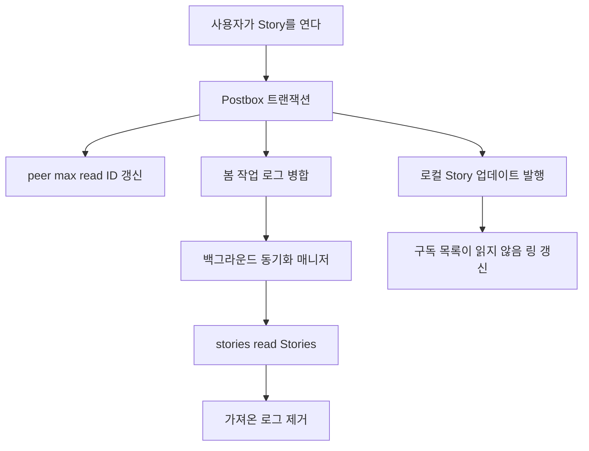
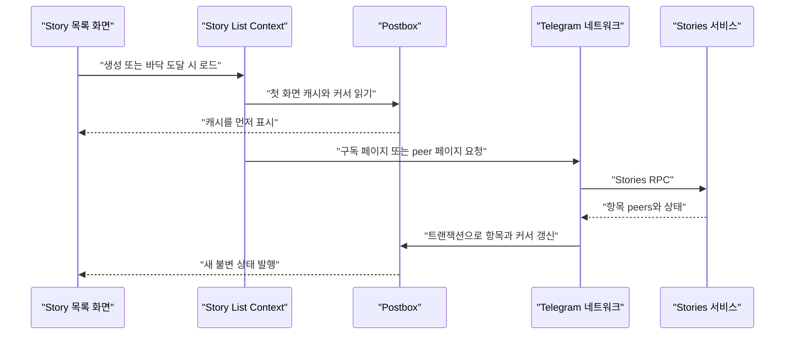
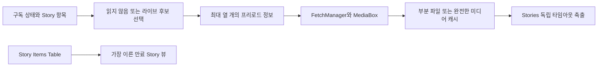

# Stories의 데이터와 미디어 파이프라인

웹: /docs/system/26-stories/ · Markdown: /docs/system/26-stories.md

> Telegram Stories가 Postbox 전용 상태, 구독 페이지네이션, 미디어 게시에서 시작해 프리로드, 회수, macOS 구현에 이르기까지 거치는 전체 경로를 따라가 봐요.

> 시스템 설계 · 비즈니스 시스템 · 26장 · 도표 3 · 코드 발췌 9 · 인용 29 · 소스 기준선: [TelegramMessenger/Telegram-iOS@f1dd7a2d](https://github.com/TelegramMessenger/Telegram-iOS/tree/f1dd7a2dbd02cbbf513e75d5695d8d36d1cf5838), [overtake/TelegramSwift@579cebbf](https://github.com/overtake/TelegramSwift/tree/579cebbf0c01fd41b712eff3647fa7f69db9665d)
>
> 핵심 소스 파일: [TelegramMessenger/Telegram-iOS/submodules/TelegramCore/Sources/TelegramEngine/Messages/Stories.swift](https://github.com/TelegramMessenger/Telegram-iOS/blob/f1dd7a2dbd02cbbf513e75d5695d8d36d1cf5838/submodules/TelegramCore/Sources/TelegramEngine/Messages/Stories.swift), [TelegramMessenger/Telegram-iOS/submodules/TelegramCore/Sources/TelegramEngine/Messages/StoryListContext.swift](https://github.com/TelegramMessenger/Telegram-iOS/blob/f1dd7a2dbd02cbbf513e75d5695d8d36d1cf5838/submodules/TelegramCore/Sources/TelegramEngine/Messages/StoryListContext.swift), [TelegramMessenger/Telegram-iOS/submodules/TelegramCore/Sources/TelegramEngine/Messages/TelegramEngineMessages.swift](https://github.com/TelegramMessenger/Telegram-iOS/blob/f1dd7a2dbd02cbbf513e75d5695d8d36d1cf5838/submodules/TelegramCore/Sources/TelegramEngine/Messages/TelegramEngineMessages.swift), [TelegramMessenger/Telegram-iOS/submodules/TelegramCore/Sources/SyncCore/SynchronizeViewStoriesOperation.swift](https://github.com/TelegramMessenger/Telegram-iOS/blob/f1dd7a2dbd02cbbf513e75d5695d8d36d1cf5838/submodules/TelegramCore/Sources/SyncCore/SynchronizeViewStoriesOperation.swift), [TelegramMessenger/Telegram-iOS/submodules/TelegramCore/Sources/State/ManagedSynchronizeViewStoriesOperations.swift](https://github.com/TelegramMessenger/Telegram-iOS/blob/f1dd7a2dbd02cbbf513e75d5695d8d36d1cf5838/submodules/TelegramCore/Sources/State/ManagedSynchronizeViewStoriesOperations.swift), [TelegramMessenger/Telegram-iOS/submodules/Postbox/Sources/StoryTable.swift](https://github.com/TelegramMessenger/Telegram-iOS/blob/f1dd7a2dbd02cbbf513e75d5695d8d36d1cf5838/submodules/Postbox/Sources/StoryTable.swift), [TelegramMessenger/Telegram-iOS/submodules/Postbox/Sources/StoryItemsTable.swift](https://github.com/TelegramMessenger/Telegram-iOS/blob/f1dd7a2dbd02cbbf513e75d5695d8d36d1cf5838/submodules/Postbox/Sources/StoryItemsTable.swift), [TelegramMessenger/Telegram-iOS/submodules/Postbox/Sources/StorySubscriptionsTable.swift](https://github.com/TelegramMessenger/Telegram-iOS/blob/f1dd7a2dbd02cbbf513e75d5695d8d36d1cf5838/submodules/Postbox/Sources/StorySubscriptionsTable.swift), [TelegramMessenger/Telegram-iOS/submodules/Postbox/Sources/StoryExpirationTimeItemsView.swift](https://github.com/TelegramMessenger/Telegram-iOS/blob/f1dd7a2dbd02cbbf513e75d5695d8d36d1cf5838/submodules/Postbox/Sources/StoryExpirationTimeItemsView.swift), [TelegramMessenger/Telegram-iOS/submodules/TelegramCore/Sources/Utils/AutomaticCacheEviction.swift](https://github.com/TelegramMessenger/Telegram-iOS/blob/f1dd7a2dbd02cbbf513e75d5695d8d36d1cf5838/submodules/TelegramCore/Sources/Utils/AutomaticCacheEviction.swift), [overtake/TelegramSwift/Telegram-Mac/StoryChatContent.swift](https://github.com/overtake/TelegramSwift/blob/579cebbf0c01fd41b712eff3647fa7f69db9665d/Telegram-Mac/StoryChatContent.swift), [overtake/TelegramSwift/Telegram-Mac/StoryPrivacyModalController.swift](https://github.com/overtake/TelegramSwift/blob/579cebbf0c01fd41b712eff3647fa7f69db9665d/Telegram-Mac/StoryPrivacyModalController.swift), [overtake/TelegramSwift/Telegram-Mac/StoryModalController.swift](https://github.com/overtake/TelegramSwift/blob/579cebbf0c01fd41b712eff3647fa7f69db9665d/Telegram-Mac/StoryModalController.swift), [overtake/TelegramSwift/Telegram-Mac/StoryMediaController.swift](https://github.com/overtake/TelegramSwift/blob/579cebbf0c01fd41b712eff3647fa7f69db9665d/Telegram-Mac/StoryMediaController.swift), [overtake/TelegramSwift/Telegram-Mac/StoryChatListView.swift](https://github.com/overtake/TelegramSwift/blob/579cebbf0c01fd41b712eff3647fa7f69db9665d/Telegram-Mac/StoryChatListView.swift), [overtake/Telegram-iOS/submodules/TelegramCore/Sources/TelegramEngine/Messages/Stories.swift](https://github.com/overtake/Telegram-iOS/blob/a24bbe45f9861f736a79916a50898512f751e0dc/submodules/TelegramCore/Sources/TelegramEngine/Messages/Stories.swift)
>
> 미검증 사항:
> - 만료 시각에 맞춰 로컬 Story 항목을 한꺼번에 삭제하거나 갱신하는 계정 수준 스케줄러 진입점을 찾지 못했어요.
> - sendStory 요청이 실패한 뒤, 이미 제거된 게시 대기 Story 항목을 다른 계층이 다시 만드는지는 검증하지 않았어요.
> - macOS fork의 현재 업로드 화면이 Story 음악과 앨범 파라미터를 어디까지 지원하는지는 검증하지 않았어요.

## 문제와 제약 [#문제와-제약]

Stories는 일반 메시지 기록을 다르게 보여주는 방식이 아니에요. 다음을 독립적으로 따로 가져요.

- 정체성
- 만료 시간
- peer(사용자, 그룹, 채널 같은 대화 주체)별 읽음 상한
- 구독 스트림
- 게시 큐

일반 기록은 메시지 번호로 공백(hole)을 채울 수 있어요. 하지만 Stories는 단기적인 질문 세 가지에 동시에 답해야 해요.

1. 어떤 peer에게 지금 만료되지 않은 항목이 무엇인가
2. 사용자가 어느 항목까지 봤는가
3. 다음에 열릴 가능성이 높은 미디어가 무엇인가 [\[1\]](https://github.com/TelegramMessenger/Telegram-iOS/blob/f1dd7a2dbd02cbbf513e75d5695d8d36d1cf5838/submodules/Postbox/Sources/Message.swift#L586-L600) [\[3\]](https://github.com/TelegramMessenger/Telegram-iOS/blob/f1dd7a2dbd02cbbf513e75d5695d8d36d1cf5838/submodules/TelegramCore/Sources/TelegramEngine/Messages/Stories.swift#L614-L804)

시스템은 단기 미디어 비용도 통제할 수 있는 범위로 제한해야 해요. Story에는 사진, 비디오, 대체 화질 미디어, 음악, 인터랙션 영역, 텍스트 엔티티, 조회 통계가 들어갈 수 있어요. 또 개인정보 설정, 채널 권한, 고정, 보관, 서버 제한에 따라 보이는 집합이 바뀔 수 있어요.

이런 상태를 채팅 메시지 테이블에 밀어 넣으면 문제가 생겨요.

- 클라이언트가 기록 읽음과 Story 읽음을 헷갈리게 돼요.
- 만료와 구독 페이지네이션을 부분적으로 갱신하기 어려워져요. [\[2\]](https://github.com/TelegramMessenger/Telegram-iOS/blob/f1dd7a2dbd02cbbf513e75d5695d8d36d1cf5838/submodules/TelegramCore/Sources/TelegramEngine/Messages/Stories.swift#L70-L194) [\[3\]](https://github.com/TelegramMessenger/Telegram-iOS/blob/f1dd7a2dbd02cbbf513e75d5695d8d36d1cf5838/submodules/TelegramCore/Sources/TelegramEngine/Messages/Stories.swift#L614-L804)

이 장은 Stories 전용 부분만 다뤄요. Postbox(클라이언트의 로컬 저장소)의 트랜잭션, 일반 MediaBox(미디어 파일 저장소) 범위 파일, 일반 메시지 업로드는 이미 있는 「Postbox 스토리지 엔진」, 「Postbox 뷰와 메시지 기록 모델」, 「미디어 리소스, 다운로드·업로드와 캐시」 장을 참고하세요. 여기서 볼 건 이런 범용 메커니즘을 Stories가 어떻게 다시 조합하느냐예요.

## 모듈과 데이터 구조 [#모듈과-데이터-구조]

### peer와 Story ID로 만드는 안정적인 정체성 [#peer와-story-id로-만드는-안정적인-정체성]

`StoryId`는 `peerId`와 `Int32` 스토리 번호로 이뤄져요. `MessageId`가 아니고, 메시지 네임스페이스도 없어요. 서버가 게시자 한 명의 Story 시퀀스에 번호를 매기는 방식과 잘 맞는 선택이에요. 메시지나 웹 페이지 미리보기가 Story를 가리킬 때는 채팅 메시지를 위조할 필요 없이 이 정체성만 따로 저장할 수 있어요. [\[1\]](https://github.com/TelegramMessenger/Telegram-iOS/blob/f1dd7a2dbd02cbbf513e75d5695d8d36d1cf5838/submodules/Postbox/Sources/Message.swift#L586-L600)

도메인 모델은 `Stories.Item`이에요. 저장하는 값은 이래요.

- 게시 시각, 만료 시각
- 주 미디어, 대체 미디어, 인터랙션 영역
- 텍스트, 엔티티
- 조회 수, 전달 수, 반응
- 개인정보, 고정, 만료, 공개, 친한 친구, 연락처, 전달 금지, 편집
- 본인 반응, 전달 출처, 음악, 작성자, 폴더 식별자 [\[2\]](https://github.com/TelegramMessenger/Telegram-iOS/blob/f1dd7a2dbd02cbbf513e75d5695d8d36d1cf5838/submodules/TelegramCore/Sources/TelegramEngine/Messages/Stories.swift#L70-L194)

서버가 보낸 최소 항목에 완전한 미디어가 없으면 `Stories.StoredItem`은 `placeholder`(자리 표시 항목)를 그대로 둬요. 삭제된 항목으로 잘못 보지 않아요. [\[3\]](https://github.com/TelegramMessenger/Telegram-iOS/blob/f1dd7a2dbd02cbbf513e75d5695d8d36d1cf5838/submodules/TelegramCore/Sources/TelegramEngine/Messages/Stories.swift#L614-L804)

개인정보는 기본 범위 하나와 보충 peer로 이뤄져요.

- 기본 범위: 모든 사람, 연락처, 친한 친구, 아무도 없음의 네 종류예요.
- 보충 목록: 화이트리스트(허용 목록)를 나타낼 수도 있고, 연락처나 모든 사람 범위에서는 제외 사용자로 바뀌기도 해요.

이 모델 덕분에 클라이언트는 Story마다 펼쳐진 수신자 집합을 따로 저장하지 않아도 돼요. [\[2\]](https://github.com/TelegramMessenger/Telegram-iOS/blob/f1dd7a2dbd02cbbf513e75d5695d8d36d1cf5838/submodules/TelegramCore/Sources/TelegramEngine/Messages/Stories.swift#L70-L194) [\[14\]](https://github.com/TelegramMessenger/Telegram-iOS/blob/f1dd7a2dbd02cbbf513e75d5695d8d36d1cf5838/submodules/TelegramCore/Sources/TelegramEngine/Messages/Stories.swift#L963-L1051)

```swift
public enum Base: Int32, Codable {
    private enum CodingKeys: CodingKey {
        case value
    }
    
    case everyone = 0
    case contacts = 1
    case closeFriends = 2
    case nobody = 3
}
```
[\[2\]](https://github.com/TelegramMessenger/Telegram-iOS/blob/f1dd7a2dbd02cbbf513e75d5695d8d36d1cf5838/submodules/TelegramCore/Sources/TelegramEngine/Messages/Stories.swift#L70-L194)

### Postbox의 여섯 가지 전용 레코드 [#postbox의-여섯-가지-전용-레코드]

Stories는 테이블 하나만 쓰지 않아요. Postbox는 단일 객체, peer별 항목 집합, 읽음 상태, 구독 멤버, 전역 상태, 파생 뷰를 나눠서 저장해요. 덕분에 업데이트 하나가 그 업데이트를 필요로 하는 관찰 결과만 다시 재생할 수 있어요.

1. `StoryTable`은 `StoryId`별로 완전히 인코딩한 항목을 저장해요. 키는 8바이트 peer ID에 4바이트 story ID를 더한 고정 형식이에요. 이 테이블은 딥링크, 인용, ID 기준 갱신에 알맞아요.
2. `StoryItemsTable`은 peer별로 현재 목록을 저장해요. 각 값은 만료 시각, 친한 친구 표식, 라이브 표식도 함께 저장해요. 이 테이블은 peer별 최상단 항목의 파생 정보도 같이 유지해요.
3. Story 상태 레코드는 `StoredStoryPeerState`를 저장해요. 도메인 값 `Stories.PeerState`에는 현재 `maxReadId`만 있고, 저장 래퍼에는 이 값이 `maxSeenId`로 중복 기록돼요.
4. `StorySubscriptionsTable`은 구독 파티션과 peer ID별로 멤버를 저장해요. 파티션은 `filtered`와 `hidden`이에요. 멤버 값은 비어 있고, 정렬과 커서 상태는 이 테이블에 없어요.
5. 범용 Story 상태 레코드는 구독 커서, 게시 대기 로컬 상태, 스텔스 모드 같은 인코딩된 상태를 저장해요.
6. `StoryExpirationTimeItemsView`는 모든 `StoryItemsTable` 항목에서 가장 이른 만료 항목을 투영해요. 타이머나 옵저버에게 다음 만료 시점을 알려주기 때문에, UI 계층에서 DB 전체를 스캔할 필요가 없어요. [\[3\]](https://github.com/TelegramMessenger/Telegram-iOS/blob/f1dd7a2dbd02cbbf513e75d5695d8d36d1cf5838/submodules/TelegramCore/Sources/TelegramEngine/Messages/Stories.swift#L614-L804) [\[4\]](https://github.com/TelegramMessenger/Telegram-iOS/blob/f1dd7a2dbd02cbbf513e75d5695d8d36d1cf5838/submodules/Postbox/Sources/StoryTable.swift#L3-L39) [\[5\]](https://github.com/TelegramMessenger/Telegram-iOS/blob/f1dd7a2dbd02cbbf513e75d5695d8d36d1cf5838/submodules/Postbox/Sources/StoryItemsTable.swift#L214-L278) [\[6\]](https://github.com/TelegramMessenger/Telegram-iOS/blob/f1dd7a2dbd02cbbf513e75d5695d8d36d1cf5838/submodules/Postbox/Sources/StoryItemsTable.swift#L281-L427) [\[7\]](https://github.com/TelegramMessenger/Telegram-iOS/blob/f1dd7a2dbd02cbbf513e75d5695d8d36d1cf5838/submodules/Postbox/Sources/StoryExpirationTimeItemsView.swift#L3-L62) [\[8\]](https://github.com/TelegramMessenger/Telegram-iOS/blob/f1dd7a2dbd02cbbf513e75d5695d8d36d1cf5838/submodules/Postbox/Sources/StorySubscriptionsTable.swift#L3-L90)

`StoryTable`은 같은 인코딩 값을 다시 쓰지 않고, 값이 바뀌면 `updated` 이벤트를 일으켜요. 그래서 Story 하나를 직접 요청하는 경우와 목록을 갱신하는 경우가 같은 정규 객체를 공유하되, 듣는 범위는 달라요.

### 프로토콜 객체를 표시할 수 있는 Story로 병합하기 [#프로토콜-객체를-표시할-수-있는-story로-병합하기]

서버의 `Api.StoryItem`이 항상 완전한 새 객체인 건 아니에요. 완전한 항목에는 flags, 미디어, 만료 날짜, 텍스트, 엔티티, 개인정보, 조회 데이터, 반응, 앨범, 음악이 있어요. 파서는 이렇게 변환해요.

1. 먼저 메시지 미디어 변환 함수로 저장할 수 있는 미디어를 얻어요.
2. 이어서 API 개인정보 규칙을 기본 범위와 추가 peer로 줄여요.
3. 고정, 만료됨, 공개, 친한 친구, 전달 금지, 편집, 연락처, 선택된 연락처 같은 flags를 읽어요.

그래서 Postbox 내부 모델은 API flags의 구체적인 비트 배치에 기대지 않아요. [\[2\]](https://github.com/TelegramMessenger/Telegram-iOS/blob/f1dd7a2dbd02cbbf513e75d5695d8d36d1cf5838/submodules/TelegramCore/Sources/TelegramEngine/Messages/Stories.swift#L70-L194) [\[3\]](https://github.com/TelegramMessenger/Telegram-iOS/blob/f1dd7a2dbd02cbbf513e75d5695d8d36d1cf5838/submodules/TelegramCore/Sources/TelegramEngine/Messages/Stories.swift#L614-L804)

최소 업데이트는 또 다른 입력이에요. 병합 규칙은 이래요.

- API 항목에 minimum 표식이 있으면: 파서는 기존의 조회 통계, 내 반응, 본인 게시 여부, 전달 출처를 그대로 둬요.
- minimum 표식이 없을 때만: 파서가 서버 필드로 이 값들을 덮어써요.

이 병합 규칙 덕분에, 최신 조회 수만 담은 업데이트가 이미 캐시된 미디어, 반응, 출처 정보를 지워 버리는 일이 없어요. 또 `StoryItemsTable`의 시퀀스가 네트워크 응답을 그대로 비추는 거울이 아니라는 것도 보여줘요. [\[3\]](https://github.com/TelegramMessenger/Telegram-iOS/blob/f1dd7a2dbd02cbbf513e75d5695d8d36d1cf5838/submodules/TelegramCore/Sources/TelegramEngine/Messages/Stories.swift#L614-L804)

건너뜀(skipped) 항목과 삭제된 항목도 달라요.

- 건너뜀 항목: 시간과 만료 시각이 있는 placeholder를 만들어요.
- 삭제된 항목: 파싱할 때 빈 값을 돌려줘요.

목록은 보이지 않는 Story의 번호 연속성과 읽지 않음 계산을 유지할 수 있어요. 하지만 단건 상세는 삭제된 항목을 재생할 수 있는 미디어처럼 꾸밀 수 없어요. 이 차이는 UI 문자열이 아니라 `StoredItem` 열거형이 맡아요. [\[3\]](https://github.com/TelegramMessenger/Telegram-iOS/blob/f1dd7a2dbd02cbbf513e75d5695d8d36d1cf5838/submodules/TelegramCore/Sources/TelegramEngine/Messages/Stories.swift#L614-L804)

서버 푸시가 도착하면 상태 매니저가 added, deleted, read, 내 반응의 변동을 `InternalStoryUpdate`로 모아요. Story list context는 이 스트림을 구독해서 최소 범위로 로컬 항목을 교체하거나 제거해요. 그래서 네트워크 폴링, 게시 영수증, 실시간 업데이트가 모두 같은 Postbox 레코드와 메모리 이벤트 채널로 합쳐져요. 이 마지막 문장은 업데이트 유형과 context 구독 관계에서 얻은 추정이에요. [\[11\]](https://github.com/TelegramMessenger/Telegram-iOS/blob/f1dd7a2dbd02cbbf513e75d5695d8d36d1cf5838/submodules/TelegramCore/Sources/TelegramEngine/Messages/TelegramEngineMessages.swift#L1044-L1379) [\[16\]](https://github.com/TelegramMessenger/Telegram-iOS/blob/f1dd7a2dbd02cbbf513e75d5695d8d36d1cf5838/submodules/TelegramCore/Sources/TelegramEngine/Messages/Stories.swift#L1309-L1535)

```swift
private let sharedKey = ValueBoxKey(length: 8 + 4)

private func key(_ key: StoryId) -> ValueBoxKey {
    self.sharedKey.setInt64(0, value: key.peerId.toInt64())
    self.sharedKey.setInt32(8, value: key.id)
    return self.sharedKey
}

public func set(id: StoryId, value: CodableEntry, events: inout [Event]) {
    if self.get(id: id) != value {
        self.valueBox.set(self.table, key: self.key(id), value: MemoryBuffer(data: value.data))
        events.append(.updated(id: id))
    }
}
```
[\[4\]](https://github.com/TelegramMessenger/Telegram-iOS/blob/f1dd7a2dbd02cbbf513e75d5695d8d36d1cf5838/submodules/Postbox/Sources/StoryTable.swift#L3-L39)

`StoryItemsTable`이 저장하는 목록은 무한한 기록이 아니에요. peer의 항목 집합을 교체할 때 코드는 이 순서로 처리해요.

1. 그 peer의 이전 키를 삭제하고 새 집합을 써요.
2. 최상단 ID와 라이브 항목이 있는지도 함께 갱신해요.

각 항목 값에는 만료 시각과 가벼운 표식 두 개가 따로 저장돼요. 덕분에 아바타 Story 링, 구독 행, 만료 투영이 개수를 묻는 질문에 답하려고 완전한 미디어 객체를 하나하나 역직렬화하지 않아도 돼요. [\[5\]](https://github.com/TelegramMessenger/Telegram-iOS/blob/f1dd7a2dbd02cbbf513e75d5695d8d36d1cf5838/submodules/Postbox/Sources/StoryItemsTable.swift#L214-L278) [\[6\]](https://github.com/TelegramMessenger/Telegram-iOS/blob/f1dd7a2dbd02cbbf513e75d5695d8d36d1cf5838/submodules/Postbox/Sources/StoryItemsTable.swift#L281-L427)

구독 멤버 테이블도 교체 시맨틱을 써요. 새 구독 페이지를 받거나 숨김 상태를 전환하면, 트랜잭션은 그 파티션의 모든 멤버를 먼저 지우고 새 peer 집합을 쓴 뒤 `replaceAll`을 한 번 일으켜요. 이 동작은 UI 컨트롤러마다 따로 관리하는 추가·삭제 목록이 아니라, 서버가 준 집합의 스냅샷을 나타내요.

```swift
public func replaceAll(subscriptionsKey: PostboxStorySubscriptionsKey, peerIds: [PeerId], events: inout [Event]) {
    for key in self.getAllKeys(subscriptionsKey: subscriptionsKey) {
        self.valueBox.remove(self.table, key: self.key(key), secure: true)
    }
    
    for peerId in peerIds {
        self.valueBox.set(self.table, key: self.key(Key(subscriptionsKey: subscriptionsKey, peerId: peerId)), value: MemoryBuffer())
    }
    
    events.append(.replaceAll(key: subscriptionsKey))
}
```
[\[8\]](https://github.com/TelegramMessenger/Telegram-iOS/blob/f1dd7a2dbd02cbbf513e75d5695d8d36d1cf5838/submodules/Postbox/Sources/StorySubscriptionsTable.swift#L3-L90)

Postbox는 이 투영들을 `storySubscriptions`, `storiesState`, `storyItems`, `storyExpirationTimeItems`, `peerStoryStats`, 단건 `story`의 뷰 키로 공개해요. 그래서 UI가 구독하는 건 불변 투영이에요. 테이블을 쥐고 있거나 데이터베이스 스냅샷을 스스로 비교하지 않아요. [\[9\]](https://github.com/TelegramMessenger/Telegram-iOS/blob/f1dd7a2dbd02cbbf513e75d5695d8d36d1cf5838/submodules/Postbox/Sources/Views.swift#L93-L100)

### 단조 증가하는 상한, 읽음 위치 [#단조-증가하는-상한-읽음-위치]

각 peer의 Story 읽음 위치는 `maxReadId`예요. 구독 목록은 이 값을 항목 ID와 비교해서 `hasUnseen`, `unseenCount`, 읽지 않은 친한 친구 표식을 계산해요. `maxReadId`는 메시지 안 읽은 수처럼 하나씩 줄어들지 않아요. 그 peer의 번호 시퀀스를 어디까지 봤는지를 나타내요. 그래서 클라이언트는 최댓값을 취하는 방식으로, 중복되거나 순서가 뒤바뀌거나 늦게 도착한 "봄" 동작을 처리할 수 있어요. [\[3\]](https://github.com/TelegramMessenger/Telegram-iOS/blob/f1dd7a2dbd02cbbf513e75d5695d8d36d1cf5838/submodules/TelegramCore/Sources/TelegramEngine/Messages/Stories.swift#L614-L804) [\[11\]](https://github.com/TelegramMessenger/Telegram-iOS/blob/f1dd7a2dbd02cbbf513e75d5695d8d36d1cf5838/submodules/TelegramCore/Sources/TelegramEngine/Messages/TelegramEngineMessages.swift#L1044-L1379)

로컬에서 탭해서 시청하면 `_internal_markStoryAsSeen`이 이 순서로 처리해요.

1. Postbox 트랜잭션에서 상한을 이전 값과 현재 ID 중 큰 값으로 갱신해요.
2. 동기화 요청을 peer 작업 로그에 써요.
3. 바로 `AccountStateManager`를 거쳐 로컬 read 업데이트를 내보내요.

UI는 읽지 않음 링을 바로 없앨 수 있고, 네트워크 확인은 백그라운드에서 계속 진행돼요.

```swift
if let peerStoryState = transaction.getPeerStoryState(peerId: peerId)?.entry.get(Stories.PeerState.self) {
    transaction.setPeerStoryState(peerId: peerId, state: Stories.PeerState(
        maxReadId: max(peerStoryState.maxReadId, id)
    ).postboxRepresentation)
}

_internal_addSynchronizeViewStoriesOperation(peerId: peerId, storyId: id, transaction: transaction)

return transaction.getPeer(peerId).flatMap(apiInputUser)
```
[\[18\]](https://github.com/TelegramMessenger/Telegram-iOS/blob/f1dd7a2dbd02cbbf513e75d5695d8d36d1cf5838/submodules/TelegramCore/Sources/TelegramEngine/Messages/Stories.swift#L2073-L2211)

로그 병합은 중요한 신뢰성 제약이에요. `_internal_addSynchronizeViewStoriesOperation`은 같은 peer의 기존 작업을 확인해요.

- 새 ID가 더 크면: 이전 작업을 삭제하고 새 작업을 써요.
- 더 작거나 같은 읽음 위치: 더 높은 위치를 덮어쓰지 않아요.

백그라운드 매니저는 병합된 로그에서 최대 10건의 작업을 가져와 `stories.readStories`를 불러요. 요청이 성공했든, 오류가 빈 결과로 바뀌었든 가져온 로그 레코드를 제거해요. [\[19\]](https://github.com/TelegramMessenger/Telegram-iOS/blob/f1dd7a2dbd02cbbf513e75d5695d8d36d1cf5838/submodules/TelegramCore/Sources/SyncCore/SynchronizeViewStoriesOperation.swift#L24-L45) [\[20\]](https://github.com/TelegramMessenger/Telegram-iOS/blob/f1dd7a2dbd02cbbf513e75d5695d8d36d1cf5838/submodules/TelegramCore/Sources/State/ManagedSynchronizeViewStoriesOperations.swift#L73-L132)

여기에는 일부러 다르게 만든 분기가 하나 있어요. 고정된 Story를 시청하면 로컬 `maxReadId`를 갱신하지 않고 바로 `incrementStoryViews`를 보내요. 소스는 고정 항목 조회의 통계 요청과 구독 스트림의 읽음 상한을 나눠요. 그렇게 나눈 제품상의 이유는 여기에 인코딩돼 있지 않아요. 그래서 "고정 항목 조회는 읽지 않음 상태를 바꾸지 않는다"는 사업적 근거는 미검증이에요. [\[18\]](https://github.com/TelegramMessenger/Telegram-iOS/blob/f1dd7a2dbd02cbbf513e75d5695d8d36d1cf5838/submodules/TelegramCore/Sources/TelegramEngine/Messages/Stories.swift#L2073-L2211)



## 목록 구독, 페이지네이션, 보관 [#목록-구독-페이지네이션-보관]

### 테이블 두 개와 여러 부분 뷰로 합성하는 구독 스트림 [#테이블-두-개와-여러-부분-뷰로-합성하는-구독-스트림]

`TelegramEngine.Messages.storySubscriptions`는 이 순서로 구독 목록을 만들어요.

1. 계정 peer, 구독 멤버, 구독 상태, 로컬 게시 대기 상태를 구독해요.
2. 구독 peer마다 `storyItems`, peer Story state, 기본 peer 뷰를 추가해요.
3. 이 값들을 바탕으로 `EngineStorySubscriptions.Item`을 만들어요.

`EngineStorySubscriptions.Item`에는 읽지 않음, 친한 친구, 라이브, 게시 대기, 총 개수, 읽지 않은 수, 마지막 시각이 들어 있어요. [\[11\]](https://github.com/TelegramMessenger/Telegram-iOS/blob/f1dd7a2dbd02cbbf513e75d5695d8d36d1cf5838/submodules/TelegramCore/Sources/TelegramEngine/Messages/TelegramEngineMessages.swift#L1044-L1379)

이 목록은 네트워크 목록 객체를 그대로 전달하는 게 아니에요. `SubscriptionsState`는 불투명 커서, 무작위 새로고침 ID, `hasMore`를 저장해요. Engine은 불투명 커서와 무작위 새로고침 ID를 이어 붙여 `hasMoreToken`을 만들어요. 같은 구독 페이지라면, 이렇게 해서 표현 계층은 더 불러올 수 있는지만 판단하면 돼요. 서버 opaque state의 구조에는 기대지 않아도 돼요. [\[3\]](https://github.com/TelegramMessenger/Telegram-iOS/blob/f1dd7a2dbd02cbbf513e75d5695d8d36d1cf5838/submodules/TelegramCore/Sources/TelegramEngine/Messages/Stories.swift#L614-L804) [\[11\]](https://github.com/TelegramMessenger/Telegram-iOS/blob/f1dd7a2dbd02cbbf513e75d5695d8d36d1cf5838/submodules/TelegramCore/Sources/TelegramEngine/Messages/TelegramEngineMessages.swift#L1044-L1379)

숨김과 보관에는 서로 다른 의미가 두 가지 있어요. 하나는 구독 스트림의 숨김이고, 다른 하나는 바로 다음 문단의 자신의 기록 보관이에요. 구독 스트림의 숨김은 이래요.

- 숨김 파티션은 peer의 `storiesHidden` 상태에 따라 그 peer를 `hidden` 또는 `filtered`에 넣어요.
- 채널에 가입할 때도 코드는 이 상태를 바탕으로 멤버를 옮기고, peer Stories 가져오기를 한 번 등록해요.
- 데스크톱의 "연락처 Story 보관"은 `updatePeerStoriesHidden`을 부르는데, 이 파티션과 맞물려 있어요. [\[8\]](https://github.com/TelegramMessenger/Telegram-iOS/blob/f1dd7a2dbd02cbbf513e75d5695d8d36d1cf5838/submodules/Postbox/Sources/StorySubscriptionsTable.swift#L3-L90) [\[27\]](https://github.com/overtake/TelegramSwift/blob/579cebbf0c01fd41b712eff3647fa7f69db9665d/Telegram-Mac/StoryChatListView.swift#L842-L864)

자신의 기록을 보관하는 건 또 다른 경로예요. `PeerStoryListContext`는 `isArchived`로 `getStoriesArchive`를 부를지 정해요. 구독 행을 그냥 걸러 내는 게 아니에요. 보관하지 않는 같은 `PeerStoryListContext`는 `getPinnedStories`를 불러요. 그래서 "연락처 Story 숨기기"와 "내 보관 Story 보기"는 불리언 하나를 같은 뜻으로 공유할 수 없어요. [\[13\]](https://github.com/TelegramMessenger/Telegram-iOS/blob/f1dd7a2dbd02cbbf513e75d5695d8d36d1cf5838/submodules/TelegramCore/Sources/TelegramEngine/Messages/StoryListContext.swift#L850-L1094) [\[26\]](https://github.com/overtake/TelegramSwift/blob/579cebbf0c01fd41b712eff3647fa7f69db9665d/Telegram-Mac/StoryMediaController.swift#L1035-L1114) [\[27\]](https://github.com/overtake/TelegramSwift/blob/579cebbf0c01fd41b712eff3647fa7f69db9665d/Telegram-Mac/StoryChatListView.swift#L842-L864)

### 서버 상태를 기준으로 하는 전역 구독 페이지네이션 [#서버-상태를-기준으로-하는-전역-구독-페이지네이션]

`StorySubscriptionsContext`는 로컬 구독 상태에서 현재 opaque state를 가져와 `stories.getAllStories`를 요청해요. 응답은 peer, 항목, 새 `SubscriptionsState`에 기록돼요. 더 많은 페이지가 있고 state mark가 바뀐 경우에만 context가 계속 로드를 예약해요. 덕분에 페이지네이션 이어받기 정보와 구독 멤버가 같은 트랜잭션 영역에 저장돼요. [\[10\]](https://github.com/TelegramMessenger/Telegram-iOS/blob/f1dd7a2dbd02cbbf513e75d5695d8d36d1cf5838/submodules/TelegramCore/Sources/TelegramEngine/Messages/StoryListContext.swift#L327-L527)

구독 표시가 곧 모든 미디어를 다운로드한다는 뜻은 아니에요. Engine은 필요한 item과 peer 상태를 먼저 병합한 뒤 정렬해요. 정렬 우선순위는 이래요.

1. 읽지 않음, 라이브, 게시 대기
2. 서비스 계정
3. Premium
4. 최신 시각
5. peer ID

정렬 규칙은 소스의 표현 정책이에요. 저장 테이블의 키 순서가 아니에요. [\[11\]](https://github.com/TelegramMessenger/Telegram-iOS/blob/f1dd7a2dbd02cbbf513e75d5695d8d36d1cf5838/submodules/TelegramCore/Sources/TelegramEngine/Messages/TelegramEngineMessages.swift#L1044-L1379)

### 캐시된 첫 페이지와 ID 커서를 쓰는 단일 peer 갤러리 [#캐시된-첫-페이지와-id-커서를-쓰는-단일-peer-갤러리]

`PeerStoryListContext`는 만들어질 때 먼저 `cachedPeerStoryListHeads`를 읽어요. 캐시 키에는 peer, 보관 여부, 선택적 폴더 ID가 들어 있어요. 캐시하는 건 첫 묶음의 이 값들뿐이에요.

- 최대 100개 항목
- 고정 ID
- 총 개수
- 폴더 메타데이터

처음 로컬 표시를 한 뒤 context는 바로 네트워크 페이지를 요청해요. [\[12\]](https://github.com/TelegramMessenger/Telegram-iOS/blob/f1dd7a2dbd02cbbf513e75d5695d8d36d1cf5838/submodules/TelegramCore/Sources/TelegramEngine/Messages/StoryListContext.swift#L704-L842) [\[13\]](https://github.com/TelegramMessenger/Telegram-iOS/blob/f1dd7a2dbd02cbbf513e75d5695d8d36d1cf5838/submodules/TelegramCore/Sources/TelegramEngine/Messages/StoryListContext.swift#L850-L1094)

요청하는 페이지 크기는 100이에요. 목록 종류마다 부르는 요청이 달라요.

- 폴더: `getAlbumStories`
- 자신의 보관: `getStoriesArchive`
- 일반적인 자신의 저장 목록: `getPinnedStories`를 부르고 Albums도 추가로 읽어요.

돌려받은 항목 수가 100에 이르면 마지막 Story ID가 다음 페이지 token이 돼요. 새 결과는 ID로 중복을 제거한 뒤 뒤에 붙이고, 캐시된 첫 화면은 네트워크 결과가 도착한 뒤 비워요. [\[13\]](https://github.com/TelegramMessenger/Telegram-iOS/blob/f1dd7a2dbd02cbbf513e75d5695d8d36d1cf5838/submodules/TelegramCore/Sources/TelegramEngine/Messages/StoryListContext.swift#L850-L1094)

```swift
if let folderId {
    signal = account.network.request(Api.functions.stories.getAlbumStories(peer: inputPeer, albumId: Int32(clamping: folderId), offset: Int32(loadMoreToken), limit: Int32(limit))) |> map(Optional.init)
} else {
    if isArchived {
        signal = account.network.request(Api.functions.stories.getStoriesArchive(peer: inputPeer, offsetId: Int32(loadMoreToken), limit: Int32(limit))) |> map(Optional.init)
    } else {
        signal = account.network.request(Api.functions.stories.getPinnedStories(peer: inputPeer, offsetId: Int32(loadMoreToken), limit: Int32(limit))) |> map(Optional.init)
        additionalFolders = account.network.request(Api.functions.stories.getAlbums(peer: inputPeer, hash: 0))
        |> map(Optional.init)
    }
}
```
[\[13\]](https://github.com/TelegramMessenger/Telegram-iOS/blob/f1dd7a2dbd02cbbf513e75d5695d8d36d1cf5838/submodules/TelegramCore/Sources/TelegramEngine/Messages/StoryListContext.swift#L850-L1094)

이 설계는 단기 시청 목록과 장기 개인 갤러리를 나눠요.

- 단기 시청 목록: 구독 서버 상태가 중심이에요.
- 장기 개인 갤러리: 로컬 첫 화면을 먼저 보여준 뒤 Story ID로 페이지네이션하고, 앨범과 고정 순서도 함께 관리해요.

스크롤 갤러리를 위해 활성 구독 peer 모두의 미디어 목록을 계속 구독하는 일은 피해요. (추정)



## 게시, 편집, 고정과 미디어 처리 [#게시-편집-고정과-미디어-처리]

### 로컬 게시 의도 먼저 쓰기 [#로컬-게시-의도-먼저-쓰기]

`uploadStory`는 RPC를 먼저 실행하지 않아요. 먼저 두 가지를 준비해요.

- `EngineStoryInputMedia`를 업로드용 미디어로 바꿔요.
- 2000000 이상의 무작위 `stableId`를 만들어요.

이어서 다음 값을 `Stories.LocalState`에 써요.

- 대상 peer
- 미디어, 영역
- 텍스트, 엔티티, 임베디드 스티커
- 고정, 개인정보, 전달 금지, 기간
- 무작위 요청 ID, 전달 출처, 폴더, 음악
- 선택적 배치 정보 [\[15\]](https://github.com/TelegramMessenger/Telegram-iOS/blob/f1dd7a2dbd02cbbf513e75d5695d8d36d1cf5838/submodules/TelegramCore/Sources/TelegramEngine/Messages/Stories.swift#L1066-L1117)

```swift
var stableId: Int32 = Int32.random(in: 2000000 ..< Int32.max)
while currentState.items.contains(where: { $0.stableId == stableId }) {
    stableId = Int32.random(in: 2000000 ..< Int32.max)
}
currentState.items.append(Stories.PendingItem(
    target: target,
    stableId: stableId,
    timestamp: Int32(Date().timeIntervalSince1970),
    media: inputMedia,
    mediaAreas: mediaAreas,
    text: text,
    entities: entities,
    embeddedStickers: media.embeddedStickers,
    pin: pin,
    privacy: privacy,
    isForwardingDisabled: isForwardingDisabled,
    period: Int32(period),
    randomId: randomId,
    forwardInfo: forwardInfo,
    folders: folders,
    music: music,
    uploadInfo: uploadInfo
))
transaction.setLocalStoryState(state: CodableEntry(currentState))
```
[\[15\]](https://github.com/TelegramMessenger/Telegram-iOS/blob/f1dd7a2dbd02cbbf513e75d5695d8d36d1cf5838/submodules/TelegramCore/Sources/TelegramEngine/Messages/Stories.swift#L1066-L1117)

이렇게 하면 구독 행에 `hasPending` 신호가 가고, 게시 의도가 에디터 메모리에만 있지 않고 트랜잭션 안의 영속 데이터가 돼요. 일괄 게시는 `groupingId`, `index`, `total`로 순서를 나타낼 수도 있어요. 배치 구성원 하나를 취소하면 코드는 같은 배치에 남은 항목의 index와 total을 다시 매겨요. 중간에 빈자리를 남기지 않아요. [\[11\]](https://github.com/TelegramMessenger/Telegram-iOS/blob/f1dd7a2dbd02cbbf513e75d5695d8d36d1cf5838/submodules/TelegramCore/Sources/TelegramEngine/Messages/TelegramEngineMessages.swift#L1044-L1379) [\[15\]](https://github.com/TelegramMessenger/Telegram-iOS/blob/f1dd7a2dbd02cbbf513e75d5695d8d36d1cf5838/submodules/TelegramCore/Sources/TelegramEngine/Messages/Stories.swift#L1066-L1117)

### Story 제한이 있는 메시지 미디어 처리 재사용 [#story-제한이-있는-메시지-미디어-처리-재사용]

Story 업로드 진입점은 `messageContentToUpload`를 불러요. 임베디드 스티커 속성, 미디어 참조, 사전 업로드 관리자를 넘기지만 `forceReupload`와 `forceNoBigParts`를 강제해요. 그래서 Story는 기존의 로컬 미디어 변환, 업로드 진행률, 리소스 참조 재검증 기능을 쓰면서도, 이미 전송된 미디어 참조를 그대로 재사용하는 일은 분명히 피해요. 대용량 파일 분할 전략도 쓰지 않아요. “대용량 파일 분할 전략도 쓰지 않아요”라는 마지막 문장은 이 두 파라미터에서 얻은 추정이에요. [\[14\]](https://github.com/TelegramMessenger/Telegram-iOS/blob/f1dd7a2dbd02cbbf513e75d5695d8d36d1cf5838/submodules/TelegramCore/Sources/TelegramEngine/Messages/Stories.swift#L963-L1051)

업로드 구현은 처리 단계와 업로드 단계를 `PendingStoryUploadResult.progress`로 연결해요. 미디어가 준비된 뒤에야 `stories.sendStory`를 조립해요.

요청 flags에는 다음을 하나하나 인코딩해요.

- 고정, 캡션, 엔티티
- 전달 금지, 인터랙션 영역
- 전달 출처, 전달할 때 출처를 다시 쓸지 여부
- 폴더, 음악

개인정보 규칙은 같은 Postbox 트랜잭션 안에서 peer 객체로부터 변환돼요. 그래서 삭제됐거나 access hash가 없는 사용자가 API 요청에 그대로 들어가는 일을 피해요. [\[14\]](https://github.com/TelegramMessenger/Telegram-iOS/blob/f1dd7a2dbd02cbbf513e75d5695d8d36d1cf5838/submodules/TelegramCore/Sources/TelegramEngine/Messages/Stories.swift#L963-L1051) [\[16\]](https://github.com/TelegramMessenger/Telegram-iOS/blob/f1dd7a2dbd02cbbf513e75d5695d8d36d1cf5838/submodules/TelegramCore/Sources/TelegramEngine/Messages/Stories.swift#L1309-L1535)

```swift
return network.request(Api.functions.stories.sendStory(
    flags: flags,
    peer: inputPeer,
    media: inputMedia,
    mediaAreas: inputMediaAreas,
    caption: apiCaption,
    entities: apiEntities,
    privacyRules: privacyRules,
    randomId: randomId,
    period: Int32(period),
    fwdFromId: fwdFromId,
    fwdFromStory: fwdFromStory,
    albums: folders.isEmpty ? nil : folders.map(Int32.init(clamping:)),
    music: apiMusic
))
```
[\[16\]](https://github.com/TelegramMessenger/Telegram-iOS/blob/f1dd7a2dbd02cbbf513e75d5695d8d36d1cf5838/submodules/TelegramCore/Sources/TelegramEngine/Messages/Stories.swift#L1309-L1535)

`updateStory`를 받으면 코드는 이 순서로 처리해요.

1. 서버 미디어를 파싱하고, 대상 peer의 `StoryItemsTable`에 추가하거나 갱신해요.
2. 필요하면 채널을 그 구독 파티션에 넣어요.
3. 로컬 stable ID를 서버 Story ID로 연결해요.
4. `applyMediaResourceChanges`를 불러서, 로컬 업로드 리소스 참조를 서버가 확인한 리소스로 다시 써요. [\[16\]](https://github.com/TelegramMessenger/Telegram-iOS/blob/f1dd7a2dbd02cbbf513e75d5695d8d36d1cf5838/submodules/TelegramCore/Sources/TelegramEngine/Messages/Stories.swift#L1309-L1535)

Story 편집은 같은 업로드 보조 함수를 재사용해요.

- 새 미디어가 없으면: 텍스트, 엔티티, 개인정보, 영역 필드만 보내요.
- 새 미디어가 있으면: 업로드 결과로 `editStory`를 조립하고, 서버 미디어 변경을 리소스 시스템에 되돌려 써요.

별도의 `editStoryPrivacy`는 먼저 단건 테이블과 peer 목록 테이블을 낙관적으로(서버 응답 전에 먼저 반영해서) 갱신한 뒤, 개인정보 flags만 담은 `editStory`를 불러요. [\[17\]](https://github.com/TelegramMessenger/Telegram-iOS/blob/f1dd7a2dbd02cbbf513e75d5695d8d36d1cf5838/submodules/TelegramCore/Sources/TelegramEngine/Messages/Stories.swift#L1779-L1982)

게시한 뒤에 이중으로 쓰는 데는 분명한 목적이 있어요.

- `StoryTable`: `StoryId` 하나를 기준으로 읽고 갱신하는 일을 지원해요.
- `StoryItemsTable`: peer 기준의 현재 시퀀스와 구독 카드를 지원해요.

개인정보를 편집하면 두 종류의 레코드를 함께 갱신하는데, 한 객체가 상세 화면과 Story 링에서 동시에 관찰될 수 있기 때문이에요. 둘 중 하나의 테이블만 갱신하면 다음 전체 새로고침 전까지 두 진입점이 서로 다른 수신자 상태를 보여줘요. [\[4\]](https://github.com/TelegramMessenger/Telegram-iOS/blob/f1dd7a2dbd02cbbf513e75d5695d8d36d1cf5838/submodules/Postbox/Sources/StoryTable.swift#L3-L39) [\[5\]](https://github.com/TelegramMessenger/Telegram-iOS/blob/f1dd7a2dbd02cbbf513e75d5695d8d36d1cf5838/submodules/Postbox/Sources/StoryItemsTable.swift#L214-L278) [\[17\]](https://github.com/TelegramMessenger/Telegram-iOS/blob/f1dd7a2dbd02cbbf513e75d5695d8d36d1cf5838/submodules/TelegramCore/Sources/TelegramEngine/Messages/Stories.swift#L1779-L1982)

미디어 리소스를 다시 쓰는 일도 빼놓을 수 없어요. 로컬 사진은 로컬 파일 리소스로 나타낼 수 있어요. 업로드가 확인되면 서버가 돌려주는 사진이나 파일에는 클라우드 리소스 ID, access hash, 새 파일 참조가 들어 있어요. `applyMediaResourceChanges`는 원본 미디어에서 해석된 미디어로 바뀐 리소스 변경을 Postbox와 MediaBox에 넘겨요. 덕분에 이미 업로드 미리보기를 보여주던 컨트롤은 같은 도메인 항목을 계속 참조할 수 있고, 이후 다운로드는 클라우드에서 데이터를 찾을 수 있어요. [\[16\]](https://github.com/TelegramMessenger/Telegram-iOS/blob/f1dd7a2dbd02cbbf513e75d5695d8d36d1cf5838/submodules/TelegramCore/Sources/TelegramEngine/Messages/Stories.swift#L1309-L1535)

개인정보 규칙은 일대일로 바뀌지 않아요.

- 모든 사람과 연락처 범위에서 추가 사용자를 만나면: 제외 사용자 규칙을 만들어요.
- 친한 친구와 아무도 없음 범위에서 추가 사용자를 만나면: 허용 사용자 규칙을 만들어요.
- 추가된 그룹이나 채널: 항상 허용 채팅 참여자 규칙으로 바뀌어요.
- 아무도 없음이면서 추가 객체가 없을 때: 코어가 자기 자신도 명시적으로 허용해요.

이를 보면 모델에서 "추가 peer"는 예외 집합을 나타내고, 그 긍정과 부정의 의미는 기본 범위가 정한다는 걸 알 수 있어요. [\[14\]](https://github.com/TelegramMessenger/Telegram-iOS/blob/f1dd7a2dbd02cbbf513e75d5695d8d36d1cf5838/submodules/TelegramCore/Sources/TelegramEngine/Messages/Stories.swift#L963-L1051)

### 고정, 삭제, 실패 의미론 [#고정-삭제-실패-의미론]

`updateStoriesArePinned`는 먼저 `StoryItemsTable`에서 `isPinned`를 수정하고, `AccountStateManager`에 항목 업데이트를 주입하고, 마지막으로 `stories.togglePinned`를 불러요. 네트워크 오류는 빈 값으로 바뀌고 로컬 롤백은 없어요. 이 구현은 조작이 바로 보이게 해요. 하지만 잠시 네트워크가 끊기면 서버의 최종 상태와 달라질 수 있고, 그 상태는 이후 새로고침이 바로잡을 때까지 이어져요. [\[18\]](https://github.com/TelegramMessenger/Telegram-iOS/blob/f1dd7a2dbd02cbbf513e75d5695d8d36d1cf5838/submodules/TelegramCore/Sources/TelegramEngine/Messages/Stories.swift#L2073-L2211)

삭제도 먼저 `StoryItemsTable`에서 ID를 제거하고 deleted 업데이트를 주입한 뒤에야 `stories.deleteStories`를 불러요. 여기서도 오류는 내용 없는 결과로 삼켜져요. 즉각적인 상호작용을 엄격한 확인보다 우선하는 거예요. 클라이언트는 서버의 이후 업데이트나 새로고침으로 상태가 맞춰지기를 기대해요. (추정) [\[18\]](https://github.com/TelegramMessenger/Telegram-iOS/blob/f1dd7a2dbd02cbbf513e75d5695d8d36d1cf5838/submodules/TelegramCore/Sources/TelegramEngine/Messages/Stories.swift#L2073-L2211)

게시 경로에는 더 강한 경계가 있어요. `sendStory`의 네트워크 오류는 `nil`로 바뀌어요. 그런데도 코드는 `stableId`로 로컬 게시 대기 항목을 제거하고, 서버 ID가 없는 완료 결과를 돌려줘요. 소스에는 여기서 재시도하거나 실패한 항목을 보존하는 코드가 보이지 않아요. 그래서 네트워크 실패 시 다른 계층이 그 pending item을 다시 만드는지는 미검증이에요. [\[16\]](https://github.com/TelegramMessenger/Telegram-iOS/blob/f1dd7a2dbd02cbbf513e75d5695d8d36d1cf5838/submodules/TelegramCore/Sources/TelegramEngine/Messages/Stories.swift#L1309-L1535)

채널에 게시하기 전에는 요청에 앞서 `canSendStory`를 불러요. 코어는 다음을 `StoriesUploadAvailability` 열거형으로 나눠요.

- 주간 한도
- 월간 한도
- Premium 요구
- 동시에 존재하는 만료 Story 수 한도
- `BOOSTS_REQUIRED`

채널 부스트는 UI가 추측한 게 아니에요. 서버 오류를 도메인의 가용성 상태로 연결한 거예요. [\[16\]](https://github.com/TelegramMessenger/Telegram-iOS/blob/f1dd7a2dbd02cbbf513e75d5695d8d36d1cf5838/submodules/TelegramCore/Sources/TelegramEngine/Messages/Stories.swift#L1309-L1535)

## 뷰어 프리로드, 캐시, 만료 [#뷰어-프리로드-캐시-만료]

### 가장 열릴 가능성이 높은 열 항목만 고르는 프리로드 [#가장-열릴-가능성이-높은-열-항목만-고르는-프리로드]

프리로드(곧 볼 가능성이 높은 미디어를 미리 받아 두는 일)를 위해 `preloadStorySubscriptions`는 각 구독 peer의 Story 항목, 읽음 상태, 기본 peer를 구독해요. 그다음 이 순서로 고르고 만들어요.

1. 첫 번째 읽지 않음 또는 라이브 항목을 먼저 골라요.
2. 이어서 읽지 않음 또는 라이브, 서비스 계정, Premium, 마지막 시각, peer ID 순으로 정렬해요.
3. 마지막에는 앞의 10개 항목만 취하고, 항목마다 peer, Story ID, 미디어, 인터랙션 반응, 위치 우선순위를 담은 `StoryPreloadInfo`를 만들어요. [\[21\]](https://github.com/TelegramMessenger/Telegram-iOS/blob/f1dd7a2dbd02cbbf513e75d5695d8d36d1cf5838/submodules/TelegramCore/Sources/TelegramEngine/Messages/TelegramEngineMessages.swift#L1385-L1523)

사용자가 고화질을 고르지 않았고 항목이 본인이 게시한 게 아니면, 프리로더는 첫 번째 대체 미디어를 우선 써요. 주 미디어 ID는 여전히 결과 딕셔너리의 키예요. 프리로드 정보의 `media`만 저화질 대체본으로 바뀔 수 있어요. 덕분에 대체 스트림이 Story의 의미와 상관없는 두 번째 스케줄링 정체성을 만들지 않아요. [\[21\]](https://github.com/TelegramMessenger/Telegram-iOS/blob/f1dd7a2dbd02cbbf513e75d5695d8d36d1cf5838/submodules/TelegramCore/Sources/TelegramEngine/Messages/TelegramEngineMessages.swift#L1385-L1523)

```swift
for itemAndPeer in sortedItems.prefix(10) {
    guard let peerReference = PeerReference(itemAndPeer.peer) else {
        continue
    }
    guard let media = itemAndPeer.item.media, let mediaId = media.id else {
        continue
    }
    var reactions: [MessageReaction.Reaction] = []
    for mediaArea in itemAndPeer.item.mediaAreas {
        if case let .reaction(_, reaction, _) = mediaArea {
            if !reactions.contains(reaction) {
                reactions.append(reaction)
            }
        }
    }
    
    var selectedMedia: EngineMedia
    if let alternativeMediaValue = itemAndPeer.item.alternativeMediaList.first.flatMap(EngineMedia.init), (!preferHighQuality && !itemAndPeer.item.isMy) {
        selectedMedia = alternativeMediaValue
    } else {
        selectedMedia = EngineMedia(media)
    }
```
[\[21\]](https://github.com/TelegramMessenger/Telegram-iOS/blob/f1dd7a2dbd02cbbf513e75d5695d8d36d1cf5838/submodules/TelegramCore/Sources/TelegramEngine/Messages/TelegramEngineMessages.swift#L1385-L1523)

이어서 플랫폼 계층은 `StoryPreloadInfo`를 범용 MediaBox와 FetchManager에 넘겨요. 미디어 바이트는 여전히 리소스 ID, 범위, 우선순위로 공유되고, Story는 독립된 파일 캐시를 만들지 않아요. 다운로드 계층은 실제로 `AnyMediaReference.story`를 식별해서 Story 분할 전략을 골라요. 구체적인 Story 분할 바이트 수는 네트워크 구현에서 읽을 수 있지만, 이 장은 그 바이트 수를 버전이 바뀌어도 안정적인 인터페이스로 보지 않아요. [\[22\]](https://github.com/TelegramMessenger/Telegram-iOS/blob/f1dd7a2dbd02cbbf513e75d5695d8d36d1cf5838/submodules/TelegramCore/Sources/Utils/AutomaticCacheEviction.swift#L137-L199)

미디어 축출(캐시에서 파일을 비우는 일)은 Story를 분명히 구분해요. `AutomaticCacheEviction`은 `StorageBox`에서 `MediaResourceUserContentType.story`로 표시된 리소스를 가져와, 독립된 stories timeout에 따라 정리해요. 사용자 설정이 없을 때 이 기본값은 이틀이에요. 일반 채팅 미디어는 자기 범주의 timeout을 쓰고, 같은 peer에 Story가 있다고 해서 합쳐서 처리하지 않아요. [\[22\]](https://github.com/TelegramMessenger/Telegram-iOS/blob/f1dd7a2dbd02cbbf513e75d5695d8d36d1cf5838/submodules/TelegramCore/Sources/Utils/AutomaticCacheEviction.swift#L137-L199)

### 데이터 상태가 되는 만료 [#데이터-상태가-되는-만료]

`StoryItemsTable`은 만료를 두 가지로 찾을 수 있어요.

- 주어진 시각 이전에 만료되는 `StoryId`를 스캔해서 찾아요.
- 전체 테이블에서 가장 이른 만료 항목을 찾아요.

`StoryExpirationTimeItemsView`는 목록 교체 이벤트가 일어난 뒤 이 가장 이른 값 하나를 다시 투영해요. 이 구조는 계정 수준의 스케줄러 하나가 가장 가까운 만료 시점을 기다리기에 알맞아요. Story 카드마다 타이머를 만들게 하지 않아요. [\[6\]](https://github.com/TelegramMessenger/Telegram-iOS/blob/f1dd7a2dbd02cbbf513e75d5695d8d36d1cf5838/submodules/Postbox/Sources/StoryItemsTable.swift#L281-L427) [\[7\]](https://github.com/TelegramMessenger/Telegram-iOS/blob/f1dd7a2dbd02cbbf513e75d5695d8d36d1cf5838/submodules/Postbox/Sources/StoryExpirationTimeItemsView.swift#L3-L62)

소스로 확인되는 건 만료 시각이 저장되고, 스캔할 수 있고, 가장 가까운 시각을 투영할 수 있다는 점이에요. 지금 읽은 범위에서는 만료된 모든 Story를 제때 삭제하거나 갱신하는 통합 스케줄러 진입점을 찾지 못했어요. 그래서 클라이언트가 만료 즉시 로컬 항목을 항상 삭제하는지는 미검증이에요.



## iOS와 macOS 비교 [#ios와-macos-비교]

### 공유 코어 버전과 확인 가능한 경계 [#공유-코어-버전과-확인-가능한-경계]

iOS 장의 핵심 증거는 `TelegramMessenger/Telegram-iOS`의 지정된 커밋에서 나와요. macOS 프로젝트는 `overtake/Telegram-iOS` fork의 다른 커밋에 고정돼 있어요. 둘 다 다음을 포함해요.

- `StoryItemsTable`
- Story 상태 테이블
- 구독 컨텍스트
- 게시 대기 상태
- 읽음 동기화 매니저

하지만 인터페이스가 글자 그대로 같지는 않아요. 예를 들어 macOS fork의 `uploadStory` 시그니처에는 업스트림 현재 버전에 있는 folders와 music 파라미터가 없어요. 플랫폼 간 아키텍처가 같다고 해서 인터페이스 버전까지 완전히 같은 건 아니에요. [\[15\]](https://github.com/TelegramMessenger/Telegram-iOS/blob/f1dd7a2dbd02cbbf513e75d5695d8d36d1cf5838/submodules/TelegramCore/Sources/TelegramEngine/Messages/Stories.swift#L1066-L1117) [\[28\]](https://github.com/overtake/Telegram-iOS/blob/a24bbe45f9861f736a79916a50898512f751e0dc/submodules/TelegramCore/Sources/TelegramEngine/Messages/Stories.swift#L991-L1025)

macOS의 `AccountContext`는 `Postbox`와 `TelegramCore`를 직접 임포트하고 `TelegramEngine`을 만들어요. 그래서 데스크톱은 Story 저장과 프로토콜을 다시 구현하지 않아요. AppKit 컨트롤러에서 fork가 주는 Engine 신호와 context를 소비하고, 데스크톱 윈도우, Modal, 목록 상호작용을 유지해요. [\[23\]](https://github.com/overtake/TelegramSwift/blob/579cebbf0c01fd41b712eff3647fa7f69db9665d/Telegram-Mac/StoryChatContent.swift#L806-L1040) [\[28\]](https://github.com/overtake/Telegram-iOS/blob/a24bbe45f9861f736a79916a50898512f751e0dc/submodules/TelegramCore/Sources/TelegramEngine/Messages/Stories.swift#L991-L1025)

### macOS의 구독, 조회, 프리로드 실제 사용 [#macos의-구독-조회-프리로드-실제-사용]

`StoryChatContent`는 다음을 들고 있어요.

- 구독 disposable(구독을 해제하는 핸들)
- 미디어 ID별 프리로드 disposable
- Story ID별 메타데이터 폴링 disposable
- 단일 peer의 expiring context

다중 peer 모드는 `context.engine.messages.storySubscriptions`를 구독하고 메인 큐에서 전달해요. 사라질 때 구독, 리소스 프리로드, 메타데이터 폴링을 해제해요. 그래서 Story Modal을 닫은 뒤에는 네트워크나 캐시 수요가 남지 않아요. [\[23\]](https://github.com/overtake/TelegramSwift/blob/579cebbf0c01fd41b712eff3647fa7f69db9665d/Telegram-Mac/StoryChatContent.swift#L806-L1040)

macOS 뷰어는 read 동작을 `stories.markAsSeen`으로 넘겨요. 시청자 목록에는 `isChannel`도 전달돼서, 채널 Story와 개인 Story가 같은 Modal에서 서로 다른 표시와 조작 구성을 쓸 수 있어요. 고정 동작은 `updateStoriesArePinned`를 부르기 때문에, 로컬 수정과 RPC 요청은 여전히 공유 코어가 처리해요. [\[25\]](https://github.com/overtake/TelegramSwift/blob/579cebbf0c01fd41b712eff3647fa7f69db9665d/Telegram-Mac/StoryModalController.swift#L2678-L2712)

macOS의 스토리 미디어 라이브러리는 일반 및 보관 `PeerStoryListContext`를 명시적으로 만들어요. 스크롤을 처리할 때는 현재 context의 `loadMore`를 불러요. 이걸 보면 데스크톱에는 Story 뷰어만 있는 게 아니라, 개인 갤러리, 보관, 페이지네이션 인터페이스도 실제로 쓰고 있다는 걸 알 수 있어요. [\[26\]](https://github.com/overtake/TelegramSwift/blob/579cebbf0c01fd41b712eff3647fa7f69db9665d/Telegram-Mac/StoryMediaController.swift#L1035-L1114)

### macOS 게시와 채널 부스트 [#macos-게시와-채널-부스트]

`StoryPrivacyModalController`는 로컬 이미지 파일을 `EngineStoryInputMedia.image`로 바꿔요. 로컬 비디오 리소스는 `EngineStoryInputMedia.video`로 바꿔요. 검증을 통과하면 컨트롤러는 24시간 기간, 무작위 ID, 개인정보, 고정, 전달 금지 옵션으로 `uploadStory`를 불러요. 이 호출은 fork에 영속화된 `Stories.LocalState` 게시 큐로 들어가요. [\[24\]](https://github.com/overtake/TelegramSwift/blob/579cebbf0c01fd41b712eff3647fa7f69db9665d/Telegram-Mac/StoryPrivacyModalController.swift#L834-L988) [\[28\]](https://github.com/overtake/Telegram-iOS/blob/a24bbe45f9861f736a79916a50898512f751e0dc/submodules/TelegramCore/Sources/TelegramEngine/Messages/Stories.swift#L991-L1025)

채널에 게시할 때는 macOS가 먼저 `checkStoriesUploadAvailability`를 불러요. `channelBoostRequired`를 받으면 채널 부스트 상태와 내 부스트 상태를 불러온 뒤, 실패할 게 뻔한 업로드 요청을 제출하는 대신 `BoostChannelModalController`를 보여줘요. [\[24\]](https://github.com/overtake/TelegramSwift/blob/579cebbf0c01fd41b712eff3647fa7f69db9665d/Telegram-Mac/StoryPrivacyModalController.swift#L834-L988) fork의 코어도 `BOOSTS_REQUIRED`를 같은 가용성 분기에 연결해요. [\[29\]](https://github.com/overtake/Telegram-iOS/blob/a24bbe45f9861f736a79916a50898512f751e0dc/submodules/TelegramCore/Sources/TelegramEngine/Messages/Stories.swift#L1760-L1807)

```swift
if peer.peer.isChannel {
    let peerId = peer.peer.id
    let check = context.engine.messages.checkStoriesUploadAvailability(target: .peer(peerId)) |> deliverOnMainQueue
    actionsDisposable.add(check.start(next: { availability in
        switch availability {
        case .available:
            updateState { current in
                var current = current
                current.privacy.sendAsPeerId = peerId
                return current
            }
        case .channelBoostRequired:
            let signal = showModalProgress(signal: combineLatest(context.engine.peers.getChannelBoostStatus(peerId: peerId), context.engine.peers.getMyBoostStatus()), for: window)
            _ = signal.start(next: { stats, myStatus in
                if let stats = stats {
                    showModal(with: BoostChannelModalController(context: context, peer: peer.peer, boosts: stats, myStatus: myStatus, infoOnly: true, source: .story, presentation: presentation), for: window)
                }
            })
        default:
            break
        }
    }))
}
```
[\[24\]](https://github.com/overtake/TelegramSwift/blob/579cebbf0c01fd41b712eff3647fa7f69db9665d/Telegram-Mac/StoryPrivacyModalController.swift#L834-L988)

macOS는 보관 진입점도 두 가지 공개해요.

- 연락처나 채널의 목록 메뉴: `updatePeerStoriesHidden`으로 상대의 Story를 숨김 파티션으로 옮겨요. 구독 가시성을 바꿔요.
- 계정 자신의 메뉴: `PeerStoryListContext`의 `isArchived` 파라미터로 저장된 Stories 또는 보관된 Stories를 열어요. 자신의 서로 다른 서버 집합을 페이지 단위로 읽어요. [\[26\]](https://github.com/overtake/TelegramSwift/blob/579cebbf0c01fd41b712eff3647fa7f69db9665d/Telegram-Mac/StoryMediaController.swift#L1035-L1114) [\[27\]](https://github.com/overtake/TelegramSwift/blob/579cebbf0c01fd41b712eff3647fa7f69db9665d/Telegram-Mac/StoryChatListView.swift#L842-L864)

데스크톱의 수명 주기 처리도 API 호출 하나보다 중요해요. `StoryChatContent`는 프리로드 disposable을 `MediaId`별로, 메타데이터 폴링 disposable을 `StoryId`별로 들고 있어요. 이 두 키는 각각 미디어 중복 제거와 단건 정보 갱신에 대응해요. 컨트롤러가 사라질 때 하나씩 dispose해서, 이미 닫힌 Story 윈도우가 포그라운드 프리페치 요청을 계속 붙들고 있지 않게 해요. 이 결론은 보유 구조와 소멸 경로에서 바로 나와요. [\[23\]](https://github.com/overtake/TelegramSwift/blob/579cebbf0c01fd41b712eff3647fa7f69db9665d/Telegram-Mac/StoryChatContent.swift#L806-L1040)

버전 차이는 호출하는 쪽이 주의해야 해요. 업스트림 현재 업로드 진입점에는 folders와 music 파라미터가 있어요. macOS fork의 영속화된 업로드 진입점은 `uploadInfo`에만 저장해요. 하지만 macOS UI가 부르는 기본 파라미터에는 여전히 대상, 미디어, 영역, 텍스트, 엔티티, 고정, 개인정보, 전달 금지, 기간, 무작위 ID, 전달 출처가 들어 있어요. 그래서 데스크톱의 스토리 게시, 개인정보, 부스트 확인은 실제로 지원되는 기능이에요. 음악과 앨범을 현재 fork 버전의 데스크톱 업로드 화면에서 쓸 수 있는지는 미검증이에요. [\[24\]](https://github.com/overtake/TelegramSwift/blob/579cebbf0c01fd41b712eff3647fa7f69db9665d/Telegram-Mac/StoryPrivacyModalController.swift#L834-L988) [\[28\]](https://github.com/overtake/Telegram-iOS/blob/a24bbe45f9861f736a79916a50898512f751e0dc/submodules/TelegramCore/Sources/TelegramEngine/Messages/Stories.swift#L991-L1025) [\[29\]](https://github.com/overtake/Telegram-iOS/blob/a24bbe45f9861f736a79916a50898512f751e0dc/submodules/TelegramCore/Sources/TelegramEngine/Messages/Stories.swift#L1760-L1807)

## 경계 사례와 실패 처리 [#경계-사례와-실패-처리]

### 중복, 순서 뒤바뀜, 오프라인 읽음 [#중복-순서-뒤바뀜-오프라인-읽음]

로컬 `maxReadId`는 앞으로만 움직일 수 있어요. 작업 로그는 같은 peer에서 동기화를 기다리는 가장 큰 ID만 유지해요. 이 두 규칙이 함께 작동해서, 빠르게 이어진 시청의 네트워크 작업을 압축하고, `readStories`를 보내기 전에 프로세스가 종료되는 것도 받아들여요. 대가는 작업 로그를 가져간 뒤에는 네트워크 오류가 나도 그 로그가 삭제된다는 거예요. 최종적으로 상태를 맞추는 일은 다음 전역 읽음 새로고침이나 서버 업데이트가 맡아야 해요. [\[18\]](https://github.com/TelegramMessenger/Telegram-iOS/blob/f1dd7a2dbd02cbbf513e75d5695d8d36d1cf5838/submodules/TelegramCore/Sources/TelegramEngine/Messages/Stories.swift#L2073-L2211) [\[19\]](https://github.com/TelegramMessenger/Telegram-iOS/blob/f1dd7a2dbd02cbbf513e75d5695d8d36d1cf5838/submodules/TelegramCore/Sources/SyncCore/SynchronizeViewStoriesOperation.swift#L24-L45) [\[20\]](https://github.com/TelegramMessenger/Telegram-iOS/blob/f1dd7a2dbd02cbbf513e75d5695d8d36d1cf5838/submodules/TelegramCore/Sources/State/ManagedSynchronizeViewStoriesOperations.swift#L73-L132)

### 캐시 첫 화면과 네트워크 첫 화면의 불일치 [#캐시-첫-화면과-네트워크-첫-화면의-불일치]

peer 갤러리는 캐시를 먼저 보여준 뒤 네트워크를 요청해요. 네트워크 응답이 도착하면 코드는 초기 캐시 항목을 비우고, ID로 중복을 제거하고, 다음 ID token을 설정해요. 이렇게 해서 로컬 첫 화면과 서버의 첫 페이지가 영원히 나란히 놓이는 일을 피해요. 대가는 캐시와 네트워크의 차이가 클 때 화면이 재배열된다는 거예요. [\[12\]](https://github.com/TelegramMessenger/Telegram-iOS/blob/f1dd7a2dbd02cbbf513e75d5695d8d36d1cf5838/submodules/TelegramCore/Sources/TelegramEngine/Messages/StoryListContext.swift#L704-L842) [\[13\]](https://github.com/TelegramMessenger/Telegram-iOS/blob/f1dd7a2dbd02cbbf513e75d5695d8d36d1cf5838/submodules/TelegramCore/Sources/TelegramEngine/Messages/StoryListContext.swift#L850-L1094)

### 불완전한 미디어 또는 개인정보 입력 [#불완전한-미디어-또는-개인정보-입력]

업로드 전 개인정보 변환은 트랜잭션에 있는 peer로부터만 `InputUser`나 chat ID를 만들어요. 로컬 peer를 찾지 못한 보충 대상은 요청에 들어가지 않아요. UI가 날 사용자 ID를 직접 저장하면 이 보호를 우회하게 되고, access hash가 만료됐을 때 무효한 요청을 만들 수 있어요. [\[14\]](https://github.com/TelegramMessenger/Telegram-iOS/blob/f1dd7a2dbd02cbbf513e75d5695d8d36d1cf5838/submodules/TelegramCore/Sources/TelegramEngine/Messages/Stories.swift#L963-L1051)

Story 항목을 파싱했는데 미디어를 얻지 못하면 `nil`로 실패해요. 서버가 skipped 항목을 주면 클라이언트는 시간, 만료, 친한 친구 또는 라이브 표식이 있는 placeholder를 그대로 저장해요. 덕분에 목록은 번호와 시청 진행을 유지할 수 있어요. 하지만 완전한 미디어를 보려면 이후 ID별 가져오기 경로를 거쳐야 해요. [\[3\]](https://github.com/TelegramMessenger/Telegram-iOS/blob/f1dd7a2dbd02cbbf513e75d5695d8d36d1cf5838/submodules/TelegramCore/Sources/TelegramEngine/Messages/Stories.swift#L614-L804)

### 서로 다른 두 시계, 만료와 캐시 [#서로-다른-두-시계-만료와-캐시]

Story의 `expirationTimestamp`는 도메인 항목이 보이는 수명 주기를 제어해요. 리소스 캐시의 stories timeout은 파일이 디스크에서 언제 축출될 수 있는지를 제어해요. 둘은 서로를 대신할 수 없어요. 만료되지 않은 Story의 미디어가 이미 캐시에서 축출돼서, 필요할 때 다시 다운로드해야 할 수 있어요. 만료된 Story의 파일이 축출 작업이 실행되기 전까지 잠시 디스크에 남아 있을 수도 있어요. [\[6\]](https://github.com/TelegramMessenger/Telegram-iOS/blob/f1dd7a2dbd02cbbf513e75d5695d8d36d1cf5838/submodules/Postbox/Sources/StoryItemsTable.swift#L281-L427) [\[22\]](https://github.com/TelegramMessenger/Telegram-iOS/blob/f1dd7a2dbd02cbbf513e75d5695d8d36d1cf5838/submodules/TelegramCore/Sources/Utils/AutomaticCacheEviction.swift#L137-L199)

## 설계 트레이드오프 [#설계-트레이드오프]

**단조 증가하는 읽음 상한으로 낮은 쓰기 비용을 얻어요.** 시청할 때마다 "읽은 Story" 레코드를 쓸 필요가 없어요. 대가는 이 모델이 peer 안에서 Story ID를 정렬할 수 있다는 점에 기댄다는 거예요. 더 늦은 Story만 읽고 더 이른 Story는 읽지 않은 채로 두는 임의의 집합은 나타낼 수 없어요. [\[3\]](https://github.com/TelegramMessenger/Telegram-iOS/blob/f1dd7a2dbd02cbbf513e75d5695d8d36d1cf5838/submodules/TelegramCore/Sources/TelegramEngine/Messages/Stories.swift#L614-L804) [\[18\]](https://github.com/TelegramMessenger/Telegram-iOS/blob/f1dd7a2dbd02cbbf513e75d5695d8d36d1cf5838/submodules/TelegramCore/Sources/TelegramEngine/Messages/Stories.swift#L2073-L2211)

**여러 개의 작은 테이블로 부분 뷰 갱신을 얻어요.** 단건, peer 목록, 구독 멤버, 읽음 상태, 전역 커서를 각각 저장하니까 쓰기 경로는 더 복잡해져요. 이득은 구독 링, 개인 갤러리, 딥링크, 만료 확인이 각자의 투영을 구독할 수 있다는 거예요. 범용 메시지 테이블 하나를 스캔하지 않아도 돼요. [\[4\]](https://github.com/TelegramMessenger/Telegram-iOS/blob/f1dd7a2dbd02cbbf513e75d5695d8d36d1cf5838/submodules/Postbox/Sources/StoryTable.swift#L3-L39) [\[5\]](https://github.com/TelegramMessenger/Telegram-iOS/blob/f1dd7a2dbd02cbbf513e75d5695d8d36d1cf5838/submodules/Postbox/Sources/StoryItemsTable.swift#L214-L278) [\[8\]](https://github.com/TelegramMessenger/Telegram-iOS/blob/f1dd7a2dbd02cbbf513e75d5695d8d36d1cf5838/submodules/Postbox/Sources/StorySubscriptionsTable.swift#L3-L90) [\[9\]](https://github.com/TelegramMessenger/Telegram-iOS/blob/f1dd7a2dbd02cbbf513e75d5695d8d36d1cf5838/submodules/Postbox/Sources/Views.swift#L93-L100)

**로컬 의도로 복구 능력을 얻어요.** 게시 대기 Story는 먼저 `Stories.LocalState`에 들어가요. 시청 읽음도 먼저 로컬 상태를 바꾸고 작업 로그에 써요. UI는 빠르게 응답하고, 크래시가 나도 복구할 상태가 남아요. 대가는 비동기 부수 효과마다 명시적인 확인 또는 새로고침 경계가 필요하다는 거예요. [\[15\]](https://github.com/TelegramMessenger/Telegram-iOS/blob/f1dd7a2dbd02cbbf513e75d5695d8d36d1cf5838/submodules/TelegramCore/Sources/TelegramEngine/Messages/Stories.swift#L1066-L1117) [\[18\]](https://github.com/TelegramMessenger/Telegram-iOS/blob/f1dd7a2dbd02cbbf513e75d5695d8d36d1cf5838/submodules/TelegramCore/Sources/TelegramEngine/Messages/Stories.swift#L2073-L2211) [\[20\]](https://github.com/TelegramMessenger/Telegram-iOS/blob/f1dd7a2dbd02cbbf513e75d5695d8d36d1cf5838/submodules/TelegramCore/Sources/State/ManagedSynchronizeViewStoriesOperations.swift#L73-L132)

**선택적 프리로드로 짧은 비디오의 비용을 통제해요.** 프리로더는 사용자가 볼 가능성이 가장 높은 순서로 배열한 앞의 열 항목만 고려하고, 허용되면 대체 화질 미디어를 골라요. 대가는 아주 먼 peer로 빠르게 건너뛰면 여전히 다운로드 대기가 생길 수 있다는 거예요. [\[21\]](https://github.com/TelegramMessenger/Telegram-iOS/blob/f1dd7a2dbd02cbbf513e75d5695d8d36d1cf5838/submodules/TelegramCore/Sources/TelegramEngine/Messages/TelegramEngineMessages.swift#L1385-L1523)

**채널 자격은 서버가 권위를 갖도록 둬요.** 클라이언트는 `canSendStory`로 미리 확인하고 부스트가 부족하면 전용 UI를 보여줘요. 하지만 최종 권한은 여전히 서버가 정해요. 이렇게 하면 로컬에서 채널 멤버 수나 캐시된 부스트 수로 게시할 수 있는지 스스로 추론하는 일을 피해요. [\[16\]](https://github.com/TelegramMessenger/Telegram-iOS/blob/f1dd7a2dbd02cbbf513e75d5695d8d36d1cf5838/submodules/TelegramCore/Sources/TelegramEngine/Messages/Stories.swift#L1309-L1535) [\[24\]](https://github.com/overtake/TelegramSwift/blob/579cebbf0c01fd41b712eff3647fa7f69db9665d/Telegram-Mac/StoryPrivacyModalController.swift#L834-L988) [\[29\]](https://github.com/overtake/Telegram-iOS/blob/a24bbe45f9861f736a79916a50898512f751e0dc/submodules/TelegramCore/Sources/TelegramEngine/Messages/Stories.swift#L1760-L1807)

## 참고 [#references]

- \[1\] [Story 정체성 정의](https://github.com/TelegramMessenger/Telegram-iOS/blob/f1dd7a2dbd02cbbf513e75d5695d8d36d1cf5838/submodules/Postbox/Sources/Message.swift#L586-L600)
- \[2\] [Story 모델과 개인정보 범위](https://github.com/TelegramMessenger/Telegram-iOS/blob/f1dd7a2dbd02cbbf513e75d5695d8d36d1cf5838/submodules/TelegramCore/Sources/TelegramEngine/Messages/Stories.swift#L70-L194)
- \[3\] [저장 항목과 peer 상태](https://github.com/TelegramMessenger/Telegram-iOS/blob/f1dd7a2dbd02cbbf513e75d5695d8d36d1cf5838/submodules/TelegramCore/Sources/TelegramEngine/Messages/Stories.swift#L614-L804)
- \[4\] [단일 Story 테이블](https://github.com/TelegramMessenger/Telegram-iOS/blob/f1dd7a2dbd02cbbf513e75d5695d8d36d1cf5838/submodules/Postbox/Sources/StoryTable.swift#L3-L39)
- \[5\] [peer별 Story 항목](https://github.com/TelegramMessenger/Telegram-iOS/blob/f1dd7a2dbd02cbbf513e75d5695d8d36d1cf5838/submodules/Postbox/Sources/StoryItemsTable.swift#L214-L278)
- \[6\] [만료 스캔과 목록 교체](https://github.com/TelegramMessenger/Telegram-iOS/blob/f1dd7a2dbd02cbbf513e75d5695d8d36d1cf5838/submodules/Postbox/Sources/StoryItemsTable.swift#L281-L427)
- \[7\] [가장 이른 만료 Story 뷰](https://github.com/TelegramMessenger/Telegram-iOS/blob/f1dd7a2dbd02cbbf513e75d5695d8d36d1cf5838/submodules/Postbox/Sources/StoryExpirationTimeItemsView.swift#L3-L62)
- \[8\] [Story 구독 멤버 테이블](https://github.com/TelegramMessenger/Telegram-iOS/blob/f1dd7a2dbd02cbbf513e75d5695d8d36d1cf5838/submodules/Postbox/Sources/StorySubscriptionsTable.swift#L3-L90)
- \[9\] [Stories Postbox 뷰 키](https://github.com/TelegramMessenger/Telegram-iOS/blob/f1dd7a2dbd02cbbf513e75d5695d8d36d1cf5838/submodules/Postbox/Sources/Views.swift#L93-L100)
- \[10\] [구독 목록 컨텍스트 로드](https://github.com/TelegramMessenger/Telegram-iOS/blob/f1dd7a2dbd02cbbf513e75d5695d8d36d1cf5838/submodules/TelegramCore/Sources/TelegramEngine/Messages/StoryListContext.swift#L327-L527)
- \[11\] [Engine 구독 투영과 정렬](https://github.com/TelegramMessenger/Telegram-iOS/blob/f1dd7a2dbd02cbbf513e75d5695d8d36d1cf5838/submodules/TelegramCore/Sources/TelegramEngine/Messages/TelegramEngineMessages.swift#L1044-L1379)
- \[12\] [peer Story 첫 페이지 캐시](https://github.com/TelegramMessenger/Telegram-iOS/blob/f1dd7a2dbd02cbbf513e75d5695d8d36d1cf5838/submodules/TelegramCore/Sources/TelegramEngine/Messages/StoryListContext.swift#L704-L842)
- \[13\] [peer Story 페이지네이션 요청](https://github.com/TelegramMessenger/Telegram-iOS/blob/f1dd7a2dbd02cbbf513e75d5695d8d36d1cf5838/submodules/TelegramCore/Sources/TelegramEngine/Messages/StoryListContext.swift#L850-L1094)
- \[14\] [Story 미디어 업로드와 개인정보 변환](https://github.com/TelegramMessenger/Telegram-iOS/blob/f1dd7a2dbd02cbbf513e75d5695d8d36d1cf5838/submodules/TelegramCore/Sources/TelegramEngine/Messages/Stories.swift#L963-L1051)
- \[15\] [게시 대기 Story 영속화](https://github.com/TelegramMessenger/Telegram-iOS/blob/f1dd7a2dbd02cbbf513e75d5695d8d36d1cf5838/submodules/TelegramCore/Sources/TelegramEngine/Messages/Stories.swift#L1066-L1117)
- \[16\] [Story 업로드와 서버 업데이트](https://github.com/TelegramMessenger/Telegram-iOS/blob/f1dd7a2dbd02cbbf513e75d5695d8d36d1cf5838/submodules/TelegramCore/Sources/TelegramEngine/Messages/Stories.swift#L1309-L1535)
- \[17\] [Story 편집과 개인정보 업데이트](https://github.com/TelegramMessenger/Telegram-iOS/blob/f1dd7a2dbd02cbbf513e75d5695d8d36d1cf5838/submodules/TelegramCore/Sources/TelegramEngine/Messages/Stories.swift#L1779-L1982)
- \[18\] [봄과 고정 조작](https://github.com/TelegramMessenger/Telegram-iOS/blob/f1dd7a2dbd02cbbf513e75d5695d8d36d1cf5838/submodules/TelegramCore/Sources/TelegramEngine/Messages/Stories.swift#L2073-L2211)
- \[19\] [봄 동기화 작업 병합](https://github.com/TelegramMessenger/Telegram-iOS/blob/f1dd7a2dbd02cbbf513e75d5695d8d36d1cf5838/submodules/TelegramCore/Sources/SyncCore/SynchronizeViewStoriesOperation.swift#L24-L45)
- \[20\] [봄 동기화 실행기](https://github.com/TelegramMessenger/Telegram-iOS/blob/f1dd7a2dbd02cbbf513e75d5695d8d36d1cf5838/submodules/TelegramCore/Sources/State/ManagedSynchronizeViewStoriesOperations.swift#L73-L132)
- \[21\] [Story 프리로드 후보](https://github.com/TelegramMessenger/Telegram-iOS/blob/f1dd7a2dbd02cbbf513e75d5695d8d36d1cf5838/submodules/TelegramCore/Sources/TelegramEngine/Messages/TelegramEngineMessages.swift#L1385-L1523)
- \[22\] [Story 캐시 독립 축출](https://github.com/TelegramMessenger/Telegram-iOS/blob/f1dd7a2dbd02cbbf513e75d5695d8d36d1cf5838/submodules/TelegramCore/Sources/Utils/AutomaticCacheEviction.swift#L137-L199)
- \[23\] [macOS Story 구독 수명 주기](https://github.com/overtake/TelegramSwift/blob/579cebbf0c01fd41b712eff3647fa7f69db9665d/Telegram-Mac/StoryChatContent.swift#L806-L1040)
- \[24\] [macOS 게시와 채널 부스트](https://github.com/overtake/TelegramSwift/blob/579cebbf0c01fd41b712eff3647fa7f69db9665d/Telegram-Mac/StoryPrivacyModalController.swift#L834-L988)
- \[25\] [macOS 봄과 고정 호출](https://github.com/overtake/TelegramSwift/blob/579cebbf0c01fd41b712eff3647fa7f69db9665d/Telegram-Mac/StoryModalController.swift#L2678-L2712)
- \[26\] [macOS Story 갤러리 페이지네이션](https://github.com/overtake/TelegramSwift/blob/579cebbf0c01fd41b712eff3647fa7f69db9665d/Telegram-Mac/StoryMediaController.swift#L1035-L1114)
- \[27\] [macOS 숨김과 보관 메뉴](https://github.com/overtake/TelegramSwift/blob/579cebbf0c01fd41b712eff3647fa7f69db9665d/Telegram-Mac/StoryChatListView.swift#L842-L864)
- \[28\] [macOS fork 게시 대기 Story](https://github.com/overtake/Telegram-iOS/blob/a24bbe45f9861f736a79916a50898512f751e0dc/submodules/TelegramCore/Sources/TelegramEngine/Messages/Stories.swift#L991-L1025)
- \[29\] [macOS fork 게시 자격과 부스트 오류](https://github.com/overtake/Telegram-iOS/blob/a24bbe45f9861f736a79916a50898512f751e0dc/submodules/TelegramCore/Sources/TelegramEngine/Messages/Stories.swift#L1760-L1807)
