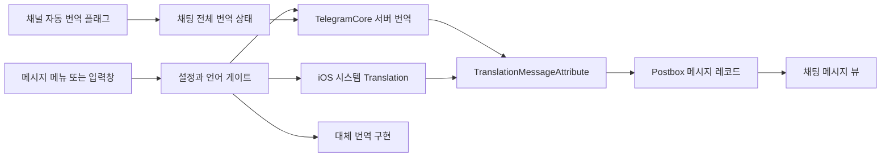
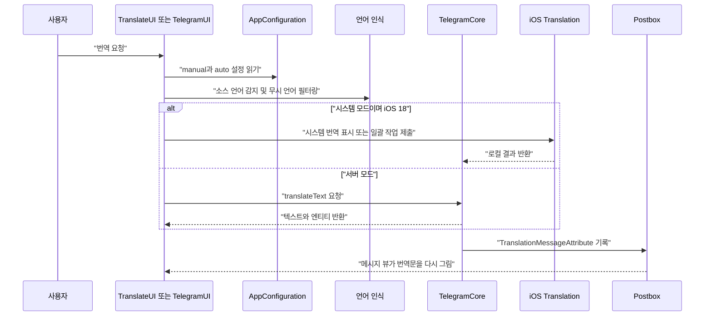
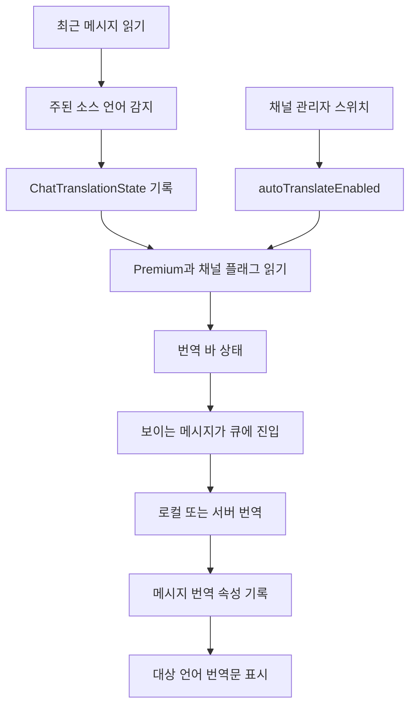

# 메시지 번역

웹: /docs/system/27-translation/ · Markdown: /docs/system/27-translation.md

> Telegram iOS와 macOS의 번역 라우팅, 캐시, 언어 감지, 자동 번역, 권한 경계를 분석해요.

> 시스템 설계 · 비즈니스 시스템 · 27장 · 도표 3 · 코드 발췌 10 · 인용 30 · 소스 기준선: [TelegramMessenger/Telegram-iOS@f1dd7a2d](https://github.com/TelegramMessenger/Telegram-iOS/tree/f1dd7a2dbd02cbbf513e75d5695d8d36d1cf5838), [overtake/TelegramSwift@579cebbf](https://github.com/overtake/TelegramSwift/tree/579cebbf0c01fd41b712eff3647fa7f69db9665d)
>
> 핵심 소스 파일: [TelegramMessenger/Telegram-iOS/submodules/AccountContext/Sources/AccountContext.swift](https://github.com/TelegramMessenger/Telegram-iOS/blob/f1dd7a2dbd02cbbf513e75d5695d8d36d1cf5838/submodules/AccountContext/Sources/AccountContext.swift), [TelegramMessenger/Telegram-iOS/submodules/TranslateUI/Sources/Translate.swift](https://github.com/TelegramMessenger/Telegram-iOS/blob/f1dd7a2dbd02cbbf513e75d5695d8d36d1cf5838/submodules/TranslateUI/Sources/Translate.swift), [TelegramMessenger/Telegram-iOS/submodules/TranslateUI/Sources/ChatTranslation.swift](https://github.com/TelegramMessenger/Telegram-iOS/blob/f1dd7a2dbd02cbbf513e75d5695d8d36d1cf5838/submodules/TranslateUI/Sources/ChatTranslation.swift), [TelegramMessenger/Telegram-iOS/submodules/TelegramCore/Sources/TelegramEngine/Messages/Translate.swift](https://github.com/TelegramMessenger/Telegram-iOS/blob/f1dd7a2dbd02cbbf513e75d5695d8d36d1cf5838/submodules/TelegramCore/Sources/TelegramEngine/Messages/Translate.swift), [TelegramMessenger/Telegram-iOS/submodules/TelegramCore/Sources/SyncCore/SyncCore_TranslationMessageAttribute.swift](https://github.com/TelegramMessenger/Telegram-iOS/blob/f1dd7a2dbd02cbbf513e75d5695d8d36d1cf5838/submodules/TelegramCore/Sources/SyncCore/SyncCore_TranslationMessageAttribute.swift), [TelegramMessenger/Telegram-iOS/submodules/TelegramCore/Sources/State/AccountStateManagementUtils.swift](https://github.com/TelegramMessenger/Telegram-iOS/blob/f1dd7a2dbd02cbbf513e75d5695d8d36d1cf5838/submodules/TelegramCore/Sources/State/AccountStateManagementUtils.swift), [TelegramMessenger/Telegram-iOS/submodules/TelegramUI/Sources/ChatControllerContentData.swift](https://github.com/TelegramMessenger/Telegram-iOS/blob/f1dd7a2dbd02cbbf513e75d5695d8d36d1cf5838/submodules/TelegramUI/Sources/ChatControllerContentData.swift), [TelegramMessenger/Telegram-iOS/submodules/TelegramUI/Sources/ChatHistoryListNode.swift](https://github.com/TelegramMessenger/Telegram-iOS/blob/f1dd7a2dbd02cbbf513e75d5695d8d36d1cf5838/submodules/TelegramUI/Sources/ChatHistoryListNode.swift), [TelegramMessenger/Telegram-iOS/submodules/TelegramUI/Components/PeerInfo/PeerInfoScreen/Sources/PeerInfoProfileItems.swift](https://github.com/TelegramMessenger/Telegram-iOS/blob/f1dd7a2dbd02cbbf513e75d5695d8d36d1cf5838/submodules/TelegramUI/Components/PeerInfo/PeerInfoScreen/Sources/PeerInfoProfileItems.swift), [overtake/TelegramSwift/packages/Translate/Sources/Translate/Translate.swift](https://github.com/overtake/TelegramSwift/blob/579cebbf0c01fd41b712eff3647fa7f69db9665d/packages/Translate/Sources/Translate/Translate.swift), [overtake/TelegramSwift/Telegram-Mac/ChatLiveTranslateContext.swift](https://github.com/overtake/TelegramSwift/blob/579cebbf0c01fd41b712eff3647fa7f69db9665d/Telegram-Mac/ChatLiveTranslateContext.swift), [overtake/TelegramSwift/Telegram-Mac/TranslateModalController.swift](https://github.com/overtake/TelegramSwift/blob/579cebbf0c01fd41b712eff3647fa7f69db9665d/Telegram-Mac/TranslateModalController.swift), [overtake/TelegramSwift/Telegram-Mac/LanguageController.swift](https://github.com/overtake/TelegramSwift/blob/579cebbf0c01fd41b712eff3647fa7f69db9665d/Telegram-Mac/LanguageController.swift), [overtake/TelegramSwift/Telegram-Mac/ChannelInfoEntries.swift](https://github.com/overtake/TelegramSwift/blob/579cebbf0c01fd41b712eff3647fa7f69db9665d/Telegram-Mac/ChannelInfoEntries.swift), [overtake/Telegram-iOS/submodules/TelegramCore/Sources/SyncCore/SyncCore_TranslationMessageAttribute.swift](https://github.com/overtake/Telegram-iOS/blob/a24bbe45f9861f736a79916a50898512f751e0dc/submodules/TelegramCore/Sources/SyncCore/SyncCore_TranslationMessageAttribute.swift)
>
> 미검증 사항:
> - TextProcessingScreen이 시스템이 아닌 iOS 수동 번역 모드에서 최종적으로 Telegram 서버를 고르는지 대체 구현을 고르는지는 해당 컴포넌트의 비동기 요청 체인을 따라 계속 검증해야 해요.
> - Apple TranslationSession이 대상 시스템에서, 언어 팩이 없을 때, 또는 오프라인일 때 보이는 다운로드 안내와 오류 의미는 이번 클라이언트 소스로 검증할 수 있는 범위 밖이에요.
> - translations_manual_enabled와 translations_auto_enabled의 서버 측 배포 조건, 그리고 채널 부스트 레벨의 실제 수치는 클라이언트 고정 소스에 없어요.
> - 현재 iOS 메인 저장소의 리치 텍스트 번역 속성과 TelegramSwift 고정 fork의 속성 버전이 달라요. macOS 실행 버전에 추가 마이그레이션이나 호환 계층이 있는지는 빌드 산출물이나 업데이트 브랜치로 계속 확인해야 해요.

## 문제와 제약 [#문제와-제약]

메시지 번역은 네트워크 요청 한 번으로 끝나지 않아요. 클라이언트가 해야 하는 일은 이래요.

1. 먼저 텍스트의 언어를 판정해요.
2. 그다음 진입점을 보여 줄지, 어떤 번역 제공자를 고를지, 결과를 어떻게 저장할지를 정해요.
3. 메시지 목록이 원문 대신 번역문을 보여 주게 해요.

채팅 전체 번역은 스크롤 윈도우를 따라 새 메시지도 계속 처리해야 해요. 채널 관리자가 켜는 자동 번역은 서버의 채널 플래그, 채널 부스트 레벨, 사용자 Premium 권한이라는 세 가지 차원을 더해요.

이 문서의 소스 기준선은 Telegram-iOS의 `f1dd7a2dbd02cbbf513e75d5695d8d36d1cf5838`과 TelegramSwift의 `579cebbf0c01fd41b712eff3647fa7f69db9665d`예요.

본문에서 “로컬”은 클라이언트가 Apple 시스템 Translation 프레임워크를 호출하는 경로를 가리켜요. 소스를 보면 이 경로는 iOS 18 이상에 있어요. 하지만 Apple 프레임워크가 반드시 오프라인으로 동작한다는 증거는 소스에 없고 모델 다운로드 관리도 보이지 않아요. 그래서 이 문서는 이 경로를 입증된 오프라인 모델로 서술하지 않아요.

Postbox(Telegram의 로컬 저장소)의 트랜잭션, 메시지 속성, 뷰 증분 메커니즘은 “Postbox 저장 엔진”과 “Postbox 뷰와 메시지 히스토리 모델”에서 이미 설명했어요. 이 문서는 번역이 이 기반 기능을 어떻게 쓰는지만 다뤄요.

### 설계 목표 [#설계-목표]

소스를 보면 이 설계는 다섯 가지 목표를 동시에 해결해요.

1. 단일 구간 번역은 텍스트 엔티티(링크, 굵은 글씨, 코드 영역 같은 서식 범위)를 보존해야 해요. 서버는 `TextWithEntities`를 돌려주고, 클라이언트는 이 결과를 `MessageTextEntity`로 변환해요. 덕분에 링크, 굵은 글씨, 코드 영역을 계속 렌더링할 수 있어요. [\[5\]](https://github.com/TelegramMessenger/Telegram-iOS/blob/f1dd7a2dbd02cbbf513e75d5695d8d36d1cf5838/submodules/TelegramCore/Sources/TelegramEngine/Messages/Translate.swift#L16-L77)
2. 연속된 채팅에서 보이는 메시지마다 번역을 반복해서 요청하면 안 돼요. 클라이언트는 번역문을 메시지 속성으로 Postbox에 기록하고, 대상 언어에 따라 캐시를 적중시켜요. [\[6\]](https://github.com/TelegramMessenger/Telegram-iOS/blob/f1dd7a2dbd02cbbf513e75d5695d8d36d1cf5838/submodules/TelegramCore/Sources/TelegramEngine/Messages/Translate.swift#L283-L479)[\[7\]](https://github.com/TelegramMessenger/Telegram-iOS/blob/f1dd7a2dbd02cbbf513e75d5695d8d36d1cf5838/submodules/TelegramCore/Sources/SyncCore/SyncCore_TranslationMessageAttribute.swift#L3-L100)
3. 언어 감지가 사용자 인터페이스 언어나 시스템 언어를 번역 대상 콘텐츠로 반복해서 안내하면 안 돼요. iOS에는 무시 언어 집합이 있어요. macOS도 인터페이스 언어를 기본 번역 제외 언어로 써요. [\[2\]](https://github.com/TelegramMessenger/Telegram-iOS/blob/f1dd7a2dbd02cbbf513e75d5695d8d36d1cf5838/submodules/TranslateUI/Sources/Translate.swift#L175-L238)[\[20\]](https://github.com/overtake/TelegramSwift/blob/579cebbf0c01fd41b712eff3647fa7f69db9665d/Telegram-Mac/ChatLiveTranslateContext.swift#L439-L534)
4. 자동 번역은 일반 채팅, 채널 관리자 설정, Premium 문턱을 조합할 수 있어야 해요. 채널 플래그는 개인 Premium의 채팅 전체 실행 문턱을 우회할 수 있어요. [\[13\]](https://github.com/TelegramMessenger/Telegram-iOS/blob/f1dd7a2dbd02cbbf513e75d5695d8d36d1cf5838/submodules/TelegramUI/Sources/ChatControllerContentData.swift#L2200-L2247)[\[14\]](https://github.com/TelegramMessenger/Telegram-iOS/blob/f1dd7a2dbd02cbbf513e75d5695d8d36d1cf5838/submodules/TelegramUI/Sources/ChatHistoryListNode.swift#L2303-L2318)
5. 플랫폼은 서로 다른 제공자를 쓸 수 있으면서 공유 코어는 같은 번역 속성을 유지해요. iOS는 현재 시스템 프레임워크 경로를 새로 추가했어요. macOS는 Telegram 서버와 `Translate` 패키지의 대체 경로를 유지해요. [\[6\]](https://github.com/TelegramMessenger/Telegram-iOS/blob/f1dd7a2dbd02cbbf513e75d5695d8d36d1cf5838/submodules/TelegramCore/Sources/TelegramEngine/Messages/Translate.swift#L283-L479)[\[17\]](https://github.com/overtake/TelegramSwift/blob/579cebbf0c01fd41b712eff3647fa7f69db9665d/packages/Translate/Sources/Translate/Translate.swift#L316-L390)[\[18\]](https://github.com/overtake/TelegramSwift/blob/579cebbf0c01fd41b712eff3647fa7f69db9665d/Telegram-Mac/TranslateModalController.swift#L141-L190)

### 원격 설정이 첫 번째 스위치 [#원격-설정이-첫-번째-스위치]

`TranslationConfiguration`은 `AppConfiguration.data`에서 문자열 키 두 개를 읽어요.

- `translations_manual_enabled`: 수동 번역을 제어해요.
- `translations_auto_enabled`: 채팅 전체 자동 번역을 제어해요.

알 수 없는 값과 설정 누락은 모두 `disabled`로 폴백해요. iOS는 자동 모드의 `alternative`도 `disabled`로 강제로 낮춰요. 그래서 서버는 수동 능력과 자동 능력을 따로 배포할 수 있고, 둘 중 하나만 열 수도 있어요. [\[1\]](https://github.com/TelegramMessenger/Telegram-iOS/blob/f1dd7a2dbd02cbbf513e75d5695d8d36d1cf5838/submodules/AccountContext/Sources/AccountContext.swift#L2107-L2151)

```swift
public enum TranslationAvailability {
    case enabled
    case system
    case alternative
    case disabled
    
    init(string: String) {
        switch string {
        case "enabled":
            self = .enabled
        case "system":
            self = .system
        case "alternative":
            self = .alternative
        default:
            self = .disabled
        }
    }
}
```
[\[1\]](https://github.com/TelegramMessenger/Telegram-iOS/blob/f1dd7a2dbd02cbbf513e75d5695d8d36d1cf5838/submodules/AccountContext/Sources/AccountContext.swift#L2107-L2151)

여기서 각 값의 뜻은 이래요.

- `enabled`: Telegram 서버 번역을 쓸 수 있다는 뜻이에요.
- `system`: iOS가 시스템 Translation 프레임워크를 선택할 수 있다는 뜻이에요.
- `alternative`: 대체 번역 구현을 쓸 수 있다는 뜻이에요.

`alternative`는 수동 능력의 파싱 결과에서만 남아요. 이 결론은 설정 파싱과 호출 조건이 함께 확인해 줘요. [\[1\]](https://github.com/TelegramMessenger/Telegram-iOS/blob/f1dd7a2dbd02cbbf513e75d5695d8d36d1cf5838/submodules/AccountContext/Sources/AccountContext.swift#L2107-L2151)[\[2\]](https://github.com/TelegramMessenger/Telegram-iOS/blob/f1dd7a2dbd02cbbf513e75d5695d8d36d1cf5838/submodules/TranslateUI/Sources/Translate.swift#L175-L238)

## 모듈과 데이터 구조 [#모듈과-데이터-구조]

### 모듈 경계 [#모듈-경계]

iOS의 진입점은 주로 `TranslateUI`, `TelegramUI`, `TextProcessingScreen`에 있어요. 역할은 이렇게 나뉘어요.

- `TranslateUI`: 언어 판단, 시스템 Translation 브리지, 채팅 상태를 맡아요.
- `TelegramUI`: 메뉴, 번역 바, Premium 안내를 결정해요.
- `TelegramCore`: Telegram RPC, 번역 결과 기록, 채널 자동 번역 RPC를 맡아요.
- `TelegramUIPreferences`: 사용자 수준의 스위치를 저장해요. [\[2\]](https://github.com/TelegramMessenger/Telegram-iOS/blob/f1dd7a2dbd02cbbf513e75d5695d8d36d1cf5838/submodules/TranslateUI/Sources/Translate.swift#L175-L238)[\[5\]](https://github.com/TelegramMessenger/Telegram-iOS/blob/f1dd7a2dbd02cbbf513e75d5695d8d36d1cf5838/submodules/TelegramCore/Sources/TelegramEngine/Messages/Translate.swift#L16-L77)[\[10\]](https://github.com/TelegramMessenger/Telegram-iOS/blob/f1dd7a2dbd02cbbf513e75d5695d8d36d1cf5838/submodules/TranslateUI/Sources/ChatTranslation.swift#L141-L208)[\[12\]](https://github.com/TelegramMessenger/Telegram-iOS/blob/f1dd7a2dbd02cbbf513e75d5695d8d36d1cf5838/submodules/TelegramUIPreferences/Sources/TranslationSettings.swift#L5-L64)

macOS는 `Telegram-Mac`의 AppKit 컨트롤러와 독립 Swift Package인 `packages/Translate`를 써요. macOS도 여전히 서브모듈 fork의 `TelegramCore`를 호출해서, 단일 메시지 캐시 구조와 `channels.toggleAutotranslation` 인터페이스는 공유 코어에서 와요. macOS의 화면 계층이 다시 배치 처리 큐, 로딩 상태, 결제 유도, 채널 설정을 관리해요. [\[17\]](https://github.com/overtake/TelegramSwift/blob/579cebbf0c01fd41b712eff3647fa7f69db9665d/packages/Translate/Sources/Translate/Translate.swift#L316-L390)[\[19\]](https://github.com/overtake/TelegramSwift/blob/579cebbf0c01fd41b712eff3647fa7f69db9665d/Telegram-Mac/ChatLiveTranslateContext.swift#L244-L312)[\[22\]](https://github.com/overtake/TelegramSwift/blob/579cebbf0c01fd41b712eff3647fa7f69db9665d/Telegram-Mac/ChannelInfoEntries.swift#L1313-L1320)[\[23\]](https://github.com/overtake/Telegram-iOS/blob/a24bbe45f9861f736a79916a50898512f751e0dc/submodules/TelegramCore/Sources/SyncCore/SyncCore_TranslationMessageAttribute.swift#L3-L87)



### 사용자 설정, 채팅 상태, 메시지 캐시 [#사용자-설정-채팅-상태-메시지-캐시]

사용자 수준 `TranslationSettings`에는 필드가 셋 있어요.

- `showTranslate`: 수동 진입점을 제어해요.
- `translateChats`: 채팅 전체 감지를 제어해요.
- `ignoredLanguages`: 선택적 언어 목록이에요.

기본값은 수동 진입점 끄기, 채팅 전체 감지 켜기, 무시 목록 비어 있음이에요. 빈 목록은 “어떤 언어도 무시하지 않는다”는 뜻이 아니에요. 감지 코드는 인터페이스 언어와 시스템 선호 언어로 기본 집합을 만들어요. [\[2\]](https://github.com/TelegramMessenger/Telegram-iOS/blob/f1dd7a2dbd02cbbf513e75d5695d8d36d1cf5838/submodules/TranslateUI/Sources/Translate.swift#L175-L238)[\[12\]](https://github.com/TelegramMessenger/Telegram-iOS/blob/f1dd7a2dbd02cbbf513e75d5695d8d36d1cf5838/submodules/TelegramUIPreferences/Sources/TranslationSettings.swift#L5-L64)

`ChatTranslationState`는 채팅 수준의 파생 상태예요.

- 저장하는 필드: iOS는 `baseLang`, `fromLang`, 타임스탬프, `toLang`, `isEnabled`를 저장해요.
- key: peer 식별자를 key로 써요. 포럼 토픽에는 8바이트 `threadId`가 추가로 붙어요.
- 저장 위치: 메시지 속성이 아니라 `ApplicationSpecificItemCacheCollectionId.translationState`에 둬요.

그래서 같은 채팅에서 대상 언어를 바꾸거나, 번역을 끄거나, 한 시간짜리 감지 캐시를 쓰더라도 메시지마다 수정하지 않아요. [\[9\]](https://github.com/TelegramMessenger/Telegram-iOS/blob/f1dd7a2dbd02cbbf513e75d5695d8d36d1cf5838/submodules/TranslateUI/Sources/ChatTranslation.swift#L78-L135)[\[11\]](https://github.com/TelegramMessenger/Telegram-iOS/blob/f1dd7a2dbd02cbbf513e75d5695d8d36d1cf5838/submodules/TranslateUI/Sources/ChatTranslation.swift#L211-L379)

```swift
private func updateChatTranslationState(engine: TelegramEngine, peerId: EnginePeer.Id, threadId: Int64?, state: ChatTranslationState?) -> Signal<Never, NoError> {
    let key: EngineDataBuffer
    if let threadId {
        key = EngineDataBuffer(length: 16)
        key.setInt64(0, value: peerId.id._internalGetInt64Value())
        key.setInt64(8, value: threadId)
    } else {
        key = EngineDataBuffer(length: 8)
        key.setInt64(0, value: peerId.id._internalGetInt64Value())
    }
    
    if let state {
        return engine.itemCache.put(collectionId: ApplicationSpecificItemCacheCollectionId.translationState, id: key, item: state)
    } else {
        return engine.itemCache.remove(collectionId: ApplicationSpecificItemCacheCollectionId.translationState, id: key)
    }
}
```
[\[9\]](https://github.com/TelegramMessenger/Telegram-iOS/blob/f1dd7a2dbd02cbbf513e75d5695d8d36d1cf5838/submodules/TranslateUI/Sources/ChatTranslation.swift#L78-L135)

번역된 메시지마다 `TranslationMessageAttribute`가 붙어요. 속성에는 이런 필드가 들어 있어요.

- `text`: 번역문
- `entities`: 엔티티
- `toLang`: 대상 언어
- `additional`: 투표 선택지
- `pollSolution`: 투표 답안
- `instantPage`: 리치 텍스트 페이지

속성 인코더가 이 필드들을 Postbox에 기록해요. 새 번역 결과가 나오면 기존의 같은 종류 속성을 제거하고 새 속성을 추가해요. 그래서 현재 iOS 구현에서 같은 메시지는 대상 언어 캐시를 최대 하나만 보존해요. [\[6\]](https://github.com/TelegramMessenger/Telegram-iOS/blob/f1dd7a2dbd02cbbf513e75d5695d8d36d1cf5838/submodules/TelegramCore/Sources/TelegramEngine/Messages/Translate.swift#L283-L479)[\[7\]](https://github.com/TelegramMessenger/Telegram-iOS/blob/f1dd7a2dbd02cbbf513e75d5695d8d36d1cf5838/submodules/TelegramCore/Sources/SyncCore/SyncCore_TranslationMessageAttribute.swift#L3-L100)

```swift
public class TranslationMessageAttribute: MessageAttribute, Equatable {
    public let text: String
    public let entities: [MessageTextEntity]
    public let toLang: String

    public let additional: [Additional]
    public let pollSolution: Additional?
    public let instantPage: InstantPage?

    public func encode(_ encoder: PostboxEncoder) {
        encoder.encodeString(self.text, forKey: "text")
        encoder.encodeObjectArray(self.entities, forKey: "entities")
        encoder.encodeString(self.toLang, forKey: "toLang")
        encoder.encodeObjectArray(self.additional, forKey: "additional")

        if let pollSolution {
            encoder.encodeObject(pollSolution, forKey: "pollSolution")
        } else {
            encoder.encodeNil(forKey: "pollSolution")
        }
        if let instantPage {
            encoder.encodeObject(instantPage, forKey: "ipage")
        } else {
            encoder.encodeNil(forKey: "ipage")
        }
    }
}
```
[\[7\]](https://github.com/TelegramMessenger/Telegram-iOS/blob/f1dd7a2dbd02cbbf513e75d5695d8d36d1cf5838/submodules/TelegramCore/Sources/SyncCore/SyncCore_TranslationMessageAttribute.swift#L3-L100)

메시지가 업데이트돼도 캐시를 무조건 삭제하지는 않아요. 상태 관리 코드는 다음 조건이 모두 맞을 때만 이전 `TranslationMessageAttribute`를 갱신된 속성 집합에 다시 넣어요.

- 원문 텍스트가 같아요.
- 텍스트 엔티티가 같아요.
- 새 메시지에 번역 속성이 없어요.

이렇게 하면 관련 없는 서버 업데이트 뒤에도 번역문이 보존되고, 본문이나 엔티티가 바뀌면 자연스럽게 무효화돼요. [\[8\]](https://github.com/TelegramMessenger/Telegram-iOS/blob/f1dd7a2dbd02cbbf513e75d5695d8d36d1cf5838/submodules/TelegramCore/Sources/State/AccountStateManagementUtils.swift#L4666-L4673)

```swift
if previousMessage.text == message.text {
    let previousEntities = previousMessage.textEntitiesAttribute?.entities ?? []
    let updatedEntities = (message.attributes.first(where: { $0 is TextEntitiesMessageAttribute }) as? TextEntitiesMessageAttribute)?.entities ?? []
    if previousEntities == updatedEntities, let translation = previousMessage.attributes.first(where: { $0 is TranslationMessageAttribute }) as? TranslationMessageAttribute {
        if message.attributes.firstIndex(where: { $0 is TranslationMessageAttribute }) == nil {
            updatedAttributes.append(translation)
        }
    }
}
```
[\[8\]](https://github.com/TelegramMessenger/Telegram-iOS/blob/f1dd7a2dbd02cbbf513e75d5695d8d36d1cf5838/submodules/TelegramCore/Sources/State/AccountStateManagementUtils.swift#L4666-L4673)

메시지 말풍선은 다음 조건이 모두 맞을 때만 번역문으로 원문을 대체해요.

- 수신 메시지예요.
- 현재 화면에서 대상 언어가 켜져 있어요.
- 속성의 `toLang`이 같아요.

리치 텍스트 메시지는 같은 속성의 `instantPage`를 읽어요. 그래서 캐시가 있다고 반드시 표시되는 건 아니에요. 화면 상태가 여전히 최종 표시 스위치예요. [\[24\]](https://github.com/TelegramMessenger/Telegram-iOS/blob/f1dd7a2dbd02cbbf513e75d5695d8d36d1cf5838/submodules/TelegramUI/Components/Chat/ChatMessageTextBubbleContentNode/Sources/ChatMessageTextBubbleContentNode.swift#L415-L439)[\[25\]](https://github.com/overtake/TelegramSwift/blob/579cebbf0c01fd41b712eff3647fa7f69db9665d/Telegram-Mac/ChatController.swift#L5393-L5430)

### 언어 감지 [#언어-감지]

iOS의 단일 구간 감지는 이렇게 해요.

- 앞 64자만 가져오고 `NLLanguageRecognizer`(Apple의 언어 인식기)의 상위 후보 세 개를 써요.
- 지역 접미사를 정규화하고 노르웨이어 `nb`를 `no`로 바꿔요.
- 후보는 Telegram의 지원 목록에도 있어야 해요.

실험 설정으로 인식이 꺼져 있으면 함수는 소스 언어를 돌려주지 않고 번역을 곧바로 허가해요. [\[2\]](https://github.com/TelegramMessenger/Telegram-iOS/blob/f1dd7a2dbd02cbbf513e75d5695d8d36d1cf5838/submodules/TranslateUI/Sources/Translate.swift#L175-L238)

```swift
let text = String(text.prefix(64))
languageRecognizer.processString(text)
let hypotheses = languageRecognizer.languageHypotheses(withMaximum: 3)
languageRecognizer.reset()

var supportedTranslationLanguages = supportedTranslationLanguages
if !showTranslate && showTranslateIfTopical {
    supportedTranslationLanguages = ["uk", "ru"]
}
        
let filteredLanguages = hypotheses.filter { supportedTranslationLanguages.contains(normalizeTranslationLanguage($0.key.rawValue)) }.sorted(by: { $0.value > $1.value })
if let language = filteredLanguages.first {
    let languageCode = normalizeTranslationLanguage(language.key.rawValue)
    return (!dontTranslateLanguages.contains(languageCode), languageCode)
} else {
    return (false, nil)
}
```
[\[2\]](https://github.com/TelegramMessenger/Telegram-iOS/blob/f1dd7a2dbd02cbbf513e75d5695d8d36d1cf5838/submodules/TranslateUI/Sources/Translate.swift#L175-L238)

채팅 전체 감지는 단일 구간보다 보수적이에요. iOS는 이렇게 해요.

- 최신 히스토리 32개에서 수신 메시지를 읽어요.
- 메시지마다 최소 10자가 필요해요. 최대 16개까지 집계해요.
- 일반 메시지는 앞 256자만 가져오고, 코드, URL, 이메일, 멘션, 토픽, 봇 명령 엔티티가 덮는 범위를 제거해요.
- `SummarizationMessageAttribute`에 소스 언어가 있으면 그것을 우선해요.
- 언어마다 메시지 글자 수로 가중하고 마지막에 가중치가 가장 큰 언어를 골라요.
- 결과는 한 시간의 만료 시간과 함께 채팅 상태에 기록돼요. [\[11\]](https://github.com/TelegramMessenger/Telegram-iOS/blob/f1dd7a2dbd02cbbf513e75d5695d8d36d1cf5838/submodules/TranslateUI/Sources/ChatTranslation.swift#L211-L379)

macOS는 이렇게 달라요.

- 히스토리 32개를 읽지만 히스토리 항목이 10개보다 많아야 해요.
- 각 텍스트는 10자보다 길어야 해요. 코드와 사전 서식 엔티티만 제거해요.
- `Translate.detectLanguage`는 최대 256자를 읽고 `NLLanguageRecognizer`의 후보 네 개를 호출해요.
- 글자 수가 아니라 메시지 개수로 집계하고, 최소 다섯 개를 인식한 뒤에야 다수 언어를 고르며, 최대 16개까지 처리해요.

이 차이가 두 플랫폼의 언어 판단이 일관되지 않은 분명한 원인이에요. [\[17\]](https://github.com/overtake/TelegramSwift/blob/579cebbf0c01fd41b712eff3647fa7f69db9665d/packages/Translate/Sources/Translate/Translate.swift#L316-L390)[\[20\]](https://github.com/overtake/TelegramSwift/blob/579cebbf0c01fd41b712eff3647fa7f69db9665d/Telegram-Mac/ChatLiveTranslateContext.swift#L439-L534)

## 핵심 흐름 [#핵심-흐름]

### 수동 번역의 라우팅 선택 [#수동-번역의-라우팅-선택]

메뉴는 먼저 `canTranslateText`를 호출해요. 이 함수는 다음 조건을 확인해요.

- 사용자가 `showTranslate`를 켰거나, 텍스트가 공개 채널 같은 주제성 출처에서 왔어야 해요.
- 원격 `manual` 설정이 진입점을 허용해야 해요.
  - `enabled`와 `alternative`에서는 곧바로 표시할 수 있어요.
  - `system`에서는 iOS 18 이상에서만 표시할 수 있어요.

비밀 채팅은 채팅 메뉴 계층에서 따로 제외돼요. [\[2\]](https://github.com/TelegramMessenger/Telegram-iOS/blob/f1dd7a2dbd02cbbf513e75d5695d8d36d1cf5838/submodules/TranslateUI/Sources/Translate.swift#L175-L238)[\[26\]](https://github.com/TelegramMessenger/Telegram-iOS/blob/f1dd7a2dbd02cbbf513e75d5695d8d36d1cf5838/submodules/TelegramUI/Sources/ChatInterfaceStateContextMenus.swift#L1456-L1480)

이어서 UI는 같은 원격 설정을 읽어요.

- `manual`이 `system`이고 시스템 버전이 요건을 충족하면: `presentTranslateScreen`이 SwiftUI의 `translationPresentation`으로 시스템 화면을 띄워요.
- 그렇지 않으면: 채팅 컨트롤러가 내용을 `TextProcessingScreen`으로 밀어 넣어요.

소스를 보면 `TextProcessingScreen` 라우트가 있다는 건 확인되지만, 이번에 조사한 `presentTranslateScreen`에는 시스템이 아닌 분기가 구현돼 있지 않아요. 이 사실이 `TextProcessingScreen`에 백엔드가 없다는 뜻은 아니에요. 단지 이 함수가 맡는 일이 아니라는 뜻이에요. [\[3\]](https://github.com/TelegramMessenger/Telegram-iOS/blob/f1dd7a2dbd02cbbf513e75d5695d8d36d1cf5838/submodules/TelegramUI/Sources/Chat/ChatControllerLoadDisplayNode.swift#L687-L691)[\[27\]](https://github.com/TelegramMessenger/Telegram-iOS/blob/f1dd7a2dbd02cbbf513e75d5695d8d36d1cf5838/submodules/TelegramUI/Sources/ChatController.swift#L4472-L4535)

iOS 18의 일괄 채팅 전체 경로는 채팅 표시 노드를 만들 때 `ExperimentalInternalTranslationServiceImpl`을 코어 전역 변수에 한 번 설치하기도 해요. 이 구현은 이렇게 동작해요.

- 숨겨진 `UIHostingController`를 가지고 `TranslationSession`과 `translationTask`를 써요.
- 작업 큐는 첫 작업의 소스 언어와 대상 언어로 설정을 만들거나 갱신해요.
- 작업 하나에는 메시지 식별자로 색인된 문자열 여러 개를 실을 수 있어요.
- 성공하면 클라이언트 식별자에 따라 결과를 채워 넣어요. 예외가 나면 빈 결과를 돌려줘요. [\[3\]](https://github.com/TelegramMessenger/Telegram-iOS/blob/f1dd7a2dbd02cbbf513e75d5695d8d36d1cf5838/submodules/TelegramUI/Sources/Chat/ChatControllerLoadDisplayNode.swift#L687-L691)[\[4\]](https://github.com/TelegramMessenger/Telegram-iOS/blob/f1dd7a2dbd02cbbf513e75d5695d8d36d1cf5838/submodules/TranslateUI/Sources/Translate.swift#L258-L438)

설치는 메인 윈도우의 `hostView`에 기대요. 그래서 애플리케이션에 아직 이 뷰가 없으면 코어의 로컬 서비스 변수는 비어 있어요. 이후 일괄 인터페이스는 조건이 갖춰지지 않았다고 판단해서, UI 준비가 끝나기를 기다리지 않고 서버 경로를 자동으로 골라요. 전역 서비스는 변수가 비어 있을 때만 한 번 생성돼요. 소스에는 계정마다 서비스를 중복 생성하는 로직이 보이지 않아요. 추정: 같은 애플리케이션 프로세스의 여러 채팅은 시스템 Translation 작업 컨테이너 하나를 직렬로 재사용해요. [\[3\]](https://github.com/TelegramMessenger/Telegram-iOS/blob/f1dd7a2dbd02cbbf513e75d5695d8d36d1cf5838/submodules/TelegramUI/Sources/Chat/ChatControllerLoadDisplayNode.swift#L687-L691)[\[4\]](https://github.com/TelegramMessenger/Telegram-iOS/blob/f1dd7a2dbd02cbbf513e75d5695d8d36d1cf5838/submodules/TranslateUI/Sources/Translate.swift#L258-L438)[\[6\]](https://github.com/TelegramMessenger/Telegram-iOS/blob/f1dd7a2dbd02cbbf513e75d5695d8d36d1cf5838/submodules/TelegramCore/Sources/TelegramEngine/Messages/Translate.swift#L283-L479)



### Telegram 서버 경로 [#telegram-서버-경로]

`TelegramEngine.Messages.translate`는 단일 구간 공개 인터페이스예요.

- 메시지 식별자가 있으면 코어는 먼저 Postbox에서 peer를 가져와 `InputPeer`를 구성해요.
- 없으면 요청에 `TextWithEntities`를 실어 보내요.

하위의 `_internal_translate`는 `Api.functions.messages.translateText`로 요청을 보내요. `tone`이 중립이 아니면 플래그 비트를 설정해요. 결과에서는 첫 번째 `TextWithEntities`만 가져와 클라이언트 엔티티로 변환해요. [\[5\]](https://github.com/TelegramMessenger/Telegram-iOS/blob/f1dd7a2dbd02cbbf513e75d5695d8d36d1cf5838/submodules/TelegramCore/Sources/TelegramEngine/Messages/Translate.swift#L16-L77)

```swift
let apiText: [Api.TextWithEntities]?
if peer != nil && messageId != nil {
    flags |= (1 << 0)
    apiText = nil
} else {
    flags |= (1 << 1)
    apiText = [.textWithEntities(.init(text: text, entities: apiEntitiesFromMessageTextEntities(entities, associatedPeers: SimpleDictionary())))]
}

return network.request(Api.functions.messages.translateText(flags: flags, peer: peer, id: messageId.flatMap { [$0] }, text: apiText, toLang: toLang, tone: tone.rawValue))
```
[\[5\]](https://github.com/TelegramMessenger/Telegram-iOS/blob/f1dd7a2dbd02cbbf513e75d5695d8d36d1cf5838/submodules/TelegramCore/Sources/TelegramEngine/Messages/Translate.swift#L16-L77)

일괄 메시지 인터페이스는 먼저 peer별로 묶어요. 일반 메시지는 다음 세 조건이 모두 맞을 때만 로컬 경로로 처리할 수 있어요.

- 호출하는 쪽이 `enableLocalIfPossible`을 넘겨요.
- 전역 서비스가 이미 등록돼 있어요.
- 감지로 `fromLang`을 얻었어요.

세 조건 중 하나라도 충족되지 않으면 Telegram 서버의 `messages.translateText`를 호출해요. 다른 콘텐츠는 이렇게 처리해요.

- 리치 텍스트 메시지: 이 분기를 타지 않고 `messages.translateRichMessage`를 호출해요.
- 투표: 제목, 선택지, 답안을 각각 텍스트 배열로 구성해요.
- 음성 전사: 일반 텍스트로서 따로 요청해요. [\[6\]](https://github.com/TelegramMessenger/Telegram-iOS/blob/f1dd7a2dbd02cbbf513e75d5695d8d36d1cf5838/submodules/TelegramCore/Sources/TelegramEngine/Messages/Translate.swift#L283-L479)

```swift
if enableLocalIfPossible, let engineExperimentalInternalTranslationService, let fromLang {
    msgs = account.postbox.transaction { transaction -> [MessageId: String] in
        var texts: [MessageId: String] = [:]
        for messageId in plainMessageIds {
            if let message = transaction.getMessage(messageId) {
                texts[message.id] = message.text
            }
        }
        return texts
    }
    |> castError(TranslationError.self)
    |> mapToSignal { messageTexts -> Signal<Api.messages.TranslatedText?, TranslationError> in
        var mappedTexts: [AnyHashable: String] = [:]
        for (id, text) in messageTexts {
            mappedTexts[AnyHashable(id)] = text
        }
        return engineExperimentalInternalTranslationService.translate(texts: mappedTexts, fromLang: fromLang, toLang: toLang)
```
[\[6\]](https://github.com/TelegramMessenger/Telegram-iOS/blob/f1dd7a2dbd02cbbf513e75d5695d8d36d1cf5838/submodules/TelegramCore/Sources/TelegramEngine/Messages/Translate.swift#L283-L479)

이 설계에는 중요한 결과가 두 가지 있어요.

1. 시스템 경로에서 온 일반 텍스트도 `Api.messages.TranslatedText`로 바꿔 서버 결과처럼 보이게 하고, 서버 결과와 같은 트랜잭션으로 속성에 기록해요. 그래서 렌더링과 캐시가 제공자를 구별할 필요가 없어요.
2. 로컬 경로는 원래 엔티티를 보존하지 않고 채워 넣을 때 빈 엔티티 배열을 만들어요. 서버 경로는 서버가 돌려준 엔티티를 저장할 수 있어요. 이 차이는 로컬 분기가 `TextWithEntities`를 구성하는 코드로 확인돼요. [\[6\]](https://github.com/TelegramMessenger/Telegram-iOS/blob/f1dd7a2dbd02cbbf513e75d5695d8d36d1cf5838/submodules/TelegramCore/Sources/TelegramEngine/Messages/Translate.swift#L283-L479)

`TranslationError`는 `FLOOD_WAIT`를 비롯한 여러 오류를 하나로 묶어 캡슐화해요. 예는 이래요.

- `FLOOD_WAIT`
- 잘못된 메시지 식별자
- 빈 텍스트
- 너무 긴 텍스트
- 잘못된 대상 언어
- 대체 서비스가 필요한 경우

채팅 일괄 처리의 UI 호출은 오류가 나도 화면에 던지지 않고 마쳐요. 그래서 채팅 전체 번역이 실패해도 메시지 목록이 끊기지 않지만, 사용자는 이 경로에서 세분화된 오류 문구를 얻지 못해요. [\[5\]](https://github.com/TelegramMessenger/Telegram-iOS/blob/f1dd7a2dbd02cbbf513e75d5695d8d36d1cf5838/submodules/TelegramCore/Sources/TelegramEngine/Messages/Translate.swift#L16-L77)[\[10\]](https://github.com/TelegramMessenger/Telegram-iOS/blob/f1dd7a2dbd02cbbf513e75d5695d8d36d1cf5838/submodules/TranslateUI/Sources/ChatTranslation.swift#L141-L208)

`TranslateUI`에는 대체 HTTP GET 구현도 정의돼 있어요. 소스 언어가 없으면 다시 로컬에서 감지하고, 여러 조각의 문자열로 구성한 Google Translate 주소에 접근해요. 오류는 이렇게 매핑해요.

- 네트워크 오류, HTTP 응답 누락, 200이 아닌 상태, 데이터 없음: 일반 오류
- 429: `limitExceeded`

이 함수가 있다는 건 소스로 확인돼요. 추정: 문자열을 조각낸 건 프로토콜이 요구해서가 아니라 정적 리터럴의 노출도를 낮추려는 거예요. [\[28\]](https://github.com/TelegramMessenger/Telegram-iOS/blob/f1dd7a2dbd02cbbf513e75d5695d8d36d1cf5838/submodules/TranslateUI/Sources/Translate.swift#L440-L549)

### 채팅 전체 자동 번역 [#채팅-전체-자동-번역]

채팅 화면은 사용자가 Premium인지, peer의 `translationHidden`, 채널의 `autoTranslateEnabled`, 번역 안내 카운트를 함께 구독해요. 조건은 두 단계로 나뉘어요.

- 번역 바 상태를 얻는 조건: 일반 채팅은 Premium 사용자이거나, 안내 카운트가 세 번에 이른 뒤의 안내 상태일 때만 얻어요. 채널에 자동 번역 플래그가 있을 때도 들어올 수 있어요.
- 보이는 메시지마다 `translateToLanguage`를 실제로 제공하는 조건(더 엄격해요): 채팅 상태가 이미 켜져 있고, 사용자가 Premium이거나 채널이 자동 번역을 켜 두었어야 해요. [\[13\]](https://github.com/TelegramMessenger/Telegram-iOS/blob/f1dd7a2dbd02cbbf513e75d5695d8d36d1cf5838/submodules/TelegramUI/Sources/ChatControllerContentData.swift#L2200-L2247)[\[14\]](https://github.com/TelegramMessenger/Telegram-iOS/blob/f1dd7a2dbd02cbbf513e75d5695d8d36d1cf5838/submodules/TelegramUI/Sources/ChatHistoryListNode.swift#L2303-L2318)



채팅 상태가 허용하면 `translateMessageIds`는 자신의 메시지를 걸러 내요. 이어서 이렇게 처리해요.

- 이미 같은 `toLang` 속성이 있는 주 메시지와 답글 메시지는 건너뛰어요.
- 일반 텍스트, 리치 텍스트, 투표, 완료된 음성 전사, 아직 로컬에서 읽지 못한 메시지 식별자를 추가해요.
- 그다음에야 자동 설정의 `system` 값에 따라 `enableLocalIfPossible`을 결정해요.

그래서 같은 목록이 Postbox 캐시에서 메시지를 완성할 수도 있고 새 메시지를 위해 큐에 쌓을 수도 있어요. [\[10\]](https://github.com/TelegramMessenger/Telegram-iOS/blob/f1dd7a2dbd02cbbf513e75d5695d8d36d1cf5838/submodules/TranslateUI/Sources/ChatTranslation.swift#L141-L208)

사용자가 대상 언어를 바꾸면 채팅 상태는 새 `toLang`을 기록하고 `isEnabled`를 켜요. 기존 메시지의 속성은 언어가 맞지 않아서 더 이상 표시되지 않아요. 바로 지워지지는 않아요. 새 대상 언어의 번역문은 같은 메시지의 이전 번역 속성을 덮어써요. 그래서 되돌아오면 보통 다시 번역해야 해요. 현재 속성이 번역 버전을 하나만 보존하기 때문에 생기는 직접적인 결과예요. 다국어를 영속 캐시한다는 뜻은 아니에요. [\[6\]](https://github.com/TelegramMessenger/Telegram-iOS/blob/f1dd7a2dbd02cbbf513e75d5695d8d36d1cf5838/submodules/TelegramCore/Sources/TelegramEngine/Messages/Translate.swift#L283-L479)[\[7\]](https://github.com/TelegramMessenger/Telegram-iOS/blob/f1dd7a2dbd02cbbf513e75d5695d8d36d1cf5838/submodules/TelegramCore/Sources/SyncCore/SyncCore_TranslationMessageAttribute.swift#L3-L100)

### 캐시 생명주기와 보이는 윈도우 [#캐시-생명주기와-보이는-윈도우]

iOS는 채팅 상태가 바뀌었다고 전체 히스토리를 스캔하지 않아요. 대신 이렇게 해요.

- 메시지 목록은 연관 데이터를 구성할 때 비로소 현재 대상 언어를 `translateToLanguage`에 넣어요.
- 메시지 말풍선마다 이 값을 보고 자신의 속성을 확인해요.
- 속성이 적중하지 않으면 말풍선은 로딩 상태를 유지할 수 있어요. 같은 언어의 속성이 적중해야 번역문을 표시해요.

이렇게 해서 히스토리 범위, 번역 네트워크 요청, 레이아웃 갱신이 모두 현재 뷰 윈도우로 제한돼요. [\[14\]](https://github.com/TelegramMessenger/Telegram-iOS/blob/f1dd7a2dbd02cbbf513e75d5695d8d36d1cf5838/submodules/TelegramUI/Sources/ChatHistoryListNode.swift#L2303-L2318)[\[24\]](https://github.com/TelegramMessenger/Telegram-iOS/blob/f1dd7a2dbd02cbbf513e75d5695d8d36d1cf5838/submodules/TelegramUI/Components/Chat/ChatMessageTextBubbleContentNode/Sources/ChatMessageTextBubbleContentNode.swift#L415-L439)

일괄 함수는 트랜잭션 안에서 먼저 캐시를 확인해요.

- 일반 메시지에 이미 같은 대상 언어의 속성이 있으면 요청 목록에 넣지 않아요.
- 답글 메시지도 따로 확인해요. 답글 내용이 비어 있지 않고 같은 언어의 캐시가 없으면 먼저 추가돼요. 이렇게 하면 번역된 주 메시지와 인용 답글이 가능한 한 동시에 표시돼요.
- 발신자가 현재 계정 자신인 메시지는 함수가 주 메시지를 건너뛰지만, 앞서 추가된 답글 메시지를 막지는 않아요.

소스로 확인되는 이 순서를 보면, “수신 메시지만 번역한다”는 건 요청 전체에 대한 단순 필터가 아니라 메시지 수준의 규칙이에요. [\[10\]](https://github.com/TelegramMessenger/Telegram-iOS/blob/f1dd7a2dbd02cbbf513e75d5695d8d36d1cf5838/submodules/TranslateUI/Sources/ChatTranslation.swift#L141-L208)

결과를 받으면 이렇게 기록해요.

- 일반 메시지, 투표, 음성 전사: 각자 같은 Postbox 트랜잭션 안에서 갱신돼요. 어느 범주에 결과가 없으면 그것을 위한 빈 번역 속성을 만들지 않아요.
- 리치 텍스트 메시지: 자체 요청과 쓰기 트랜잭션을 먼저 거친 뒤, 일반 메시지 결과와 조합 시그널로 합류해요.

이 설계 덕분에 내용 유형별로 동시에 완료될 수 있고, UI가 반쯤 쓰인 단일 메시지 속성을 읽는 일은 없어요. [\[6\]](https://github.com/TelegramMessenger/Telegram-iOS/blob/f1dd7a2dbd02cbbf513e75d5695d8d36d1cf5838/submodules/TelegramCore/Sources/TelegramEngine/Messages/Translate.swift#L283-L479)

속성 캐시는 `toLang`을 적중 키로 써요. 텍스트 말풍선은 대상 언어가 완전히 같아야 해요. 감지된 언어는 채팅 전체의 소스 언어와 로컬 서비스의 파라미터를 정하는 데만 쓰이고, 속성 조회에는 직접 참여하지 않아요. 그래서 소스 언어 감지가 정정된 뒤에도 대상 언어가 바뀌지 않았다면 기존 속성이 계속 표시될 수 있어요. 추정: 스크롤 성능과 안정적인 표시를 우선한 선택이에요. 감지 모델 버전을 캐시 무효화 키로 쓸 수는 없어요. [\[6\]](https://github.com/TelegramMessenger/Telegram-iOS/blob/f1dd7a2dbd02cbbf513e75d5695d8d36d1cf5838/submodules/TelegramCore/Sources/TelegramEngine/Messages/Translate.swift#L283-L479)[\[11\]](https://github.com/TelegramMessenger/Telegram-iOS/blob/f1dd7a2dbd02cbbf513e75d5695d8d36d1cf5838/submodules/TranslateUI/Sources/ChatTranslation.swift#L211-L379)[\[24\]](https://github.com/TelegramMessenger/Telegram-iOS/blob/f1dd7a2dbd02cbbf513e75d5695d8d36d1cf5838/submodules/TelegramUI/Components/Chat/ChatMessageTextBubbleContentNode/Sources/ChatMessageTextBubbleContentNode.swift#L415-L439)

메시지 본문이나 엔티티가 바뀌었는지에 따라 속성을 다르게 다뤄요.

- 본문이나 엔티티가 바뀌면: 상태 관리자는 기존 속성을 보존하지 않아요. 편집된 메시지는 다음에 보이는 윈도우에 들어올 때 번역을 다시 요청해요.
- 내용과 무관한 서버 업데이트: 속성을 재사용해요.

이 규칙은 생성 시각, 서비스 제공자, 입력 해시를 저장하지 않아요. 메시지 본문과 엔티티가 같은지를 내용 동등성 판단으로 삼아서 추가 메타데이터 기록을 피해요. [\[7\]](https://github.com/TelegramMessenger/Telegram-iOS/blob/f1dd7a2dbd02cbbf513e75d5695d8d36d1cf5838/submodules/TelegramCore/Sources/SyncCore/SyncCore_TranslationMessageAttribute.swift#L3-L100)[\[8\]](https://github.com/TelegramMessenger/Telegram-iOS/blob/f1dd7a2dbd02cbbf513e75d5695d8d36d1cf5838/submodules/TelegramCore/Sources/State/AccountStateManagementUtils.swift#L4666-L4673)

macOS의 실시간 컨텍스트는 메모리상의 `result` 딕셔너리도 유지해요.

- 키는 메시지 식별자와 대상 언어로 이루어져요.
- 값은 먼저 loading이 되고, 영속 속성을 다시 읽으면 complete로 바뀌어요.
- 사용자가 대상 언어를 바꾸거나 번역이 꺼지면 딕셔너리는 비워져요.

이 딕셔너리는 영속 캐시가 아니라 스크롤 중 중복 큐잉을 막는 화면 조율 계층이에요. 재시작한 뒤에도 보이는 결과는 여전히 코어의 메시지 속성이에요. [\[19\]](https://github.com/overtake/TelegramSwift/blob/579cebbf0c01fd41b712eff3647fa7f69db9665d/Telegram-Mac/ChatLiveTranslateContext.swift#L244-L312)[\[23\]](https://github.com/overtake/Telegram-iOS/blob/a24bbe45f9861f736a79916a50898512f751e0dc/submodules/TelegramCore/Sources/SyncCore/SyncCore_TranslationMessageAttribute.swift#L3-L87)

“번역 숨기기”는 이렇게 동작해요.

1. 로컬 peer cached data의 `translationHidden` 플래그를 낙관적으로(서버 응답을 기다리지 않고 먼저) 갱신해요.
2. `messages.togglePeerTranslations`를 호출해요.
3. 요청 실패는 잡혀서 버려져요.

소스의 이 함수에는 이후 로컬 플래그를 되돌리는 코드가 없어요. 그래서 추정: 짧은 오프라인이나 실패 때문에 로컬의 숨김 상태가 서버 상태와 어긋날 수 있고, 다음 peer 데이터 갱신 때까지 이어져요. [\[29\]](https://github.com/TelegramMessenger/Telegram-iOS/blob/f1dd7a2dbd02cbbf513e75d5695d8d36d1cf5838/submodules/TelegramCore/Sources/TelegramEngine/Messages/Translate.swift#L484-L531)

### 채널 수준 자동 번역 [#채널-수준-자동-번역]

서버 채널 객체의 두 번째 플래그 묶음은 `TelegramChannelFlags.autoTranslateEnabled`로 매핑돼요. 코어는 peer를 `InputChannel`로 바꿀 수 있을 때만 `channels.toggleAutotranslation`을 호출하고, 돌아온 업데이트를 상태 관리자에게 넘겨요. 채널이 아니면 이 RPC를 보내지 않아요. [\[15\]](https://github.com/TelegramMessenger/Telegram-iOS/blob/f1dd7a2dbd02cbbf513e75d5695d8d36d1cf5838/submodules/TelegramCore/Sources/TelegramEngine/Peers/AutoTranslate.swift#L7-L19)[\[30\]](https://github.com/TelegramMessenger/Telegram-iOS/blob/f1dd7a2dbd02cbbf513e75d5695d8d36d1cf5838/submodules/TelegramCore/Sources/SyncCore/SyncCore_TelegramChannel.swift#L162-L188)

관리자 설정은 단순한 Premium 사용자 특권이 아니에요.

- iOS: 채널 정보 화면은 `BoostSubject.autoTranslate.requiredLevel`에 따라 채널 부스트 레벨을 판단해요. 레벨이 부족하면 스위치가 잠기고 부스트 레벨 화면이 표시돼요.
- macOS: 원격 `PremiumConfiguration`의 `minChannelAutotranslationLevel`에 따라 같은 성격의 비활성화 판단을 해요.

두 플랫폼의 문턱 값은 설정이 결정하고, 소스에는 고정된 숫자가 없어요. [\[16\]](https://github.com/TelegramMessenger/Telegram-iOS/blob/f1dd7a2dbd02cbbf513e75d5695d8d36d1cf5838/submodules/TelegramUI/Components/PeerInfo/PeerInfoScreen/Sources/PeerInfoProfileItems.swift#L1234-L1245)[\[22\]](https://github.com/overtake/TelegramSwift/blob/579cebbf0c01fd41b712eff3647fa7f69db9665d/Telegram-Mac/ChannelInfoEntries.swift#L1313-L1320)

자동 번역 스위치가 채널 상태에 기록되면 일반 멤버의 채팅 경로가 `autoTranslateEnabled`를 받게 돼요. iOS와 macOS 모두 이 채널 조건이 사용자 Premium의 실시간 채팅 전체 실행 제한을 대신하도록 허용해요. 그렇다고 관리자가 채널 부스트 레벨을 우회할 수 있다는 뜻은 아니에요. 관리자 화면이 쓰기 동작을 먼저 제한하기 때문이에요. [\[13\]](https://github.com/TelegramMessenger/Telegram-iOS/blob/f1dd7a2dbd02cbbf513e75d5695d8d36d1cf5838/submodules/TelegramUI/Sources/ChatControllerContentData.swift#L2200-L2247)[\[14\]](https://github.com/TelegramMessenger/Telegram-iOS/blob/f1dd7a2dbd02cbbf513e75d5695d8d36d1cf5838/submodules/TelegramUI/Sources/ChatHistoryListNode.swift#L2303-L2318)[\[19\]](https://github.com/overtake/TelegramSwift/blob/579cebbf0c01fd41b712eff3647fa7f69db9665d/Telegram-Mac/ChatLiveTranslateContext.swift#L244-L312)[\[22\]](https://github.com/overtake/TelegramSwift/blob/579cebbf0c01fd41b712eff3647fa7f69db9665d/Telegram-Mac/ChannelInfoEntries.swift#L1313-L1320)

## 경계 사례와 실패 처리 [#경계-사례와-실패-처리]

### 콘텐츠 유형과 캐시 완전성 [#콘텐츠-유형과-캐시-완전성]

콘텐츠 유형별 처리는 이래요.

- 일반 텍스트: 번역문은 텍스트와 엔티티를 유지해요.
- 투표: 제목, 각 선택지, 답안은 따로 번역한 뒤 `additional`과 `pollSolution`에 넣어요.
- 음성: 전사 속성이 비어 있지 않고 pending이 아닐 때만 참여해요.
- 리치 텍스트 메시지: 전용 RPC를 호출해서 `InstantPage`를 속성에 기록해요.

이 분기들은 구조화된 메시지를 서식 없는 일반 문자열로 잘못 강등하는 일을 막아요. [\[6\]](https://github.com/TelegramMessenger/Telegram-iOS/blob/f1dd7a2dbd02cbbf513e75d5695d8d36d1cf5838/submodules/TelegramCore/Sources/TelegramEngine/Messages/Translate.swift#L283-L479)[\[7\]](https://github.com/TelegramMessenger/Telegram-iOS/blob/f1dd7a2dbd02cbbf513e75d5695d8d36d1cf5838/submodules/TelegramCore/Sources/SyncCore/SyncCore_TranslationMessageAttribute.swift#L3-L100)

로컬 iOS 일괄 처리는 `message.text`만 수집해요. 소스에는 투표, 음성, 리치 텍스트를 `TranslationSession`에 넘기는 모습이 보이지 않아요. 투표, 음성, 리치 텍스트는 계속 서버 전용 분기를 타요. 그래서 시스템 경로는 모든 콘텐츠 유형의 범용 대체재가 아니라 일반 메시지 텍스트에 대한 최적화예요. [\[6\]](https://github.com/TelegramMessenger/Telegram-iOS/blob/f1dd7a2dbd02cbbf513e75d5695d8d36d1cf5838/submodules/TelegramCore/Sources/TelegramEngine/Messages/Translate.swift#L283-L479)

리치 텍스트 캐시는 버전 경계도 드러내요.

- 현재 iOS의 `TranslationMessageAttribute`: `instantPage`가 있고 `ipage`로 인코딩할 수 있어요.
- TelegramSwift 고정 fork의 속성: 텍스트, 엔티티, 투표 부가 필드, 답안 필드뿐이고 `instantPage`가 없어요.

그래서 iOS 메인 저장소를 보고 macOS의 해당 고정 버전이 리치 텍스트 번역 캐시를 지원한다고 추론할 수 없어요. [\[7\]](https://github.com/TelegramMessenger/Telegram-iOS/blob/f1dd7a2dbd02cbbf513e75d5695d8d36d1cf5838/submodules/TelegramCore/Sources/SyncCore/SyncCore_TranslationMessageAttribute.swift#L3-L100)[\[23\]](https://github.com/overtake/Telegram-iOS/blob/a24bbe45f9861f736a79916a50898512f751e0dc/submodules/TelegramCore/Sources/SyncCore/SyncCore_TranslationMessageAttribute.swift#L3-L87)

### 언어, 프라이버시, 범위 제한 [#언어-프라이버시-범위-제한]

iOS의 채팅 히스토리 노드는 비밀 채팅, 자신의 Saved Messages, scheduled messages의 채팅 전체 번역 상태를 명시적으로 제외해요. 메시지 컨텍스트 메뉴도 비밀 채팅에서는 번역 동작을 꺼요. `showTranslate`가 참이더라도 무시 언어로 인식되면 진입점을 표시하지 않아요. [\[2\]](https://github.com/TelegramMessenger/Telegram-iOS/blob/f1dd7a2dbd02cbbf513e75d5695d8d36d1cf5838/submodules/TranslateUI/Sources/Translate.swift#L175-L238)[\[26\]](https://github.com/TelegramMessenger/Telegram-iOS/blob/f1dd7a2dbd02cbbf513e75d5695d8d36d1cf5838/submodules/TelegramUI/Sources/ChatInterfaceStateContextMenus.swift#L1456-L1480)

언어 인식은 휴리스틱(경험적 추정)한 결과예요. 짧은 텍스트에는 후보가 없을 수 있어요. 채팅에 여러 언어가 섞여 있을 때 iOS는 글자 수로 주된 언어를 고르고, macOS는 메시지 수로 주된 언어를 골라요. 둘 다 인식 신뢰도를 눈에 보이는 임계값으로 쓰지 않아요. 문서가 확인할 수 있는 건 후보가 지원 언어로 필터링됐다는 점뿐이고, 인식 정확도는 확인할 수 없어요. [\[2\]](https://github.com/TelegramMessenger/Telegram-iOS/blob/f1dd7a2dbd02cbbf513e75d5695d8d36d1cf5838/submodules/TranslateUI/Sources/Translate.swift#L175-L238)[\[11\]](https://github.com/TelegramMessenger/Telegram-iOS/blob/f1dd7a2dbd02cbbf513e75d5695d8d36d1cf5838/submodules/TranslateUI/Sources/ChatTranslation.swift#L211-L379)[\[17\]](https://github.com/overtake/TelegramSwift/blob/579cebbf0c01fd41b712eff3647fa7f69db9665d/packages/Translate/Sources/Translate/Translate.swift#L316-L390)[\[20\]](https://github.com/overtake/TelegramSwift/blob/579cebbf0c01fd41b712eff3647fa7f69db9665d/Telegram-Mac/ChatLiveTranslateContext.swift#L439-L534)

iOS의 시스템 번역 호출에는 iOS 18이 필요해요.

- 구형 시스템: 원격 설정이 `system`이어도 수동 시스템 진입점과 채팅 전체 기능이 꺼져요.
- 원격 설정이 `disabled`: 시스템 버전이 높아도 기능을 켤 수 없어요.

이 이중 게이트는 설정이 잘못 열려서 생기는 비호환을 제한해요. [\[1\]](https://github.com/TelegramMessenger/Telegram-iOS/blob/f1dd7a2dbd02cbbf513e75d5695d8d36d1cf5838/submodules/AccountContext/Sources/AccountContext.swift#L2107-L2151)[\[2\]](https://github.com/TelegramMessenger/Telegram-iOS/blob/f1dd7a2dbd02cbbf513e75d5695d8d36d1cf5838/submodules/TranslateUI/Sources/Translate.swift#L175-L238)[\[10\]](https://github.com/TelegramMessenger/Telegram-iOS/blob/f1dd7a2dbd02cbbf513e75d5695d8d36d1cf5838/submodules/TranslateUI/Sources/ChatTranslation.swift#L141-L208)

### 요청 실패, 취소, 중복 [#요청-실패-취소-중복]

서버 오류는 한정된 `TranslationError`로 매핑돼요. 플랫폼별 처리는 이래요.

- 일괄 처리 메시지 화면: 오류를 잡아서 시그널을 완료해요.
- macOS 실시간 상태: 오류가 나면 해당 메시지와 대상 언어의 loading 키를 제거해서 메시지를 재시도할 수 있게 해요.
- macOS 배치 제한: 한 배치를 메시지 20개 이하로, 누적 텍스트를 25000자 미만으로 제한해요. 이 큐 정책은 데스크톱 쪽에서 스크롤 중에 요청이 끝없이 생기는 것을 막는 보호 장치예요. [\[5\]](https://github.com/TelegramMessenger/Telegram-iOS/blob/f1dd7a2dbd02cbbf513e75d5695d8d36d1cf5838/submodules/TelegramCore/Sources/TelegramEngine/Messages/Translate.swift#L16-L77)[\[19\]](https://github.com/overtake/TelegramSwift/blob/579cebbf0c01fd41b712eff3647fa7f69db9665d/Telegram-Mac/ChatLiveTranslateContext.swift#L244-L312)

로컬 `ExperimentalInternalTranslationServiceImpl`은 이렇게 동작해요.

- 작업마다 증가하는 식별자를 부여해요.
- 구독을 취소하면 메인 큐에서 작업 컨테이너에서 해당 식별자를 제거해요.
- `TranslationSession`이 예외를 던지면 작업 완료 콜백에 빈 결과가 전달돼요. 코어는 이어서 빈 결과를 일반 실패로 간주해요.

그래서 취소, 시스템 서비스 실패, 일부 결과 누락 어느 경우에도 가짜 성공 캐시는 기록되지 않아요. [\[4\]](https://github.com/TelegramMessenger/Telegram-iOS/blob/f1dd7a2dbd02cbbf513e75d5695d8d36d1cf5838/submodules/TranslateUI/Sources/Translate.swift#L258-L438)[\[6\]](https://github.com/TelegramMessenger/Telegram-iOS/blob/f1dd7a2dbd02cbbf513e75d5695d8d36d1cf5838/submodules/TelegramCore/Sources/TelegramEngine/Messages/Translate.swift#L283-L479)

대체 HTTP 경로는 429만 특별히 속도 제한으로 해석해요. macOS `Translate` 패키지의 대체 요청은 네트워크 오류가 나거나 JSON 구조가 기대와 다르면 일반 오류를 보고하기만 해요. HTTP 상태 코드는 검사하지 않아요. 이 차이 때문에 두 클라이언트는 같은 종류의 실패에 대해 서로 다른 오류 정밀도를 제공해요. [\[17\]](https://github.com/overtake/TelegramSwift/blob/579cebbf0c01fd41b712eff3647fa7f69db9665d/packages/Translate/Sources/Translate/Translate.swift#L316-L390)[\[28\]](https://github.com/TelegramMessenger/Telegram-iOS/blob/f1dd7a2dbd02cbbf513e75d5695d8d36d1cf5838/submodules/TranslateUI/Sources/Translate.swift#L440-L549)

## iOS와 macOS 비교 [#ios와-macos-비교]

### 라우팅과 제공자 [#라우팅과-제공자]

| 항목 | iOS 메인 저장소 | macOS TelegramSwift |
| --- | --- | --- |
| 단일 구간 서버 번역 | `TelegramEngine.Messages.translate`가 Telegram RPC 호출 | 팝업도 먼저 코어 번역 인터페이스를 호출 |
| 시스템 Translation | `TranslationSession`과 `translationPresentation`, iOS 18 이상만 | `Telegram-Mac`이나 `packages/Translate`에서 `import Translation`을 찾지 못함 |
| 대체 번역 | `TranslateUI`가 URLSession 대체 구현을 정의 | `packages/Translate`가 URLSession으로 대체 서비스 호출 |
| 언어 감지 | `NLLanguageRecognizer`, 단일 구간은 앞 64자 | `NLLanguageRecognizer`, 앞 256자 |
| 채팅 전체 로컬 번역 | `enableLocalIfPossible`을 넘기고, 조건을 충족하면 시스템 서비스를 탐 | 명시적으로 `false`를 넘겨 코어 서버 인터페이스로 고정 |
| 실시간 번역 사용자 문턱 | Premium 또는 채널 자동 번역 플래그 | Premium 또는 채널 자동 번역 플래그 |
| 관리자 자동 번역 문턱 | 채널 부스트 레벨 | 채널 부스트 레벨 |

macOS의 단일 구간 `TranslateModalController`는 긴 텍스트를 최대 1024자 블록으로 잘라요. 설정에 따라 이렇게 동작해요.

- `enabled`: 먼저 `context.engine.messages.translate`를 호출해요. 코어가 `tryAlternative`를 돌려주면 `Translate.translateText`를 호출해요.
- `alternative`: 대체 구현을 바로 호출해요.
- `system`과 `disabled`: 요청을 만들지 않아요.

블록 사이에 일부러 2초 지연을 두고, 텍스트와 오프셋이 있는 엔티티를 이어 붙여요. [\[18\]](https://github.com/overtake/TelegramSwift/blob/579cebbf0c01fd41b712eff3647fa7f69db9665d/Telegram-Mac/TranslateModalController.swift#L141-L190)

```swift
switch configState {
case .enabled:
    signals.append(context.engine.messages.translate(text: block.0, toLang: to, entities: block.1) |> `catch` { error in
        switch error {
        case .tryAlternative:
            return .single(nil)
        default:
            #if DEBUG
            return .single(nil)
            #endif
            return .fail(.generic)
        }
    } |> mapToSignal { value in
        if let value = value {
            return .single((detect: nil, result: value.0, entities: value.1))
        } else {
            return Translate.translateText(text: block.0, from: from, to: to) |> map {
                (detect: $0.detect, result: $0.result, entities: [])
            }
        }
    })
case .alternative:
    signals.append(Translate.translateText(text: block.0, from: from, to: to) |> map {
        (detect: $0.detect, result: $0.result, entities: [])
    })
case .disabled, .system:
    continue
}
```
[\[18\]](https://github.com/overtake/TelegramSwift/blob/579cebbf0c01fd41b712eff3647fa7f69db9665d/Telegram-Mac/TranslateModalController.swift#L141-L190)

macOS `Translate` 패키지의 감지는 로컬 NaturalLanguage 호출이지만 번역 자체는 네트워크 요청이에요. 이 패키지는 Apple Translation 프레임워크의 래퍼가 아니에요. 번역 함수는 이렇게 동작해요.

- 소스 언어가 비어 있으면 `auto`로 설정하고 `URLSession.shared.dataTask`를 써요.
- 돌아온 JSON의 첫 구간들을 이어 붙여 번역문으로 삼아요.
- 세 번째 항목에서 감지 언어를 가져와요. [\[17\]](https://github.com/overtake/TelegramSwift/blob/579cebbf0c01fd41b712eff3647fa7f69db9665d/packages/Translate/Sources/Translate/Translate.swift#L316-L390)

```swift
@available(macOS 10.14, *)
private static let languageRecognizer = NLLanguageRecognizer()

public static func detectLanguage(for text: String) -> String? {
    let text = String(text.prefix(256))
    if #available(macOS 10.14, *) {
        languageRecognizer.processString(text)
        let hypotheses = languageRecognizer.languageHypotheses(withMaximum: 4)
        languageRecognizer.reset()
        
        func normalize(_ code: String) -> String {
            if code.contains("-") {
                return code.components(separatedBy: "-").first ?? code
            } else if code == "nb" {
                return "no"
            } else {
                return code
            }
        }
```
[\[17\]](https://github.com/overtake/TelegramSwift/blob/579cebbf0c01fd41b712eff3647fa7f69db9665d/packages/Translate/Sources/Translate/Translate.swift#L316-L390)

macOS 실시간 번역 컨텍스트는 일괄 메시지 요청에 `enableLocalIfPossible: false`를 명시적으로 써요. 이 명시적 `false`는 비교표의 “`import Translation`을 찾지 못함”보다 강한 동작 증거예요. 실시간 채팅 전체 큐에 들어온 메시지는 반드시 코어 서버 경로를 타야 한다는 걸 보여 줘요. 실패하면 loading 상태를 삭제해요. 성공한 뒤의 속성 기록은 여전히 fork의 `TelegramCore`가 해요. [\[19\]](https://github.com/overtake/TelegramSwift/blob/579cebbf0c01fd41b712eff3647fa7f69db9665d/Telegram-Mac/ChatLiveTranslateContext.swift#L244-L312)[\[23\]](https://github.com/overtake/Telegram-iOS/blob/a24bbe45f9861f736a79916a50898512f751e0dc/submodules/TelegramCore/Sources/SyncCore/SyncCore_TranslationMessageAttribute.swift#L3-L87)

```swift
private func activateTranslation(for msgIds: [MessageId], state: State) -> Void {
    let signal = context.engine.messages.translateMessages(messageIds: msgIds, fromLang: nil, toLang: state.to, enableLocalIfPossible: false)
    
    actionsDisposable.add(signal.start(error: { [weak self] error in
        self?.updateState { current in
            var current = current
            for id in msgIds {
                current.result.removeValue(forKey: .Key(id: id, toLang: current.to))
            }
            return current
        }
    }))
    
    self.updateState { current in
        var current = current
        current.queued.removeAll()
        for id in msgIds {
            current.result[.Key(id: id, toLang: current.to)] = .loading(toLang: current.to)
        }
        return current
    }
}
```
[\[19\]](https://github.com/overtake/TelegramSwift/blob/579cebbf0c01fd41b712eff3647fa7f69db9665d/Telegram-Mac/ChatLiveTranslateContext.swift#L244-L312)

### Premium과 채널 기능 [#premium과-채널-기능]

두 플랫폼 모두 “채팅 전체 번역”을 Premium 기능으로 두지만, 채널 자동 번역은 대체 통행증이에요. macOS는 이렇게 처리해요.

- 언어 설정 화면: 채팅 전체 스위치의 `enabled` 속성을 `state.isPremium`에 직접 바인딩해요. 사용자가 비활성화된 스위치를 누르면 화면이 Premium 소개 페이지를 열어요.
- 채팅 컨트롤러: Premium이 아닌 사용자가 실시간 번역을 켜려 할 때 그 페이지를 띄워요. [\[21\]](https://github.com/overtake/TelegramSwift/blob/579cebbf0c01fd41b712eff3647fa7f69db9665d/Telegram-Mac/LanguageController.swift#L106-L120)[\[25\]](https://github.com/overtake/TelegramSwift/blob/579cebbf0c01fd41b712eff3647fa7f69db9665d/Telegram-Mac/ChatController.swift#L5393-L5430)

iOS의 표시 로직은 더 세밀해요. 안내 카운트가 3에 이르면 Premium이 아닌 사용자도 번역 관련 상태를 볼 수 있어서 구독을 유도할 수 있어요. 하지만 메시지 목록이 `translateToLanguage`를 실제로 계산할 때는 여전히 Premium 또는 채널 `autoTranslateEnabled`를 요구해요. 안내 상태가 뜻하지 않게 무료 채팅 전체 번역을 일으키는 걸 막으려는 거예요. [\[13\]](https://github.com/TelegramMessenger/Telegram-iOS/blob/f1dd7a2dbd02cbbf513e75d5695d8d36d1cf5838/submodules/TelegramUI/Sources/ChatControllerContentData.swift#L2200-L2247)[\[14\]](https://github.com/TelegramMessenger/Telegram-iOS/blob/f1dd7a2dbd02cbbf513e75d5695d8d36d1cf5838/submodules/TelegramUI/Sources/ChatHistoryListNode.swift#L2303-L2318)

macOS의 채팅 상태는 `isEnabled`와 사용자 Premium을 조합해요.

- 채널에 자동 번역 플래그가 있으면 상태를 곧바로 번역 중으로 둬요.
- `paywall` 필드는 닫을 수 있는 구독 안내 상태를 기록해요.
- 사용자가 번역을 숨기면 Premium이 아닌 클라이언트는 안내를 지우고, Premium 클라이언트는 코어의 숨김 RPC를 호출해요. [\[19\]](https://github.com/overtake/TelegramSwift/blob/579cebbf0c01fd41b712eff3647fa7f69db9665d/Telegram-Mac/ChatLiveTranslateContext.swift#L244-L312)[\[25\]](https://github.com/overtake/TelegramSwift/blob/579cebbf0c01fd41b712eff3647fa7f69db9665d/Telegram-Mac/ChatController.swift#L5393-L5430)

### 상태 감지 차이 [#상태-감지-차이]

두 플랫폼은 캐시하는 채팅 상태가 달라요.

- macOS: 타임스탬프와 토픽 식별자가 없어요. peer 식별자, 인터페이스 언어, 감지 언어 등의 필드만 있어요. `baseLang`이 변하지 않는 한 오래도록 적중할 수 있어요.
- iOS: 한 시간의 만료 시간이 더해지고, forum `threadId`로 토픽을 격리할 수도 있어요.

추정: iOS의 전략은 언어가 바뀌거나 토픽이 다른 긴 채팅에 더 견고하고, macOS의 오래된 상태는 번역 바에 더 오래 영향을 줄 수 있어요. [\[9\]](https://github.com/TelegramMessenger/Telegram-iOS/blob/f1dd7a2dbd02cbbf513e75d5695d8d36d1cf5838/submodules/TranslateUI/Sources/ChatTranslation.swift#L78-L135)[\[11\]](https://github.com/TelegramMessenger/Telegram-iOS/blob/f1dd7a2dbd02cbbf513e75d5695d8d36d1cf5838/submodules/TranslateUI/Sources/ChatTranslation.swift#L211-L379)[\[20\]](https://github.com/overtake/TelegramSwift/blob/579cebbf0c01fd41b712eff3647fa7f69db9665d/Telegram-Mac/ChatLiveTranslateContext.swift#L439-L534)

## 설계 트레이드오프 [#설계-트레이드오프]

### 통일된 제공자보다 통일된 캐시 [#통일된-제공자보다-통일된-캐시]

코어는 서버와 로컬의 일반 텍스트 결과를 같은 `TranslationMessageAttribute`로 모아요. 렌더링 계층은 대상 언어와 속성 필드만 확인해요.

- 이득: 플랫폼 서비스 차이가 메시지 레이아웃에 끼어드는 범위가 줄고, 히스토리를 둘러볼 때 영속된 결과를 바로 재사용할 수 있어요.
- 대가: 속성이 대상 언어를 하나만 저장하기 때문에 언어를 바꾸면 캐시 적중을 희생해요. [\[6\]](https://github.com/TelegramMessenger/Telegram-iOS/blob/f1dd7a2dbd02cbbf513e75d5695d8d36d1cf5838/submodules/TelegramCore/Sources/TelegramEngine/Messages/Translate.swift#L283-L479)[\[7\]](https://github.com/TelegramMessenger/Telegram-iOS/blob/f1dd7a2dbd02cbbf513e75d5695d8d36d1cf5838/submodules/TelegramCore/Sources/SyncCore/SyncCore_TranslationMessageAttribute.swift#L3-L100)[\[24\]](https://github.com/TelegramMessenger/Telegram-iOS/blob/f1dd7a2dbd02cbbf513e75d5695d8d36d1cf5838/submodules/TelegramUI/Components/Chat/ChatMessageTextBubbleContentNode/Sources/ChatMessageTextBubbleContentNode.swift#L415-L439)

### 정적 기능 스위치보다 원격 설정 [#정적-기능-스위치보다-원격-설정]

수동과 자동 설정을 나누면 얻는 것과 치르는 것이 있어요.

- 이득: 시스템 서비스를 점진적으로 켜거나, 서버 용량과 제품 정책 때문에 기능을 끌 수 있어요. 버전 조건은 구형 시스템이 없는 API를 호출하는 것을 다시 막아 줘요.
- 대가: 사용자에게 보이는지가 원격 설정, 시스템 버전, 언어 인식, 로컬 설정에 달려 있어요. 문제를 추적할 때는 이 상태들을 함께 봐야 해요. [\[1\]](https://github.com/TelegramMessenger/Telegram-iOS/blob/f1dd7a2dbd02cbbf513e75d5695d8d36d1cf5838/submodules/AccountContext/Sources/AccountContext.swift#L2107-L2151)[\[2\]](https://github.com/TelegramMessenger/Telegram-iOS/blob/f1dd7a2dbd02cbbf513e75d5695d8d36d1cf5838/submodules/TranslateUI/Sources/Translate.swift#L175-L238)

### 요청을 줄이기 위해 번역보다 감지를 먼저 [#요청을-줄이기-위해-번역보다-감지를-먼저]

번역보다 감지를 먼저 하면 얻는 것과 치르는 것이 있어요.

- 이득: 최근 히스토리를 샘플링해 주된 언어를 기록하면 메시지마다 따로 감지하는 일을 피할 수 있어요. 무시 언어를 건너뛰면 사용자가 원래 읽는 언어가 번역 바로 바뀌는 일도 피해요.
- 대가: 여러 언어가 섞인 채팅에서 소수 언어 메시지가 다수 언어로 처리될 수 있어요. 소스에는 메시지마다 언어를 재검증하는 로직이 없어요. [\[11\]](https://github.com/TelegramMessenger/Telegram-iOS/blob/f1dd7a2dbd02cbbf513e75d5695d8d36d1cf5838/submodules/TranslateUI/Sources/ChatTranslation.swift#L211-L379)[\[20\]](https://github.com/overtake/TelegramSwift/blob/579cebbf0c01fd41b712eff3647fa7f69db9665d/Telegram-Mac/ChatLiveTranslateContext.swift#L439-L534)

### 채널 수준 플래그가 기능 비용을 채널로 이전 [#채널-수준-플래그가-기능-비용을-채널로-이전]

채널 부스트 레벨이 관리자가 자동 번역을 켤 수 있는지를 제어해요. 사용자는 이미 켜진 채널에 참여하면 Premium이 아니어도 채팅 전체 번역을 받을 수 있어요. 이 트레이드오프는 브로드캐스트 채널의 독자 경험에 알맞아요. 대가는 개인 채팅에서는 번역이 여전히 Premium 기능이라는 점이에요. [\[13\]](https://github.com/TelegramMessenger/Telegram-iOS/blob/f1dd7a2dbd02cbbf513e75d5695d8d36d1cf5838/submodules/TelegramUI/Sources/ChatControllerContentData.swift#L2200-L2247)[\[16\]](https://github.com/TelegramMessenger/Telegram-iOS/blob/f1dd7a2dbd02cbbf513e75d5695d8d36d1cf5838/submodules/TelegramUI/Components/PeerInfo/PeerInfoScreen/Sources/PeerInfoProfileItems.swift#L1234-L1245)[\[22\]](https://github.com/overtake/TelegramSwift/blob/579cebbf0c01fd41b712eff3647fa7f69db9665d/Telegram-Mac/ChannelInfoEntries.swift#L1313-L1320)

### 관측 가능성과 복구 경계 [#관측-가능성과-복구-경계]

번역 상태는 관찰할 수 있는 세 층위로 나뉘어요.

- 사용자 설정: 계정 관리자의 공유 데이터에서 와요.
- 채팅 감지 결과: item cache에서 와요.
- 번역문: 메시지 속성에서 와요.

사용자 설정과 채팅 감지 결과는 작업을 시작할지를 결정해요. 번역문 층은 메시지 말풍선이 결과를 바로 표시할 수 있는지를 결정해요. 이렇게 층을 나눠서 UI는 히스토리를 다시 불러온 뒤에도 번역문을 복원할 수 있고, 임시 loading 플래그를 메시지 데이터베이스에 쓰지 않아요. [\[7\]](https://github.com/TelegramMessenger/Telegram-iOS/blob/f1dd7a2dbd02cbbf513e75d5695d8d36d1cf5838/submodules/TelegramCore/Sources/SyncCore/SyncCore_TranslationMessageAttribute.swift#L3-L100)[\[9\]](https://github.com/TelegramMessenger/Telegram-iOS/blob/f1dd7a2dbd02cbbf513e75d5695d8d36d1cf5838/submodules/TranslateUI/Sources/ChatTranslation.swift#L78-L135)[\[19\]](https://github.com/overtake/TelegramSwift/blob/579cebbf0c01fd41b712eff3647fa7f69db9665d/Telegram-Mac/ChatLiveTranslateContext.swift#L244-L312)

iOS 채팅 감지에는 실험적 로그 스위치가 있어요.

- 감지를 시작하고 끝낼 때 peer와 최종 언어를 기록해요.
- 영어도 러시아어도 아니고 무시 목록에도 없는 후보에 대해서는 인식에 참여한 텍스트와 후보 언어도 기록해요.

이 동작은 `logLanguageRecognition`이 켜져 있을 때만 실행돼요. 잘못된 인식을 진단하는 데 도움이 되지만, 디버깅할 때 로그 수집과 접근 경계를 점검해야 한다는 뜻이기도 해요. [\[11\]](https://github.com/TelegramMessenger/Telegram-iOS/blob/f1dd7a2dbd02cbbf513e75d5695d8d36d1cf5838/submodules/TranslateUI/Sources/ChatTranslation.swift#L211-L379)

번역문 속성에는 서비스 제공자, 생성 시각, 소스 언어, 실패 사유 필드가 없어요. 속성이 한 번 적중했다는 건 어떤 대상 언어에 표시할 수 있는 결과가 이미 있다는 것만 보여 줄 뿐, 그 결과가 Telegram 서버, 시스템 Translation, 대체 네트워크 서비스 중 어디에서 왔는지는 알려 주지 않아요. 추정: 이런 최소 속성 모델은 Postbox 레코드 크기와 플랫폼 간 호환 비용을 낮추지만, 문제를 추적할 때는 런타임 설정, 네트워크 로그, 채팅 상태를 함께 봐야 해요. 메시지 레코드만 점검해서는 안 돼요. [\[6\]](https://github.com/TelegramMessenger/Telegram-iOS/blob/f1dd7a2dbd02cbbf513e75d5695d8d36d1cf5838/submodules/TelegramCore/Sources/TelegramEngine/Messages/Translate.swift#L283-L479)[\[7\]](https://github.com/TelegramMessenger/Telegram-iOS/blob/f1dd7a2dbd02cbbf513e75d5695d8d36d1cf5838/submodules/TelegramCore/Sources/SyncCore/SyncCore_TranslationMessageAttribute.swift#L3-L100)

시스템 경로가 실패하면 코어는 빈 결과를 일반 오류로 바꾸고 Telegram 서버로 자동 강등하지 않아요. macOS 단일 구간 팝업은 서버가 `tryAlternative`를 명시적으로 알려 줄 때만 대체 구현으로 전환해요. 두 복구 전략은 달라요.

- 전자(iOS 시스템 경로): 현재 시스템 모드를 존중하는 쪽을 우선해요.
- 후자(macOS 팝업): 데스크톱의 수동 번역을 계속 쓸 수 있게 유지하는 쪽을 우선해요.

iOS 시스템 서비스가 실패한 뒤 자동으로 폴백해야 하는지는 제품 정책과 프라이버시 정책이 함께 정해야 하고, 소스에는 그 결정이 나와 있지 않아요. [\[4\]](https://github.com/TelegramMessenger/Telegram-iOS/blob/f1dd7a2dbd02cbbf513e75d5695d8d36d1cf5838/submodules/TranslateUI/Sources/Translate.swift#L258-L438)[\[5\]](https://github.com/TelegramMessenger/Telegram-iOS/blob/f1dd7a2dbd02cbbf513e75d5695d8d36d1cf5838/submodules/TelegramCore/Sources/TelegramEngine/Messages/Translate.swift#L16-L77)[\[18\]](https://github.com/overtake/TelegramSwift/blob/579cebbf0c01fd41b712eff3647fa7f69db9665d/Telegram-Mac/TranslateModalController.swift#L141-L190)

영속 캐시는 복구 범위도 한정해요.

- 복원되는 것: 애플리케이션을 재시작한 뒤에는 채팅 상태와 메시지 속성을 Postbox에서 복원할 수 있어요.
- 복원되지 않는 것: 실행 중이던 iOS Translation 작업과 macOS `result` 딕셔너리.

요청 도중 프로세스가 종료되면, 다음에 보이는 메시지는 속성이 있는지 없는지에 따라 큐에 다시 들어가요. 이 결론은 영속 타입과 메모리 큐 필드가 분리돼 있다는 점에서 나온 추정이에요. [\[7\]](https://github.com/TelegramMessenger/Telegram-iOS/blob/f1dd7a2dbd02cbbf513e75d5695d8d36d1cf5838/submodules/TelegramCore/Sources/SyncCore/SyncCore_TranslationMessageAttribute.swift#L3-L100)[\[9\]](https://github.com/TelegramMessenger/Telegram-iOS/blob/f1dd7a2dbd02cbbf513e75d5695d8d36d1cf5838/submodules/TranslateUI/Sources/ChatTranslation.swift#L78-L135)[\[19\]](https://github.com/overtake/TelegramSwift/blob/579cebbf0c01fd41b712eff3647fa7f69db9665d/Telegram-Mac/ChatLiveTranslateContext.swift#L244-L312)

## Open questions [#open-questions]

1. `TextProcessingScreen`이 시스템이 아닌 iOS 수동 번역 모드에서 최종적으로 Telegram 서버를 고르는지 대체 구현을 고르는지는 해당 컴포넌트의 비동기 요청 체인을 따라 계속 검증해야 해요.
2. Apple `TranslationSession`이 대상 시스템에서, 언어 팩이 없을 때, 또는 오프라인일 때 보이는 다운로드 안내와 오류 의미는 이번 클라이언트 소스로 검증할 수 있는 범위 밖이에요.
3. `translations_manual_enabled`와 `translations_auto_enabled`의 서버 측 배포 조건, 그리고 채널 부스트 레벨의 실제 수치는 클라이언트 고정 소스에 없어요.
4. 현재 iOS 메인 저장소의 리치 텍스트 번역 속성과 TelegramSwift 고정 fork의 속성 버전이 달라요. macOS 실행 버전에 추가 마이그레이션이나 호환 계층이 있는지는 빌드 산출물이나 업데이트 브랜치로 계속 확인해야 해요.

## 참고 [#references]

- \[1\] [번역 원격 설정 파싱](https://github.com/TelegramMessenger/Telegram-iOS/blob/f1dd7a2dbd02cbbf513e75d5695d8d36d1cf5838/submodules/AccountContext/Sources/AccountContext.swift#L2107-L2151)
- \[2\] [iOS 번역 진입점과 언어 인식](https://github.com/TelegramMessenger/Telegram-iOS/blob/f1dd7a2dbd02cbbf513e75d5695d8d36d1cf5838/submodules/TranslateUI/Sources/Translate.swift#L175-L238)
- \[3\] [iOS 시스템 번역 서비스 등록](https://github.com/TelegramMessenger/Telegram-iOS/blob/f1dd7a2dbd02cbbf513e75d5695d8d36d1cf5838/submodules/TelegramUI/Sources/Chat/ChatControllerLoadDisplayNode.swift#L687-L691)
- \[4\] [iOS TranslationSession 서비스 구현](https://github.com/TelegramMessenger/Telegram-iOS/blob/f1dd7a2dbd02cbbf513e75d5695d8d36d1cf5838/submodules/TranslateUI/Sources/Translate.swift#L258-L438)
- \[5\] [서버 단일 구간 번역 인터페이스](https://github.com/TelegramMessenger/Telegram-iOS/blob/f1dd7a2dbd02cbbf513e75d5695d8d36d1cf5838/submodules/TelegramCore/Sources/TelegramEngine/Messages/Translate.swift#L16-L77)
- \[6\] [일괄 번역 제공자 선택과 캐시 기록](https://github.com/TelegramMessenger/Telegram-iOS/blob/f1dd7a2dbd02cbbf513e75d5695d8d36d1cf5838/submodules/TelegramCore/Sources/TelegramEngine/Messages/Translate.swift#L283-L479)
- \[7\] [번역 메시지 속성 인코딩](https://github.com/TelegramMessenger/Telegram-iOS/blob/f1dd7a2dbd02cbbf513e75d5695d8d36d1cf5838/submodules/TelegramCore/Sources/SyncCore/SyncCore_TranslationMessageAttribute.swift#L3-L100)
- \[8\] [메시지 업데이트 시 번역 속성 보존](https://github.com/TelegramMessenger/Telegram-iOS/blob/f1dd7a2dbd02cbbf513e75d5695d8d36d1cf5838/submodules/TelegramCore/Sources/State/AccountStateManagementUtils.swift#L4666-L4673)
- \[9\] [iOS 채팅 번역 상태 캐시](https://github.com/TelegramMessenger/Telegram-iOS/blob/f1dd7a2dbd02cbbf513e75d5695d8d36d1cf5838/submodules/TranslateUI/Sources/ChatTranslation.swift#L78-L135)
- \[10\] [iOS 메시지 번역 큐잉](https://github.com/TelegramMessenger/Telegram-iOS/blob/f1dd7a2dbd02cbbf513e75d5695d8d36d1cf5838/submodules/TranslateUI/Sources/ChatTranslation.swift#L141-L208)
- \[11\] [iOS 채팅 언어 감지](https://github.com/TelegramMessenger/Telegram-iOS/blob/f1dd7a2dbd02cbbf513e75d5695d8d36d1cf5838/submodules/TranslateUI/Sources/ChatTranslation.swift#L211-L379)
- \[12\] [iOS 사용자 번역 설정](https://github.com/TelegramMessenger/Telegram-iOS/blob/f1dd7a2dbd02cbbf513e75d5695d8d36d1cf5838/submodules/TelegramUIPreferences/Sources/TranslationSettings.swift#L5-L64)
- \[13\] [iOS 번역 바 Premium 게이트](https://github.com/TelegramMessenger/Telegram-iOS/blob/f1dd7a2dbd02cbbf513e75d5695d8d36d1cf5838/submodules/TelegramUI/Sources/ChatControllerContentData.swift#L2200-L2247)
- \[14\] [iOS 보이는 메시지 자동 번역 게이트](https://github.com/TelegramMessenger/Telegram-iOS/blob/f1dd7a2dbd02cbbf513e75d5695d8d36d1cf5838/submodules/TelegramUI/Sources/ChatHistoryListNode.swift#L2303-L2318)
- \[15\] [채널 자동 번역 RPC](https://github.com/TelegramMessenger/Telegram-iOS/blob/f1dd7a2dbd02cbbf513e75d5695d8d36d1cf5838/submodules/TelegramCore/Sources/TelegramEngine/Peers/AutoTranslate.swift#L7-L19)
- \[16\] [iOS 채널 자동 번역 부스트 레벨 게이트](https://github.com/TelegramMessenger/Telegram-iOS/blob/f1dd7a2dbd02cbbf513e75d5695d8d36d1cf5838/submodules/TelegramUI/Components/PeerInfo/PeerInfoScreen/Sources/PeerInfoProfileItems.swift#L1234-L1245)
- \[17\] [macOS 감지 및 대체 번역 패키지](https://github.com/overtake/TelegramSwift/blob/579cebbf0c01fd41b712eff3647fa7f69db9665d/packages/Translate/Sources/Translate/Translate.swift#L316-L390)
- \[18\] [macOS 단일 구간 번역 라우팅](https://github.com/overtake/TelegramSwift/blob/579cebbf0c01fd41b712eff3647fa7f69db9665d/Telegram-Mac/TranslateModalController.swift#L141-L190)
- \[19\] [macOS 실시간 번역 큐](https://github.com/overtake/TelegramSwift/blob/579cebbf0c01fd41b712eff3647fa7f69db9665d/Telegram-Mac/ChatLiveTranslateContext.swift#L244-L312)
- \[20\] [macOS 채팅 언어 감지](https://github.com/overtake/TelegramSwift/blob/579cebbf0c01fd41b712eff3647fa7f69db9665d/Telegram-Mac/ChatLiveTranslateContext.swift#L439-L534)
- \[21\] [macOS 채팅 전체 번역 Premium 설정 항목](https://github.com/overtake/TelegramSwift/blob/579cebbf0c01fd41b712eff3647fa7f69db9665d/Telegram-Mac/LanguageController.swift#L106-L120)
- \[22\] [macOS 채널 자동 번역 부스트 레벨 게이트](https://github.com/overtake/TelegramSwift/blob/579cebbf0c01fd41b712eff3647fa7f69db9665d/Telegram-Mac/ChannelInfoEntries.swift#L1313-L1320)
- \[23\] [macOS fork의 번역 속성 버전](https://github.com/overtake/Telegram-iOS/blob/a24bbe45f9861f736a79916a50898512f751e0dc/submodules/TelegramCore/Sources/SyncCore/SyncCore_TranslationMessageAttribute.swift#L3-L87)
- \[24\] [iOS 텍스트 메시지 번역 렌더링](https://github.com/TelegramMessenger/Telegram-iOS/blob/f1dd7a2dbd02cbbf513e75d5695d8d36d1cf5838/submodules/TelegramUI/Components/Chat/ChatMessageTextBubbleContentNode/Sources/ChatMessageTextBubbleContentNode.swift#L415-L439)
- \[25\] [macOS 실시간 번역 Premium 상호작용](https://github.com/overtake/TelegramSwift/blob/579cebbf0c01fd41b712eff3647fa7f69db9665d/Telegram-Mac/ChatController.swift#L5393-L5430)
- \[26\] [iOS 메뉴 번역 진입점과 비밀 채팅 제외](https://github.com/TelegramMessenger/Telegram-iOS/blob/f1dd7a2dbd02cbbf513e75d5695d8d36d1cf5838/submodules/TelegramUI/Sources/ChatInterfaceStateContextMenus.swift#L1456-L1480)
- \[27\] [iOS 수동 번역 화면 라우팅](https://github.com/TelegramMessenger/Telegram-iOS/blob/f1dd7a2dbd02cbbf513e75d5695d8d36d1cf5838/submodules/TelegramUI/Sources/ChatController.swift#L4472-L4535)
- \[28\] [iOS 대체 HTTP 번역](https://github.com/TelegramMessenger/Telegram-iOS/blob/f1dd7a2dbd02cbbf513e75d5695d8d36d1cf5838/submodules/TranslateUI/Sources/Translate.swift#L440-L549)
- \[29\] [번역 숨김 상태 갱신](https://github.com/TelegramMessenger/Telegram-iOS/blob/f1dd7a2dbd02cbbf513e75d5695d8d36d1cf5838/submodules/TelegramCore/Sources/TelegramEngine/Messages/Translate.swift#L484-L531)
- \[30\] [채널 자동 번역 플래그](https://github.com/TelegramMessenger/Telegram-iOS/blob/f1dd7a2dbd02cbbf513e75d5695d8d36d1cf5838/submodules/TelegramCore/Sources/SyncCore/SyncCore_TelegramChannel.swift#L162-L188)
