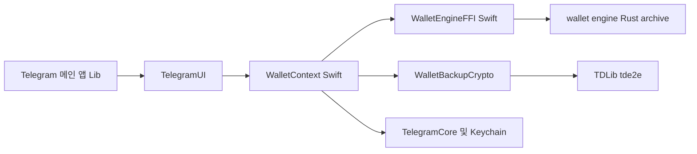
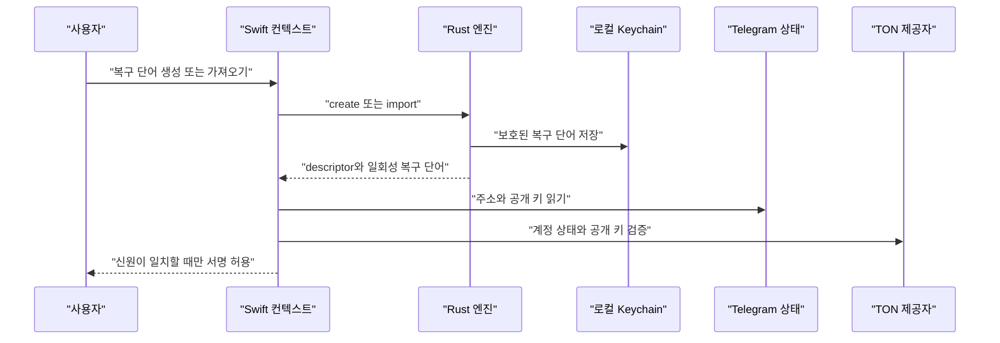
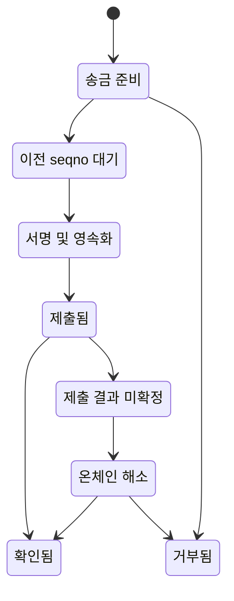
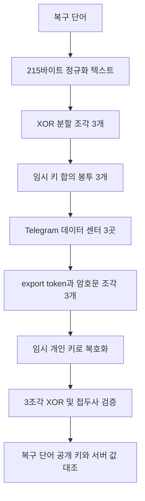

# 지갑 모듈

웹: /docs/system/28-wallet/ · Markdown: /docs/system/28-wallet.md

> Telegram iOS 지갑의 빌드 도달 가능성, TON 엔진 경계, 키 백업 암호화, macOS 대조.

> 시스템 설계 · 비즈니스 시스템 · 28장 · 도표 4 · 코드 발췌 10 · 인용 25 · 소스 기준선: [TelegramMessenger/Telegram-iOS@f1dd7a2d](https://github.com/TelegramMessenger/Telegram-iOS/tree/f1dd7a2dbd02cbbf513e75d5695d8d36d1cf5838), [overtake/TelegramSwift@579cebbf](https://github.com/overtake/TelegramSwift/tree/579cebbf0c01fd41b712eff3647fa7f69db9665d)
>
> 핵심 소스 파일: [TelegramMessenger/Telegram-iOS/Telegram/BUILD](https://github.com/TelegramMessenger/Telegram-iOS/blob/f1dd7a2dbd02cbbf513e75d5695d8d36d1cf5838/Telegram/BUILD), [TelegramMessenger/Telegram-iOS/submodules/TelegramUI/BUILD](https://github.com/TelegramMessenger/Telegram-iOS/blob/f1dd7a2dbd02cbbf513e75d5695d8d36d1cf5838/submodules/TelegramUI/BUILD), [TelegramMessenger/Telegram-iOS/submodules/TelegramUI/Sources/AccountContext.swift](https://github.com/TelegramMessenger/Telegram-iOS/blob/f1dd7a2dbd02cbbf513e75d5695d8d36d1cf5838/submodules/TelegramUI/Sources/AccountContext.swift), [TelegramMessenger/Telegram-iOS/submodules/WalletContext/BUILD](https://github.com/TelegramMessenger/Telegram-iOS/blob/f1dd7a2dbd02cbbf513e75d5695d8d36d1cf5838/submodules/WalletContext/BUILD), [TelegramMessenger/Telegram-iOS/submodules/WalletContext/Sources/WalletContext.swift](https://github.com/TelegramMessenger/Telegram-iOS/blob/f1dd7a2dbd02cbbf513e75d5695d8d36d1cf5838/submodules/WalletContext/Sources/WalletContext.swift), [TelegramMessenger/Telegram-iOS/submodules/WalletContext/Sources/WalletEngineRuntime.swift](https://github.com/TelegramMessenger/Telegram-iOS/blob/f1dd7a2dbd02cbbf513e75d5695d8d36d1cf5838/submodules/WalletContext/Sources/WalletEngineRuntime.swift), [TelegramMessenger/Telegram-iOS/submodules/WalletContext/Sources/WalletSecurity.swift](https://github.com/TelegramMessenger/Telegram-iOS/blob/f1dd7a2dbd02cbbf513e75d5695d8d36d1cf5838/submodules/WalletContext/Sources/WalletSecurity.swift), [TelegramMessenger/Telegram-iOS/submodules/WalletContext/Sources/WalletStorage.swift](https://github.com/TelegramMessenger/Telegram-iOS/blob/f1dd7a2dbd02cbbf513e75d5695d8d36d1cf5838/submodules/WalletContext/Sources/WalletStorage.swift), [TelegramMessenger/Telegram-iOS/submodules/WalletContext/Sources/WalletBackup.swift](https://github.com/TelegramMessenger/Telegram-iOS/blob/f1dd7a2dbd02cbbf513e75d5695d8d36d1cf5838/submodules/WalletContext/Sources/WalletBackup.swift), [TelegramMessenger/Telegram-iOS/submodules/WalletBackupCrypto/Sources/WalletBackupCrypto.mm](https://github.com/TelegramMessenger/Telegram-iOS/blob/f1dd7a2dbd02cbbf513e75d5695d8d36d1cf5838/submodules/WalletBackupCrypto/Sources/WalletBackupCrypto.mm), [TelegramMessenger/Telegram-iOS/third-party/wallet-engine/BUILD](https://github.com/TelegramMessenger/Telegram-iOS/blob/f1dd7a2dbd02cbbf513e75d5695d8d36d1cf5838/third-party/wallet-engine/BUILD), [i582/wallet-engine/src/lib.rs](https://github.com/i582/wallet-engine/blob/e59e0d89d7ee90c388bf36e3334c5b276f396697/src/lib.rs), [i582/wallet-engine/src/wallet/mod.rs](https://github.com/i582/wallet-engine/blob/e59e0d89d7ee90c388bf36e3334c5b276f396697/src/wallet/mod.rs), [tdlib/td/tde2e/td/e2e/MessageEncryption.cpp](https://github.com/tdlib/td/blob/e894536b2f46caad93f997448d2daff9431b19dd/tde2e/td/e2e/MessageEncryption.cpp), [overtake/TelegramSwift/.gitmodules](https://github.com/overtake/TelegramSwift/blob/579cebbf0c01fd41b712eff3647fa7f69db9665d/.gitmodules), [overtake/TelegramSwift/Telegram-Mac/InAppLinks.swift](https://github.com/overtake/TelegramSwift/blob/579cebbf0c01fd41b712eff3647fa7f69db9665d/Telegram-Mac/InAppLinks.swift), [overtake/TelegramSwift/Telegram.xcodeproj/project.pbxproj](https://github.com/overtake/TelegramSwift/blob/579cebbf0c01fd41b712eff3647fa7f69db9665d/Telegram.xcodeproj/project.pbxproj)
>
> 미검증 사항:
> - 백업 holder의 서버 측 보존 기간, 지역 분포, 삭제 의미.
> - wallet_available의 서버 측 공개 조건과 지역 정책.
> - tde2e 임시 키의 하위 곡선 파라미터의 구체적 구현.
> - wallet.sendTransfer에서 서버가 일반 BOC와 수수료 면제 BOC 중 하나를 고르는 규칙.
> - macOS fork의 이후 커밋에서 지갑 모듈이 다시 도입되는지 여부.

## 문제와 결론 [#문제와-결론]

이 장은 고정 커밋의 Telegram iOS 지갑 구현을 살펴봐요. 결론은 이래요. iOS 메인 앱은 지갑 경로 전체를 컴파일하고 링크해요. 쓰지 않는 서드파티 디렉터리가 아니에요. 이 경로에는 이런 것들이 들어 있어요.

- `WalletContext`
- `WalletBackupCrypto`
- Rust의 `wallet-engine`

지갑 경로의 역할은 이렇게 나뉘어요.

- `WalletContext`: Swift 오케스트레이션 계층이에요. Telegram 계정, 원격 지갑 상태, 인증 세션, Keychain(Apple 기기의 보안 저장소), 로컬 영속화, 지갑 화면을 연결해요.
- `wallet-engine`: i582의 Rust 라이브러리예요. TON 지갑 도출, 서명, 송금 구성, 체인 상태, NFT, 암호화 메모, TON Connect를 처리해요.
- Telegram 호스트: 네트워크 전송, 보호된 저장소, 작업 로그, 사용자 인터페이스는 여전히 Telegram 호스트가 맡아요.[\[9\]](https://github.com/i582/wallet-engine/blob/e59e0d89d7ee90c388bf36e3334c5b276f396697/src/lib.rs#L1-L66)[\[10\]](https://github.com/i582/wallet-engine/blob/e59e0d89d7ee90c388bf36e3334c5b276f396697/src/wallet/mod.rs#L44-L170)

지갑 코드가 컴파일됐다고 모든 사용자에게 보이는 건 아니에요. 메인 앱은 정상적인 메인 계정에 대해 `WalletContext`를 만들어요. 하지만 원격 앱 설정의 `wallet_available`은 기본적으로 꺼져 있어요. 다음 모두 이 스위치를 검사해요.

- 화면
- 딥 링크(앱의 특정 화면을 여는 링크)
- TON Connect 표시

그래서 컴파일 도달 가능성과 제품 사용 가능성은 서로 독립된 두 가지 조건이에요.[\[6\]](https://github.com/TelegramMessenger/Telegram-iOS/blob/f1dd7a2dbd02cbbf513e75d5695d8d36d1cf5838/submodules/TelegramUI/Sources/AccountContext.swift#L340-L380)[\[8\]](https://github.com/TelegramMessenger/Telegram-iOS/blob/f1dd7a2dbd02cbbf513e75d5695d8d36d1cf5838/submodules/WalletContext/Sources/WalletContext.swift#L529-L588)[\[25\]](https://github.com/TelegramMessenger/Telegram-iOS/blob/f1dd7a2dbd02cbbf513e75d5695d8d36d1cf5838/submodules/TelegramUI/Sources/AppDelegate.swift#L2615-L2624)

이 장은 “아키텍처”와 “비밀 채팅과 로컬 보안”의 일반적인 결론을 반복하지 않아요. 지갑 전용 객체 경계, 자금 작업, 복구 단어 보호만 설명해요.

### 연구 범위와 판정 방법 [#연구-범위와-판정-방법]

이 글의 소스 버전은 Telegram iOS 커밋 `f1dd7a2dbd02cbbf513e75d5695d8d36d1cf5838`이에요. Rust 엔진 버전은 i582 `wallet-engine` 커밋 `e59e0d89d7ee90c388bf36e3334c5b276f396697`이에요. `tde2e`의 구현은 TDLib 커밋 `e894536b2f46caad93f997448d2daff9431b19dd`에서 가져왔어요.

“컴파일됨”은 Bazel 의존성 폐포(한 타깃에서 `deps`를 따라 닿는 모든 타깃)로 판정해요. 그러니까 `Telegram:Lib`에서 출발해 `deps`를 따라 `TelegramUI`, `WalletContext`, `WalletEngineFFI`, 하위 정적 라이브러리에 이르는 거예요. 이 판정은 화면 문구, 리소스 이름, 바이너리 추측에 기대지 않아요.

“사용됨”은 런타임 호출로 판정해요. 다시 말해 `AccountContextImpl`이 메인 앱이고 임시 계정이 아닌 조건에서 다음을 해요.

- `WalletContext`를 인스턴스화해요.
- 지갑 상태와 TON Connect 이벤트를 구독해요.

임시 계정은 이 속성을 `nil`로 두기 때문에 지갑 컨텍스트를 만들거나 사용할 수 없어요.[\[6\]](https://github.com/TelegramMessenger/Telegram-iOS/blob/f1dd7a2dbd02cbbf513e75d5695d8d36d1cf5838/submodules/TelegramUI/Sources/AccountContext.swift#L340-L380)[\[7\]](https://github.com/TelegramMessenger/Telegram-iOS/blob/f1dd7a2dbd02cbbf513e75d5695d8d36d1cf5838/submodules/WalletContext/Sources/WalletContext.swift#L210-L355)

“키 백업”은 이 장에서 두 가지 의미를 가져요.

- 첫째 층: 기기 로컬의 복구 단어 금고예요.
- 둘째 층: 서버가 보조하는 3분할 암호화 복구 단어 백업이에요.

둘은 키, 저장 위치, 실패 모델이 달라서 한 층으로 헷갈리면 안 돼요.

## 컴파일 경로와 모듈 경계 [#컴파일-경로와-모듈-경계]

### 앱 타깃에서 Rust 정적 라이브러리까지 [#앱-타깃에서-rust-정적-라이브러리까지]

의존 관계는 이 사슬로 이어져요.

- `Telegram:Lib`는 `TelegramUI`에 직접 의존해요.
- `TelegramUI`의 의존성 목록에는 `WalletContext`가 있어요.
- `WalletContext`는 `WalletEngineFFI`와 `WalletBackupCrypto`에 동시에 의존해요.

이 세 간선은 지갑이 필요할 때 내려받는 플러그인이 아니라 메인 앱 의존성 그래프의 일부라는 걸 증명해요.[\[1\]](https://github.com/TelegramMessenger/Telegram-iOS/blob/f1dd7a2dbd02cbbf513e75d5695d8d36d1cf5838/Telegram/BUILD#L374-L400)[\[2\]](https://github.com/TelegramMessenger/Telegram-iOS/blob/f1dd7a2dbd02cbbf513e75d5695d8d36d1cf5838/submodules/TelegramUI/BUILD#L530-L579)[\[3\]](https://github.com/TelegramMessenger/Telegram-iOS/blob/f1dd7a2dbd02cbbf513e75d5695d8d36d1cf5838/submodules/WalletContext/BUILD#L1-L24)

```python
swift_library(
    name = "WalletContext",
    module_name = "WalletContext",
    srcs = glob([
        "Sources/**/*.swift",
    ]),
    copts = [
        "-warnings-as-errors",
        "-enable-testing",
    ],
    deps = [
      "//third-party/wallet-engine:WalletEngineFFI",
      "//submodules/SSignalKit/SwiftSignalKit",
      "//submodules/TelegramCore",
      "//submodules/TelegramUIPreferences",
      "//submodules/WalletBackupCrypto",
      "//submodules/PasscodeCore",
    ],
    visibility = [
        "//visibility:public",
    ],
)
```
[\[3\]](https://github.com/TelegramMessenger/Telegram-iOS/blob/f1dd7a2dbd02cbbf513e75d5695d8d36d1cf5838/submodules/WalletContext/BUILD#L1-L24)

`WalletBackupCrypto`는 Objective C와 C를 합친 라이브러리예요. 빌드 타깃은 이렇게 구성돼요.

- 모든 Objective C와 C 소스를 모아요.
- `td`를 링크해요.
- Foundation과 Security를 선언해요.

이 라이브러리는 Rust 엔진의 일부가 아니에요. Telegram iOS가 Swift 상위 계층에 따로 둔 복구 단어 백업 어댑터예요.[\[3\]](https://github.com/TelegramMessenger/Telegram-iOS/blob/f1dd7a2dbd02cbbf513e75d5695d8d36d1cf5838/submodules/WalletContext/BUILD#L1-L24)

`wallet-engine`의 Bazel 파일은 이 순서로 진행해요.

1. Rust 소스에서 `wallet_engine_archive`를 만들어요.
2. `objc_library`가 이 archive에 의존해요.
3. UniFFI(Rust를 Swift에서 부를 수 있게 바인딩을 만드는 도구)가 Swift와 C 헤더 파일을 생성하고 `WalletEngineFFI` Swift 모듈을 내놓아요.

`WalletContext`의 의존성이 바로 이 모듈이에요. 그래서 최종 iOS 경로는 Swift가 생성된 바인딩을 호출하고, 바인딩이 Objective C 타깃을 링크하고, 타깃이 Rust 정적 라이브러리를 링크하는 구조예요.[\[4\]](https://github.com/TelegramMessenger/Telegram-iOS/blob/f1dd7a2dbd02cbbf513e75d5695d8d36d1cf5838/third-party/wallet-engine/BUILD#L92-L160)[\[5\]](https://github.com/TelegramMessenger/Telegram-iOS/blob/f1dd7a2dbd02cbbf513e75d5695d8d36d1cf5838/third-party/wallet-engine/BUILD#L185-L262)



이 도표는 컴파일 의존성 그래프이고 자금 흐름도가 아니에요. `TelegramUI`의 여러 지갑 화면도 `WalletContext`에 따로 의존해요. 하지만 메인 앱은 이미 `TelegramUI`를 통해 `WalletContext` 의존성을 얻어요. 그래서 이런 개별 의존성은 이 장의 컴파일 결론의 전제가 아니에요.[\[1\]](https://github.com/TelegramMessenger/Telegram-iOS/blob/f1dd7a2dbd02cbbf513e75d5695d8d36d1cf5838/Telegram/BUILD#L374-L400)[\[2\]](https://github.com/TelegramMessenger/Telegram-iOS/blob/f1dd7a2dbd02cbbf513e75d5695d8d36d1cf5838/submodules/TelegramUI/BUILD#L530-L579)

### 런타임 조립과 스위치 [#런타임-조립과-스위치]

`AccountContextImpl`은 이 순서로 `WalletContext`를 조립해요.

1. 현재 계정이 메인 계정인지 계산하고, 네트워크 상태를 불리언 스트림으로 바꿔요.
2. 환경 이름과 계정 식별자로 저장소 네임스페이스를 구성해요.
3. 포그라운드 상태, 현재 계정 상태, 네트워크 상태, 앱 잠금 상태를 `WalletContext`에 전달해요.

그래서 계정 전환과 앱 잠금이 UI 계층의 약속이 아니라 인증 수명 주기의 입력이 돼요.[\[6\]](https://github.com/TelegramMessenger/Telegram-iOS/blob/f1dd7a2dbd02cbbf513e75d5695d8d36d1cf5838/submodules/TelegramUI/Sources/AccountContext.swift#L340-L380)

```swift
let environment = account.testingEnvironment ? "test" : "production"
self.walletContext = WalletContext(
    engine: self.engine,
    storageNamespace: "telegram.\(environment).\(UInt64(bitPattern: account.peerId.toInt64()))",
    applicationInForeground: sharedContext.applicationBindings.applicationInForeground,
    accountIsCurrent: accountIsCurrent,
    networkAvailable: networkAvailable,
    applicationIsPasscodeLocked: sharedContext.appLockContext.isPasscodeLocked
)
```
[\[6\]](https://github.com/TelegramMessenger/Telegram-iOS/blob/f1dd7a2dbd02cbbf513e75d5695d8d36d1cf5838/submodules/TelegramUI/Sources/AccountContext.swift#L340-L380)

생성자는 이것들을 구독해요.

- 원격 앱 설정
- `engine.wallet.stateUpdates`
- 송금 업데이트
- TON Connect 업데이트

환경 스트림이 바뀔 때 코드는 포그라운드이고, 현재 계정이며, 잠기지 않았을 때만 인증을 허용해요. 계정이 현재 계정이 아니면 즉시 인증을 무효화해요. 이 설계는 이미 전환된 계정이나 이미 잠긴 세션이 복구 단어를 계속 쓰는 걸 막아요.[\[7\]](https://github.com/TelegramMessenger/Telegram-iOS/blob/f1dd7a2dbd02cbbf513e75d5695d8d36d1cf5838/submodules/WalletContext/Sources/WalletContext.swift#L210-L355)

기본 설정은 `isAvailable`을 `false`로 둬요. `WalletConfiguration.with`는 원격 설정에서 이 네 가지만 읽어요.

- `wallet_available`
- 브라우저 주소
- 최소 송금액
- 수수료 면제 한도

추론: 같은 바이너리가 원격 스위치로 배포 범위별로 기능을 숨길 수 있고, 이미 링크된 구현은 바뀌지 않아요.[\[8\]](https://github.com/TelegramMessenger/Telegram-iOS/blob/f1dd7a2dbd02cbbf513e75d5695d8d36d1cf5838/submodules/WalletContext/Sources/WalletContext.swift#L529-L588)

`wallet_available` 스위치는 `WalletContext`의 생성을 막지 않아요. 주로 진입점과 표시를 제어해요. 예를 들어 `ton` 또는 TON Connect URL을 받으면 앱은 먼저 스위치를 검사해요. 꺼져 있으면 사용할 수 없다는 안내를 표시하고, 지갑 화면에 들어가거나 요청을 처리하지 않아요.[\[25\]](https://github.com/TelegramMessenger/Telegram-iOS/blob/f1dd7a2dbd02cbbf513e75d5695d8d36d1cf5838/submodules/TelegramUI/Sources/AppDelegate.swift#L2615-L2624)

## `wallet-engine`의 정체 [#wallet-engine의-정체]

### 책임 분담 [#책임-분담]

`wallet-engine`은 Telegram iOS가 고정 소스 미러로 포함한 Rust 지갑 엔진이에요. TON 노드도 아니고 Telegram 서버도 아니에요. 엔진 최상위 주석은 책임을 이렇게 나눠요.

- Rust: provider(TON 체인 서비스 제공자) 요청을 구성하고, 응답을 파싱하고, 지갑을 도출하고, 트랜잭션에 서명하고, 작업 상태를 유지해요.
- 임베딩하는 앱: provider 전송, 보호된 저장소, 영속 로그, 사용자 인터페이스를 제공해요.[\[9\]](https://github.com/i582/wallet-engine/blob/e59e0d89d7ee90c388bf36e3334c5b276f396697/src/lib.rs#L1-L66)

```rust
//! A callback-driven engine for TON wallet lifecycle, state, and transfers.
//!
//! The crate owns provider request construction, response parsing, wallet
//! derivation, transaction signing, and operation state. The embedding
//! application owns provider transport, protected storage, durable journal
//! storage, and the user interface.
```
[\[9\]](https://github.com/i582/wallet-engine/blob/e59e0d89d7ee90c388bf36e3334c5b276f396697/src/lib.rs#L1-L66)

이 경계로 겉보기에 중복된 두 계층이 설명돼요.

- Swift `WalletEngineRuntime`: Swift actor예요. `TelegramEngine`, 저장소, 로그를 `WalletEnginePlatformHost`와 무상태 네트워크 호스트로 감싸고 `WalletLifecycle`을 만들어요.
- Rust `WalletLifecycle`: 플랫폼 호스트 인터페이스만 가져요. iOS Keychain을 직접 읽지 않고 Telegram MTProto 요청을 직접 보내지도 않아요.[\[11\]](https://github.com/TelegramMessenger/Telegram-iOS/blob/f1dd7a2dbd02cbbf513e75d5695d8d36d1cf5838/submodules/WalletContext/Sources/WalletEngineRuntime.swift#L508-L595)[\[13\]](https://github.com/TelegramMessenger/Telegram-iOS/blob/f1dd7a2dbd02cbbf513e75d5695d8d36d1cf5838/submodules/WalletContext/Sources/WalletStorage.swift#L475-L610)

엔진의 공개 진입점에는 `WalletLifecycle`, `WalletClient`, `TonConnectSession`, `TonConnectDerivedSession`이 있어요.

- `WalletLifecycle`: 지갑의 생성, 가져오기, 표시, 삭제를 맡아요.
- `WalletClient`: 새로고침, 활동 목록, 송금 준비, 송금, BOC(TON 트랜잭션을 담는 직렬화 형식), 키 교체, 암호화 메모 복호화를 맡아요.
- TON Connect 세션: 네이티브 암호화 세션과, MTProto 릴레이를 거쳐 파생 키를 쓰는 세션으로 나뉘어요.[\[9\]](https://github.com/i582/wallet-engine/blob/e59e0d89d7ee90c388bf36e3334c5b276f396697/src/lib.rs#L1-L66)

엔진 디렉터리는 DNS, provider, 미리 보기, 전송, 파싱, NFT, NFT 송금, 키 이력, 키 교체도 분명히 나눠요. 주소와 잔액만 읽는 라이브러리가 아니에요. 현재 앱의 Swift runtime은 이 인터페이스를 호출해요.

- `previewSend`
- 암호화 메모
- `prepareTransfer`
- `send`
- NFT 미리 보기[\[11\]](https://github.com/TelegramMessenger/Telegram-iOS/blob/f1dd7a2dbd02cbbf513e75d5695d8d36d1cf5838/submodules/WalletContext/Sources/WalletEngineRuntime.swift#L508-L595)

### TON과의 관계와 키 모델 [#ton과의-관계와-키-모델]

`wallet-engine`은 TON 메인넷 지갑 구현이에요. 런타임은 클라이언트를 만들 때 네트워크를 메인넷으로 기록하고 provider 주소를 `https://toncenter.com`으로 설정해요. 서버의 주소와 32바이트 공개 키를 로컬 descriptor(지갑 식별 정보 레코드)와 비교해요. 다음이 모두 일치해야 `canSign`이 참이 돼요.

- 주소
- 서명 공개 키
- 보호된 복구 단어[\[11\]](https://github.com/TelegramMessenger/Telegram-iOS/blob/f1dd7a2dbd02cbbf513e75d5695d8d36d1cf5838/submodules/WalletContext/Sources/WalletEngineRuntime.swift#L508-L595)

엔진 descriptor가 영속화할 수 있는 필드는 이래요.

- 레코드 식별자
- TON 주소
- 32바이트 앵커 공개 키
- 네트워크
- 복구 단어에 대한 보호된 참조

소스 코드는 복구 단어가 descriptor에 들어가면 안 된다고 명시해요.

키 구성은 이래요.

- 새 지갑은 12개 단어를 만들어요.
- 키 교체 후에는 24개 단어가 될 수 있고, 앞뒤 12개 단어는 각각 독립적으로 검증되는 BIP-39(복구 단어 표준) 절반이에요.
- 앵커 키는 주소를 결정하고 변하지 않아요. 서명 절반은 교체될 수 있어요.[\[10\]](https://github.com/i582/wallet-engine/blob/e59e0d89d7ee90c388bf36e3334c5b276f396697/src/wallet/mod.rs#L44-L170)

```rust
pub struct WalletDescriptor {
    /// The stable application record identifier.
    pub record_id: String,
    /// The derived friendly non-bounceable TON address.
    pub address: TonAddressString,
    /// The raw 32-byte Ed25519 anchor public key of the rotation mnemonic.
    ///
    /// The anchor key determines the wallet account address and never
    /// changes, so this is safe to persist. It lets the engine emulate a
    /// first deployment before it asks the host to unlock the recovery
    /// phrase.
    pub public_key: Vec<u8>,
    /// The network used for derivation and future operations.
    pub network: Network,
    /// The host protected-storage reference for the mnemonic.
    pub secret_ref: ProtectedSecretRef,
}
```
[\[10\]](https://github.com/i582/wallet-engine/blob/e59e0d89d7ee90c388bf36e3334c5b276f396697/src/wallet/mod.rs#L44-L170)

그래서 지갑과 Telegram Stars는 같은 객체가 아니에요. `AccountContextImpl`은 `peerStarsContext`, `peerTonContext`, `WalletContext`를 각각 얻어요.

- `peerStarsContext`와 `peerTonContext`: Telegram 결제 상태 인터페이스에 속해요.
- `WalletContext`: 로컬 복구 단어, TON 개인 키 서명, 온체인 송금을 포함해요.

소스는 `wallet.sendTransfer`가 Telegram의 `wallet.sendTransfer` RPC를 호출하고 일반 BOC, 선택적 수수료 면제 BOC, 수신자, 무작위 식별자를 담는다는 것도 보여 줘요. 이로써 Telegram 서비스는 릴레이와 상태 조정에 참여하지만, 개인 키 도출과 서명은 클라이언트 엔진에 있다는 걸 알 수 있어요.[\[6\]](https://github.com/TelegramMessenger/Telegram-iOS/blob/f1dd7a2dbd02cbbf513e75d5695d8d36d1cf5838/submodules/TelegramUI/Sources/AccountContext.swift#L340-L380)[\[21\]](https://github.com/TelegramMessenger/Telegram-iOS/blob/f1dd7a2dbd02cbbf513e75d5695d8d36d1cf5838/submodules/TelegramCore/Sources/TelegramEngine/Wallet/Wallet.swift#L579-L586)

### 범용 서명기가 아닌 TON Connect [#범용-서명기가-아닌-ton-connect]

TON Connect의 소유권 증명 요청은 이것들을 담아요.

- descriptor
- 사용자에게 보여 주려고 승인된 dApp 도메인
- 타임스탬프
- payload

Rust는 보호된 복구 단어를 읽기 전에 descriptor를 검증해요. 프로토콜 다이제스트를 스스로 구성하고 64바이트 Ed25519 서명을 반환해요. 소스 주석은 이 방식이 호출하는 쪽이 인터페이스를 범용 서명 오라클로 쓰는 일을 막는다고 명시해요.[\[10\]](https://github.com/i582/wallet-engine/blob/e59e0d89d7ee90c388bf36e3334c5b276f396697/src/wallet/mod.rs#L44-L170)

파생 세션의 경우 엔진은 서명 키 시드, dApp client id, 서버 nonce로 세션 키를 도출해요. 서명 키를 교체하면 이후 도출되는 세션 키가 바뀌어요.

Swift 계층은 TON Connect 요청이 도착할 때 다음을 검사하고, 복구를 지원하도록 요청을 로그에 기록해요.

- 만료 시간
- 세션 상태
- 지갑 표시 가능 상태[\[10\]](https://github.com/i582/wallet-engine/blob/e59e0d89d7ee90c388bf36e3334c5b276f396697/src/wallet/mod.rs#L44-L170)[\[11\]](https://github.com/TelegramMessenger/Telegram-iOS/blob/f1dd7a2dbd02cbbf513e75d5695d8d36d1cf5838/submodules/WalletContext/Sources/WalletEngineRuntime.swift#L508-L595)

## 데이터와 로컬 보안 [#데이터와-로컬-보안]

### 보호된 복구 단어의 저장 계층 [#보호된-복구-단어의-저장-계층]

복구 단어는 Keychain에 직접 기록되지 않아요.

- 쓰기: `WalletEngineStorage.storeProtectedSecret`은 먼저 `WalletVault.encrypt`를 호출해 JSON으로 인코딩한 봉투를 만들고, 그 봉투를 secret service에 기록해요.
- 읽기: 반대로 `WalletVault.decrypt`를 호출해요.

descriptor, 보관된 지갑, 송금 로그는 따로 저장할 수 있지만 참조와 공개 메타데이터만 저장해요.[\[13\]](https://github.com/TelegramMessenger/Telegram-iOS/blob/f1dd7a2dbd02cbbf513e75d5695d8d36d1cf5838/submodules/WalletContext/Sources/WalletStorage.swift#L475-L610)

`WalletSecretEnvelope`는 봉투 암호화(데이터를 암호화한 키를 다시 다른 키로 암호화하는 방식)를 써요. 저장할 때 이 순서로 진행해요.

1. 저장할 때마다 32바이트 데이터 암호화 키(DEK)를 생성해요.
2. 앱 암호 세션이 다른 키를 도출해 이 데이터 암호화 키를 암호화해요.
3. 데이터 암호화 키로 복구 단어를 암호화해요.

두 층 모두 CryptoKit의 AES GCM을 쓰고, 무작위 nonce는 12바이트, 키 길이는 32바이트예요. 두 번의 AES GCM 모두 vault id와 secret id에 묶인 추가 인증 데이터를 가져요.[\[12\]](https://github.com/TelegramMessenger/Telegram-iOS/blob/f1dd7a2dbd02cbbf513e75d5695d8d36d1cf5838/submodules/WalletContext/Sources/WalletSecurity.swift#L7-L94)

```swift
let secretId = UUID().uuidString
var dek = try random(32)
defer { dek.resetBytes(in: 0 ..< dek.count) }
return try access.withDerivedKey(namespace: vaultId, domain: "telegram.wallet.dek.v1") { key in
    WalletSecretEnvelope(version: 1, vaultId: vaultId, secretId: secretId,
        wrappedDek: try seal(dek, key: key, context: "dek.v1:\(vaultId):\(secretId)"),
        ciphertext: try seal(secret, key: dek, context: "secret.v1:\(vaultId):\(secretId)"))
}
```
[\[12\]](https://github.com/TelegramMessenger/Telegram-iOS/blob/f1dd7a2dbd02cbbf513e75d5695d8d36d1cf5838/submodules/WalletContext/Sources/WalletSecurity.swift#L7-L94)

Keychain 쿼리는 이렇게 설정해요.

- `kSecAttrSynchronizable`을 false로 설정해요.
- 새 항목은 `kSecAttrAccessibleWhenUnlockedThisDeviceOnly`를 써요.

이 설정은 복구 단어 봉투가 Keychain으로 동기화되지 않고 이 기기가 잠금 해제됐을 때만 접근할 수 있다는 뜻이에요. iOS는 `PasscodeEnvironment`가 제공하는 비공개 access group도 써요. 코드는 macOS 조건부 컴파일 분기에서 빈 access group을 반환하지만, 이 분기가 TelegramSwift 데스크톱 클라이언트가 이 모듈을 포함하고 있다는 뜻은 아니에요.[\[12\]](https://github.com/TelegramMessenger/Telegram-iOS/blob/f1dd7a2dbd02cbbf513e75d5695d8d36d1cf5838/submodules/WalletContext/Sources/WalletSecurity.swift#L7-L94)[\[13\]](https://github.com/TelegramMessenger/Telegram-iOS/blob/f1dd7a2dbd02cbbf513e75d5695d8d36d1cf5838/submodules/WalletContext/Sources/WalletStorage.swift#L475-L610)

`WalletAuthorizationContext`는 인증 세대와 작업 세대를 유지해요. 포그라운드, 현재 계정, 잠금 상태가 바뀌면 표준 인증 세션이 무효화돼요. 비동기 작업은 결과를 전달하기 전에 세대를 다시 검증해요. 그러면 작업이 인증이 유효할 때 시작했더라도 화면 잠금이나 계정 전환 뒤에 서명 결과를 이전 페이지에 넘기는 일을 피할 수 있어요.[\[7\]](https://github.com/TelegramMessenger/Telegram-iOS/blob/f1dd7a2dbd02cbbf513e75d5695d8d36d1cf5838/submodules/WalletContext/Sources/WalletContext.swift#L210-L355)[\[12\]](https://github.com/TelegramMessenger/Telegram-iOS/blob/f1dd7a2dbd02cbbf513e75d5695d8d36d1cf5838/submodules/WalletContext/Sources/WalletSecurity.swift#L7-L94)

### 전송 로그와 크래시 복구 [#전송-로그와-크래시-복구]

온체인 브로드캐스트에는 되돌릴 수 없는 경계가 있어요. 클라이언트는 메모리의 버튼 상태만으로 이미 전송됐는지 판단할 수 없어요. `WalletEngineStorage`는 로그 레코드에 버전 번호를 매기고 compare exchange를 제공해요.

Swift는 이 순서로 전송해요.

1. RPC를 제출하기 전에 pending transfer와 제출 기록을 저장하고, seqno(지갑의 송금 순번), 유효 기간, BOC 관련 해시를 기록해요.
2. 그런 다음에야 Telegram RPC를 호출해요.[\[13\]](https://github.com/TelegramMessenger/Telegram-iOS/blob/f1dd7a2dbd02cbbf513e75d5695d8d36d1cf5838/submodules/WalletContext/Sources/WalletStorage.swift#L475-L610)[\[20\]](https://github.com/TelegramMessenger/Telegram-iOS/blob/f1dd7a2dbd02cbbf513e75d5695d8d36d1cf5838/submodules/WalletContext/Sources/WalletTransfers.swift#L448-L565)

전송 사이에서 시스템은 같은 지갑 seqno가 필요한 제출 하나만 계속 진행하도록 허용해요.

- 체인 상태를 폴링해 이전 요청의 seqno가 이미 소비됐는지, 최종 상태가 있는지 확인해요.
- 준비된 요청이 만료되면 실패해요.
- 미리 보기가 특정 seqno 상태를 만나면 1초 지연 후 한 번 재시도해요.

추론: 이 직렬화는 동시에 보내는 처리량보다 온체인 순서와 복구 능력을 우선해요.[\[19\]](https://github.com/tdlib/td/blob/e894536b2f46caad93f997448d2daff9431b19dd/tde2e/td/e2e/MessageEncryption.cpp#L55-L143)[\[20\]](https://github.com/TelegramMessenger/Telegram-iOS/blob/f1dd7a2dbd02cbbf513e75d5695d8d36d1cf5838/submodules/WalletContext/Sources/WalletTransfers.swift#L448-L565)

```swift
try await self.persistPendingTransferBeforeSend(persistedPending, generation: generation)
let record = WalletTransferSubmissionRecord(
    operationId: pending.id, recordId: preparedData.recordId, walletAddress: walletAddress,
    seqno: preparedData.data.seqno, validUntil: preparedData.data.validUntil,
    recipient: pending.recipient, normalBodyHash: persistedPending.streamingData?.normalBodyHash,
    gaslessBodyHash: persistedPending.streamingData?.gaslessBodyHash, resolution: .pending
)
try await self.storage.saveTransferSubmission(record)
self.transferSubmissions.register(record)
do {
    try Task.checkCancellation()
    guard !self.isShutdown, self.activationGeneration == generation else { throw WalletError.unavailable }
    if let pendingRegistration {
        guard self.isCurrentPendingTransferRegistration(pendingRegistration), let registrationSession else { throw WalletError.unavailable }
        try self.authorization.validate(registrationSession, boundTo: pendingRegistration.sessionId, requireAvailable: false)
    }
    try control.commit()
} catch {
```
[\[20\]](https://github.com/TelegramMessenger/Telegram-iOS/blob/f1dd7a2dbd02cbbf513e75d5695d8d36d1cf5838/submodules/WalletContext/Sources/WalletTransfers.swift#L448-L565)

제출 뒤의 네트워크 타임아웃은 곧바로 실패로 취급하지 않아요.

- 응답이 없는 경우: 전송 코드가 `submissionUnknown`으로 표시하고, 이후 온체인 트랜잭션, seqno, 영속화된 기록으로 해소해요.
- 분명히 잘못된 데이터, 전송 실패, 키 불일치: 코드가 기록을 거부하고 pending 메시지를 지워요. 키 불일치는 준비 데이터도 비우고 지갑 키 재조정을 요청해요.[\[20\]](https://github.com/TelegramMessenger/Telegram-iOS/blob/f1dd7a2dbd02cbbf513e75d5695d8d36d1cf5838/submodules/WalletContext/Sources/WalletTransfers.swift#L448-L565)

## 핵심 흐름 [#핵심-흐름]

### 생성, 가져오기, 활성화 [#생성-가져오기-활성화]

- 생성 흐름: 먼저 Rust가 복구 단어와 descriptor를 만들게 한 뒤 플랫폼 호스트가 보호된 저장소에 기록하게 해요. UI는 일회성 `RecoveryPhrase`만 얻어요.
- 가져오기 흐름: 먼저 단어 조합과 주소 도출 결과를 검증해요. Swift runtime은 TON 계정 상태와 온체인 공개 키도 조회해 가져온 단어 조합의 서명 공개 키와 비교해요. 온체인 주소는 같지만 서명 공개 키가 다르면 가져오기는 오래된 복구 단어로 실패해요.[\[10\]](https://github.com/i582/wallet-engine/blob/e59e0d89d7ee90c388bf36e3334c5b276f396697/src/wallet/mod.rs#L44-L170)[\[11\]](https://github.com/TelegramMessenger/Telegram-iOS/blob/f1dd7a2dbd02cbbf513e75d5695d8d36d1cf5838/submodules/WalletContext/Sources/WalletEngineRuntime.swift#L508-L595)

런타임 활성화는 이 조건을 요구해요.

- 서버 public key는 정확히 32바이트여야 해요.
- 저장된 descriptor의 메인넷, 주소, 서명 공개 키와 보호된 secret이 있는지를 비교해요.
- 복구 단어에서 다시 도출한 서명 공개 키가 서버 공개 키와 같아야만 서명을 허용해요.

이 이중 비교가 Telegram이 반환한 지갑 신원을 로컬 복구 단어에 묶어요.[\[11\]](https://github.com/TelegramMessenger/Telegram-iOS/blob/f1dd7a2dbd02cbbf513e75d5695d8d36d1cf5838/submodules/WalletContext/Sources/WalletEngineRuntime.swift#L508-L595)



### 송금 준비와 제출 [#송금-준비와-제출]

준비 단계는 이 순서로 진행해요.

1. TON 주소를 정규화해요.
2. 사용자가 암호화 메모를 선택하면 Swift는 엔진을 호출해 수취인용 페이로드를 만들어요. 암호화 메모의 BOC가 1024바이트를 넘으면 거부해요.
3. 코드는 수수료를 추정하거나 체인 시뮬레이션을 해요. 시뮬레이션 결과가 완전해야 하고, 잔액, 수수료, 300초 로컬 유효 기간을 검사해요.[\[19\]](https://github.com/tdlib/td/blob/e894536b2f46caad93f997448d2daff9431b19dd/tde2e/td/e2e/MessageEncryption.cpp#L55-L143)

제출 단계는 이 순서로 진행해요.

1. 이전 트랜잭션이 해소되기를 기다려요.
2. 인증 세션을 검증해요.
3. Rust가 서명된 BOC를 준비해요.
4. Swift가 취소할 수 없는 `control.commit` 전에 pending transfer와 journal을 저장해요.

제출을 마치면 RPC는 수락, 네트워크 타임아웃, 명시적 거부 중 하나를 반환할 수 있어요. 복구기는 저장된 seqno, 트랜잭션 해시, 체인 상태로 확인, 거부, 미확정의 세 가지 결과로 수렴시켜요.[\[20\]](https://github.com/TelegramMessenger/Telegram-iOS/blob/f1dd7a2dbd02cbbf513e75d5695d8d36d1cf5838/submodules/WalletContext/Sources/WalletTransfers.swift#L448-L565)



### 복구 단어 원격 백업 [#복구-단어-원격-백업]

원격 백업은 이 순서로 진행해요.

1. 단어 조합을 소문자, 단일 공백 텍스트로 정규화해요.
2. `WalletPhraseCodec`은 텍스트가 215바이트를 넘지 않아야 하고, 공백으로 215바이트까지 채워요.
3. 클라이언트는 backup holder(암호문 조각을 보관하는 곳) 세 곳의 32바이트 공개 키를 가져와 `WalletBackupCrypto.encryptSecretForBackup`을 호출해 암호문 세 조각을 만들어요.
4. TelegramCore는 이 조각들을 `enableBackup`과 함께 전송해요.[\[16\]](https://github.com/TelegramMessenger/Telegram-iOS/blob/f1dd7a2dbd02cbbf513e75d5695d8d36d1cf5838/submodules/WalletContext/Sources/WalletBackup.swift#L35-L173)[\[17\]](https://github.com/TelegramMessenger/Telegram-iOS/blob/f1dd7a2dbd02cbbf513e75d5695d8d36d1cf5838/submodules/TelegramCore/Sources/TelegramEngine/Wallet/TelegramEngineWallet.swift#L150-L167)[\[21\]](https://github.com/TelegramMessenger/Telegram-iOS/blob/f1dd7a2dbd02cbbf513e75d5695d8d36d1cf5838/submodules/TelegramCore/Sources/TelegramEngine/Wallet/Wallet.swift#L579-L586)

`WalletBackupCrypto`는 3분의 2 복구를 쓰지 않아요. 정확히 세 조각을 요구해요. 암호화할 때 이렇게 해요.

1. 215바이트의 안전한 난수 분할 조각 두 개를 만들어요.
2. 바이트별 XOR로 세 번째 조각을 계산해요.

그래서 세 조각을 XOR하면 원문이 복원돼요. 한 조각이나 두 조각만으로는 원문을 복구할 수 없어요. 조각마다 고정된 5바이트 접두사를 앞에 붙여 220바이트의 평문 페이로드를 만들어요.[\[14\]](https://github.com/TelegramMessenger/Telegram-iOS/blob/f1dd7a2dbd02cbbf513e75d5695d8d36d1cf5838/submodules/WalletBackupCrypto/Sources/WalletBackupCrypto.mm#L254-L352)[\[15\]](https://github.com/TelegramMessenger/Telegram-iOS/blob/f1dd7a2dbd02cbbf513e75d5695d8d36d1cf5838/submodules/WalletBackupCrypto/Sources/WalletBackupCrypto.mm#L169-L208)

```objc
const std::string value = stringFromData(secret);
std::array<std::string, kShareCount> shares = {
    std::string(value.size(), '\0'),
    std::string(value.size(), '\0'),
    std::string(value.size(), '\0')
};
if (!fillSecureRandom(shares[0]) || !fillSecureRandom(shares[1])) {
    setError(error, WalletBackupCryptoErrorEncryption, @"Could not generate random secret shares");
    return nil;
}
for (std::size_t index = 0; index < value.size(); ++index) {
    shares[2][index] = value[index] ^ shares[0][index] ^ shares[1][index];
}
```
[\[15\]](https://github.com/TelegramMessenger/Telegram-iOS/blob/f1dd7a2dbd02cbbf513e75d5695d8d36d1cf5838/submodules/WalletBackupCrypto/Sources/WalletBackupCrypto.mm#L169-L208)

holder마다 서로 다른 임시 개인 키를 써요. 클라이언트는 이 순서로 처리해요.

1. 임시 공개 키를 내보내요.
2. holder 공개 키를 읽어요.
3. ECDH(타원곡선 키 교환)로 공유 키를 얻어요.
4. 접두사와 조각을 `tde2e_api::encrypt_message_for_one`에 넘겨요.

최종 원시(bare) 봉투는 32바이트 임시 공개 키 뒤에 암호문이 붙은 형태예요. 개인 키, holder key id, shared key id는 실패하거나 완료될 때 모두 파기돼요.[\[15\]](https://github.com/TelegramMessenger/Telegram-iOS/blob/f1dd7a2dbd02cbbf513e75d5695d8d36d1cf5838/submodules/WalletBackupCrypto/Sources/WalletBackupCrypto.mm#L169-L208)[\[18\]](https://github.com/tdlib/td/blob/e894536b2f46caad93f997448d2daff9431b19dd/tde2e/td/e2e/e2e_api.h#L108-L138)

`tde2e`의 이 단일 수신자 암호화는 CryptoKit의 AES GCM이 아니에요. 동작은 이래요.

1. ECDH secret에서 HMAC SHA512로 확장해요. 앞 32바이트는 AES CBC 키 재료로, 뒤 32바이트는 HMAC SHA256에 써요.
2. 16바이트 메시지 식별자를 기록해요.
3. 복호화 후 HMAC의 앞 16바이트를 고정 길이 루프로 비교하고, 무작위 패딩 길이를 검증해요.

이 조합은 기밀성과 무결성 검증을 함께 제공해요. 다만 본문은 이를 AES GCM이라고 잘못 부르지 않아요.[\[18\]](https://github.com/tdlib/td/blob/e894536b2f46caad93f997448d2daff9431b19dd/tde2e/td/e2e/e2e_api.h#L108-L138)[\[19\]](https://github.com/tdlib/td/blob/e894536b2f46caad93f997448d2daff9431b19dd/tde2e/td/e2e/MessageEncryption.cpp#L55-L143)

```cpp
std::string payload(kMnemonicBackupPrefix, kMnemonicBackupPrefixSize);
payload.append(share);
auto encryptedResult = tde2e_api::encrypt_message_for_one(sharedKeyId, payload);
destroyKey(sharedKeyId);
destroyKey(holderKeyId);
destroyKey(privateKeyId);
if (!encryptedResult.is_ok() || publicResult.value().size() != kPublicKeyLength) {
    return false;
}
envelope = publicResult.value();
envelope.append(encryptedResult.value());
return true;
```
[\[15\]](https://github.com/TelegramMessenger/Telegram-iOS/blob/f1dd7a2dbd02cbbf513e75d5695d8d36d1cf5838/submodules/WalletBackupCrypto/Sources/WalletBackupCrypto.mm#L169-L208)

복구할 때 클라이언트는 이 순서로 처리해요.

1. 먼저 Telegram에 export token을 요청해요.
2. 같은 임시 공개 키로 데이터 센터 세 곳에 암호문 조각을 요청해요.
3. 봉투 안의 임시 공개 키로 ECDH를 해서 조각을 하나씩 복호화해요.

코드는 이런 데이터를 거부해요.

- 불완전한 데이터
- 서로 다른 래핑 형식이 섞인 데이터
- 길이가 220바이트가 아닌 데이터
- 분할 조각 집합 식별자가 일치하지 않는 데이터
- 접두사가 맞지 않는 데이터[\[16\]](https://github.com/TelegramMessenger/Telegram-iOS/blob/f1dd7a2dbd02cbbf513e75d5695d8d36d1cf5838/submodules/WalletContext/Sources/WalletBackup.swift#L35-L173)

복호화한 세 조각의 220바이트 페이로드를 다시 바이트별로 XOR해요. 접두사도 XOR에 참여하는데, 같은 접두사 세 개를 XOR하면 원래 접두사가 그대로 남아요.

이어지는 검증은 이 순서예요.

1. 코드는 접두사를 먼저 검증한 뒤 제거해요.
2. 최종적으로 215바이트 텍스트만 받아들여요.
3. 단어 조합을 디코딩한 뒤 Swift는 복구 단어에서 서명 공개 키를 다시 도출해 서버가 선언한 32바이트 공개 키와 비교해요.

그래서 백업 전송의 복호화가 성공했다는 것만으로는 복구 단어를 받아들이기에 부족해요.[\[14\]](https://github.com/TelegramMessenger/Telegram-iOS/blob/f1dd7a2dbd02cbbf513e75d5695d8d36d1cf5838/submodules/WalletBackupCrypto/Sources/WalletBackupCrypto.mm#L254-L352)[\[16\]](https://github.com/TelegramMessenger/Telegram-iOS/blob/f1dd7a2dbd02cbbf513e75d5695d8d36d1cf5838/submodules/WalletContext/Sources/WalletBackup.swift#L35-L173)

```swift
let fetch = combineLatest(
    engine.wallet.fetchEncryptedSecretPhrasePart(
        datacenterId: datacenterIds[0],
        token: phraseExport.token,
        publicKey: keyPair.publicKey
    ),
    engine.wallet.fetchEncryptedSecretPhrasePart(
        datacenterId: datacenterIds[1],
        token: phraseExport.token,
        publicKey: keyPair.publicKey
    ),
    engine.wallet.fetchEncryptedSecretPhrasePart(
        datacenterId: datacenterIds[2],
        token: phraseExport.token,
        publicKey: keyPair.publicKey
    )
)
```
[\[16\]](https://github.com/TelegramMessenger/Telegram-iOS/blob/f1dd7a2dbd02cbbf513e75d5695d8d36d1cf5838/submodules/WalletContext/Sources/WalletBackup.swift#L35-L173)



### 백업 위협 모델과 형식 책임 [#백업-위협-모델과-형식-책임]

원격 백업은 클라이언트 코드에서 기밀성 경계가 분명해요. 세 분할 조각은 업로드 전에 XOR로 쪼개지고, 서로 다른 임시 ECDH 공유 키로 각각 암호화돼요.

- 암호문 조각 하나만으로는 215바이트 원문이 나오지 않아요.
- 두 조각이 있어도 세 번째 조각이 없어요.
- 복구하는 쪽은 이번 export의 임시 개인 키도 가지고 있어야 각 봉투에서 같은 공유 키를 도출하고 무결성 검사를 통과할 수 있어요.[\[14\]](https://github.com/TelegramMessenger/Telegram-iOS/blob/f1dd7a2dbd02cbbf513e75d5695d8d36d1cf5838/submodules/WalletBackupCrypto/Sources/WalletBackupCrypto.mm#L254-L352)[\[15\]](https://github.com/TelegramMessenger/Telegram-iOS/blob/f1dd7a2dbd02cbbf513e75d5695d8d36d1cf5838/submodules/WalletBackupCrypto/Sources/WalletBackupCrypto.mm#L169-L208)[\[18\]](https://github.com/tdlib/td/blob/e894536b2f46caad93f997448d2daff9431b19dd/tde2e/td/e2e/e2e_api.h#L108-L138)[\[19\]](https://github.com/tdlib/td/blob/e894536b2f46caad93f997448d2daff9431b19dd/tde2e/td/e2e/MessageEncryption.cpp#L55-L143)

그렇다고 해서 소스가 Telegram 서버가 복구 단어를 얻을 수 없다는 걸 증명하는 건 아니에요. 클라이언트 소스는 프로토콜의 입력과 출력만 보여 줘요. 이 소스로는 다음을 설명할 수 없어요.

- holder 개인 키를 서버가 어떻게 관리하는지
- 데이터 센터 간 운영 격리가 어떤지
- 서버 로그에 암호문이 기록되는지

그래서 이 글이 확인하는 건 클라이언트가 평문을 암호화된 봉투 세 개로 바꾼 뒤 RPC를 호출한다는 점뿐이에요. 서버 신뢰 모델을 제로 트러스트로 추론할 수는 없어요.[\[15\]](https://github.com/TelegramMessenger/Telegram-iOS/blob/f1dd7a2dbd02cbbf513e75d5695d8d36d1cf5838/submodules/WalletBackupCrypto/Sources/WalletBackupCrypto.mm#L169-L208)[\[16\]](https://github.com/TelegramMessenger/Telegram-iOS/blob/f1dd7a2dbd02cbbf513e75d5695d8d36d1cf5838/submodules/WalletContext/Sources/WalletBackup.swift#L35-L173)[\[17\]](https://github.com/TelegramMessenger/Telegram-iOS/blob/f1dd7a2dbd02cbbf513e75d5695d8d36d1cf5838/submodules/TelegramCore/Sources/TelegramEngine/Wallet/TelegramEngineWallet.swift#L150-L167)

분할 방식에는 별도의 비밀 분산 인증 태그도 추가되지 않았어요. 무결성은 주로 각 tde2e 봉투의 HMAC 검증과, 재구성 후의 고정 접두사 및 단어 조합 인코딩 규칙에서 나와요. 마지막 서명 공개 키 비교는 백업 텍스트를 현재 지갑 신원에 다시 묶어요. 이 세 층위는 각각 이런 오류를 검출해요.

- HMAC 검증: 개별 암호문의 변조
- 고정 접두사와 인코딩 규칙: 세 조각 조합 오류
- 서명 공개 키 비교: 디코딩은 되지만 대상 지갑에 속하지 않는 단어 조합[\[14\]](https://github.com/TelegramMessenger/Telegram-iOS/blob/f1dd7a2dbd02cbbf513e75d5695d8d36d1cf5838/submodules/WalletBackupCrypto/Sources/WalletBackupCrypto.mm#L254-L352)[\[16\]](https://github.com/TelegramMessenger/Telegram-iOS/blob/f1dd7a2dbd02cbbf513e75d5695d8d36d1cf5838/submodules/WalletContext/Sources/WalletBackup.swift#L35-L173)[\[19\]](https://github.com/tdlib/td/blob/e894536b2f46caad93f997448d2daff9431b19dd/tde2e/td/e2e/MessageEncryption.cpp#L55-L143)

고정 접두사는 암호학적 인증을 대신할 수 없어요. 모든 복호화가 성공한 뒤에야 검증되는 형식 보초(sentinel)예요. 역할은 길이는 맞지만 지갑 복구 텍스트가 아닌 조합을 거부하고, 접두사가 붙은 블록을 쪼갠 중간 백업과도 호환되게 하는 거예요. 진위는 여전히 각 봉투의 HMAC 검사와 최종 공개 키 비교에 달려 있어요.[\[14\]](https://github.com/TelegramMessenger/Telegram-iOS/blob/f1dd7a2dbd02cbbf513e75d5695d8d36d1cf5838/submodules/WalletBackupCrypto/Sources/WalletBackupCrypto.mm#L254-L352)[\[19\]](https://github.com/tdlib/td/blob/e894536b2f46caad93f997448d2daff9431b19dd/tde2e/td/e2e/MessageEncryption.cpp#L55-L143)

봉투 파싱은 입력 크기에 엄격한 요구를 해요.

- 원시 봉투: 최소한 32바이트 임시 공개 키가 있어야 하고, 나머지 암호문은 비어 있지 않아야 하며 16바이트의 배수여야 해요.
- 래핑된 봉투: TL 바이트 길이, 제로 패딩, 고유한 인덱스 세 개, 동일한 집합 식별자도 모두 올발라야 해요.

코드는 복호화 전에 이 검사들을 수행해요. 그래서 기형적인 네트워크 내용이 키 합의나 XOR 루프로 곧바로 들어가지 않아요.[\[14\]](https://github.com/TelegramMessenger/Telegram-iOS/blob/f1dd7a2dbd02cbbf513e75d5695d8d36d1cf5838/submodules/WalletBackupCrypto/Sources/WalletBackupCrypto.mm#L254-L352)

임시 개인 키의 수명도 짧아요.

- `WalletBackupCryptoKeyPair`는 객체가 소멸될 때 key id를 파기해요.
- `encryptShare`는 암호문을 얻은 즉시 임시 개인 키, holder 공개 키 객체, 공유 키 객체를 파기해요.

TDLib의 공개 인터페이스는 키가 가능한 한 라이브러리 메모리에만 보관된다고 설명해요. 컴파일러, 런타임, 크래시 덤프가 이 메모리를 어떻게 처리하는지는 소스로 증명할 수 없어요. 다만 이 임시 개인 키를 Keychain이나 앱 환경설정에 기록하지는 않아요.[\[15\]](https://github.com/TelegramMessenger/Telegram-iOS/blob/f1dd7a2dbd02cbbf513e75d5695d8d36d1cf5838/submodules/WalletBackupCrypto/Sources/WalletBackupCrypto.mm#L169-L208)[\[18\]](https://github.com/tdlib/td/blob/e894536b2f46caad93f997448d2daff9431b19dd/tde2e/td/e2e/e2e_api.h#L108-L138)

로컬 봉투와 원격 봉투는 키의 출처가 달라요.

- 로컬 AES GCM 봉투: 현재 기기의 passcode session이 도출한 키에 기대고, vault id와 secret id를 인증 데이터에 넣어요. 이 기기의 저장된 데이터에 알맞아요.
- 원격 tde2e 봉투: 작업마다 새로 하는 임시 키 합의 결과에 기대요. 백업 holder로 전송하는 데 알맞아요.

어떤 감사에서도 로컬 DEK나 사용자 passcode를 원격 복구의 복호화 키로 보면 안 돼요.[\[12\]](https://github.com/TelegramMessenger/Telegram-iOS/blob/f1dd7a2dbd02cbbf513e75d5695d8d36d1cf5838/submodules/WalletContext/Sources/WalletSecurity.swift#L7-L94)[\[15\]](https://github.com/TelegramMessenger/Telegram-iOS/blob/f1dd7a2dbd02cbbf513e75d5695d8d36d1cf5838/submodules/WalletBackupCrypto/Sources/WalletBackupCrypto.mm#L169-L208)[\[19\]](https://github.com/tdlib/td/blob/e894536b2f46caad93f997448d2daff9431b19dd/tde2e/td/e2e/MessageEncryption.cpp#L55-L143)

복구 단어는 UTF 8 텍스트로 인코딩되고 공백으로 채워져요. 이 형식은 여분의 공백을 정규화한 단어 조합은 담을 수 있지만 215바이트를 넘는 단어 조합은 담을 수 없어요. 임의 길이의 비밀 데이터를 담는 범용 컨테이너로 쓸 수도 없어요. 디코딩할 때 코드는 단어 조합을 다시 인코딩해 바이트가 완전히 같아야 해요. 그래서 후행 데이터, 비표준 공백, 길이만 같은 비표준 텍스트가 유효한 복구 단어로 받아들여지는 일을 막아요.[\[16\]](https://github.com/TelegramMessenger/Telegram-iOS/blob/f1dd7a2dbd02cbbf513e75d5695d8d36d1cf5838/submodules/WalletContext/Sources/WalletBackup.swift#L35-L173)

원격 복구는 네트워크상에서 세션에 묶이는 특징이 있어요. 클라이언트는 먼저 token을 요청한 뒤, 새로 만든 임시 공개 키를 조각 가져오기 요청 세 개에 제공해요. 단일 token의 유효 기간과 서버가 한 번만 사용하도록 허용하는지는 클라이언트 소스에 없어요. 클라이언트는 다음 오류를 재시도할 수 있는 한 번의 가져오기 오류로만 취급해요.

- token 무효
- 만료
- 클라이언트 키 무효
- 조각 사용 불가[\[16\]](https://github.com/TelegramMessenger/Telegram-iOS/blob/f1dd7a2dbd02cbbf513e75d5695d8d36d1cf5838/submodules/WalletContext/Sources/WalletBackup.swift#L35-L173)[\[17\]](https://github.com/TelegramMessenger/Telegram-iOS/blob/f1dd7a2dbd02cbbf513e75d5695d8d36d1cf5838/submodules/TelegramCore/Sources/TelegramEngine/Wallet/TelegramEngineWallet.swift#L150-L167)

지갑 신원 대조는 읽을 수 있는 주소만 비교하지 않고 서명 공개 키를 사용해요. 가져올 때 런타임은 TON 계정 상태도 조회해요.

- 이미 배포된 계정: 현재 온체인 공개 키를 취해요.
- 배포되지 않은 계정: 앵커 공개 키를 취해요.

두 경우 모두, 취한 공개 키가 복구 단어에서 도출한 서명 공개 키와 같지 않으면 시스템은 오래된 복구 단어를 반환해요. 이렇게 주소는 그대로인데 서명 절반이 교체된 경우를 처리할 수 있어요.[\[10\]](https://github.com/i582/wallet-engine/blob/e59e0d89d7ee90c388bf36e3334c5b276f396697/src/wallet/mod.rs#L44-L170)[\[11\]](https://github.com/TelegramMessenger/Telegram-iOS/blob/f1dd7a2dbd02cbbf513e75d5695d8d36d1cf5838/submodules/WalletContext/Sources/WalletEngineRuntime.swift#L508-L595)

이 모델은 복구와 백업 활성화에 모두 계정 보호가 필요한 이유도 설명해요. 복구 단어 자체가 온체인 자산을 통제할 수 있어요.

- 사용자가 지갑 보호를 꺼도: 코드는 보호 없는 session을 만들지만 여전히 통합된 `WalletVault` 인터페이스 경로로 저장하고 읽어요.
- 보호가 켜져 있으면: 호스트는 passcode 또는 생체 인증으로 namespace에 맞는 session을 얻어야 해요.

이 선택은 접근 정책을 모든 서명 호출에 흩어 놓지 않고 호스트에 집중시켜요.[\[7\]](https://github.com/TelegramMessenger/Telegram-iOS/blob/f1dd7a2dbd02cbbf513e75d5695d8d36d1cf5838/submodules/WalletContext/Sources/WalletContext.swift#L210-L355)[\[12\]](https://github.com/TelegramMessenger/Telegram-iOS/blob/f1dd7a2dbd02cbbf513e75d5695d8d36d1cf5838/submodules/WalletContext/Sources/WalletSecurity.swift#L7-L94)

## 경계 사례와 실패 처리 [#경계-사례와-실패-처리]

### 백업의 재시도와 거부 조건 [#백업의-재시도와-거부-조건]

복구 단어 export는 이런 경우에 한 번 재시도해요.

- 네트워크 오류
- token 무효 또는 만료
- 클라이언트 키 무효
- 조각 사용 불가
- 백업 데이터 무효

두 번째에도 실패해야 오류를 위로 던져요. 코드는 비밀번호 오류, 2단계 인증 누락, 백업 비활성화를 재시도로 바꾸지 않아요. 사용자나 계정 상태의 문제이기 때문이에요.[\[16\]](https://github.com/TelegramMessenger/Telegram-iOS/blob/f1dd7a2dbd02cbbf513e75d5695d8d36d1cf5838/submodules/WalletContext/Sources/WalletBackup.swift#L35-L173)

백업 복구는 token이 데이터 센터 식별자 세 개를 반환해야 해요. 여기서 코드는 그 배열의 인덱스 0~2를 직접 읽어요. 서버 응답이 세 항목에 못 미치면 배열 접근은 통제된 `WalletError`가 아니라 런타임 문제를 일으켜요. 소스로 확인되는 견고성 위험이고, 호출 전에 길이를 명시적으로 검사해야 해요.

`WalletBackupCrypto`는 관측된 래핑 봉투 형식도 허용하고 원시 봉투 형식도 허용하지만, 한 집합 안에서 둘을 섞는 건 거부해요. 래핑 형식은 이 조건을 충족해야 해요.

- 항목이 정확히 세 개여야 해요.
- 인덱스가 중복되지 않아야 해요.
- 집합 식별자가 일치해야 해요.

이 호환 경로는 데이터 형식 이전을 지원하려는 거예요. 3분할 조각의 복구 문턱을 낮추려는 게 아니에요.[\[14\]](https://github.com/TelegramMessenger/Telegram-iOS/blob/f1dd7a2dbd02cbbf513e75d5695d8d36d1cf5838/submodules/WalletBackupCrypto/Sources/WalletBackupCrypto.mm#L254-L352)

### 인증, 잠금, 기기 변경 [#인증-잠금-기기-변경]

인증이 철회되면 이렇게 처리해요.

- 아직 제출되지 않은 작업: 취소할 수 있어요.
- 이미 `commit`에 들어간 전송: 일어나지 않은 것으로 취급할 수 없어요. 코드는 pending record로 계속 추적해요.

여기서의 설계 목표는 사용자가 UI를 취소한 뒤 로컬 기록은 없는데 이미 브로드캐스트됐을 수도 있는 BOC가 생기는 일을 피하는 거예요.[\[7\]](https://github.com/TelegramMessenger/Telegram-iOS/blob/f1dd7a2dbd02cbbf513e75d5695d8d36d1cf5838/submodules/WalletContext/Sources/WalletContext.swift#L210-L355)[\[20\]](https://github.com/TelegramMessenger/Telegram-iOS/blob/f1dd7a2dbd02cbbf513e75d5695d8d36d1cf5838/submodules/WalletContext/Sources/WalletTransfers.swift#L448-L565)

로컬 복구 단어 Keychain 항목은 이 기기 전용으로 표시돼요. 기기를 옮긴 뒤에는 원격 3분할 백업이나 사용자가 기록해 둔 복구 단어가 서명 능력을 다시 얻는 경로가 돼요. 이 결론은 `ThisDeviceOnly` 속성과 원격 export 흐름에서 나와요. 서버가 단독으로 사용자 개인 키를 재구성할 수 있다는 뜻은 아니에요. 복구하는 쪽은 여전히 클라이언트의 임시 개인 키로 봉투 세 개를 열어야 하기 때문이에요.[\[13\]](https://github.com/TelegramMessenger/Telegram-iOS/blob/f1dd7a2dbd02cbbf513e75d5695d8d36d1cf5838/submodules/WalletContext/Sources/WalletStorage.swift#L475-L610)[\[16\]](https://github.com/TelegramMessenger/Telegram-iOS/blob/f1dd7a2dbd02cbbf513e75d5695d8d36d1cf5838/submodules/WalletContext/Sources/WalletBackup.swift#L35-L173)

키를 교체하는 동안 런타임은 일반 서명을 막아요. 후보 복구 단어, 이전 복구 단어, 체인 상태, 단계 기록을 저장해요.

- 체인에 새 키가 나타나야 후보를 승격해요.
- 체인 상태가 여전히 이전 키이면 이전 복구 단어를 복원해요.

추론: 이 2단계 모델은 로컬 서명 키는 먼저 바뀌었는데 온체인 키는 바뀌지 않은 영구적 불일치를 막는 걸 우선해요.[\[11\]](https://github.com/TelegramMessenger/Telegram-iOS/blob/f1dd7a2dbd02cbbf513e75d5695d8d36d1cf5838/submodules/WalletContext/Sources/WalletEngineRuntime.swift#L508-L595)

### 검증 우회로 보지 않는 수수료 면제 [#검증-우회로-보지-않는-수수료-면제]

수수료 면제는 송금 제출 옵션이고 로컬 서명 검사의 우회가 아니에요. 전송 API는 일반 BOC와 선택적 `dataGasless`를 함께 받아요. 준비 단계에서 코드는 여전히 이것들을 검증해요.

- 수취인이 자기 자신이 아닌지
- 금액이 설정된 임계값에 도달하는지
- 잔액과 수수료 조건이 성립하는지

서버는 여전히 무작위 식별자와 대기 메시지 참조를 받아요.[\[19\]](https://github.com/tdlib/td/blob/e894536b2f46caad93f997448d2daff9431b19dd/tde2e/td/e2e/MessageEncryption.cpp#L55-L143)[\[21\]](https://github.com/TelegramMessenger/Telegram-iOS/blob/f1dd7a2dbd02cbbf513e75d5695d8d36d1cf5838/submodules/TelegramCore/Sources/TelegramEngine/Wallet/Wallet.swift#L579-L586)

## iOS와 macOS 대조 [#ios와-macos-대조]

### iOS의 상태 [#ios의-상태]

iOS 고정 커밋에는 완전한 빌드 경로가 있어요.

- `TelegramUI`는 `WalletContext`에 의존해요.
- `WalletContext`는 Rust FFI(Rust 코드를 Swift에서 부르는 연결 계층)와 백업 암호화 라이브러리에 의존해요.
- 메인 계정의 `AccountContextImpl`은 `WalletContext`를 만들고 UI에 TON Connect 인증 표시기를 제공해요.

이것이 “컴파일되었고 연결되어 있다”는 직접적인 증거예요.[\[2\]](https://github.com/TelegramMessenger/Telegram-iOS/blob/f1dd7a2dbd02cbbf513e75d5695d8d36d1cf5838/submodules/TelegramUI/BUILD#L530-L579)[\[3\]](https://github.com/TelegramMessenger/Telegram-iOS/blob/f1dd7a2dbd02cbbf513e75d5695d8d36d1cf5838/submodules/WalletContext/BUILD#L1-L24)[\[6\]](https://github.com/TelegramMessenger/Telegram-iOS/blob/f1dd7a2dbd02cbbf513e75d5695d8d36d1cf5838/submodules/TelegramUI/Sources/AccountContext.swift#L340-L380)

iOS의 지갑은 TelegramCore의 지갑 RPC 파사드도 써요. 이 파사드는 이것들을 공개해요.

- backup holders
- 백업 활성화
- 복구 단어 export
- 데이터 센터별 암호화 조각 가져오기
- 상태 업데이트
- TON Connect 업데이트

하위 체인 지갑 엔진이 Telegram 계정 네트워크 계층을 대신하지는 않아요.[\[17\]](https://github.com/TelegramMessenger/Telegram-iOS/blob/f1dd7a2dbd02cbbf513e75d5695d8d36d1cf5838/submodules/TelegramCore/Sources/TelegramEngine/Wallet/TelegramEngineWallet.swift#L150-L167)[\[21\]](https://github.com/TelegramMessenger/Telegram-iOS/blob/f1dd7a2dbd02cbbf513e75d5695d8d36d1cf5838/submodules/TelegramCore/Sources/TelegramEngine/Wallet/Wallet.swift#L579-L586)

### TelegramSwift macOS의 상태 [#telegramswift-macos의-상태]

macOS의 결론은 달라요. 여기서의 macOS 클라이언트는 `overtake/TelegramSwift` 고정 커밋 `579cebbf0c01fd41b712eff3647fa7f69db9665d`이고 `overtake/Telegram-iOS` 서브모듈의 고정 커밋 `a24bbe45f9861f736a79916a50898512f751e0dc`를 써요. `.gitmodules`가 이 서브모듈의 출처를 확인해 줘요.[\[22\]](https://github.com/overtake/TelegramSwift/blob/579cebbf0c01fd41b712eff3647fa7f69db9665d/.gitmodules#L7-L9)

이 fork의 고정 트리에 `git ls-tree` 감사를 실행하면 이 세 경로가 모두 없어요.

- `submodules/WalletContext`
- `submodules/WalletBackupCrypto`
- `third-party/wallet-engine`

TelegramSwift가 추적하는 파일에 지갑 이름 감사를 실행하면 오래된 지갑 소개 행, 아이콘, 리소스만 나와요. 이 macOS fork의 `third-party` 디렉터리에도 지갑 엔진이 없어요. 그래서 iOS의 Rust FFI 컴파일 폐포를 구성할 수 없어요.

Xcode 메인 타깃의 `packageProductDependencies`에는 TelegramCore, Postbox, GraphCore, GraphUI, SwiftSignalKit 등이 있지만 `WalletContext`나 `WalletEngineFFI`는 없어요. 이 사실이 두 번째 빌드 계층 증거예요. TelegramSwift 메인 타깃은 iOS 지갑 모듈을 링크하지 않아요.[\[24\]](https://github.com/overtake/TelegramSwift/blob/579cebbf0c01fd41b712eff3647fa7f69db9665d/Telegram.xcodeproj/project.pbxproj#L6985-L7030)

macOS에는 여전히 TON 잔액 설정 행과 레거시 `WalletSplashRowItem`이 있어요. 이 행들은 오래된 UI 리소스나 계정 표시가 있다는 것만 증명해요. 개인 키 지갑이 있다는 걸 증명하지는 않아요.

더 중요한 건 딥 링크 처리예요.

- `tonTransfer` 분기가 빈 가용성 블록을 실행한 뒤 곧바로 끝나요.
- `parseWalletUrl`의 전체 파싱 구현도 주석 처리되어 있어요.

그래서 고정 커밋에서 데스크톱 클라이언트는 TON 송금 딥 링크를 처리하지 않아요.[\[23\]](https://github.com/overtake/TelegramSwift/blob/579cebbf0c01fd41b712eff3647fa7f69db9665d/Telegram-Mac/InAppLinks.swift#L1262-L1266)

```swift
case .tonTransfer:
    if #available(OSX 10.12, *) {

    }
    afterComplete(true)
```
[\[23\]](https://github.com/overtake/TelegramSwift/blob/579cebbf0c01fd41b712eff3647fa7f69db9665d/Telegram-Mac/InAppLinks.swift#L1262-L1266)

그러므로 macOS는 이 장의 iOS 지갑 기능을 지원하지 않아요. 이 결론은 이것들을 모두 포괄해요.

- 로컬 복구 단어 금고
- 3분할 클라우드 백업
- Rust TON 지갑 엔진
- 서명 전송
- TON Connect

macOS가 계정의 TON 수치를 표시하거나 과거의 지갑 리소스를 남겨 두는 것까지 부정하지는 않아요.

## 설계 트레이드오프 [#설계-트레이드오프]

### 프로토콜 로직과 플랫폼 능력의 분리 [#프로토콜-로직과-플랫폼-능력의-분리]

역할은 이렇게 나뉘어요.

- Rust 엔진: 크로스 플랫폼이면서 위험도가 높은 TON 알고리즘과 상태 머신을 처리해요.
- Swift 호스트: Keychain, passcode, Telegram 네트워크, UI, 영속 데이터를 맡아요.

덕분에 주소 도출, 서명, BOC 구성이 플랫폼 간에 일관되게 유지되면서도 민감한 저장은 Apple 기기의 기능을 따라요. 대가는 인터페이스가 많고 비동기 경계가 많아서 신원과 인증 세대를 반복해서 검증해야 한다는 점이에요.[\[9\]](https://github.com/i582/wallet-engine/blob/e59e0d89d7ee90c388bf36e3334c5b276f396697/src/lib.rs#L1-L66)[\[11\]](https://github.com/TelegramMessenger/Telegram-iOS/blob/f1dd7a2dbd02cbbf513e75d5695d8d36d1cf5838/submodules/WalletContext/Sources/WalletEngineRuntime.swift#L508-L595)[\[12\]](https://github.com/TelegramMessenger/Telegram-iOS/blob/f1dd7a2dbd02cbbf513e75d5695d8d36d1cf5838/submodules/WalletContext/Sources/WalletSecurity.swift#L7-L94)

### 단층 암호화가 아닌 2층 암호화 [#단층-암호화가-아닌-2층-암호화]

두 계층은 이렇게 달라요.

- 로컬 계층: 기기 Keychain과 AES GCM 봉투를 써요. 로컬 데이터베이스와 잠금 해제된 기기의 유출을 막아요.
- 원격 계층: XOR 분할 조각 세 개와 임시 ECDH 봉투를 써요. 기기를 잃어버린 뒤 복구 능력을 제공해요.

두 층을 분리해서 클라우드 백업이 Keychain 항목을 복제하지 않고, 로컬 Keychain도 기기 간 동기화 책임을 지지 않아요.[\[12\]](https://github.com/TelegramMessenger/Telegram-iOS/blob/f1dd7a2dbd02cbbf513e75d5695d8d36d1cf5838/submodules/WalletContext/Sources/WalletSecurity.swift#L7-L94)[\[13\]](https://github.com/TelegramMessenger/Telegram-iOS/blob/f1dd7a2dbd02cbbf513e75d5695d8d36d1cf5838/submodules/WalletContext/Sources/WalletStorage.swift#L475-L610)[\[15\]](https://github.com/TelegramMessenger/Telegram-iOS/blob/f1dd7a2dbd02cbbf513e75d5695d8d36d1cf5838/submodules/WalletBackupCrypto/Sources/WalletBackupCrypto.mm#L169-L208)

세 조각 전체 복구는 임계값 복구보다 보수적이에요. 데이터 센터 조각이 하나라도 없어지면 복구는 실패해요. 하지만 한 조각이나 두 조각이 따로 유출되는 것으로는 부족해요. 소스는 3분의 2 임계값 방식을 구현하지 않았어요. 추론: 이 트레이드오프는 가용성을 내주고 더 단순한 분할 조합과 더 명확한 유출 경계를 얻어요.

### 먼저 영속화하고 나중에 전송 [#먼저-영속화하고-나중에-전송]

전송 경로는 네트워크 호출 전에 상태를 저장해요. 이 설계 덕분에 크래시나 타임아웃 뒤에도 seqno, 해시, 확인 상태를 추적할 수 있어요. 대가는 가비지 컬렉션, 버전이 있는 로그, 오래된 작업의 해소가 필요하다는 점이에요. 온체인 서명에서는 되돌릴 수 없는 전송 한 번의 사실을 잃어버리지 않는 게 로컬 쓰기를 줄이는 것보다 중요해요.[\[13\]](https://github.com/TelegramMessenger/Telegram-iOS/blob/f1dd7a2dbd02cbbf513e75d5695d8d36d1cf5838/submodules/WalletContext/Sources/WalletStorage.swift#L475-L610)[\[20\]](https://github.com/TelegramMessenger/Telegram-iOS/blob/f1dd7a2dbd02cbbf513e75d5695d8d36d1cf5838/submodules/WalletContext/Sources/WalletTransfers.swift#L448-L565)

### 기능 게이트의 명시 [#기능-게이트의-명시]

`wallet_available`을 원격 앱 설정에 두면 같은 앱 바이너리가 완전한 구현을 포함하면서도 서비스 범위에 따라 진입점을 닫을 수 있어요. 대가는 소스에 컴파일되어 있지만 현재 사용자에게는 도달할 수 없는 기능이 있다는 점이에요. 연구와 보안 감사는 코드가 패키지에 들어 있는지와 현재 설정이 이를 표시하는지를 각각 따로 답해야 해요.[\[8\]](https://github.com/TelegramMessenger/Telegram-iOS/blob/f1dd7a2dbd02cbbf513e75d5695d8d36d1cf5838/submodules/WalletContext/Sources/WalletContext.swift#L529-L588)[\[25\]](https://github.com/TelegramMessenger/Telegram-iOS/blob/f1dd7a2dbd02cbbf513e75d5695d8d36d1cf5838/submodules/TelegramUI/Sources/AppDelegate.swift#L2615-L2624)

## 열린 기술 문제 [#열린-기술-문제]

- 지갑 backup holders의 암호문 세 조각이 서버에서 갖는 보존 기간, 지역 분포, 삭제 의미는 클라이언트 소스로 확인할 수 없어요.
- `wallet_available`의 서버 측 공개 조건과 지역 정책은 로컬 소스에 없어서 확인할 수 없어요.
- `tde2e`의 임시 키 하위 곡선 파라미터는 그 `PrivateKey` 구현이 결정해요. 이 글은 ECDH 인터페이스를 호출한다는 것까지 확인했지만 이 장에서 곡선 구현까지는 추적하지 않았어요.
- Telegram의 `wallet.sendTransfer`에서 서버가 일반 BOC와 수수료 면제 BOC 중 어느 것을 고르는지는 클라이언트 코드의 범위 밖이에요.
- macOS fork의 이후 커밋이 이 모듈을 다시 도입하는지는 이 고정 커밋의 연구 범위 밖이에요.

## 참고 자료 [#references]

- \[1\] [메인 앱의 TelegramUI 의존성](https://github.com/TelegramMessenger/Telegram-iOS/blob/f1dd7a2dbd02cbbf513e75d5695d8d36d1cf5838/Telegram/BUILD#L374-L400)
- \[2\] [TelegramUI의 WalletContext 의존성](https://github.com/TelegramMessenger/Telegram-iOS/blob/f1dd7a2dbd02cbbf513e75d5695d8d36d1cf5838/submodules/TelegramUI/BUILD#L530-L579)
- \[3\] [WalletContext 빌드 의존성](https://github.com/TelegramMessenger/Telegram-iOS/blob/f1dd7a2dbd02cbbf513e75d5695d8d36d1cf5838/submodules/WalletContext/BUILD#L1-L24)
- \[4\] [Rust 지갑 엔진 빌드 타깃](https://github.com/TelegramMessenger/Telegram-iOS/blob/f1dd7a2dbd02cbbf513e75d5695d8d36d1cf5838/third-party/wallet-engine/BUILD#L92-L160)
- \[5\] [UniFFI 생성과 Swift 바인딩](https://github.com/TelegramMessenger/Telegram-iOS/blob/f1dd7a2dbd02cbbf513e75d5695d8d36d1cf5838/third-party/wallet-engine/BUILD#L185-L262)
- \[6\] [메인 계정의 지갑 컨텍스트 생성](https://github.com/TelegramMessenger/Telegram-iOS/blob/f1dd7a2dbd02cbbf513e75d5695d8d36d1cf5838/submodules/TelegramUI/Sources/AccountContext.swift#L340-L380)
- \[7\] [지갑 컨텍스트 구독과 인증 환경](https://github.com/TelegramMessenger/Telegram-iOS/blob/f1dd7a2dbd02cbbf513e75d5695d8d36d1cf5838/submodules/WalletContext/Sources/WalletContext.swift#L210-L355)
- \[8\] [지갑 원격 설정](https://github.com/TelegramMessenger/Telegram-iOS/blob/f1dd7a2dbd02cbbf513e75d5695d8d36d1cf5838/submodules/WalletContext/Sources/WalletContext.swift#L529-L588)
- \[9\] [지갑 엔진의 책임과 진입점](https://github.com/i582/wallet-engine/blob/e59e0d89d7ee90c388bf36e3334c5b276f396697/src/lib.rs#L1-L66)
- \[10\] [지갑 descriptor와 복구 단어](https://github.com/i582/wallet-engine/blob/e59e0d89d7ee90c388bf36e3334c5b276f396697/src/wallet/mod.rs#L44-L170)
- \[11\] [런타임의 TON 지갑 클라이언트 활성화](https://github.com/TelegramMessenger/Telegram-iOS/blob/f1dd7a2dbd02cbbf513e75d5695d8d36d1cf5838/submodules/WalletContext/Sources/WalletEngineRuntime.swift#L508-L595)
- \[12\] [복구 단어 AES GCM 봉투](https://github.com/TelegramMessenger/Telegram-iOS/blob/f1dd7a2dbd02cbbf513e75d5695d8d36d1cf5838/submodules/WalletContext/Sources/WalletSecurity.swift#L7-L94)
- \[13\] [보호된 저장소와 Keychain 속성](https://github.com/TelegramMessenger/Telegram-iOS/blob/f1dd7a2dbd02cbbf513e75d5695d8d36d1cf5838/submodules/WalletContext/Sources/WalletStorage.swift#L475-L610)
- \[14\] [3분할 백업 복구와 검증](https://github.com/TelegramMessenger/Telegram-iOS/blob/f1dd7a2dbd02cbbf513e75d5695d8d36d1cf5838/submodules/WalletBackupCrypto/Sources/WalletBackupCrypto.mm#L254-L352)
- \[15\] [임시 ECDH 봉투 암호화](https://github.com/TelegramMessenger/Telegram-iOS/blob/f1dd7a2dbd02cbbf513e75d5695d8d36d1cf5838/submodules/WalletBackupCrypto/Sources/WalletBackupCrypto.mm#L169-L208)
- \[16\] [백업 호출과 복구 단어 인코딩](https://github.com/TelegramMessenger/Telegram-iOS/blob/f1dd7a2dbd02cbbf513e75d5695d8d36d1cf5838/submodules/WalletContext/Sources/WalletBackup.swift#L35-L173)
- \[17\] [TelegramCore 백업 인터페이스](https://github.com/TelegramMessenger/Telegram-iOS/blob/f1dd7a2dbd02cbbf513e75d5695d8d36d1cf5838/submodules/TelegramCore/Sources/TelegramEngine/Wallet/TelegramEngineWallet.swift#L150-L167)
- \[18\] [임시 키 ECDH와 단일 수신자 암호화 인터페이스](https://github.com/tdlib/td/blob/e894536b2f46caad93f997448d2daff9431b19dd/tde2e/td/e2e/e2e_api.h#L108-L138)
- \[19\] [tde2e AES CBC와 HMAC 검증](https://github.com/tdlib/td/blob/e894536b2f46caad93f997448d2daff9431b19dd/tde2e/td/e2e/MessageEncryption.cpp#L55-L143)
- \[20\] [송금 제출 전의 영속화와 RPC](https://github.com/TelegramMessenger/Telegram-iOS/blob/f1dd7a2dbd02cbbf513e75d5695d8d36d1cf5838/submodules/WalletContext/Sources/WalletTransfers.swift#L448-L565)
- \[21\] [Telegram 지갑 송금 RPC](https://github.com/TelegramMessenger/Telegram-iOS/blob/f1dd7a2dbd02cbbf513e75d5695d8d36d1cf5838/submodules/TelegramCore/Sources/TelegramEngine/Wallet/Wallet.swift#L579-L586)
- \[22\] [macOS가 사용하는 Telegram iOS fork](https://github.com/overtake/TelegramSwift/blob/579cebbf0c01fd41b712eff3647fa7f69db9665d/.gitmodules#L7-L9)
- \[23\] [macOS TON 송금 빈 처리](https://github.com/overtake/TelegramSwift/blob/579cebbf0c01fd41b712eff3647fa7f69db9665d/Telegram-Mac/InAppLinks.swift#L1262-L1266)
- \[24\] [macOS 메인 타깃 패키지 의존성](https://github.com/overtake/TelegramSwift/blob/579cebbf0c01fd41b712eff3647fa7f69db9665d/Telegram.xcodeproj/project.pbxproj#L6985-L7030)
- \[25\] [딥 링크의 지갑 가용성 검사](https://github.com/TelegramMessenger/Telegram-iOS/blob/f1dd7a2dbd02cbbf513e75d5695d8d36d1cf5838/submodules/TelegramUI/Sources/AppDelegate.swift#L2615-L2624)
