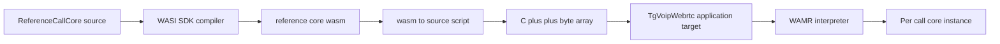
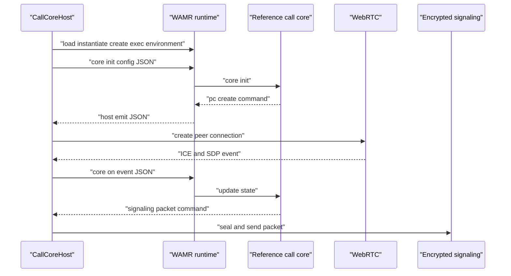
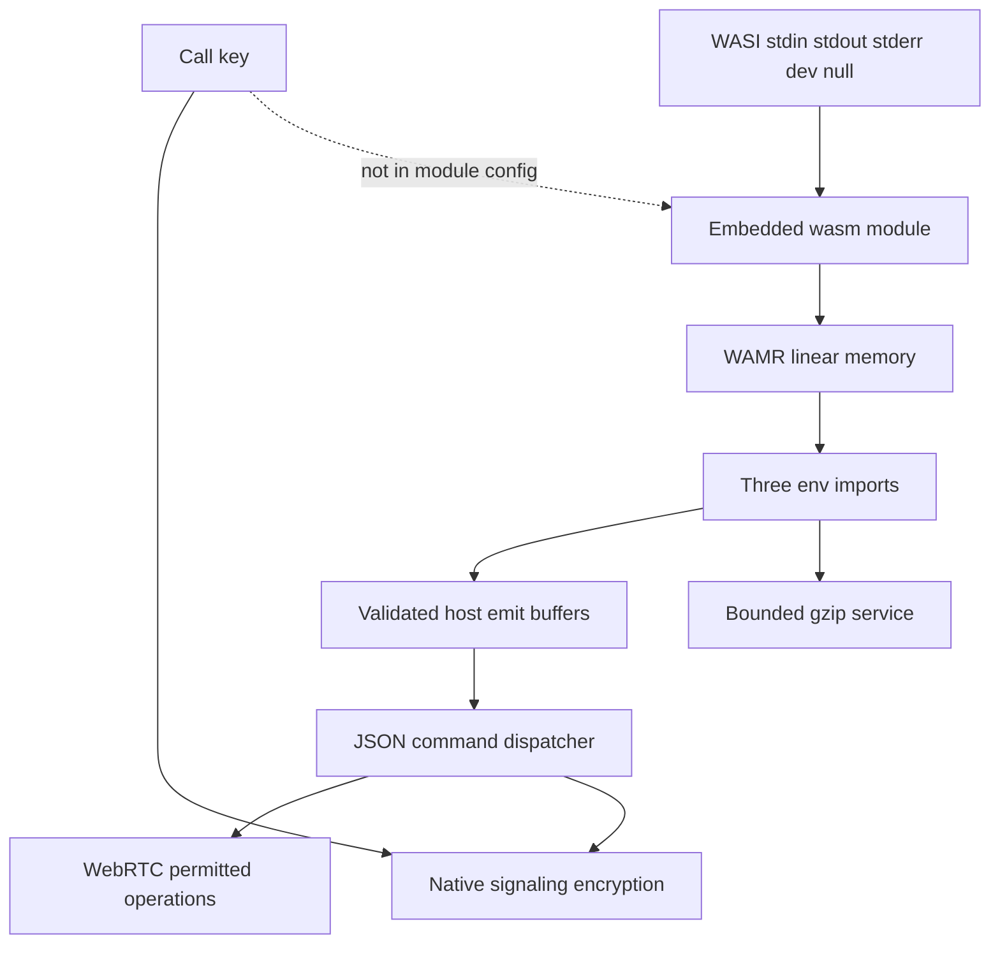
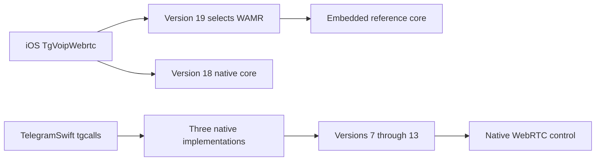

# 통화 모듈의 WebAssembly 런타임

웹: /docs/system/29-wamr-in-calls/ · Markdown: /docs/system/29-wamr-in-calls.md

> Telegram iOS 통화 코어가 wasm 모듈을 어떻게 만들고, 내장하고, WAMR로 실행하는지, 그리고 macOS 고정 버전이 왜 이 경로에 연결되지 않았는지 따라가요.

> 시스템 설계 · 통화 · 29장 · 도표 4 · 코드 발췌 10 · 인용 31 · 소스 기준선: [TelegramMessenger/Telegram-iOS@f1dd7a2d](https://github.com/TelegramMessenger/Telegram-iOS/tree/f1dd7a2dbd02cbbf513e75d5695d8d36d1cf5838), [overtake/TelegramSwift@579cebbf](https://github.com/overtake/TelegramSwift/tree/579cebbf0c01fd41b712eff3647fa7f69db9665d)
>
> 핵심 소스 파일: [TelegramMessenger/Telegram-iOS/submodules/TgVoipWebrtc/BUILD](https://github.com/TelegramMessenger/Telegram-iOS/blob/f1dd7a2dbd02cbbf513e75d5695d8d36d1cf5838/submodules/TgVoipWebrtc/BUILD), [TelegramMessenger/Telegram-iOS/submodules/TgVoipWebrtc/tools/wasm_to_source.py](https://github.com/TelegramMessenger/Telegram-iOS/blob/f1dd7a2dbd02cbbf513e75d5695d8d36d1cf5838/submodules/TgVoipWebrtc/tools/wasm_to_source.py), [TelegramMessenger/Telegram-iOS/third-party/wamr/BUILD](https://github.com/TelegramMessenger/Telegram-iOS/blob/f1dd7a2dbd02cbbf513e75d5695d8d36d1cf5838/third-party/wamr/BUILD), [TelegramMessenger/Telegram-iOS/third-party/wamr/core/version.h](https://github.com/TelegramMessenger/Telegram-iOS/blob/f1dd7a2dbd02cbbf513e75d5695d8d36d1cf5838/third-party/wamr/core/version.h), [TelegramMessenger/tgcalls/tgcalls/v2wasm/WamrCoreBackend.h](https://github.com/TelegramMessenger/tgcalls/blob/a024eaabf13c189d9577a14fb244bd242825ac96/tgcalls/v2wasm/WamrCoreBackend.h), [TelegramMessenger/tgcalls/tgcalls/v2wasm/WamrCoreBackend.cpp](https://github.com/TelegramMessenger/tgcalls/blob/a024eaabf13c189d9577a14fb244bd242825ac96/tgcalls/v2wasm/WamrCoreBackend.cpp), [TelegramMessenger/tgcalls/tgcalls/v2wasm/CallCoreABI.h](https://github.com/TelegramMessenger/tgcalls/blob/a024eaabf13c189d9577a14fb244bd242825ac96/tgcalls/v2wasm/CallCoreABI.h), [TelegramMessenger/tgcalls/tgcalls/v2wasm/CallCoreHost.cpp](https://github.com/TelegramMessenger/tgcalls/blob/a024eaabf13c189d9577a14fb244bd242825ac96/tgcalls/v2wasm/CallCoreHost.cpp), [TelegramMessenger/tgcalls/tgcalls/v2wasm/wasm_module_entry.cpp](https://github.com/TelegramMessenger/tgcalls/blob/a024eaabf13c189d9577a14fb244bd242825ac96/tgcalls/v2wasm/wasm_module_entry.cpp), [TelegramMessenger/tgcalls/tgcalls/v2wasm/ReferenceCallCore.cpp](https://github.com/TelegramMessenger/tgcalls/blob/a024eaabf13c189d9577a14fb244bd242825ac96/tgcalls/v2wasm/ReferenceCallCore.cpp), [overtake/tgcalls/Package.swift](https://github.com/overtake/tgcalls/blob/5ddc3ccf2086127722a06e3d836698fcd717f11b/Package.swift), [overtake/tgcalls/macos/Sources/OngoingCallThreadLocalContext.mm](https://github.com/overtake/tgcalls/blob/5ddc3ccf2086127722a06e3d836698fcd717f11b/macos/Sources/OngoingCallThreadLocalContext.mm), [overtake/tgcalls/tgcalls/v2/InstanceV2Impl.cpp](https://github.com/overtake/tgcalls/blob/5ddc3ccf2086127722a06e3d836698fcd717f11b/tgcalls/v2/InstanceV2Impl.cpp)
>
> 미검증 사항:
> - 서버가 어떤 조건에서 iOS 세션에 19.0.0을 협상하는지, 그리고 실제 적용 비율이 얼마인지.
> - wasm 모듈이 선언하는 초기 페이지 수, 최대 페이지 수, memory grow 허용의 실제 동작. 현재 호출은 max_memory_pages를 설정하지 않아요.
> - 미디어 스레드에서 wasm 계산이 오래 걸릴 때 WebRTC나 상위 계층에 별도의 watchdog, 취소, 크래시 복구 메커니즘이 있는지.
> - variant-core-abi1.wasm을 CI, 개발 도구, 실험 환경에서 실제로 호출하는 주체와 테스트 커버리지 범위.
> - TelegramSwift의 이후 커밋이 v2wasm 디렉터리와 WAMR을 포함한 tgcalls 버전으로 올라갈지.

## 결론과 범위 [#결론과-범위]

`third-party/wamr`(WebAssembly 런타임 WAMR)는 미디어를 재생하는 범용 스크립트 엔진이 아니에요. iOS의 `TgVoipWebrtc`는 이것을 일대일 통화의 제어 코어에 연결해요. 고정된 네이티브 호스트가 WebRTC, 오디오 장치, 암호화 키, 네트워크 연결을 계속 가지고 있어요. WAMR은 ABI v1의 통화 제어 모듈 하나만 실행해요. 이 모듈이 JSON 명령을 내보내면, 호스트가 허용된 명령을 실행해요. [\[4\]](https://github.com/TelegramMessenger/Telegram-iOS/blob/f1dd7a2dbd02cbbf513e75d5695d8d36d1cf5838/submodules/TgVoipWebrtc/BUILD#L239-L305) [\[11\]](https://github.com/TelegramMessenger/tgcalls/blob/a024eaabf13c189d9577a14fb244bd242825ac96/tgcalls/v2wasm/CallCoreABI.h#L7-L42) [\[12\]](https://github.com/TelegramMessenger/tgcalls/blob/a024eaabf13c189d9577a14fb244bd242825ac96/tgcalls/v2wasm/CallCoreABI.h#L108-L208)

소스로 확인한 내용은 이래요.

- 정식 iOS 타깃은 `ReferenceCallCore`를 `reference-core-abi1.wasm`으로 컴파일하고, 이를 C++ 바이트 배열로 바꿔서 앱 바이너리에 링크해요.
- 런타임은 협상된 버전이 `19.0.0`일 때만 이 내장 바이트 배열에서 WAMR 인스턴스를 만들어요.
- 버전 `18.0.0`은 같은 제어 소스의 네이티브 백엔드를 써요.

이렇게 하면 두 경로를 같은 호스트와 프로토콜 경계에서 비교해서 실행 기반의 차이를 볼 수 있어요. [\[1\]](https://github.com/TelegramMessenger/Telegram-iOS/blob/f1dd7a2dbd02cbbf513e75d5695d8d36d1cf5838/submodules/TgVoipWebrtc/BUILD#L25-L87) [\[2\]](https://github.com/TelegramMessenger/Telegram-iOS/blob/f1dd7a2dbd02cbbf513e75d5695d8d36d1cf5838/submodules/TgVoipWebrtc/BUILD#L115-L127) [\[14\]](https://github.com/TelegramMessenger/tgcalls/blob/a024eaabf13c189d9577a14fb244bd242825ac96/tgcalls/v2wasm/CallCoreHost.cpp#L305-L321) [\[16\]](https://github.com/TelegramMessenger/tgcalls/blob/a024eaabf13c189d9577a14fb244bd242825ac96/tgcalls/v2wasm/InstanceV2PumpImpl.cpp#L95-L108)

소스로 확인한 내용이 하나 더 있어요. iOS의 WAMR은 2.4.5 정적 라이브러리예요. 빠른 인터프리터를 켜고 AOT(미리 기계어로 컴파일), JIT(실행 중 컴파일), 빠른 JIT, 스레드 관리를 꺼요. 이 글에서 본 빌드에는 AOT 파일이 없고, 런타임에 기계어를 컴파일하는 경로도 없어요. [\[5\]](https://github.com/TelegramMessenger/Telegram-iOS/blob/f1dd7a2dbd02cbbf513e75d5695d8d36d1cf5838/third-party/wamr/BUILD#L1-L77) [\[6\]](https://github.com/TelegramMessenger/Telegram-iOS/blob/f1dd7a2dbd02cbbf513e75d5695d8d36d1cf5838/third-party/wamr/core/version.h#L1-L24)

정식 앱은 파일 시스템이나 서버에서 새 wasm 모듈을 불러올 수 없어요. 개발용 명령줄 타깃만 `TGCALLS_ALLOW_EXTERNAL_WASM_CORE`를 정의하고 `customParameters` 안의 로컬 모듈 경로를 받아요. 코드에는 이 키가 배포된 앱에 들어가면 원격 코드 실행 표면이 된다고 분명히 적혀 있어요. 그래서 `objc_library`에는 이 매크로가 없어요. 소스에는 wasm 파일을 내려받는 네트워크 요청이 보이지 않아요. [\[4\]](https://github.com/TelegramMessenger/Telegram-iOS/blob/f1dd7a2dbd02cbbf513e75d5695d8d36d1cf5838/submodules/TgVoipWebrtc/BUILD#L239-L305) [\[15\]](https://github.com/TelegramMessenger/tgcalls/blob/a024eaabf13c189d9577a14fb244bd242825ac96/tgcalls/v2wasm/CallCoreHost.cpp#L623-L695) [\[30\]](https://github.com/TelegramMessenger/Telegram-iOS/blob/f1dd7a2dbd02cbbf513e75d5695d8d36d1cf5838/submodules/TgVoipWebrtc/BUILD#L440-L510)

이 장은 기존의 [통화 시스템](/docs/system/13-calls/)을 보충해요. 기존 장은 전화 제어 면, 미디어 면, WebRTC 브리지를 설명해요. 이 장은 통화 제어 코어의 wasm 형태, 로딩 경계, 리소스 제약만 다뤄요. macOS 셸 계층의 시스템 적응은 [macOS 클라이언트의 시스템 계층](/docs/system/15-macos-system-layer/)를 참고하세요.

연구 대상은 `Telegram-iOS`의 고정 커밋 `f1dd7a2dbd02cbbf513e75d5695d8d36d1cf5838`과 그 `tgcalls` 서브모듈의 고정 커밋 `a024eaabf13c189d9577a14fb244bd242825ac96`이에요. macOS 대조 대상은 `TelegramSwift`의 `579cebbf0c01fd41b712eff3647fa7f69db9665d`와 그 `tgcalls` 서브모듈의 `5ddc3ccf2086127722a06e3d836698fcd717f11b`예요.

## 문제와 설계 경계 [#문제와-설계-경계]

실시간 통화의 미디어 스택은 커요. WebRTC의 스레드, PeerConnection, ICE(P2P 연결 경로 탐색), 오디오 장치, 비디오 트랙, 암호화 시그널링이 모두 들어 있어요. 제어 정책을 실험하려고 네이티브 라이브러리 전체를 교체하면 비교 결과에 컴파일러, 기기, 미디어 스택의 차이가 섞여 들어와요. 이 구현은 자주 바뀌는 협상과 제어 정책을 작은 ABI로 줄이고, 안정적인 호스트가 미디어 리소스의 소유권을 유지하게 해요. 이건 파일 구조와 버전 선택에서 확인할 수 있는 계층 분리예요. 통화 전체를 wasm으로 옮긴 게 아니에요. [\[11\]](https://github.com/TelegramMessenger/tgcalls/blob/a024eaabf13c189d9577a14fb244bd242825ac96/tgcalls/v2wasm/CallCoreABI.h#L7-L42) [\[14\]](https://github.com/TelegramMessenger/tgcalls/blob/a024eaabf13c189d9577a14fb244bd242825ac96/tgcalls/v2wasm/CallCoreHost.cpp#L305-L321) [\[15\]](https://github.com/TelegramMessenger/tgcalls/blob/a024eaabf13c189d9577a14fb244bd242825ac96/tgcalls/v2wasm/CallCoreHost.cpp#L623-L695)

ABI 문서는 고정 호스트와 교체 가능한 코어가 각각 맡을 책임을 정해 놔요. 코어에는 이런 제약이 있어요.

- 코어는 미디어 스레드에서만 이벤트를 받을 수 있어요.
- 스레드를 만들 수 없고 타이머를 직접 설정할 수도 없어요. 코어는 `set_timer` 명령을 내보내야 하고, 호스트가 시간과 지연 콜백을 제공해요.
- 호스트에 재진입(실행 도중 같은 코드로 다시 들어오는 호출)할 수도 없어요. 호스트는 `create` 또는 `onEvent`가 한 번 반환된 뒤에야 코어가 내보낸 명령을 하나씩 실행해요. [\[11\]](https://github.com/TelegramMessenger/tgcalls/blob/a024eaabf13c189d9577a14fb244bd242825ac96/tgcalls/v2wasm/CallCoreABI.h#L7-L42)

설정에는 발신 방향, P2P 스위치, 초기 비디오 상태, 서버 목록, 사용자 정의 매개변수가 있어요. ABI 주석은 설정에 키 재료를 넣는 것을 명시적으로 금지해요. 시그널링 평문도 호스트가 복호화를 마친 뒤에야 이벤트 형태로 코어에 전달돼요. 돌아가는 시그널링은 다시 호스트를 거쳐 암호화해야 해요. 이 두 방향 덕분에 제어 정책과 통화 키가 서로 분리돼요. [\[11\]](https://github.com/TelegramMessenger/tgcalls/blob/a024eaabf13c189d9577a14fb244bd242825ac96/tgcalls/v2wasm/CallCoreABI.h#L7-L42) [\[18\]](https://github.com/TelegramMessenger/tgcalls/blob/a024eaabf13c189d9577a14fb244bd242825ac96/tgcalls/v2wasm/CallCoreHost.cpp#L1480-L1530)



도표의 `reference core wasm`은 Bazel 빌드 산출물이에요. 저장소에 미리 들어 있는 이진 리소스가 아니에요. 이후의 C++ 배열이 정식 앱 런타임이 읽는 내장 리소스예요. [\[1\]](https://github.com/TelegramMessenger/Telegram-iOS/blob/f1dd7a2dbd02cbbf513e75d5695d8d36d1cf5838/submodules/TgVoipWebrtc/BUILD#L25-L87) [\[2\]](https://github.com/TelegramMessenger/Telegram-iOS/blob/f1dd7a2dbd02cbbf513e75d5695d8d36d1cf5838/submodules/TgVoipWebrtc/BUILD#L115-L127) [\[3\]](https://github.com/TelegramMessenger/Telegram-iOS/blob/f1dd7a2dbd02cbbf513e75d5695d8d36d1cf5838/submodules/TgVoipWebrtc/tools/wasm_to_source.py#L1-L45)

## 모듈 생성, 의존성 연결, 버전 선택 [#모듈-생성-의존성-연결-버전-선택]

### 생성되는 것은 WASI reactor 모듈 [#생성되는-것은-wasi-reactor-모듈]

`BUILD`는 참조 코어, 시그널링 프레임, gzip 래퍼, 진입 파일, JSON 라이브러리를 WASI(wasm용 시스템 인터페이스) SDK의 `clang++`에 넘겨요. 타깃 트리플은 `wasm32-wasip1`이에요. 옵션은 이래요.

- `-mexec-model=reactor`
- `--no-entry`
- `-Oz`
- LTO(링크 시점 최적화)
- 예외와 RTTI 비활성화

소스 주석은 이 모듈을 오디오·비디오 데이터 면이 아니라 약 10 Hz, KB 수준 페이로드의 제어 면으로 설명해요. [\[1\]](https://github.com/TelegramMessenger/Telegram-iOS/blob/f1dd7a2dbd02cbbf513e75d5695d8d36d1cf5838/submodules/TgVoipWebrtc/BUILD#L25-L87)

```python
_WASM_CORE_CMD = """
set -e
SDK_CLANG="$(execpath {sdk}//:bin/clang++)"
SDK_DIR="$$(cd "$$(dirname "$$SDK_CLANG")/.." && pwd)"
"$$SDK_CLANG" --target=wasm32-wasip1 --sysroot="$$SDK_DIR/share/wasi-sysroot" \\
    -std=c++17 -Oz -flto -fno-exceptions -fno-rtti \\
    -mexec-model=reactor -Wl,--no-entry,--strip-all \\
    -Isubmodules/TgVoipWebrtc/tgcalls/tgcalls \\
    submodules/TgVoipWebrtc/tgcalls/tgcalls/v2wasm/ReferenceCallCore.cpp \\
    submodules/TgVoipWebrtc/tgcalls/tgcalls/v2wasm/SignalingFraming.cpp \\
    submodules/TgVoipWebrtc/tgcalls/tgcalls/v2wasm/CoreGzip.cpp \\
    submodules/TgVoipWebrtc/tgcalls/tgcalls/v2wasm/wasm_module_entry.cpp \\
    submodules/TgVoipWebrtc/tgcalls/tgcalls/third-party/json11.cpp \\
{extra_srcs}    -o $@
"""
```
[\[1\]](https://github.com/TelegramMessenger/Telegram-iOS/blob/f1dd7a2dbd02cbbf513e75d5695d8d36d1cf5838/submodules/TgVoipWebrtc/BUILD#L25-L87)

여기의 `--strip-all`은 wasm name section을 지워요. 소스에는 이렇게 하면 모듈이 크게 줄지만 WAMR trap 역추적에는 함수 인덱스만 보인다고 적혀 있어요. `-Oz`와 LTO를 고른 걸 보면 구현이 패키지 크기를 우선했다는 걸 알 수 있어요. 제어 면을 인터프리터에 넣어서 늘어나는 CPU 비용은 낮은 빈도와 작은 메시지 예산으로 상쇄돼요. 이건 소스 주석이 내세운 성능 전제예요. 실제 기기에서 걸리는 시간을 측정한 게 아니에요. [\[1\]](https://github.com/TelegramMessenger/Telegram-iOS/blob/f1dd7a2dbd02cbbf513e75d5695d8d36d1cf5838/submodules/TgVoipWebrtc/BUILD#L25-L87)

Bazel은 Linux와 macOS 호스트 빌드에 각각 `wasi_sdk_linux`와 `wasi_sdk_macos`를 골라요. 이건 빌드 머신의 SDK에만 영향을 줘요. 산출물은 여전히 `wasm32-wasip1` 모듈이고, macOS Telegram 클라이언트에서 실행된다는 뜻은 아니에요. [\[1\]](https://github.com/TelegramMessenger/Telegram-iOS/blob/f1dd7a2dbd02cbbf513e75d5695d8d36d1cf5838/submodules/TgVoipWebrtc/BUILD#L25-L87)

### 동적 리소스가 아니라 내장한 참조 모듈 [#동적-리소스가-아니라-내장한-참조-모듈]

`reference_core_embedded_src`는 먼저 `reference_core_wasm`에 의존한 뒤 `wasm_to_source.py`를 호출해요. 스크립트는 wasm의 8바이트 매직과 버전 헤더를 검사한 뒤 `kReferenceCoreWasm` 배열과 그 길이를 만들어요. `TgVoipWebrtc` 네이티브 타깃은 이렇게 만든 C++ 파일을 소스 목록에 추가해요. [\[2\]](https://github.com/TelegramMessenger/Telegram-iOS/blob/f1dd7a2dbd02cbbf513e75d5695d8d36d1cf5838/submodules/TgVoipWebrtc/BUILD#L115-L127) [\[3\]](https://github.com/TelegramMessenger/Telegram-iOS/blob/f1dd7a2dbd02cbbf513e75d5695d8d36d1cf5838/submodules/TgVoipWebrtc/tools/wasm_to_source.py#L1-L45) [\[4\]](https://github.com/TelegramMessenger/Telegram-iOS/blob/f1dd7a2dbd02cbbf513e75d5695d8d36d1cf5838/submodules/TgVoipWebrtc/BUILD#L239-L305)

```python
# Converts the reference module into a C++ byte array so it ships inside the
# binary. Production builds have no filesystem loader (see
# TGCALLS_ALLOW_EXTERNAL_WASM_CORE), so this is the only module they can run.
genrule(
    name = "reference_core_embedded_src",
    srcs = [
        ":reference_core_wasm",
        "tools/wasm_to_source.py",
    ],
    outs = ["ReferenceCoreEmbedded.cpp"],
    cmd = "python3 $(location tools/wasm_to_source.py) $(location :reference_core_wasm) $@",
    visibility = ["//visibility:public"],
)
```
[\[2\]](https://github.com/TelegramMessenger/Telegram-iOS/blob/f1dd7a2dbd02cbbf513e75d5695d8d36d1cf5838/submodules/TgVoipWebrtc/BUILD#L115-L127)

그래서 모듈의 출처는 세 가지로 나뉘어요.

- 정식 앱: 출처는 컴파일 산출물이고, 이진 내장 배열로 나타나요.
- `variant-core-abi1.wasm`: 빌드할 수 있는 산출물이지만 정식 앱의 내장 규칙에는 선택되지 않았어요.
- 서버가 내려보낸 모듈: 소스로 확인되지 않았어요.

서버 매개변수와 이어진 외부 경로는 딱 하나예요. 개발 CLI가 `customParameters`에서 파일 경로를 얻어 로컬에서 그 파일을 읽는 경로예요. [\[1\]](https://github.com/TelegramMessenger/Telegram-iOS/blob/f1dd7a2dbd02cbbf513e75d5695d8d36d1cf5838/submodules/TgVoipWebrtc/BUILD#L25-L87) [\[2\]](https://github.com/TelegramMessenger/Telegram-iOS/blob/f1dd7a2dbd02cbbf513e75d5695d8d36d1cf5838/submodules/TgVoipWebrtc/BUILD#L115-L127) [\[15\]](https://github.com/TelegramMessenger/tgcalls/blob/a024eaabf13c189d9577a14fb244bd242825ac96/tgcalls/v2wasm/CallCoreHost.cpp#L623-L695) [\[30\]](https://github.com/TelegramMessenger/Telegram-iOS/blob/f1dd7a2dbd02cbbf513e75d5695d8d36d1cf5838/submodules/TgVoipWebrtc/BUILD#L440-L510) [\[31\]](https://github.com/TelegramMessenger/Telegram-iOS/blob/f1dd7a2dbd02cbbf513e75d5695d8d36d1cf5838/submodules/TgVoipWebrtc/BUILD#L89-L113)

`variant_core_wasm`을 정식 점진 배포 모듈로 오해하면 안 돼요. 이 모듈의 팩토리는 `VariantCallCore`를 구성해요. 이 코어는 SDP(미디어 세션 설명 형식) 매개변수 재작성, 데이터 채널 ping pong, 속도 상한, 주기적 ICE 재시작을 실제로 시연해요. 하지만 정식 `objc_library`는 참조 모듈만 내장해요. variant 빌드 규칙은 CLI나 테스트에서 쓸 수 있을 뿐, 정식 iOS 런타임이 로드하도록 허용한 두 번째 모듈이 아니에요. [\[2\]](https://github.com/TelegramMessenger/Telegram-iOS/blob/f1dd7a2dbd02cbbf513e75d5695d8d36d1cf5838/submodules/TgVoipWebrtc/BUILD#L115-L127) [\[4\]](https://github.com/TelegramMessenger/Telegram-iOS/blob/f1dd7a2dbd02cbbf513e75d5695d8d36d1cf5838/submodules/TgVoipWebrtc/BUILD#L239-L305) [\[31\]](https://github.com/TelegramMessenger/Telegram-iOS/blob/f1dd7a2dbd02cbbf513e75d5695d8d36d1cf5838/submodules/TgVoipWebrtc/BUILD#L89-L113)

### `TgVoipWebrtc`가 WAMR에 의존하는 이유 [#tgvoipwebrtc가-wamr에-의존하는-이유]

`TgVoipWebrtc`의 소스 목록에는 `ReferenceCallCore.cpp`, 네이티브 백엔드, WAMR 백엔드, 생성된 내장 배열이 함께 있어요. 의존성 목록에는 `//third-party/wamr:wamr`이 명시되어 있어요. 이걸 보면 WAMR은 쓰이지 않는 서드파티 디렉터리가 아니라, `WamrCoreBackend.cpp`를 컴파일하는 데 필요한 링크 의존성이에요. [\[4\]](https://github.com/TelegramMessenger/Telegram-iOS/blob/f1dd7a2dbd02cbbf513e75d5695d8d36d1cf5838/submodules/TgVoipWebrtc/BUILD#L239-L305)

버전 선택은 `customParameters`에서 오지 않아요. `versionUsesWasmCore`는 버전 문자열이 정확히 `19.0.0`일 때만 참을 돌려줘요. 알 수 없는 버전과 `18.0.0`은 모두 네이티브 백엔드로 가요. `InstanceV2PumpImpl`은 `18.0.0`과 `19.0.0`을 함께 공표하고, 둘의 차이는 호스트가 고르는 백엔드라고 설명해요. [\[14\]](https://github.com/TelegramMessenger/tgcalls/blob/a024eaabf13c189d9577a14fb244bd242825ac96/tgcalls/v2wasm/CallCoreHost.cpp#L305-L321) [\[15\]](https://github.com/TelegramMessenger/tgcalls/blob/a024eaabf13c189d9577a14fb244bd242825ac96/tgcalls/v2wasm/CallCoreHost.cpp#L623-L695) [\[16\]](https://github.com/TelegramMessenger/tgcalls/blob/a024eaabf13c189d9577a14fb244bd242825ac96/tgcalls/v2wasm/InstanceV2PumpImpl.cpp#L95-L108)

```cpp
// Substrate is intrinsic to the negotiated version string, never taken from
// configuration: 18.0.0 runs the core natively, 19.0.0 runs the same source
// as the embedded wasm module. An unrecognized version falls back to native,
// mirroring stock's unknown-version -> V2 defaulting
// (v2/InstanceV2ReferenceImpl.cpp:79).
bool versionUsesWasmCore(std::string const &version) {
    return version == "19.0.0";
}
```
[\[14\]](https://github.com/TelegramMessenger/tgcalls/blob/a024eaabf13c189d9577a14fb244bd242825ac96/tgcalls/v2wasm/CallCoreHost.cpp#L305-L321)

이게 WAMR에 의존하는 직접적인 이유예요. `19.0.0`은 같은 제어 코어를 wasm ABI와 인터프리터로 실행해요. `18.0.0`은 `NativeCoreBackend`로 같은 C ABI를 직접 호출해요. 추론하면, 이렇게 짝이 되는 버전을 두면 서버 협상 결과를 실행 기반의 선택자로 삼으면서 WebRTC와 장치 계층은 그대로 둘 수 있어요. 소스에서는 서버가 실제로 몇 개의 세션에 `19.0.0`을 협상하는지 알 수 없어요. 그래서 배포 비율로 쓸 수 없어요. [\[14\]](https://github.com/TelegramMessenger/tgcalls/blob/a024eaabf13c189d9577a14fb244bd242825ac96/tgcalls/v2wasm/CallCoreHost.cpp#L305-L321) [\[16\]](https://github.com/TelegramMessenger/tgcalls/blob/a024eaabf13c189d9577a14fb244bd242825ac96/tgcalls/v2wasm/InstanceV2PumpImpl.cpp#L95-L108)

## 런타임, ABI, 제어 로직 [#런타임-abi-제어-로직]

### WAMR의 컴파일 형태 [#wamr의-컴파일-형태]

WAMR `BUILD`는 스스로를 interpreter only configuration이라고 불러요.

- 켜는 것: `WASM_ENABLE_INTERP=1`, `WASM_ENABLE_FAST_INTERP=1`, WASI libc, reference types, bulk memory
- 모두 0인 것: AOT, JIT, fast JIT, SIMD, 공유 메모리, 다중 모듈, 스레드 관리 [\[5\]](https://github.com/TelegramMessenger/Telegram-iOS/blob/f1dd7a2dbd02cbbf513e75d5695d8d36d1cf5838/third-party/wamr/BUILD#L1-L77)

```python
"-DWASM_ENABLE_INTERP=1",
"-DWASM_ENABLE_FAST_INTERP=1",
"-DWASM_ENABLE_LIBC_WASI=1",
"-DWASM_ENABLE_LIBC_BUILTIN=0",
"-DWASM_ENABLE_MINI_LOADER=0",
"-DWASM_ENABLE_AOT=0",
"-DWASM_ENABLE_JIT=0",
"-DWASM_ENABLE_FAST_JIT=0",
"-DWASM_ENABLE_SIMD=0",
"-DWASM_ENABLE_REF_TYPES=1",
"-DWASM_ENABLE_BULK_MEMORY=1",
"-DWASM_ENABLE_SHARED_MEMORY=0",
"-DWASM_ENABLE_THREAD_MGR=0",
"-DWASM_ENABLE_MULTI_MODULE=0",
"-DWASM_ENABLE_MODULE_INST_CONTEXT=1",
"-DWASM_DISABLE_HW_BOUND_CHECK=1",
"-DWASM_DISABLE_STACK_HW_BOUND_CHECK=1",
```
[\[5\]](https://github.com/TelegramMessenger/Telegram-iOS/blob/f1dd7a2dbd02cbbf513e75d5695d8d36d1cf5838/third-party/wamr/BUILD#L1-L77)

WAMR의 정적 타깃에는 빠른 인터프리터, loader, runtime, WASI libc, 공용 메모리 코드만 나열되어 있어요. `aot` 런타임, 컴파일러, JIT 소스 파일은 `srcs`에 넣지 않았어요. 그래서 “AOT와 JIT를 지원한다”는 말은 이 빌드에는 맞지 않아요. `FAST_INTERP`는 인터프리터 최적화이고 JIT가 아니에요. [\[5\]](https://github.com/TelegramMessenger/Telegram-iOS/blob/f1dd7a2dbd02cbbf513e75d5695d8d36d1cf5838/third-party/wamr/BUILD#L1-L77)

`WASM_DISABLE_HW_BOUND_CHECK=1`과 `WASM_ENABLE_THREAD_MGR=0`에는 플랫폼 차원의 목적도 있어요. 빌드 주석에 따르면 이 설정은 시그널 처리 경로 두 곳에 도달하지 못하게 만들어서, iOS 앱 프로세스가 시그널 핸들러를 설치하지 않게 해요. 이 선택이 wasm 주소 검사를 끈다는 뜻은 아니에요. 모듈이 네이티브 import에 넘기는 주소 범위는 여전히 WAMR의 native symbol 시그니처와 명시적 검증이 지켜 줘요. [\[5\]](https://github.com/TelegramMessenger/Telegram-iOS/blob/f1dd7a2dbd02cbbf513e75d5695d8d36d1cf5838/third-party/wamr/BUILD#L1-L77) [\[8\]](https://github.com/TelegramMessenger/tgcalls/blob/a024eaabf13c189d9577a14fb244bd242825ac96/tgcalls/v2wasm/WamrCoreBackend.cpp#L16-L60) [\[10\]](https://github.com/TelegramMessenger/tgcalls/blob/a024eaabf13c189d9577a14fb244bd242825ac96/tgcalls/v2wasm/WamrCoreBackend.cpp#L183-L220)

### 통화마다 인스턴스 하나 [#통화마다-인스턴스-하나]

`WamrCoreBackend`는 런타임 초기화를 함수 안의 정적 값에 두기 때문에, 프로세스가 `wasm_runtime_full_init`을 한 번만 공유해요. 반면 각 백엔드 객체는 module, module instance, exec env, 네 개의 export 함수를 각자 가져요. 헤더 파일에는 통화 하나에 모듈 인스턴스 하나이고 모든 호출이 미디어 스레드에서 일어난다고 분명히 적혀 있어요. [\[7\]](https://github.com/TelegramMessenger/tgcalls/blob/a024eaabf13c189d9577a14fb244bd242825ac96/tgcalls/v2wasm/WamrCoreBackend.h#L12-L59) [\[8\]](https://github.com/TelegramMessenger/tgcalls/blob/a024eaabf13c189d9577a14fb244bd242825ac96/tgcalls/v2wasm/WamrCoreBackend.cpp#L16-L60)

초기화할 때 모듈에 `env` import 세 개만 등록해요.

- `host_emit`
- `host_deflate`
- `host_inflate`

시그니처의 별표와 물결표 덕분에 WAMR이 wasm 선형 메모리 주소를 네이티브 포인터로 바꾸기 전에 포인터 길이 범위를 검사해요. 호스트 압축 서비스는 상태 없는 gzip 구현이고, `outCap`이 압축 해제 상한도 겸하기 때문에 압축 해제로 데이터가 부풀어 오르는 것을 제한할 수 있어요. [\[8\]](https://github.com/TelegramMessenger/tgcalls/blob/a024eaabf13c189d9577a14fb244bd242825ac96/tgcalls/v2wasm/WamrCoreBackend.cpp#L16-L60) [\[22\]](https://github.com/TelegramMessenger/tgcalls/blob/a024eaabf13c189d9577a14fb244bd242825ac96/tgcalls/v2wasm/HostCompressionService.cpp#L1-L44)

```cpp
static NativeSymbol nativeSymbols[] = {
    { "host_emit", (void *)WamrCoreBackend::hostEmitNative, "(*~)", nullptr },
    { "host_deflate", (void *)WamrCoreBackend::hostDeflateNative, "(*~*~)i", nullptr },
    { "host_inflate", (void *)WamrCoreBackend::hostInflateNative, "(*~*~)i", nullptr },
};
initArgs.native_module_name = "env";
initArgs.native_symbols = nativeSymbols;
initArgs.n_native_symbols = 3;

return wasm_runtime_full_init(&initArgs);
```
[\[8\]](https://github.com/TelegramMessenger/tgcalls/blob/a024eaabf13c189d9577a14fb244bd242825ac96/tgcalls/v2wasm/WamrCoreBackend.cpp#L16-L60)

### 데이터 소유권과 호출 생명주기 [#데이터-소유권과-호출-생명주기]

수신 이벤트 하나는 분명한 경계 변환을 네 번 거쳐요.

1. 호스트가 이벤트 JSON을 직렬화해요.
2. 백엔드가 모듈이 export한 `rt_alloc`으로 선형 메모리 오프셋을 얻어요.
3. 오프셋과 길이를 검증하고, JSON 바이트를 복사하고, `core_on_event`를 호출해요.
4. 마지막으로 `rt_free`를 호출해요.

코어가 콜백이 끝난 뒤에도 입력을 보관하려면 직접 복사해야 해요. 그래서 호스트는 자기 문자열이나 WebRTC 콜백 객체를 모듈에 빌려줘서 오래 쥐게 하는 일이 없어요. [\[10\]](https://github.com/TelegramMessenger/tgcalls/blob/a024eaabf13c189d9577a14fb244bd242825ac96/tgcalls/v2wasm/WamrCoreBackend.cpp#L183-L220) [\[11\]](https://github.com/TelegramMessenger/tgcalls/blob/a024eaabf13c189d9577a14fb244bd242825ac96/tgcalls/v2wasm/CallCoreABI.h#L7-L42)

반대 방향의 데이터도 wasm 메모리를 빌려 쓰지 않아요.

1. 모듈이 `host_emit`을 호출하면 WAMR이 먼저 내보내는 범위를 검증해요.
2. 백엔드가 호스트 클로저를 호출해요.
3. 호스트는 바로 바이트를 JSON object로 파싱해서 실행 대기 큐로 옮겨요.

코어 함수가 반환된 뒤 모듈은 선형 메모리를 다시 쓸 수 있지만, 큐는 이미 독립된 C++ JSON 값을 갖고 있어요. 이 순서 덕분에 모듈 메모리의 짧은 생명주기가 WebRTC 비동기 콜백과 분리돼요. [\[8\]](https://github.com/TelegramMessenger/tgcalls/blob/a024eaabf13c189d9577a14fb244bd242825ac96/tgcalls/v2wasm/WamrCoreBackend.cpp#L16-L60) [\[15\]](https://github.com/TelegramMessenger/tgcalls/blob/a024eaabf13c189d9577a14fb244bd242825ac96/tgcalls/v2wasm/CallCoreHost.cpp#L623-L695) [\[17\]](https://github.com/TelegramMessenger/tgcalls/blob/a024eaabf13c189d9577a14fb244bd242825ac96/tgcalls/v2wasm/CallCoreHost.cpp#L710-L885)

`globalCore`는 모듈 instance 안에 있는 단일 전역 객체예요. 프로세스 전체에 통화 코어가 하나뿐이라는 뜻이 아니에요. 각 `WamrCoreBackend`는 내장 바이트 한 부로 `wasm_runtime_load`와 `wasm_runtime_instantiate`를 호출해요. 그래서 동시 통화는 서로 다른 module instance, 선형 메모리, `globalCore`, 사용자 정의 호스트 데이터 포인터를 가져요. 프로세스가 공유하는 건 초기화된 WAMR runtime과 링크된 코드뿐이에요. [\[7\]](https://github.com/TelegramMessenger/tgcalls/blob/a024eaabf13c189d9577a14fb244bd242825ac96/tgcalls/v2wasm/WamrCoreBackend.h#L12-L59) [\[9\]](https://github.com/TelegramMessenger/tgcalls/blob/a024eaabf13c189d9577a14fb244bd242825ac96/tgcalls/v2wasm/WamrCoreBackend.cpp#L114-L180) [\[13\]](https://github.com/TelegramMessenger/tgcalls/blob/a024eaabf13c189d9577a14fb244bd242825ac96/tgcalls/v2wasm/wasm_module_entry.cpp#L15-L59)

시간도 호스트가 가져요. `CallCoreHost`는 이벤트 JSON에 단조 `nowMs`를 넣어요. 참조 코어는 가장 최근의 값을 저장하고, 이 값으로 ICE 재시작 간격과 연결 실패 시간을 판단해요. 코어는 시스템 시계를 직접 읽지 않고 스레드나 타이머 핸들도 갖지 않아요. 코어가 `set_timer`를 내보내야 호스트가 미디어 스레드에 지연 작업을 걸어 두고, token과 generation을 이후 이벤트로 돌려보내요. [\[11\]](https://github.com/TelegramMessenger/tgcalls/blob/a024eaabf13c189d9577a14fb244bd242825ac96/tgcalls/v2wasm/CallCoreABI.h#L7-L42) [\[17\]](https://github.com/TelegramMessenger/tgcalls/blob/a024eaabf13c189d9577a14fb244bd242825ac96/tgcalls/v2wasm/CallCoreHost.cpp#L710-L885) [\[20\]](https://github.com/TelegramMessenger/tgcalls/blob/a024eaabf13c189d9577a14fb244bd242825ac96/tgcalls/v2wasm/ReferenceCallCore.cpp#L141-L305)

이 설계는 상태를 복구할 수 있는 범위를 한정해요. wasm 모듈 안에는 현재 협상 상태, 타이머 generation, 네트워크 상태 기록, 비트레이트 기록이 있어요. WebRTC의 candidate, 트랙, socket, 오디오 장치, 암호화 연결은 여전히 호스트에 남아요. 모듈이 파괴된 뒤에는 wasm이 이런 것들을 자동으로 다시 만들지 않아요. 반대로 통화가 완전히 끝날 때는 호스트가 PeerConnection을 닫고, 참조 코어는 통계 기록과 `close` 명령을 만드는 일만 맡아요. [\[17\]](https://github.com/TelegramMessenger/tgcalls/blob/a024eaabf13c189d9577a14fb244bd242825ac96/tgcalls/v2wasm/CallCoreHost.cpp#L710-L885) [\[21\]](https://github.com/TelegramMessenger/tgcalls/blob/a024eaabf13c189d9577a14fb244bd242825ac96/tgcalls/v2wasm/ReferenceCallCore.cpp#L411-L490)

모듈 진입점은 `rt_alloc`, `rt_free`, `core_init`, `core_on_event`만 export하고, `env.host_emit`을 import해요. `core_init`은 설정 JSON을 파싱해서 전역 코어 객체 하나를 만들어요. `core_on_event`는 JSON object만 받아서 이 객체에 넘겨요. wasm instance 하나가 통화 하나에 대응하기 때문에 모듈 안의 전역 `globalCore`는 통화끼리 공유되지 않아요. [\[13\]](https://github.com/TelegramMessenger/tgcalls/blob/a024eaabf13c189d9577a14fb244bd242825ac96/tgcalls/v2wasm/wasm_module_entry.cpp#L15-L59)

```cpp
__attribute__((export_name("core_init")))
void core_init(const uint8_t *configJson, size_t len) {
    std::string parsingError;
    const auto config = json11::Json::parse(std::string((const char *)configJson, len), parsingError);
    globalCore = tgcalls::v2wasm::createModuleCore(config, [](json11::Json::object &&command) {
        const std::string serialized = json11::Json(std::move(command)).dump();
        host_emit((const uint8_t *)serialized.data(), serialized.size());
    });
}

__attribute__((export_name("core_on_event")))
void core_on_event(const uint8_t *data, size_t len) {
    if (!globalCore || !data) {
        return;
    }
    std::string parsingError;
    const auto event = json11::Json::parse(std::string((const char *)data, len), parsingError);
    if (!event.is_object()) {
        return;
    }
    globalCore->onEvent(event);
}
```
[\[13\]](https://github.com/TelegramMessenger/tgcalls/blob/a024eaabf13c189d9577a14fb244bd242825ac96/tgcalls/v2wasm/wasm_module_entry.cpp#L15-L59)

### 설정, 이벤트, 명령 [#설정-이벤트-명령]

ABI의 페이로드는 모두 `@type`이 붙은 UTF 8 JSON object예요.

- 코어가 받는 이벤트
  - 복호화된 signaling packet
  - PeerConnection 상태
  - ICE candidate
  - 데이터 채널 메시지
  - 통계
  - 음소거
  - 비디오
  - 타이머
- 코어가 내보내는 명령
  - PeerConnection 생성과 설정
  - offer나 answer 생성
  - SDP 설정
  - candidate 추가
  - 트랙 생성
  - 데이터 채널 메시지 전송
  - 시그널링 전송
  - 타이머 설정
  - 상태 보고

코어는 WebRTC C++ 객체를 직접 얻지 못해요. [\[11\]](https://github.com/TelegramMessenger/tgcalls/blob/a024eaabf13c189d9577a14fb244bd242825ac96/tgcalls/v2wasm/CallCoreABI.h#L7-L42) [\[12\]](https://github.com/TelegramMessenger/tgcalls/blob/a024eaabf13c189d9577a14fb244bd242825ac96/tgcalls/v2wasm/CallCoreABI.h#L108-L208)

참조 코어는 초기화한 뒤 RTC server를 STUN 또는 TURN URL로 매핑하고, `pc_create`를 내보내고, 오디오 transceiver를 만들고, 필요하면 비디오 transceiver를 추가해요. 발신 측에서는 데이터 채널도 만들고 로컬 SDP 협상을 시작해요. 이 코드가 실행하는 건 협상과 정책 로직이에요. Opus 인코딩, RTP 송수신, 카메라 캡처는 아니에요. [\[19\]](https://github.com/TelegramMessenger/tgcalls/blob/a024eaabf13c189d9577a14fb244bd242825ac96/tgcalls/v2wasm/ReferenceCallCore.cpp#L29-L131)

```cpp
this->emit({ {"@type", "core_ready"}, {"abiVersion", kAbiVersion} });

// Policy: map RtcServers to ICE servers (stock start() lines 641–685).
json11::Json::array iceServers;
for (const auto &server : _rtcServers) {
    if (server["isTcp"].bool_value()) {
        continue;
    }
    // ...
}
this->emit({
    {"@type", "pc_create"},
    {"iceTransportsType", _enableP2P ? "all" : "relay"},
    {"iceServers", std::move(iceServers)},
});

if (_isOutgoing) {
    this->emit({ {"@type", "pc_create_data_channel"} });
}
```
[\[19\]](https://github.com/TelegramMessenger/tgcalls/blob/a024eaabf13c189d9577a14fb244bd242825ac96/tgcalls/v2wasm/ReferenceCallCore.cpp#L29-L131)

코어가 보는 `rtcServers`는 값으로 복사된 설정이에요. 코어는 P2P를 `all`로 둘지 후보를 `relay`로 제한할지, offer를 언제 만들지, ICE candidate를 어떻게 처리할지, 비디오 트랙을 언제 갱신할지를 정할 수 있어요. 네이티브 socket을 갖거나 만들 수는 없어요. 호스트가 명령을 받은 뒤에야 PeerConnection을 호출해요. 바꿔 말하면, 모듈은 정책을 정하고 호스트는 실행 대상과 시스템 리소스를 쥐고 있어요. [\[11\]](https://github.com/TelegramMessenger/tgcalls/blob/a024eaabf13c189d9577a14fb244bd242825ac96/tgcalls/v2wasm/CallCoreABI.h#L7-L42) [\[12\]](https://github.com/TelegramMessenger/tgcalls/blob/a024eaabf13c189d9577a14fb244bd242825ac96/tgcalls/v2wasm/CallCoreABI.h#L108-L208) [\[19\]](https://github.com/TelegramMessenger/tgcalls/blob/a024eaabf13c189d9577a14fb244bd242825ac96/tgcalls/v2wasm/ReferenceCallCore.cpp#L29-L131)

데이터 채널도 이 경계에 속해요. ABI는 이를 제어 면 능력으로 정의하고, `dc_send` 한 건당 최대 256 KiB로 약속해요. 그리고 호출하는 쪽이 배치를 보낸 뒤 버퍼가 비워졌다는 이벤트를 기다리도록 요구해요. 참조 코어의 일반 데이터 채널은 원격 미디어 상태에 쓰여요. variant 코어는 `exp0`이라는 협상 데이터 채널을 만들어 ping pong을 시연할 수도 있어요. 정식 앱은 이 variant를 내장하지 않아요. 그러니 이 예시가 프로덕션 통화에서 이 채널이 켜져 있다는 증거는 되지 못해요. [\[12\]](https://github.com/TelegramMessenger/tgcalls/blob/a024eaabf13c189d9577a14fb244bd242825ac96/tgcalls/v2wasm/CallCoreABI.h#L108-L208) [\[31\]](https://github.com/TelegramMessenger/Telegram-iOS/blob/f1dd7a2dbd02cbbf513e75d5695d8d36d1cf5838/submodules/TgVoipWebrtc/BUILD#L89-L113)

시그널링 프레임을 만드는 책임은 호스트 바깥으로 옮겨지지 않았어요.

- 코어: candidate, SDP, 미디어 상태를 JSON으로 인코딩한 뒤 `SignalingFraming`으로 packet을 만들어요.
- 호스트(보낼 때): 증가하는 counter를 검증하고, 네이티브 키로 packet을 봉인하고, 암호문을 signaling connection에 넘기는 일만 맡아요.
- 호스트(받을 때): 먼저 검증하고 복호화한 뒤 평문 packet을 코어에 돌려줘요.

이런 구성이면 코어가 세션 키를 갖지 않으면서도 협상 메시지의 내용과 시점은 코어가 정할 수 있어요. [\[18\]](https://github.com/TelegramMessenger/tgcalls/blob/a024eaabf13c189d9577a14fb244bd242825ac96/tgcalls/v2wasm/CallCoreHost.cpp#L1480-L1530) [\[19\]](https://github.com/TelegramMessenger/tgcalls/blob/a024eaabf13c189d9577a14fb244bd242825ac96/tgcalls/v2wasm/ReferenceCallCore.cpp#L29-L131) [\[21\]](https://github.com/TelegramMessenger/tgcalls/blob/a024eaabf13c189d9577a14fb244bd242825ac96/tgcalls/v2wasm/ReferenceCallCore.cpp#L411-L490)

호스트 명령 표도 호환성 계약이에요.

- 새 코어 명령은 옛 호스트가 알아볼 수 있거나, 옛 호스트가 error event로 응답하게 해야 해요.
- 코어는 알 수 없는 이벤트를 무시해야 해요.
- ABI version은 `core_ready`로 명시적으로 협상해요. 버전이 맞지 않으면 호스트는 더 이상 명령이나 이벤트를 받지 않아요.

어떤 JSON 필드가 우연히 있는지에 기대는 것보다 릴리스 버전이 맞지 않는 것을 발견하기 쉬워요. [\[11\]](https://github.com/TelegramMessenger/tgcalls/blob/a024eaabf13c189d9577a14fb244bd242825ac96/tgcalls/v2wasm/CallCoreABI.h#L7-L42) [\[17\]](https://github.com/TelegramMessenger/tgcalls/blob/a024eaabf13c189d9577a14fb244bd242825ac96/tgcalls/v2wasm/CallCoreHost.cpp#L710-L885)

참조 코어의 제어 정책은 이래요.

- 1초마다 통계를 요청하고, 이벤트의 단조 시간으로 연결 상태를 관리해요.
- 20초 연속으로 연결되지 않으면 실패로 판정해요.
- ICE가 실패하면 발신 측만 재시작을 요청할 수 있고, 두 재시작 사이에는 최소 5초가 있어야 해요.
- 중지할 때는 네트워크와 비트레이트 기록을 모아서 통계 로그와 `close` 명령을 내보내요.

이 수치들은 참조 코어의 제어 정책이에요. WAMR이 제공하는 스케줄링 기능이 아니에요. [\[19\]](https://github.com/TelegramMessenger/tgcalls/blob/a024eaabf13c189d9577a14fb244bd242825ac96/tgcalls/v2wasm/ReferenceCallCore.cpp#L29-L131) [\[20\]](https://github.com/TelegramMessenger/tgcalls/blob/a024eaabf13c189d9577a14fb244bd242825ac96/tgcalls/v2wasm/ReferenceCallCore.cpp#L141-L305) [\[21\]](https://github.com/TelegramMessenger/tgcalls/blob/a024eaabf13c189d9577a14fb244bd242825ac96/tgcalls/v2wasm/ReferenceCallCore.cpp#L411-L490)



호스트는 코어 콜백 중에 명령을 실행하지 않아요. 먼저 `host_emit`이 낸 JSON을 `_pendingCommands`에 넣은 뒤 종류별로 나눠 보내요.

- ABI 버전이 1이 아니면 호스트는 코어를 비활성화해요.
- 알 수 없는 명령은 문자열에 따라 아무 네이티브 메서드나 호출하는 대신 error event로 바꿔요.
- 이벤트를 전달하는 중에 재진입이 일어나면 호스트는 그 이벤트를 새 미디어 스레드 작업으로 보내요. [\[17\]](https://github.com/TelegramMessenger/tgcalls/blob/a024eaabf13c189d9577a14fb244bd242825ac96/tgcalls/v2wasm/CallCoreHost.cpp#L710-L885)

이 큐 규칙은 동기 재진입도 제한해요. 예를 들어 PeerConnection을 만든 직후 하위 콜백이 협상 이벤트를 바로 만들어 낼 수 있어요. 호스트가 코어 명령 하나를 처리하는 도중 다시 `core_on_event`에 들어가면 상태 머신이 C++ 호출 스택 한 층 안에서 뒤엉켜요. 코드는 `_isDeliveringEvent`와 `_isProcessingCommands`로 이런 조건을 감지하고, 나중에 온 이벤트를 새 미디어 스레드 작업으로 보내요. 추론하면, 덕분에 코어는 wasm과 WebRTC 콜백 사이에 락을 걸지 않고도 `_isMakingOffer` 같은 상태를 단일 스레드 이벤트 순서로 관리할 수 있어요. [\[17\]](https://github.com/TelegramMessenger/tgcalls/blob/a024eaabf13c189d9577a14fb244bd242825ac96/tgcalls/v2wasm/CallCoreHost.cpp#L710-L885) [\[20\]](https://github.com/TelegramMessenger/tgcalls/blob/a024eaabf13c189d9577a14fb244bd242825ac96/tgcalls/v2wasm/ReferenceCallCore.cpp#L141-L305)

## 샌드박스, 리소스 제한, 실패 수습 [#샌드박스-리소스-제한-실패-수습]

### 능력 샌드박스의 실제 경계 [#능력-샌드박스의-실제-경계]

이 모듈에서 WASI는 일반 시스템 인터페이스로 쓰이지 않아요. 로딩 백엔드는 이렇게 설정해요.

- `/dev/null`을 열어 stdin, stdout, stderr을 모두 여기로 향하게 해요.
- 빈 preopen 디렉터리, 환경, 인자 목록을 넘겨요.

이렇게 설정하면 모듈은 호스트 디렉터리, 환경 변수, 명령줄 인자를 얻을 수 없어요. 모듈이 실제 stdin에서 읽다가 미디어 스레드를 막는 일도 피할 수 있어요. [\[9\]](https://github.com/TelegramMessenger/tgcalls/blob/a024eaabf13c189d9577a14fb244bd242825ac96/tgcalls/v2wasm/WamrCoreBackend.cpp#L114-L180)

```cpp
// Sandbox the module's WASI stdio to /dev/null: without this the loader
// maps the module's stdio to the REAL process stdin/stdout/stderr
// (fd_read on stdin could even block the media thread). No preopened
// dirs, no env, no args — the module gets no other WASI capabilities.
_devNullFd = open("/dev/null", O_RDWR);
if (_devNullFd < 0) {
    RTC_LOG(LS_ERROR) << "WamrCoreBackend: cannot open /dev/null";
    return false;
}
wasm_runtime_set_wasi_args_ex(_module, nullptr, 0, nullptr, 0, nullptr, 0, nullptr, 0, _devNullFd, _devNullFd, _devNullFd);

_instance = wasm_runtime_instantiate(_module, 512 * 1024, 0, error, sizeof(error));
if (!_instance) {
    RTC_LOG(LS_ERROR) << "WamrCoreBackend: instantiate failed: " << error;
    return false;
}
```
[\[9\]](https://github.com/TelegramMessenger/tgcalls/blob/a024eaabf13c189d9577a14fb244bd242825ac96/tgcalls/v2wasm/WamrCoreBackend.cpp#L114-L180)

이 샌드박스에는 분명한 한계가 있어요. 모듈은 여전히 호스트에 PeerConnection 생성, SDP 설정, ICE candidate 추가, 데이터 채널 메시지 전송, 시그널링 전송을 요청하는 명령을 내릴 수 있어요. 호스트가 import를 세 개만 등록하기 때문에 아무 심볼이나 직접 호출할 수 없고, `executeCommand`의 명령 분배 표를 벗어날 수도 없어요. 하지만 통화 협상과 시그널링 정책에는 영향을 줄 수 있어요. 그래서 WAMR의 메모리 격리만으로는 신뢰할 수 없는 모듈을 안전한 모듈로 만들 수 없어요. 정식 빌드가 모듈을 내장된 참조 바이트로 고정한 것이 바로 한 겹 더 바깥의 출처 통제예요. [\[8\]](https://github.com/TelegramMessenger/tgcalls/blob/a024eaabf13c189d9577a14fb244bd242825ac96/tgcalls/v2wasm/WamrCoreBackend.cpp#L16-L60) [\[12\]](https://github.com/TelegramMessenger/tgcalls/blob/a024eaabf13c189d9577a14fb244bd242825ac96/tgcalls/v2wasm/CallCoreABI.h#L108-L208) [\[17\]](https://github.com/TelegramMessenger/tgcalls/blob/a024eaabf13c189d9577a14fb244bd242825ac96/tgcalls/v2wasm/CallCoreHost.cpp#L710-L885)

WASI의 빈 디렉터리가 ABI에 어떤 능력도 없다는 뜻은 아니에요. WAMR은 reactor 형태 모듈의 초기화를 지원하려고 여전히 WASI libc를 켜 둬요. 현재 백엔드는 여기에 preopen 디렉터리, 환경, 명령줄 인자를 주지 않아요. 코드는 `wasm_runtime_set_wasi_addr_pool`이나 비슷한 인터페이스로 네트워크 주소 목록을 주지도 않아요. 이 연결 코드로 확인할 수 있는 건 적극적으로 설정한 WASI 능력이 아주 적다는 거예요. WAMR libc의 모든 구현을 하나씩 따져 보기 전에는 모든 WASI 호출에 도달할 수 없다고 일반화할 수 없어요. [\[5\]](https://github.com/TelegramMessenger/Telegram-iOS/blob/f1dd7a2dbd02cbbf513e75d5695d8d36d1cf5838/third-party/wamr/BUILD#L1-L77) [\[9\]](https://github.com/TelegramMessenger/tgcalls/blob/a024eaabf13c189d9577a14fb244bd242825ac96/tgcalls/v2wasm/WamrCoreBackend.cpp#L114-L180) [\[23\]](https://github.com/TelegramMessenger/Telegram-iOS/blob/f1dd7a2dbd02cbbf513e75d5695d8d36d1cf5838/third-party/wamr/core/iwasm/include/wasm_export.h#L702-L776)

출처 통제는 선형 메모리 검사보다 더 중요해요. 공격자가 모듈 바이트를 바꿀 수 있다면, 의미상 합법적인 모듈도 `pc_restart_ice`를 계속 요청하거나, 허용된 signaling packet을 보내거나, 오디오와 비디오 협상 매개변수를 바꿀 수 있어요. 범위 검사는 위조된 포인터가 네이티브 주소 공간으로 넘어가는 것만 막을 수 있어요. JSON 명령이 제품 정책에 맞는지는 판단하지 못해요. 정식 빌드는 파일 로더를 없애서, 누가 모듈 바이트를 줄 수 있는가 하는 문제를 좁혔어요. [\[8\]](https://github.com/TelegramMessenger/tgcalls/blob/a024eaabf13c189d9577a14fb244bd242825ac96/tgcalls/v2wasm/WamrCoreBackend.cpp#L16-L60) [\[15\]](https://github.com/TelegramMessenger/tgcalls/blob/a024eaabf13c189d9577a14fb244bd242825ac96/tgcalls/v2wasm/CallCoreHost.cpp#L623-L695) [\[17\]](https://github.com/TelegramMessenger/tgcalls/blob/a024eaabf13c189d9577a14fb244bd242825ac96/tgcalls/v2wasm/CallCoreHost.cpp#L710-L885) [\[30\]](https://github.com/TelegramMessenger/Telegram-iOS/blob/f1dd7a2dbd02cbbf513e75d5695d8d36d1cf5838/submodules/TgVoipWebrtc/BUILD#L440-L510)

입력 무결성 경계도 있어요. 내장 배열은 빌드 시점에 로컬 `reference_core_wasm` 규칙에서 나오고, 스크립트는 wasm magic과 버전 헤더만 검사해요. 스크립트에서 서명, 해시, 발행자는 검증하지 않아요. 그래서 정식 모듈의 무결성은 런타임에 네트워크에서 모듈을 받아 서명을 검증하는 방식이 아니라, 소스 코드 검토, Bazel 입력, 앱 서명 체인에 기대고 있어요. 소스에는 모듈만 따로 갱신하거나 독립적으로 폐기하는 메커니즘이 보이지 않아요. [\[2\]](https://github.com/TelegramMessenger/Telegram-iOS/blob/f1dd7a2dbd02cbbf513e75d5695d8d36d1cf5838/submodules/TgVoipWebrtc/BUILD#L115-L127) [\[3\]](https://github.com/TelegramMessenger/Telegram-iOS/blob/f1dd7a2dbd02cbbf513e75d5695d8d36d1cf5838/submodules/TgVoipWebrtc/tools/wasm_to_source.py#L1-L45)

시그널링 키는 여전히 네이티브 호스트에 있어요. 코어가 `signaling_send_packet`을 요청하면, 호스트는 먼저 Base64, 길이, 엄격히 증가하는 AEAD counter를 검증한 뒤 `_signalingEncryptedConnection`으로 암호화해서 보내요. 받을 때는 호스트가 먼저 복호화하고, 성공한 뒤에야 base64 평문 이벤트를 코어에 넘겨요. 코어는 암호화된 객체를 받지도 않고, ABI 설정에서 키 재료를 얻지도 않아요. [\[11\]](https://github.com/TelegramMessenger/tgcalls/blob/a024eaabf13c189d9577a14fb244bd242825ac96/tgcalls/v2wasm/CallCoreABI.h#L7-L42) [\[18\]](https://github.com/TelegramMessenger/tgcalls/blob/a024eaabf13c189d9577a14fb244bd242825ac96/tgcalls/v2wasm/CallCoreHost.cpp#L1480-L1530)



### 확인할 수 있는 리소스 제한 [#확인할-수-있는-리소스-제한]

instance를 만들 때 백엔드는 기본 스택 크기 512 KiB와 host managed heap 크기 0을 넘겨요. 이어서 512 KiB로 execution environment를 만들어요. WAMR API 문서에 따르면 명시적 execution environment의 스택 크기가 instance 기본 스택 크기를 덮어써요. 그래서 모듈을 호출하며 들어갈 때마다 확인할 수 있는 연산 스택 매개변수는 512 KiB예요. [\[9\]](https://github.com/TelegramMessenger/tgcalls/blob/a024eaabf13c189d9577a14fb244bd242825ac96/tgcalls/v2wasm/WamrCoreBackend.cpp#L114-L180) [\[23\]](https://github.com/TelegramMessenger/Telegram-iOS/blob/f1dd7a2dbd02cbbf513e75d5695d8d36d1cf5838/third-party/wamr/core/iwasm/include/wasm_export.h#L702-L776) [\[24\]](https://github.com/TelegramMessenger/Telegram-iOS/blob/f1dd7a2dbd02cbbf513e75d5695d8d36d1cf5838/third-party/wamr/core/iwasm/include/wasm_export.h#L904-L913)

이건 완전한 메모리 상한이 아니에요. 일반 `wasm_runtime_instantiate`는 최대 memory pages를 전달하지 않아요. WAMR의 확장 인스턴스화 API에서야 `max_memory_pages` 설정자를 제공해요. 그래서 512 KiB를 모듈 선형 메모리의 총 상한으로 쓸 수도 없고, 모듈이 memory grow를 영원히 못 한다고 단정할 수도 없어요. [\[9\]](https://github.com/TelegramMessenger/tgcalls/blob/a024eaabf13c189d9577a14fb244bd242825ac96/tgcalls/v2wasm/WamrCoreBackend.cpp#L114-L180) [\[23\]](https://github.com/TelegramMessenger/Telegram-iOS/blob/f1dd7a2dbd02cbbf513e75d5695d8d36d1cf5838/third-party/wamr/core/iwasm/include/wasm_export.h#L702-L776)

ABI는 코어가 블로킹하지 않고, 자체 스레드나 timer를 갖지 않고, 제어 면이 약 10 Hz와 KB 수준 데이터를 유지하도록 권해요. 이 예산은 인터페이스 규칙이에요. 현재 소스에는 CPU 사이클 할당량, 명령 카운터, wall clock 인터럽트, 통화 단위의 총 메모리 계량이 보이지 않아요. 내장된 모듈이 계산 루프에 빠지면, 추론하건대 WAMR trap이나 호스트 밖의 메커니즘이 개입할 때까지 미디어 스레드를 붙잡고 있어요. 이 위험을 막아 주는 타임아웃 보호는 이 소스에 구현되어 있지 않아요. [\[11\]](https://github.com/TelegramMessenger/tgcalls/blob/a024eaabf13c189d9577a14fb244bd242825ac96/tgcalls/v2wasm/CallCoreABI.h#L7-L42)

WAMR이 하드웨어 경계 검사와 스레드 관리를 끄는 건 iOS의 시그널 처리 제약 때문이에요. 주소 안전에는 여전히 두 층이 있어요. import 시그니처는 WAMR이 포인터와 길이를 검증하도록 요구해요. 호스트는 입력을 모듈에 복사하기 전에 `wasm_runtime_validate_app_addr`를 호출한 뒤 native 주소로 바꿔요. WAMR API는 이 검증을 상대 주소 범위를 검사하고, 실패하면 예외를 던지는 것으로 정의해요. [\[8\]](https://github.com/TelegramMessenger/tgcalls/blob/a024eaabf13c189d9577a14fb244bd242825ac96/tgcalls/v2wasm/WamrCoreBackend.cpp#L16-L60) [\[10\]](https://github.com/TelegramMessenger/tgcalls/blob/a024eaabf13c189d9577a14fb244bd242825ac96/tgcalls/v2wasm/WamrCoreBackend.cpp#L183-L220) [\[24\]](https://github.com/TelegramMessenger/Telegram-iOS/blob/f1dd7a2dbd02cbbf513e75d5695d8d36d1cf5838/third-party/wamr/core/iwasm/include/wasm_export.h#L904-L913)

```cpp
uint32_t args[2] = { (uint32_t)len, 0 };
if (!wasm_runtime_call_wasm(_execEnv, _rtAlloc, 1, args)) {
    RTC_LOG(LS_ERROR) << "WamrCoreBackend: rt_alloc trapped: " << wasm_runtime_get_exception(_instance);
    return false;
}
const uint32_t appOffset = args[0];
if (appOffset == 0) {
    RTC_LOG(LS_ERROR) << "WamrCoreBackend: rt_alloc returned null";
    return false;
}
if (!wasm_runtime_validate_app_addr(_instance, (uint64_t)appOffset, (uint64_t)len)) {
    RTC_LOG(LS_ERROR) << "WamrCoreBackend: rt_alloc returned invalid range";
    return false;
}
void *native = wasm_runtime_addr_app_to_native(_instance, (uint64_t)appOffset);
memcpy(native, data, len);
```
[\[10\]](https://github.com/TelegramMessenger/tgcalls/blob/a024eaabf13c189d9577a14fb244bd242825ac96/tgcalls/v2wasm/WamrCoreBackend.cpp#L183-L220)

### 실패 경로와 해제 [#실패-경로와-해제]

생성할 때는 다음을 차례로 검사해요.

1. WAMR 초기화
2. 모듈 바이트
3. `wasm_runtime_load`
4. `/dev/null`
5. 인스턴스
6. exec environment
7. 반드시 export되어야 하는 네 함수

어느 단계든 실패하면 false를 돌려줘요. 처음의 `core_init`이나 이후의 `core_on_event`가 trap을 일으켜도 false를 돌려주고 WAMR exception 문자열을 기록해요. 호스트는 false를 받으면 코어를 비활성화하고 대기 중인 명령을 비워요. 중지 처리 중이면 PeerConnection을 닫아요. 이 단계에는 wasm에서 native로 폴백하는 코드가 없어요. [\[9\]](https://github.com/TelegramMessenger/tgcalls/blob/a024eaabf13c189d9577a14fb244bd242825ac96/tgcalls/v2wasm/WamrCoreBackend.cpp#L114-L180) [\[10\]](https://github.com/TelegramMessenger/tgcalls/blob/a024eaabf13c189d9577a14fb244bd242825ac96/tgcalls/v2wasm/WamrCoreBackend.cpp#L183-L220) [\[17\]](https://github.com/TelegramMessenger/tgcalls/blob/a024eaabf13c189d9577a14fb244bd242825ac96/tgcalls/v2wasm/CallCoreHost.cpp#L710-L885)

소멸 순서는 exec env 파괴, deinstantiate, 모듈 unload, `/dev/null` 닫기예요. 프로세스 수준의 WAMR runtime은 초기화된 채로 두고 이후의 통화가 다시 써요. 이 순서 덕분에 통화 하나가 자기 wasm instance를 해제하면서도, 통화마다 전역 runtime을 다시 만들 필요가 없어요. [\[9\]](https://github.com/TelegramMessenger/tgcalls/blob/a024eaabf13c189d9577a14fb244bd242825ac96/tgcalls/v2wasm/WamrCoreBackend.cpp#L114-L180)

모듈의 ABI version이 맞지 않거나 명령이 화이트리스트에 없을 때도, 실패가 검사되지 않은 C++ 콜백으로 번지지 않아요. 앞의 경우는 코어를 비활성화해요. 뒤의 경우는 코어가 관찰할 수 있는 error event가 돼요. 중지가 이미 코어의 `close`를 기다리는 중이라면, 비활성화 경로가 중지 콜백을 바로 완료해서 호출하는 쪽이 영원히 기다리지 않게 해요. 이 오류 수습은 내장 모듈의 손상, export 누락, trap, ABI 비호환에 적용돼요. [\[17\]](https://github.com/TelegramMessenger/tgcalls/blob/a024eaabf13c189d9577a14fb244bd242825ac96/tgcalls/v2wasm/CallCoreHost.cpp#L710-L885)

오류 의미는 두 층이에요.

- 백엔드의 false: 모듈 로딩, export 해석, 메모리 변환, 실행이 더 이어질 수 없다는 뜻이에요. `disableCoreWithFailure`로 들어가요.
- 명령 error event: 모듈은 계속 실행될 수 있지만 WebRTC 작업 하나를 호스트가 받아들이지 않았다는 뜻이에요. 코어에 돌려주고, 코어가 로그를 남길지, 상태를 바꿀지, 다음 이벤트를 기다릴지 골라요.

로그를 분석할 때 둘을 같은 종류의 네트워크 장애로 합치면 안 돼요. [\[10\]](https://github.com/TelegramMessenger/tgcalls/blob/a024eaabf13c189d9577a14fb244bd242825ac96/tgcalls/v2wasm/WamrCoreBackend.cpp#L183-L220) [\[17\]](https://github.com/TelegramMessenger/tgcalls/blob/a024eaabf13c189d9577a14fb244bd242825ac96/tgcalls/v2wasm/CallCoreHost.cpp#L710-L885)

이 구분은 디버깅에도 영향을 줘요. `--strip-all`을 켜면 WAMR trap의 함수 이름이 함수 인덱스로 바뀌어 버려요. 한편 호스트는 로딩 오류, export 누락, 잘못된 명령, signaling counter 문제를 여전히 기록해요. 실패 하나를 원인과 엮으려면 최소한 통화 버전, 선택된 백엔드, WAMR exception 문자열, 호스트 명령 로그, WebRTC 상태가 필요해요. 추론하면, 상위의 “통화 실패” 상태만 저장해서는 wasm trap, ABI 비호환, 명령 오류, ICE 연결성 문제를 구분할 수 없어요. [\[1\]](https://github.com/TelegramMessenger/Telegram-iOS/blob/f1dd7a2dbd02cbbf513e75d5695d8d36d1cf5838/submodules/TgVoipWebrtc/BUILD#L25-L87) [\[9\]](https://github.com/TelegramMessenger/tgcalls/blob/a024eaabf13c189d9577a14fb244bd242825ac96/tgcalls/v2wasm/WamrCoreBackend.cpp#L114-L180) [\[10\]](https://github.com/TelegramMessenger/tgcalls/blob/a024eaabf13c189d9577a14fb244bd242825ac96/tgcalls/v2wasm/WamrCoreBackend.cpp#L183-L220) [\[17\]](https://github.com/TelegramMessenger/tgcalls/blob/a024eaabf13c189d9577a14fb244bd242825ac96/tgcalls/v2wasm/CallCoreHost.cpp#L710-L885)

## iOS와 macOS 비교 [#ios와-macos-비교]

### iOS의 현재 경로 [#ios의-현재-경로]

iOS의 상위 저장소는 WAMR, WASI SDK 빌드 규칙, `TgVoipWebrtc` Bazel 타깃을 함께 보관해요. 이 타깃은 `WamrCoreBackend.cpp`, `ReferenceCoreEmbedded.cpp`, `//third-party/wamr:wamr`을 하나의 산출물에 넣어요. 같은 소스 트리의 Apple 빌드에 쓰이도록 `WEBRTC_IOS`, `WEBRTC_MAC`, Darwin 관련 조건도 정의해요. [\[4\]](https://github.com/TelegramMessenger/Telegram-iOS/blob/f1dd7a2dbd02cbbf513e75d5695d8d36d1cf5838/submodules/TgVoipWebrtc/BUILD#L239-L305) [\[5\]](https://github.com/TelegramMessenger/Telegram-iOS/blob/f1dd7a2dbd02cbbf513e75d5695d8d36d1cf5838/third-party/wamr/BUILD#L1-L77)

주의할 점이 있어요. wasm을 만들려고 Bazel에서 macOS SDK를 고르는 분기가 있다고 해서, 데스크톱 TelegramSwift가 이 로직을 쓴다는 증거가 되지는 않아요. iOS 상위 저장소가 macOS 빌드 머신에서 모듈을 만들 수 있다는 뜻일 뿐이에요. 런타임 연결이 있는지는 TelegramSwift가 고정한 독립 `tgcalls` 서브모듈을 봐야 알 수 있어요.

### macOS 고정 버전은 WAMR에 연결되지 않음 [#macos-고정-버전은-wamr에-연결되지-않음]

TelegramSwift는 `tgcalls`를 독립 서브모듈로 기록해요. 이 고정 서브모듈의 `Package.swift` 타깃에는 의존성 목록이 없고, 소스 디렉터리에는 `v2wasm` 디렉터리, WAMR 헤더 파일, WAMR API 참조가 없어요. 이 고정 체크아웃에서 정확한 심볼 검색을 해도 `wamr`, `wasm_runtime`, `reference-core-abi`, `TGCALLS_ALLOW_EXTERNAL_WASM_CORE`가 모두 검색되지 않았어요. 이건 해당 커밋을 소스로 점검한 결과예요. 이후 버전까지 넓혀서 말하지 않아요. [\[25\]](https://github.com/overtake/tgcalls/blob/5ddc3ccf2086127722a06e3d836698fcd717f11b/Package.swift#L1-L91) [\[29\]](https://github.com/overtake/TelegramSwift/blob/579cebbf0c01fd41b712eff3647fa7f69db9665d/.gitmodules#L13-L15)

macOS Objective C 브리지가 등록하는 건 `InstanceImpl`, `InstanceV2Impl`, `InstanceV2ReferenceImpl`이에요. 이어서 전달받은 버전으로 `tgcalls::Meta::Create`를 호출해요. 여기에는 `InstanceV2PumpImpl`이나 `WamrCoreBackend`가 등록되어 있지 않아요. 그래서 고정된 macOS `tgcalls`는 네이티브 C++ 구현을 쓰고, iOS의 18과 19를 가르는 wasm 백엔드 선택자는 쓰지 않아요. [\[26\]](https://github.com/overtake/tgcalls/blob/5ddc3ccf2086127722a06e3d836698fcd717f11b/macos/Sources/OngoingCallThreadLocalContext.mm#L783-L945) [\[27\]](https://github.com/overtake/tgcalls/blob/5ddc3ccf2086127722a06e3d836698fcd717f11b/tgcalls/v2/InstanceV2Impl.cpp#L2371-L2421) [\[28\]](https://github.com/overtake/tgcalls/blob/5ddc3ccf2086127722a06e3d836698fcd717f11b/tgcalls/v2/InstanceV2ReferenceImpl.cpp#L1735-L1782)

```objc
+ (void)ensureRegisteredImplementations {
    static dispatch_once_t onceToken;
    dispatch_once(&onceToken, ^{
        tgcalls::Register<tgcalls::InstanceImpl>();
        tgcalls::Register<tgcalls::InstanceV2Impl>();
        tgcalls::Register<tgcalls::InstanceV2ReferenceImpl>();
    });
}

+ (NSArray<NSString *> * _Nonnull)versionsWithIncludeReference:(bool)includeReference {
    [self ensureRegisteredImplementations];
    
    NSMutableArray<NSString *> *list = [[NSMutableArray alloc] init];
    
    for (const auto &version : tgcalls::Meta::Versions()) {
        [list addObject:[NSString stringWithUTF8String:version.c_str()]];
    }
```
[\[26\]](https://github.com/overtake/tgcalls/blob/5ddc3ccf2086127722a06e3d836698fcd717f11b/macos/Sources/OngoingCallThreadLocalContext.mm#L783-L945)

macOS의 `InstanceV2Impl`은 `7.0.0`, `8.0.0`, `9.0.0`, `12.0.0`, `13.0.0`을 공표해요. 참조 구현은 `10.0.0`과 `11.0.0`을 공표해요. 이 버전 표에는 `18.0.0`도 `19.0.0`도 없어요. 그래서 이 장은 macOS 고정 버전이 연구한 WAMR 런타임 경로를 지원하지 않는다고 확인할 수 있어요. 단지 빌드 스위치 하나가 빠진 게 아니에요. [\[27\]](https://github.com/overtake/tgcalls/blob/5ddc3ccf2086127722a06e3d836698fcd717f11b/tgcalls/v2/InstanceV2Impl.cpp#L2371-L2421) [\[28\]](https://github.com/overtake/tgcalls/blob/5ddc3ccf2086127722a06e3d836698fcd717f11b/tgcalls/v2/InstanceV2ReferenceImpl.cpp#L1735-L1782)

TelegramSwift는 `telegram-ios` 서브모듈의 fork도 기록해요. 이 고정 fork의 로컬 체크아웃에도 `third-party/wamr` 디렉터리와 이 장의 관련 심볼이 없어요. macOS의 실제 미디어 브리지는 독립 `tgcalls` 서브모듈을 쓰기 때문에, iOS 업스트림의 Bazel 규칙에서 macOS가 WAMR을 자동으로 물려받는다고 추론할 수 없어요. 이 차이는 기존 시스템 장이 데스크톱 공유 코어 버전에 대해 신중한 태도를 유지한 이유도 설명해요. [\[25\]](https://github.com/overtake/tgcalls/blob/5ddc3ccf2086127722a06e3d836698fcd717f11b/Package.swift#L1-L91) [\[26\]](https://github.com/overtake/tgcalls/blob/5ddc3ccf2086127722a06e3d836698fcd717f11b/macos/Sources/OngoingCallThreadLocalContext.mm#L783-L945) [\[29\]](https://github.com/overtake/TelegramSwift/blob/579cebbf0c01fd41b712eff3647fa7f69db9665d/.gitmodules#L13-L15)



## 설계 절충 [#설계-절충]

첫 번째 절충은 교체 가능성과 공격 표면이에요. 제어 정책을 JSON ABI로 정의하면 참조 구현과 variant 모듈이 고정 호스트를 다시 쓸 수 있어요. 하지만 정식 앱이 서버가 지정한 아무 모듈 경로나 허용한다면, 메모리 샌드박스로도 그 모듈이 합법적인 SDP, ICE, 시그널링 명령을 내보내는 것을 막지 못해요. 구현은 외부 로딩 코드를 정식 타깃에 링크하지 않는 쪽을 택해서, 컴파일 시점에 내장하는 방식으로 출처를 확실히 했어요. [\[12\]](https://github.com/TelegramMessenger/tgcalls/blob/a024eaabf13c189d9577a14fb244bd242825ac96/tgcalls/v2wasm/CallCoreABI.h#L108-L208) [\[15\]](https://github.com/TelegramMessenger/tgcalls/blob/a024eaabf13c189d9577a14fb244bd242825ac96/tgcalls/v2wasm/CallCoreHost.cpp#L623-L695) [\[30\]](https://github.com/TelegramMessenger/Telegram-iOS/blob/f1dd7a2dbd02cbbf513e75d5695d8d36d1cf5838/submodules/TgVoipWebrtc/BUILD#L440-L510)

두 번째 절충은 인터프리터 비용과 회귀 격리예요. 빠른 인터프리터는 보통 네이티브 직접 호출보다 실행과 복사가 한 겹 더 들어요. 하지만 모듈은 저빈도 제어 메시지만 처리하고, 미디어 코덱과 네트워크 스레드는 여전히 WebRTC에 있어요. 18과 19가 같은 참조 코어 소스를 쓰기 때문에 설계상 비교 변수를 줄일 수 있어요. 추론하면, 대가로 JSON 직렬화, 선형 메모리 복사, 인터프리터 실행이 제어 이벤트마다 거치는 경로에 들어가요. [\[1\]](https://github.com/TelegramMessenger/Telegram-iOS/blob/f1dd7a2dbd02cbbf513e75d5695d8d36d1cf5838/submodules/TgVoipWebrtc/BUILD#L25-L87) [\[10\]](https://github.com/TelegramMessenger/tgcalls/blob/a024eaabf13c189d9577a14fb244bd242825ac96/tgcalls/v2wasm/WamrCoreBackend.cpp#L183-L220) [\[16\]](https://github.com/TelegramMessenger/tgcalls/blob/a024eaabf13c189d9577a14fb244bd242825ac96/tgcalls/v2wasm/InstanceV2PumpImpl.cpp#L95-L108)

세 번째 절충은 능력 최소화와 기능 완전성이에요. WASI에는 디렉터리, 환경, 인자, 실제 stdio가 없어요. 네이티브 import는 세 개뿐이에요. 반면 호스트 명령 표는 PeerConnection, 트랙, ICE, 데이터 채널, 타이머, 상태 출력을 제어할 만큼 충분히 커야 해요. 아무 시스템 콜이나 실행할 수 있는 플러그인 ABI도 아니고, 순수 함수 인터페이스도 아니에요. 제한적이면서도 통화 협상 능력을 일부러 갖춘 제어 ABI예요. [\[9\]](https://github.com/TelegramMessenger/tgcalls/blob/a024eaabf13c189d9577a14fb244bd242825ac96/tgcalls/v2wasm/WamrCoreBackend.cpp#L114-L180) [\[12\]](https://github.com/TelegramMessenger/tgcalls/blob/a024eaabf13c189d9577a14fb244bd242825ac96/tgcalls/v2wasm/CallCoreABI.h#L108-L208) [\[17\]](https://github.com/TelegramMessenger/tgcalls/blob/a024eaabf13c189d9577a14fb244bd242825ac96/tgcalls/v2wasm/CallCoreHost.cpp#L710-L885)

네 번째 절충은 실패를 분명히 드러내는 거예요. WAMR 초기화, 로딩, 인스턴스화, export 조회, trap은 모두 백엔드의 false가 돼요. 호스트는 이를 코어 비활성화와 통화 실패로 한꺼번에 수습해요. 장점은 조용히 다른 구현으로 갈아타서 문제가 생긴 현장을 바꾸는 일이 없다는 거예요. 대가는 모듈 실패 한 번이 현재 통화를 끊고, 도중에 네이티브 상태 머신으로 전환하려 시도하지 않는다는 거예요. [\[7\]](https://github.com/TelegramMessenger/tgcalls/blob/a024eaabf13c189d9577a14fb244bd242825ac96/tgcalls/v2wasm/WamrCoreBackend.h#L12-L59) [\[10\]](https://github.com/TelegramMessenger/tgcalls/blob/a024eaabf13c189d9577a14fb244bd242825ac96/tgcalls/v2wasm/WamrCoreBackend.cpp#L183-L220) [\[17\]](https://github.com/TelegramMessenger/tgcalls/blob/a024eaabf13c189d9577a14fb244bd242825ac96/tgcalls/v2wasm/CallCoreHost.cpp#L710-L885)

다섯 번째 절충은 플랫폼 간 일관성과 업그레이드 속도예요. iOS에는 WAMR 펌프 구현이 새로 추가되었어요. macOS 고정 서브모듈은 여전히 더 이른 네이티브 구현의 버전 표를 써요. 이렇게 하면 데스크톱에 인터프리터, WASI, 새 ABI를 한꺼번에 들이지 않아도 되지만, 같은 제품의 두 Apple 클라이언트가 이 실험적 런타임을 공유하지 않는다는 뜻이기도 해요. `19.0.0` 메커니즘을 macOS로 옮길 계획이 있는지는 현재 소스로 확인할 수 없어요.

여섯 번째 절충은 릴리스 관측 가능성과 재현 가능성이에요. 빌드는 wasm 바이트를 C++ 배열로 바꾸고, 런타임 로그에는 내장 모듈을 선택했다는 사실만 보일 뿐 외부 파일 경로는 기록되지 않아요. 그래서 정식 크래시 현장은 앱 버전, `19.0.0` 협상 버전, 같은 소스 트리로 다시 만들어 볼 수 있어요. 대가는 코어 로직을 고치면 앱 릴리스와 함께 나가야 하고, 서버 설정처럼 모듈을 바로 교체할 수 없다는 거예요. 소스에는 독립 모듈 버전 번호, 모듈 해시, 모듈 호환 매트릭스도 보이지 않아요. 그래서 장애를 조사할 때는 앱 빌드 버전과 생성 규칙의 입력을 함께 보관해야 해요. [\[1\]](https://github.com/TelegramMessenger/Telegram-iOS/blob/f1dd7a2dbd02cbbf513e75d5695d8d36d1cf5838/submodules/TgVoipWebrtc/BUILD#L25-L87) [\[2\]](https://github.com/TelegramMessenger/Telegram-iOS/blob/f1dd7a2dbd02cbbf513e75d5695d8d36d1cf5838/submodules/TgVoipWebrtc/BUILD#L115-L127) [\[3\]](https://github.com/TelegramMessenger/Telegram-iOS/blob/f1dd7a2dbd02cbbf513e75d5695d8d36d1cf5838/submodules/TgVoipWebrtc/tools/wasm_to_source.py#L1-L45) [\[14\]](https://github.com/TelegramMessenger/tgcalls/blob/a024eaabf13c189d9577a14fb244bd242825ac96/tgcalls/v2wasm/CallCoreHost.cpp#L305-L321) [\[15\]](https://github.com/TelegramMessenger/tgcalls/blob/a024eaabf13c189d9577a14fb244bd242825ac96/tgcalls/v2wasm/CallCoreHost.cpp#L623-L695)

참조 모듈과 네이티브 코어가 `ReferenceCallCore` 소스 파일을 같이 쓰면, 비교할 때 제어 정책의 차이를 배제하는 데 도움이 돼요. 하지만 둘의 관측 가능성이 완전히 같다고 보장하지는 않아요. 인터프리터 trap은 WAMR exception을 거치고, 네이티브 백엔드는 C ABI를 직접 호출해요. `--strip-all`은 wasm 함수 이름도 잃게 해요. 추론하면, 프로덕션 모니터링에서 18과 19를 비교하려면 백엔드 선택, ABI version, 초기화 단계, 명령 종류, WebRTC 상태를 기록해야 해요. 통화 연결 여부만으로 집계하면 안 돼요. [\[1\]](https://github.com/TelegramMessenger/Telegram-iOS/blob/f1dd7a2dbd02cbbf513e75d5695d8d36d1cf5838/submodules/TgVoipWebrtc/BUILD#L25-L87) [\[7\]](https://github.com/TelegramMessenger/tgcalls/blob/a024eaabf13c189d9577a14fb244bd242825ac96/tgcalls/v2wasm/WamrCoreBackend.h#L12-L59) [\[10\]](https://github.com/TelegramMessenger/tgcalls/blob/a024eaabf13c189d9577a14fb244bd242825ac96/tgcalls/v2wasm/WamrCoreBackend.cpp#L183-L220) [\[17\]](https://github.com/TelegramMessenger/tgcalls/blob/a024eaabf13c189d9577a14fb244bd242825ac96/tgcalls/v2wasm/CallCoreHost.cpp#L710-L885)

## 검증이 필요한 기술 문제 [#검증이-필요한-기술-문제]

- 서버가 어떤 조건에서 iOS 세션에 `19.0.0`을 협상하는지, 그리고 실제 적용 비율이 얼마인지.
- 정식 릴리스 패키지가 모든 배포 구성에서 이 장의 `TgVoipWebrtc` Bazel 타깃을 링크하는지, 또는 읽지 않은 대체 타깃이 있는지.
- wasm 모듈이 선언하는 초기 페이지 수, 최대 페이지 수, memory grow 허용의 실제 동작. 현재 호출은 `max_memory_pages`를 설정하지 않아요.
- 미디어 스레드에서 wasm 계산이 오래 걸릴 때 WebRTC나 상위 계층에 별도의 watchdog, 취소, 크래시 복구 메커니즘이 있는지.
- `variant-core-abi1.wasm`을 CI, 개발 도구, 실험 환경에서 실제로 호출하는 주체와 테스트 커버리지 범위.
- TelegramSwift의 이후 커밋이 `v2wasm` 디렉터리와 WAMR을 포함한 `tgcalls` 버전으로 올라갈지.

## 참고 자료 [#references]

- \[1\] [Wasm reference and variant generation rules](https://github.com/TelegramMessenger/Telegram-iOS/blob/f1dd7a2dbd02cbbf513e75d5695d8d36d1cf5838/submodules/TgVoipWebrtc/BUILD#L25-L87)
- \[2\] [Embedded reference wasm generation rule](https://github.com/TelegramMessenger/Telegram-iOS/blob/f1dd7a2dbd02cbbf513e75d5695d8d36d1cf5838/submodules/TgVoipWebrtc/BUILD#L115-L127)
- \[3\] [Wasm byte array generator](https://github.com/TelegramMessenger/Telegram-iOS/blob/f1dd7a2dbd02cbbf513e75d5695d8d36d1cf5838/submodules/TgVoipWebrtc/tools/wasm_to_source.py#L1-L45)
- \[4\] [TgVoipWebrtc sources and WAMR dependency](https://github.com/TelegramMessenger/Telegram-iOS/blob/f1dd7a2dbd02cbbf513e75d5695d8d36d1cf5838/submodules/TgVoipWebrtc/BUILD#L239-L305)
- \[5\] [WAMR interpreter only build configuration](https://github.com/TelegramMessenger/Telegram-iOS/blob/f1dd7a2dbd02cbbf513e75d5695d8d36d1cf5838/third-party/wamr/BUILD#L1-L77)
- \[6\] [Vendored WAMR version](https://github.com/TelegramMessenger/Telegram-iOS/blob/f1dd7a2dbd02cbbf513e75d5695d8d36d1cf5838/third-party/wamr/core/version.h#L1-L24)
- \[7\] [WAMR backend ownership and API](https://github.com/TelegramMessenger/tgcalls/blob/a024eaabf13c189d9577a14fb244bd242825ac96/tgcalls/v2wasm/WamrCoreBackend.h#L12-L59)
- \[8\] [WAMR runtime initialization and native imports](https://github.com/TelegramMessenger/tgcalls/blob/a024eaabf13c189d9577a14fb244bd242825ac96/tgcalls/v2wasm/WamrCoreBackend.cpp#L16-L60)
- \[9\] [WAMR module loading and WASI sandbox](https://github.com/TelegramMessenger/tgcalls/blob/a024eaabf13c189d9577a14fb244bd242825ac96/tgcalls/v2wasm/WamrCoreBackend.cpp#L114-L180)
- \[10\] [WAMR call buffer validation and trap handling](https://github.com/TelegramMessenger/tgcalls/blob/a024eaabf13c189d9577a14fb244bd242825ac96/tgcalls/v2wasm/WamrCoreBackend.cpp#L183-L220)
- \[11\] [Call core ABI model and constraints](https://github.com/TelegramMessenger/tgcalls/blob/a024eaabf13c189d9577a14fb244bd242825ac96/tgcalls/v2wasm/CallCoreABI.h#L7-L42)
- \[12\] [Call core commands and wasm ABI](https://github.com/TelegramMessenger/tgcalls/blob/a024eaabf13c189d9577a14fb244bd242825ac96/tgcalls/v2wasm/CallCoreABI.h#L108-L208)
- \[13\] [Wasm module imports and exports](https://github.com/TelegramMessenger/tgcalls/blob/a024eaabf13c189d9577a14fb244bd242825ac96/tgcalls/v2wasm/wasm_module_entry.cpp#L15-L59)
- \[14\] [Version gated wasm core selection](https://github.com/TelegramMessenger/tgcalls/blob/a024eaabf13c189d9577a14fb244bd242825ac96/tgcalls/v2wasm/CallCoreHost.cpp#L305-L321)
- \[15\] [Host configuration and backend creation](https://github.com/TelegramMessenger/tgcalls/blob/a024eaabf13c189d9577a14fb244bd242825ac96/tgcalls/v2wasm/CallCoreHost.cpp#L623-L695)
- \[16\] [Pump implementation version list](https://github.com/TelegramMessenger/tgcalls/blob/a024eaabf13c189d9577a14fb244bd242825ac96/tgcalls/v2wasm/InstanceV2PumpImpl.cpp#L95-L108)
- \[17\] [Event delivery command dispatch and failure disable](https://github.com/TelegramMessenger/tgcalls/blob/a024eaabf13c189d9577a14fb244bd242825ac96/tgcalls/v2wasm/CallCoreHost.cpp#L710-L885)
- \[18\] [Native signaling encryption boundary](https://github.com/TelegramMessenger/tgcalls/blob/a024eaabf13c189d9577a14fb244bd242825ac96/tgcalls/v2wasm/CallCoreHost.cpp#L1480-L1530)
- \[19\] [Reference call core initialization policy](https://github.com/TelegramMessenger/tgcalls/blob/a024eaabf13c189d9577a14fb244bd242825ac96/tgcalls/v2wasm/ReferenceCallCore.cpp#L29-L131)
- \[20\] [Reference call core event and timer policy](https://github.com/TelegramMessenger/tgcalls/blob/a024eaabf13c189d9577a14fb244bd242825ac96/tgcalls/v2wasm/ReferenceCallCore.cpp#L141-L305)
- \[21\] [Reference signaling and ICE restart policy](https://github.com/TelegramMessenger/tgcalls/blob/a024eaabf13c189d9577a14fb244bd242825ac96/tgcalls/v2wasm/ReferenceCallCore.cpp#L411-L490)
- \[22\] [Bounded host gzip service](https://github.com/TelegramMessenger/tgcalls/blob/a024eaabf13c189d9577a14fb244bd242825ac96/tgcalls/v2wasm/HostCompressionService.cpp#L1-L44)
- \[23\] [WAMR instantiation stack heap and maximum pages API](https://github.com/TelegramMessenger/Telegram-iOS/blob/f1dd7a2dbd02cbbf513e75d5695d8d36d1cf5838/third-party/wamr/core/iwasm/include/wasm_export.h#L702-L776)
- \[24\] [WAMR execution environment stack API](https://github.com/TelegramMessenger/Telegram-iOS/blob/f1dd7a2dbd02cbbf513e75d5695d8d36d1cf5838/third-party/wamr/core/iwasm/include/wasm_export.h#L904-L913)
- \[25\] [macOS tgcalls package manifest](https://github.com/overtake/tgcalls/blob/5ddc3ccf2086127722a06e3d836698fcd717f11b/Package.swift#L1-L91)
- \[26\] [macOS native tgcalls registration and creation](https://github.com/overtake/tgcalls/blob/5ddc3ccf2086127722a06e3d836698fcd717f11b/macos/Sources/OngoingCallThreadLocalContext.mm#L783-L945)
- \[27\] [macOS V2 implementation version list](https://github.com/overtake/tgcalls/blob/5ddc3ccf2086127722a06e3d836698fcd717f11b/tgcalls/v2/InstanceV2Impl.cpp#L2371-L2421)
- \[28\] [macOS V2 reference version list](https://github.com/overtake/tgcalls/blob/5ddc3ccf2086127722a06e3d836698fcd717f11b/tgcalls/v2/InstanceV2ReferenceImpl.cpp#L1735-L1782)
- \[29\] [TelegramSwift tgcalls submodule declaration](https://github.com/overtake/TelegramSwift/blob/579cebbf0c01fd41b712eff3647fa7f69db9665d/.gitmodules#L13-L15)
- \[30\] [CLI only external wasm loader build flag](https://github.com/TelegramMessenger/Telegram-iOS/blob/f1dd7a2dbd02cbbf513e75d5695d8d36d1cf5838/submodules/TgVoipWebrtc/BUILD#L440-L510)
- \[31\] [Variant wasm build rule](https://github.com/TelegramMessenger/Telegram-iOS/blob/f1dd7a2dbd02cbbf513e75d5695d8d36d1cf5838/submodules/TgVoipWebrtc/BUILD#L89-L113)
