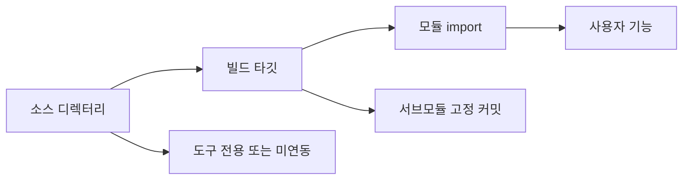
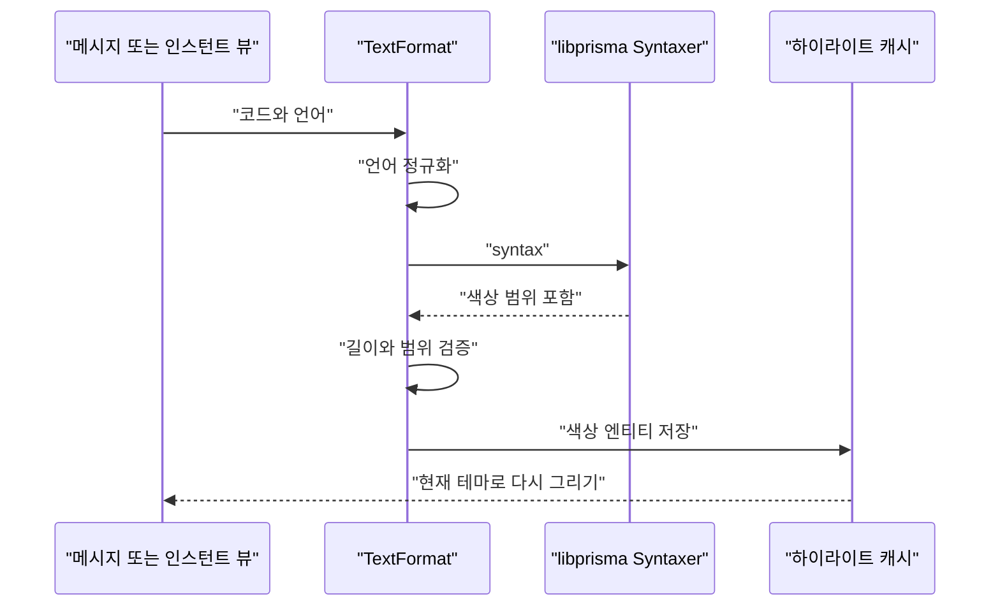
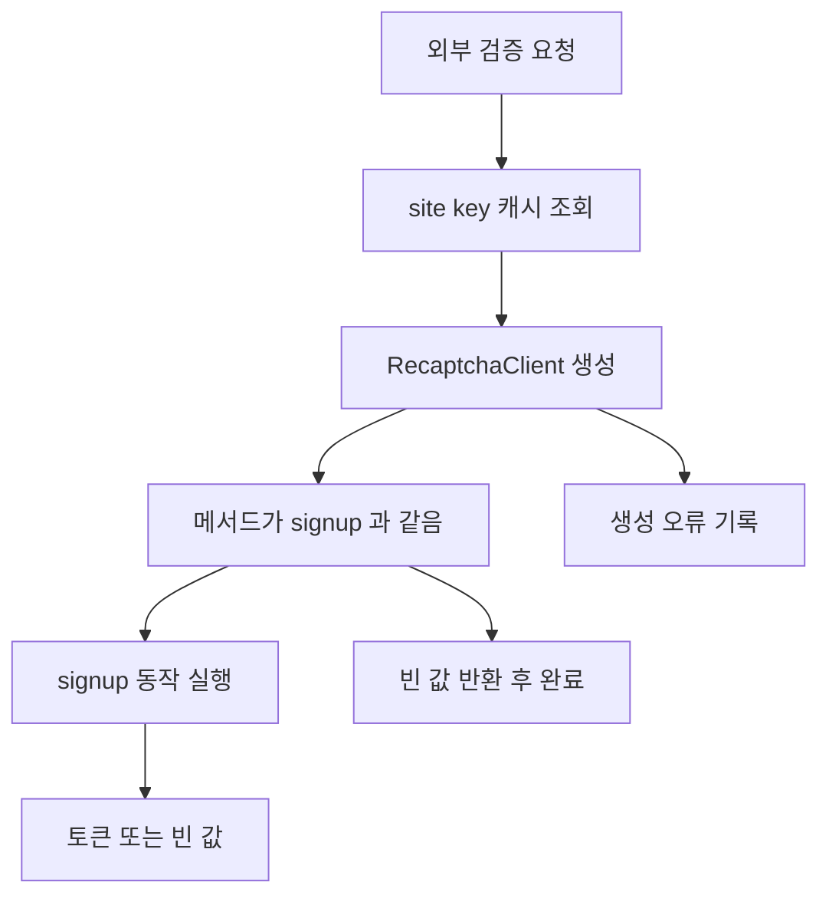
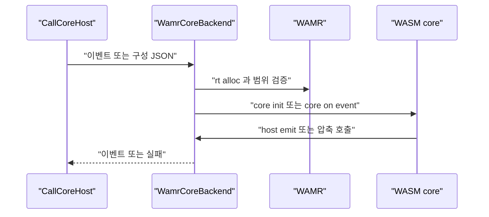

# 서드파티 의존성 목록과 드문 용도

웹: /docs/system/30-third-party-inventory/ · Markdown: /docs/system/30-third-party-inventory.md

> Telegram iOS와 TelegramSwift의 서드파티 디렉터리, 서브모듈, 호출 간선, 패치 경계, 그리고 드문 용도를 감사한 기록.

> 시스템 설계 · 엔지니어링 · 30장 · 도표 4 · 코드 발췌 8 · 인용 31 · 소스 기준선: [TelegramMessenger/Telegram-iOS@f1dd7a2d](https://github.com/TelegramMessenger/Telegram-iOS/tree/f1dd7a2dbd02cbbf513e75d5695d8d36d1cf5838), [overtake/TelegramSwift@579cebbf](https://github.com/overtake/TelegramSwift/tree/579cebbf0c01fd41b712eff3647fa7f69db9665d)
>
> 핵심 소스 파일: [TelegramMessenger/Telegram-iOS/third-party/libprisma/BUILD](https://github.com/TelegramMessenger/Telegram-iOS/blob/f1dd7a2dbd02cbbf513e75d5695d8d36d1cf5838/third-party/libprisma/BUILD), [TelegramMessenger/Telegram-iOS/submodules/TextFormat/Sources/StringWithAppliedEntities.swift](https://github.com/TelegramMessenger/Telegram-iOS/blob/f1dd7a2dbd02cbbf513e75d5695d8d36d1cf5838/submodules/TextFormat/Sources/StringWithAppliedEntities.swift), [TelegramMessenger/Telegram-iOS/submodules/TextFormat/Sources/InstantPageSyntaxHighlightSpecs.swift](https://github.com/TelegramMessenger/Telegram-iOS/blob/f1dd7a2dbd02cbbf513e75d5695d8d36d1cf5838/submodules/TextFormat/Sources/InstantPageSyntaxHighlightSpecs.swift), [TelegramMessenger/Telegram-iOS/submodules/InstantPageUI/Sources/InstantPageSyntaxHighlightApply.swift](https://github.com/TelegramMessenger/Telegram-iOS/blob/f1dd7a2dbd02cbbf513e75d5695d8d36d1cf5838/submodules/InstantPageUI/Sources/InstantPageSyntaxHighlightApply.swift), [TelegramMessenger/Telegram-iOS/submodules/TelegramUI/Sources/AppDelegate.swift](https://github.com/TelegramMessenger/Telegram-iOS/blob/f1dd7a2dbd02cbbf513e75d5695d8d36d1cf5838/submodules/TelegramUI/Sources/AppDelegate.swift), [TelegramMessenger/Telegram-iOS/submodules/InstantPageUI/Sources/InstantPageMath.swift](https://github.com/TelegramMessenger/Telegram-iOS/blob/f1dd7a2dbd02cbbf513e75d5695d8d36d1cf5838/submodules/InstantPageUI/Sources/InstantPageMath.swift), [TelegramMessenger/Telegram-iOS/submodules/ChatImportUI/Sources/ChatImportActivityScreen.swift](https://github.com/TelegramMessenger/Telegram-iOS/blob/f1dd7a2dbd02cbbf513e75d5695d8d36d1cf5838/submodules/ChatImportUI/Sources/ChatImportActivityScreen.swift), [TelegramMessenger/Telegram-iOS/submodules/TelegramCallsUI/Sources/SampleBufferVideoRenderingView.swift](https://github.com/TelegramMessenger/Telegram-iOS/blob/f1dd7a2dbd02cbbf513e75d5695d8d36d1cf5838/submodules/TelegramCallsUI/Sources/SampleBufferVideoRenderingView.swift), [TelegramMessenger/Telegram-iOS/third-party/subcodec/Sources/SubcodecObjC/SCOpenH264Decoder.mm](https://github.com/TelegramMessenger/Telegram-iOS/blob/f1dd7a2dbd02cbbf513e75d5695d8d36d1cf5838/third-party/subcodec/Sources/SubcodecObjC/SCOpenH264Decoder.mm), [TelegramMessenger/Telegram-iOS/third-party/wamr/BUILD](https://github.com/TelegramMessenger/Telegram-iOS/blob/f1dd7a2dbd02cbbf513e75d5695d8d36d1cf5838/third-party/wamr/BUILD), [TelegramMessenger/tgcalls/tgcalls/v2wasm/WamrCoreBackend.cpp](https://github.com/TelegramMessenger/tgcalls/blob/a024eaabf13c189d9577a14fb244bd242825ac96/tgcalls/v2wasm/WamrCoreBackend.cpp), [TelegramMessenger/tgcalls/tgcalls/group/GroupAudioCapturePostProcessor.cpp](https://github.com/TelegramMessenger/tgcalls/blob/a024eaabf13c189d9577a14fb244bd242825ac96/tgcalls/group/GroupAudioCapturePostProcessor.cpp), [overtake/TelegramSwift/submodules/CodeSyntax/CodeSyntax/CodeSyntax/Syntaxer.mm](https://github.com/overtake/TelegramSwift/blob/579cebbf0c01fd41b712eff3647fa7f69db9665d/submodules/CodeSyntax/CodeSyntax/CodeSyntax/Syntaxer.mm), [overtake/TelegramSwift/Telegram.xcodeproj/project.pbxproj](https://github.com/overtake/TelegramSwift/blob/579cebbf0c01fd41b712eff3647fa7f69db9665d/Telegram.xcodeproj/project.pbxproj), [overtake/TelegramSwift/Telegram-Mac/ArchiverContext.swift](https://github.com/overtake/TelegramSwift/blob/579cebbf0c01fd41b712eff3647fa7f69db9665d/Telegram-Mac/ArchiverContext.swift), [overtake/TelegramSwift/Telegram-Mac/AppUpdateViewController.swift](https://github.com/overtake/TelegramSwift/blob/579cebbf0c01fd41b712eff3647fa7f69db9665d/Telegram-Mac/AppUpdateViewController.swift)
>
> 미검증 사항:
> - 체크아웃되지 않은 iOS WebRTC, libvpx, dav1d 작업 트리에서, 구체적인 코덱 타깃과 눈에 보이는 패치가 모든 릴리스 변형에 들어가는지.
> - 체크아웃되지 않은 TelegramSwift의 Sparkle, libtgvoip, tg_owt, rlottie, regex 서브모듈에 macOS 전용 패치가 있는지.
> - 서버가 Recaptcha의 빈 값을 어떻게 처리하는지, 그리고 가입 RPC에서 토큰 필드와 만료 의미론이 어떤지.
> - 주석 처리된 libjxl 빌드 간선을 되살리면 사진 가져오기나 미디어 인코딩 경로가 바뀌는지.

## 문제와 제약 [#문제와-제약]

이 장은 디렉터리 구조 때문에 오해하기 쉬운 질문에 답해요.

- 어떤 라이브러리가 `third-party`나 `submodules`에 있다고 해서 현재 제품 코드가 그것을 링크한다는 뜻일까요?
- 그리고 그 라이브러리는 정확히 어떤 기능에 쓰일까요?

결론은 그렇게 추론할 수 없다는 거예요.

여기서는 고정 커밋의 Bazel(빌드 도구) 의존성 간선(타깃 사이의 의존 관계), Xcode 링크 간선, 실제 import 문을 증거로 삼아요. 그리고 라이브러리를 다음 네 가지로 나눠요.

- 직접 연동
- 간접 연동
- 빌드 도구 전용
- 현재 트리에 연동되지 않음

이 장의 범위는 이래요.

- iOS의 `third-party` 최상위 디렉터리 29개와 `third-party`에 나열된 Git 서브모듈
- TelegramSwift의 Git 서브모듈 8개
- 메인 프로젝트와 함께 컴파일되는 소수의 서드파티 프로젝트

이 글은 네트워크, 계정, 미디어 캐시, 통화, macOS 시스템 계층에 관한 기존 설계를 다시 설명하지 않아요. 관련 프로토콜과 상위 상태 머신은 각각 “계정, 인증, 구성”, “통화”, “macOS 시스템 계층” 장을 참고하세요. 이 장은 서드파티 경계가 이런 모듈 안에서 어떻게 놓이는지만 설명해요.

이 글에서 쓰는 말의 뜻은 이래요.

- “호출자”: 빌드 타깃이나 소스 파일에서 직접 추적할 수 있는 이 저장소의 모듈을 가리켜요. 런타임에 매번 실행된다는 뜻은 아니에요.
- “패치”: 고정 트리에서 보이는 패치 파일이나 이 저장소의 빌드 적응만 가리켜요.
- “현재 고정 트리에 연동되지 않음”: 소스 검색에서 호출 간선이 발견되지 않을 때 이 글이 쓰는 말이에요. 죽은 코드라는 뜻도, 업스트림 라이브러리가 쓸모없다는 뜻도 아니에요.

### 증거 수집 방법과 버전 경계 [#증거-수집-방법과-버전-경계]

iOS 부모 저장소의 `.gitmodules`는 `tgcalls`, `rlottie`, `tlottie`, `mtproto-engine`, `td`, `wallet-engine` 등의 경로를 명시적으로 나열해요. [\[1\]](https://github.com/TelegramMessenger/Telegram-iOS/blob/f1dd7a2dbd02cbbf513e75d5695d8d36d1cf5838/.gitmodules#L2-L40) 이 장은 체크아웃된 서브모듈에는 그 자체의 고정 커밋을 써요. Git 메타데이터가 없는 `third-party` 안의 디렉터리는 “부모 저장소와 함께 패키징된다”고만 말하고, 업스트림 커밋을 짐작하지 않아요.

`third-party` 트리에는 최상위 라이브러리 디렉터리가 29개 있어요. Bazel 타깃이 두 번째 증거예요. 예를 들어 `TextFormat`은 `//third-party/libprisma`에 명시적으로 의존해요. [\[2\]](https://github.com/TelegramMessenger/Telegram-iOS/blob/f1dd7a2dbd02cbbf513e75d5695d8d36d1cf5838/submodules/TextFormat/BUILD#L5-L26)

`Swift2D`와 `XMLCoder`는 각자 공개 Swift 타깃만 선언하고, 현재 트리에서 이들에 의존하는 다른 Bazel 타깃은 없어요. [\[3\]](https://github.com/TelegramMessenger/Telegram-iOS/blob/f1dd7a2dbd02cbbf513e75d5695d8d36d1cf5838/third-party/Swift2D/BUILD#L1-L17)[\[4\]](https://github.com/TelegramMessenger/Telegram-iOS/blob/f1dd7a2dbd02cbbf513e75d5695d8d36d1cf5838/third-party/XMLCoder/BUILD#L1-L17) 그래서 목록은 “디렉터리가 있다”와 “제품에 연동되어 있다”라는 두 가지 상태를 함께 기록해요.

빌드 타깃에서는 세 가지 관계도 구분해야 해요.

- `deps`: 컴파일이나 링크에 필요한 의존성이에요.
- `data`: 런타임에 타깃과 함께 패키징되는 리소스예요.
- `srcs`: 타깃이 컴파일할 입력이 무엇인지만 알려 줘요.

`libprisma`를 예로 들면, `grammars.dat`(코드 문법 규칙 데이터)는 리소스 번들로 제품에 들어가고 `boost_regex`는 컴파일 의존성이에요. [\[6\]](https://github.com/TelegramMessenger/Telegram-iOS/blob/f1dd7a2dbd02cbbf513e75d5695d8d36d1cf5838/third-party/libprisma/BUILD#L13-L112) 이 구분은 파일 확장자로 짐작하는 것보다 믿을 만해요. 하이라이터가 C++ 소스를 갖고 있으면서도 기기에서 grammar 데이터를 찾을 수 있는 이유도 설명해 줘요.

역방향 의존성이 없다는 사실에도 의미가 있어요. `Swift2D`와 `XMLCoder`의 타깃에는 모두 공개 가시성이 있어요. 하지만 가시성은 다른 타깃이 의존하는 것을 허용할 뿐, 이들을 자동으로 앱에 포함시키지는 않아요. 그래서 “현재 트리에 연동되지 않음”은 이 고정 커밋에서만 성립해요. 개발 브랜치, 과거 버전, 테스트 명령, 서드파티 스크립트가 이 소스 파일들을 직접 쓰는 경우까지 배제하지는 않아요. 이 글이 이 제한을 표에 적어 둔 건, 빌드 그래프에서 나온 부정적 결론이 저장소 역사에 관한 결론으로 넓어지는 것을 피하려는 거예요.



위 도표는 이 장이 판정하는 순서예요. 디렉터리 이름만으로는 A(소스 디렉터리)밖에 얻을 수 없어요. 어떤 라이브러리가 제품 기능에 참여한다는 걸 증명하려면 최소한 B(빌드 타깃)나 C(모듈 import)가 더 필요해요. 호출 간선이 없으면 이 장은 D(사용자 기능)를 지어내지 않고 E(도구 전용 또는 미연동)로 남겨 둬요.

## iOS 목록과 의존성 분류 [#ios-목록과-의존성-분류]

### 전체 목록 [#전체-목록]

아래 표는 iOS 최상위 디렉터리의 압축 색인이에요. 표에서 쓰는 말은 이래요.

- “이 저장소의 적응”: Telegram이 해당 라이브러리를 위해 Bazel 타깃, Objective C 브리지, 패키징 규칙을 작성했다는 뜻이에요. 업스트림 알고리즘을 수정했다는 뜻과는 달라요.
- “패치 보임”: `.patch`나 `.diff` 파일이 고정 트리에서 보이는지만 보고해요.

| 라이브러리 또는 디렉터리 | 분류와 용도 | 호출자 모듈 | 형태와 패치 상태 |
| --- | --- | --- | --- |
| `boringssl` | TLS와 암호 기반 라이브러리 | `webrtc`, 네트워크 및 미디어 빌드 체인 | 트리와 함께 패키징됨; 이 장의 범위에서는 파일 단위로 감사하지 않음 |
| `boost_regex` | `libprisma`의 정규식 구문 트리 매칭 | `libprisma` | 이 저장소의 Bazel 래퍼; 별도 패치 파일 없음 |
| `dav1d` | AV1 디코딩 구현 | WebRTC 또는 미디어 빌드 체인 | Git 서브모듈 미체크아웃; 호출 세부 사항은 확인 필요 |
| `flatc` | FlatBuffers 코드 생성기 | 직렬화 생성 단계 | 빌드 도구이며 앱 런타임 UI 라이브러리가 아님 |
| `libjxl` | JPEG XL 지원 후보 | 현재 `MozjpegBinding` 간선이 주석 처리됨 | 기준 수정 패치가 보임; 현재 제품 간선에는 연동되지 않음 |
| `libprisma` | 코드 블록 구문 하이라이트 | `TextFormat`, `InstantPageUI`가 간접 사용 | 트리와 함께 패키징되며 문법 리소스와 이 저장소의 테스트를 포함 |
| `libvpx` | VP8과 VP9 코덱 | WebRTC 빌드 체인 | Git 서브모듈 미체크아웃; arm64 시뮬레이터 패치 있음 |
| `libyuv` | 픽셀 형식 변환의 하위 구현 | `LibYuvBinding`, 통화 UI | 트리와 함께 패키징됨; 작은 브리지 계층이 호출 |
| `mozjpeg` | JPEG 코덱 | `MozjpegBinding` | 이 저장소의 브리지 타깃 |
| `mtproto-engine` | Rust 네트워크 엔진 | 별도의 전용 장이 있음 | Git 서브모듈; 이 장에서는 나열만 함 |
| `ogg` | Ogg 컨테이너 | 오디오 빌드 체인 | 트리와 함께 패키징됨 |
| `openh264` | H.264 인코딩과 디코딩 | `subcodec`, 그리고 WebRTC 빌드가 참조 | 이 저장소의 Bazel 적응과 아키텍처별 어셈블리 선택 |
| `opus` | Opus 오디오 코덱 | 통화 미디어 체인 | 트리와 함께 패키징됨 |
| `opusfile` | Ogg Opus 파일 읽기 | 오디오 미디어 체인 | 트리와 함께 패키징됨 |
| `recaptcha` | 가입 동작의 사람 확인 토큰 | `TelegramUI.AppDelegate` | 공식 XCFramework를 import; 소스 fork가 아님 |
| `rnnoise` | 신경망 노이즈 제거와 VAD(음성 활동 감지) 확률 | `tgcalls` 그룹 음성 캡처 후처리 | 트리와 함께 패키징되며 tgcalls가 조건부 컴파일 |
| `subcodec` | 애니메이션 캐시의 H.264 스프라이트 인코딩과 디코딩 | 애니메이션 캐시, 스티커, 미디어 편집 | Telegram 타깃; OpenH264와 VideoToolbox에 의존 |
| `td` | TDLib 바인딩 | 별도의 전용 장이 있음 | Git 서브모듈; iOS Python 지원 패치가 보임 |
| `wallet-engine` | 지갑 엔진 | 별도의 전용 장이 있음 | Git 서브모듈 |
| `wamr` | WebAssembly Micro Runtime | `tgcalls`의 v2 WASM 통화 코어 | 트리와 함께 패키징됨; iOS 인터프리터 구성 |
| `webp` | WebP 이미지 코덱 | 이미지 미디어 체인 | 트리와 함께 패키징됨 |
| `webrtc` | 실시간 오디오·비디오와 전송 스택 | `TgVoipWebrtc` | Git 서브모듈 미체크아웃; 그 안의 의존성 패치가 보임 |
| `yasm` | 어셈블러 빌드 산출물 | FFmpeg 또는 어셈블리 최적화 빌드 체인 | 생성 도구 아카이브일 뿐 |
| `SwiftMath` | LaTeX 수식 렌더링 | `InstantPageUI` | 트리와 함께 패키징됨; Swift에서 직접 import |
| `Swift2D` | 2차원 기하 모델 | 현재 고정 트리에 연동되지 않음 | 공개 Bazel 타깃이 있으나 소비자 간선 없음 |
| `XMLCoder` | `Codable` 방식의 XML 인코딩과 디코딩 | 현재 고정 트리에 연동되지 않음 | 공개 Bazel 타깃이 있으나 소비자 간선 없음 |
| `ZipArchive` | ZIP 압축 해제와 압축 | 가져오기, 공유, 연령 확인, 디버그 | Objective C와 minizip 패키징 |
| `LibYuvBinding` | I420을 NV12로 바꾸는 C 브리지 | `TelegramCallsUI` | 이 저장소의 브리지; `libyuv`에 의존 |

디렉터리 목록에는 `yasm` 같은 순수 빌드 의존성도 들어 있어요. 이런 것들은 소스 디렉터리가 있다는 것만으로 사용자에게 보이는 기능이라고 추론할 수 없어요. 반대로 `libprisma`, `recaptcha`, `ZipArchive`, `LibYuvBinding`은 명확한 상위 모듈이 호출하므로 이 장에서 중점을 둬요.

### fork, 서브모듈, 패치 경계 [#fork-서브모듈-패치-경계]

`mtproto-engine`, `td`, `wallet-engine`은 모두 Git 서브모듈이에요. 부모 저장소가 고정된 경로와 원격 주소를 기록해요. [\[1\]](https://github.com/TelegramMessenger/Telegram-iOS/blob/f1dd7a2dbd02cbbf513e75d5695d8d36d1cf5838/.gitmodules#L2-L40) 이들의 설계는 각각 전용 장에서 설명해요. `rlottie`와 `tlottie`는 `submodules`에 있고, 이 표에 나열된 29개 최상위 디렉터리에는 들어 있지 않아요. `tgcalls`도 서브모듈이고, 독립된 고정 커밋으로 통화 구현을 제공해요.

고정 트리에서 보이는 패치 파일은 `libjxl`, `libvpx`, `td`, 그리고 체크아웃되지 않은 WebRTC 작업 트리에 몰려 있어요. 이 디렉터리들에 적어도 패치 파일이 딸려 있다는 건 알 수 있지만, 파일 이름만으로 모든 변경이 패치 안에 있다고 단정할 수는 없어요.

반대로 `openh264`, `wamr`, `libprisma`, `ZipArchive`, `LibYuvBinding`에서 눈에 보이는 핵심 맞춤화는 주로 Bazel 타깃, 컴파일 매크로, 브리지 계층이에요. 이들은 비교해 보기 전에 fork라고 부르지 말고 “vendor 더하기 적응”이라고 불러야 해요.

`yasm`의 `genrule`은 `yasm-1.3.0`을 복사하고, CMake로 테스트를 끈 채 정적 산출물을 빌드한 다음, 결과를 `yasm.tar`로 묶어요. [\[5\]](https://github.com/TelegramMessenger/Telegram-iOS/blob/f1dd7a2dbd02cbbf513e75d5695d8d36d1cf5838/third-party/yasm/BUILD#L3-L56) 그래서 yasm은 iOS 프로세스에 들어가지 않아요. 로컬이나 원격 빌드 환경에서 어셈블리를 만들어야 할 때 쓰는 도구예요.

패치를 감사할 때는 소스 코드 수정과 빌드 수정도 구분해야 해요.

- 디렉터리에 `.patch` 파일이 없다고 해서 업스트림과 한 글자도 다르지 않다는 뜻은 아니에요.
- 디렉터리에 `.patch` 파일이 있다고 해서 그 패치가 반드시 해당 커밋의 빌드 규칙으로 적용된다는 뜻도 아니에요.

고정 트리에서 믿을 수 있게 확인되는 건 파일이 있다는 것, 타깃이 어떤 소스 파일을 고르는지, 어떤 매크로가 컴파일에 영향을 주는지예요. 보안 업그레이드에서는 패치 확장자만 검색하지 말고, 실제 Gitlink(서브모듈이 가리키는 커밋 기록)나 업스트림 기준선과 파일 단위 diff를 맞춰 봐야 해요.

## 드문 용도 1: 코드 블록은 단순한 고정폭 글자가 아님 [#드문-용도-1-코드-블록은-단순한-고정폭-글자가-아님]

### iOS의 libprisma 호출 체인 [#ios의-libprisma-호출-체인]

`libprisma`는 코드 블록 하이라이터예요. Prisma 데이터베이스 도구가 아니에요. 이 Bazel 타깃은 `Resources` 아래의 바이너리 문법 데이터를 함께 패키징하고 `boost_regex`에 의존해요. [\[6\]](https://github.com/TelegramMessenger/Telegram-iOS/blob/f1dd7a2dbd02cbbf513e75d5695d8d36d1cf5838/third-party/libprisma/BUILD#L13-L112) `TextFormat`이 이를 공개 의존성으로 두고, 이후 메시지와 Instant View의 텍스트 레이아웃이 다시 써요. [\[2\]](https://github.com/TelegramMessenger/Telegram-iOS/blob/f1dd7a2dbd02cbbf513e75d5695d8d36d1cf5838/submodules/TextFormat/BUILD#L5-L26)

```python
objc_library(
    name = "libprisma",
    enable_modules = True,
    module_name = "libprisma",
    srcs = glob([
        "Sources/**/*.c",
        "Sources/**/*.cpp",
        "Sources/**/*.m",
        "Sources/**/*.mm",
        "Sources/**/*.h",
        "Sources/**/*.hpp",
    ], allow_empty=True),
    hdrs = glob([
        "include/libprisma/*.h",
    ]),
    includes = [
        "include",
    ],
    data = [
        ":LibprismaBundle",
    ],
    copts = [
    ],
    deps = [
        "//third-party/boost_regex",
    ],
    sdk_frameworks = [
        "Foundation",
        "UIKit",
    ],
    visibility = [
        "//visibility:public",
    ],
)
```
[\[6\]](https://github.com/TelegramMessenger/Telegram-iOS/blob/f1dd7a2dbd02cbbf513e75d5695d8d36d1cf5838/third-party/libprisma/BUILD#L13-L112)

`StringWithAppliedEntities.swift`의 모듈이 `libprisma`를 import해요. 이 파일은 `Syntaxer`를 하나 유지하고, 코드, 언어, 테마로 `MessageSyntaxHighlight`를 만들어요. 만드는 순서는 이래요.

1. 언어에서 공백을 지우고 소문자로 바꿔요.
2. 하이라이트 뒤 길이가 변하는 결과, 잘못된 범위, 존재하지 않는 하이라이터의 결과를 거부해요.
3. 색상과 범위만 저장하고 완전한 `NSAttributedString`은 영속화하지 않아요.

덕분에 캐시가 테마와 분리되어서, 다시 그릴 때도 현재 테마를 쓸 수 있어요.

```swift
private let syntaxHighlighter = Syntaxer()

private func generateMessageSyntaxHighlight(spec: CachedMessageSyntaxHighlight.Spec, theme: SyntaxterTheme) -> MessageSyntaxHighlight {
    let expectedLength = (spec.text as NSString).length
    guard let syntaxHighlighter else {
        return MessageSyntaxHighlight(entities: [])
    }
    let engineLanguage = normalizedCodeBlockLanguage(spec.language) ?? spec.language
    guard let highlightedString = syntaxHighlighter.syntax(spec.text, language: engineLanguage, theme: theme) else {
        return MessageSyntaxHighlight(entities: [])
    }
    guard highlightedString.length == expectedLength else {
        return MessageSyntaxHighlight(entities: [])
    }
    
    var entities: [MessageSyntaxHighlight.Entity] = []
    var hasInvalidRange = false
    highlightedString.enumerateAttribute(.foregroundColor, in: NSRange(location: 0, length: highlightedString.length), using: { value, subRange, stop in
        let range = subRange.lowerBound ..< subRange.upperBound
        if !isValidMessageSyntaxHighlightRange(range, expectedLength: expectedLength) {
            hasInvalidRange = true
            stop.pointee = true
            return
        }
        if let value = value as? UIColor, value != .black {
            entities.append(MessageSyntaxHighlight.Entity(color: Int32(bitPattern: value.rgb), range: range))
        }
    })
    if hasInvalidRange {
        return MessageSyntaxHighlight(entities: [])
    }
    return MessageSyntaxHighlight(entities: entities)
}
```
[\[7\]](https://github.com/TelegramMessenger/Telegram-iOS/blob/f1dd7a2dbd02cbbf513e75d5695d8d36d1cf5838/submodules/TextFormat/Sources/StringWithAppliedEntities.swift#L83-L133)

이 코드에는 경계가 두 가지 있어요.

1. 언어 필드는 사용자나 콘텐츠 작성자가 주는 문자열이고, 하위 구문 트리는 소문자 키로 조회해요. 소스는 `Swift`와 `swift`가 서로 다른 캐시 키가 되지 않도록 명시적으로 정규화해요.
2. 범위가 하나라도 벗어나면 하이라이트 전체가 빈 엔티티로 바뀌고, 일부에만 색을 입히는 일은 없어요.

이 실패 정책 덕분에 오래된 캐시가 새 텍스트에 대응할 때 잘못 칠해지는 일을 피해요.

하이라이트를 구분하는 기준은 메시지 식별자나 블록 순번이 아니라 언어와 전체 텍스트예요. Instant View 수집기는 먼저 언어를 표준화한 다음, 언어와 텍스트로 `CachedMessageSyntaxHighlight.Spec`을 만들어요. 덕분에 같은 코드 조각을 중복 제거할 수 있고, 언어가 바뀌었을 때 옛 색상을 잘못 재사용하지 않아요. 대신 같은 텍스트라도 테마가 다르면 적용 단계에서 현재 테마의 표시 효과를 얻어야 해요. iOS가 색상 엔티티를 캐시하기로 한 건 바로 텍스트 분석과 인터페이스 테마를 분리하려는 거예요.

이 경로는 유니코드 경계에도 신중해요. 길이는 `NSString`으로 재고, `NSRange`도 같은 계량 체계로 넘겨요. token 출력의 총 길이가 원문 텍스트와 같지 않으면 함수는 모든 엔티티를 버려요. [\[7\]](https://github.com/TelegramMessenger/Telegram-iOS/blob/f1dd7a2dbd02cbbf513e75d5695d8d36d1cf5838/submodules/TextFormat/Sources/StringWithAppliedEntities.swift#L83-L133) 소스는 맞지 않는 출력을 더 짧은 길이로 잘라 내지 않아요. 하이라이트 한 번을 포기하는 대신, UTF-16 오프셋을 잘못된 글리프 범위에 쓰는 일을 피해요.

Instant View는 블록 트리에서 중복을 제거한 코드와 언어 조합도 수집해요. 커버, 임베드, 슬라이드, 목록, 상세, 인용 블록을 재귀적으로 처리하기 때문에, 중첩된 블록 안의 코드도 비동기 하이라이트 캐시에 들어가요. [\[8\]](https://github.com/TelegramMessenger/Telegram-iOS/blob/f1dd7a2dbd02cbbf513e75d5695d8d36d1cf5838/submodules/TextFormat/Sources/InstantPageSyntaxHighlightSpecs.swift#L4-L60)

첫 프레임에서 캐시가 적중하지 않으면 일반 코드 텍스트를 그대로 둬요. 캐시가 적중하면 `applyInstantPageSyntaxHighlight`가 모든 범위를 다시 검사하고, 하나라도 유효하지 않으면 어떤 색도 적용하지 않아요. [\[9\]](https://github.com/TelegramMessenger/Telegram-iOS/blob/f1dd7a2dbd02cbbf513e75d5695d8d36d1cf5838/submodules/InstantPageUI/Sources/InstantPageSyntaxHighlightApply.swift#L17-L36)



이 호출 체인을 보면 `boost_regex`가 드물게 맡는 역할도 분명해져요. 범용 검색 기능의 백엔드가 아니고, 이를 import하는 독립된 비즈니스 모듈도 없어요. `libprisma`의 Bazel `deps`가 직접 끌어들이고, 하이라이터의 C++ 회귀 테스트에 쓰여요. [\[6\]](https://github.com/TelegramMessenger/Telegram-iOS/blob/f1dd7a2dbd02cbbf513e75d5695d8d36d1cf5838/third-party/libprisma/BUILD#L13-L112) 현재 고정 트리에서 `boost_regex`는 문법 규칙의 하위 의존성이에요.

유지보수 관점에서 `boost_regex`의 위험 범위는 채팅 검색 경로가 아니라 grammar 처리 경로를 따라 평가해야 해요. `boost_regex`가 처리하는 건 코드 블록 언어 문법의 매칭 입력이에요. 메시지 본문이 이 경로에 들어올 수는 있지만, 하이라이트를 요청하는 건 언어가 지정된 서식 있는 블록뿐이에요. 비정상적인 언어 이름이 들어오면 호출 쪽의 정규화와 문법 조회 실패 때문에 색상 엔티티가 만들어지지 않을 뿐이에요. 상위의 리치 텍스트 렌더러가 통제되지 않는 token 트리를 받아들이는 일은 없어요. [\[7\]](https://github.com/TelegramMessenger/Telegram-iOS/blob/f1dd7a2dbd02cbbf513e75d5695d8d36d1cf5838/submodules/TextFormat/Sources/StringWithAppliedEntities.swift#L83-L133)[\[8\]](https://github.com/TelegramMessenger/Telegram-iOS/blob/f1dd7a2dbd02cbbf513e75d5695d8d36d1cf5838/submodules/TextFormat/Sources/InstantPageSyntaxHighlightSpecs.swift#L4-L60)

### macOS의 CodeSyntax와 libprisma 데이터 [#macos의-codesyntax와-libprisma-데이터]

TelegramSwift는 iOS의 Bazel 모듈 이름 `libprisma`가 아니라 `CodeSyntax.framework`를 써요. 앱 프로젝트는 `CodeSyntax.framework`를 Frameworks 빌드 단계에 넣고, [\[10\]](https://github.com/overtake/TelegramSwift/blob/579cebbf0c01fd41b712eff3647fa7f69db9665d/Telegram.xcodeproj/project.pbxproj#L3436-L3495) 코드 파일은 `import CodeSyntax`를 직접 해요. [\[11\]](https://github.com/overtake/TelegramSwift/blob/579cebbf0c01fd41b712eff3647fa7f69db9665d/Telegram-Mac/ChatController.swift#L9-L20) 같은 프로젝트는 `submodules/libprisma/libprisma/grammars.dat`도 파일 참조 형태로 포함해요. [\[12\]](https://github.com/overtake/TelegramSwift/blob/579cebbf0c01fd41b712eff3647fa7f69db9665d/Telegram.xcodeproj/project.pbxproj#L1779-L1806)

`CodeSyntax/Syntaxer.mm`은 `SyntaxHighlighter`로 코드와 언어를 토큰화하고, 각 token을 AppKit의 색상과 글꼴 속성으로 바꿔요. 그래서 iOS와 macOS는 같은 종류의 문법 데이터와 하이라이트 코어를 두 가지 플랫폼 래퍼로 감싼 거예요. 이 결론은 프로젝트 경로, 문법 데이터 경로, C++ 클래스 이름이 일치한다는 데서 나왔어요. 소스가 같은 계통인지는 더 세밀하게 따져 보면 추정에 속해요. macOS의 `libprisma` 서브모듈 작업 트리가 체크아웃되어 있지 않기 때문이에요.

```objc
@implementation Syntaxer
-(id)init:(NSData *)grammar {
    if (self = [super init]) {
        std::string text = dataToString(grammar);
        _m_highlighter = std::make_shared<SyntaxHighlighter>(text);
    }
    return self;
}

-(NSAttributedString *)syntax:(NSString *)code language: (NSString *)language theme: (SyntaxterTheme *) theme {
    NSMutableAttributedString *string = [[NSMutableAttributedString alloc] init];
    std::string c_code = code.UTF8String;
    std::string c_language = language.UTF8String;

    TokenList tokens = _m_highlighter->tokenize(c_code, c_language);
    for (auto it = tokens.begin(); it != tokens.end(); ++it)
    {
        auto& node = *it;
        Brush *brush;
        if (node.isSyntax()) {
            const auto& child = dynamic_cast<const Syntax&>(node);
            brush = makeBrush(child.alias(), child.type(), theme, nil);
        } else {
            brush = makeBrush("", "", theme, nil);
        }
        [self paint:node string:string brush:brush theme: theme];
    }
    return string;
}
```
[\[13\]](https://github.com/overtake/TelegramSwift/blob/579cebbf0c01fd41b712eff3647fa7f69db9665d/submodules/CodeSyntax/CodeSyntax/CodeSyntax/Syntaxer.mm#L177-L234)

두 플랫폼이 무엇을 맞바꿨는지도 여기서 알 수 있어요. iOS는 하이라이트 작업 결과를 영속화할 수 있는 색상 구간으로 압축하고, 적용할 때 UIKit 글꼴 및 테마와 합쳐요. macOS의 `CodeSyntax`는 바로 `NSAttributedString`을 돌려주고 `NSColor`와 `NSFont`를 가져요. 두 방식 모두 상위 메시지 컴포넌트가 grammar token 유형을 알 필요가 없게 해요.

## 드문 용도 2: Recaptcha는 가입 동작만 보호 [#드문-용도-2-recaptcha는-가입-동작만-보호]

`recaptcha` 디렉터리는 `apple_static_xcframework_import`로 `RecaptchaEnterprise.xcframework`를 import해요. 이건 Telegram이 직접 만든 C++나 Swift 소스가 아니고, Git 서브모듈도 아니에요. [\[14\]](https://github.com/TelegramMessenger/Telegram-iOS/blob/f1dd7a2dbd02cbbf513e75d5695d8d36d1cf5838/third-party/recaptcha/BUILD#L1-L16) 직접 연동되는 지점은 `TelegramUI.AppDelegate`이고, 이곳이 계정 구성에 `externalRecaptchaRequestVerification` 클로저를 넘겨요.

이 클로저는 site key별로 `Promise` 안에 `RecaptchaClient`를 캐시해요. 처음 site key 요청에서는 `fetchClient`를 호출하고, 이후에는 클라이언트를 다시 써요. 호출하는 쪽이 메서드 이름을 넘겨요.

- 메서드가 `signup`일 때만: `RecaptchaAction.signup`을 골라요.
- 다른 메서드: 바로 빈 토큰을 내고 끝나요.

그래서 디렉터리가 있다는 이유로 “모든 로그인이나 SMS 인증이 Google 검증을 거친다”고 해석할 수 없어요. 현재 고정 트리에서 확인되는 건 가입 동작이 외부에 검증을 요청하는 훅이에요.

```swift
Recaptcha.fetchClient(withSiteKey: siteKey) { client, error in
    Queue.mainQueue().async {
        guard let client else {
            Logger.shared.log("App \(self.episodeId)", "RecaptchaClient creation error: \(String(describing: error)).")
            return
        }
        recaptchaClient.set(.single(client))
    }
}
// ...
var recaptchaAction: RecaptchaAction?
switch method {
case "signup":
    recaptchaAction = RecaptchaAction.signup
default:
    break
}

guard let recaptchaAction else {
    subscriber.putNext(nil)
    subscriber.putCompletion()
    
    return EmptyDisposable
}
recaptchaClient.execute(withAction: recaptchaAction) { token, error in
    if let token {
        subscriber.putNext(token)
        Logger.shared.log("App \(self.episodeId)", "RecaptchaClient executed successfully")
    } else {
        subscriber.putNext(nil)
        Logger.shared.log("App \(self.episodeId)", "RecaptchaClient execute error: \(String(describing: error))")
    }
    subscriber.putCompletion()
}
```
[\[15\]](https://github.com/TelegramMessenger/Telegram-iOS/blob/f1dd7a2dbd02cbbf513e75d5695d8d36d1cf5838/submodules/TelegramUI/Sources/AppDelegate.swift#L612-L676)

실패는 세 층으로 나눠 처리해요.

- 클라이언트 생성이 실패하면: 로그만 남기고 캐시 Promise를 설정하지 않아요.
- 동작이 `signup`이 아니면: 빈 문자열 옵션을 명시적으로 내보내요.
- 실행이 실패하면: 마찬가지로 빈 값을 보내고 스트림을 완료해요.

바깥은 `Signal`이어서, SDK가 직접 UI를 보여 주는 대신 네트워크 계층이 다음 단계를 여전히 정할 수 있어요. 인증 프로토콜과 서버가 이 토큰을 어떻게 쓰는지는 “계정, 인증, 구성” 장을 참고하세요.

눈여겨볼 대기 경계가 하나 있어요. 처음 `fetchClient`가 빈 클라이언트를 돌려주면 클로저는 로그만 쓰고 반환하고, 기존 `Promise`에는 값이 들어가지 않아요. 이후 같은 site key로 요청하면 같은 Promise를 얻어서 그 첫 값을 기다려요. [\[15\]](https://github.com/TelegramMessenger/Telegram-iOS/blob/f1dd7a2dbd02cbbf513e75d5695d8d36d1cf5838/submodules/TelegramUI/Sources/AppDelegate.swift#L612-L676)

이 소스에서는 이 실패 분기에서 캐시를 제거하지 않는다는 걸 확인할 수 있어요. 더 바깥에 타임아웃이나 재생성 전략이 있는지는 현재 파일 조각으로는 미검증이에요. 그래서 이 대기를 곧바로 사용자에게 보이는 멈춤이라고 단정할 수는 없어요.

클라이언트 생성 콜백은 명시적으로 메인 큐에 디스패치돼요. 이후 `execute`도 마찬가지로 메인 큐의 신호 체인에서 실행돼요. [\[15\]](https://github.com/TelegramMessenger/Telegram-iOS/blob/f1dd7a2dbd02cbbf513e75d5695d8d36d1cf5838/submodules/TelegramUI/Sources/AppDelegate.swift#L612-L676) 이렇게 하면 UIKit이나 계정 상태에 실행기를 넘나들며 접근할 때 생기는 직접적인 경합을 피해요. 이 SDK 래퍼가 스레드 제약을 앱 쪽에 남겨 둔다는 것도 보여 줘요.

site key는 가입 세션 키가 아니라 캐시 키예요. 같은 key로 여러 요청에 걸쳐 SDK 클라이언트를 다시 쓸 수 있다는 뜻이에요. 토큰 자체는 여전히 `execute` 한 번의 반환값이에요.



도표의 빈 값이 검증을 우회한다는 증거는 아니에요. 이 Swift 콜백이 SDK token을 얻지 못했을 때 내보내는 출력 규약이에요. 이후 요청을 거부할지는 네트워크와 서버 상태 머신이 정해요. 이 장에서는 해당 소스 파일에서 검증하지 않았어요.

## 드문 용도 3: 미디어, 애니메이션, 압축, 수식 [#드문-용도-3-미디어-애니메이션-압축-수식]

### SwiftMath, Swift2D, XMLCoder [#swiftmath-swift2d-xmlcoder]

`SwiftMath`를 실제로 호출하는 곳은 `InstantPageUI`예요. 이 타깃은 `//third-party/SwiftMath:SwiftMath`에 명시적으로 의존하고, [\[16\]](https://github.com/TelegramMessenger/Telegram-iOS/blob/f1dd7a2dbd02cbbf513e75d5695d8d36d1cf5838/submodules/InstantPageUI/BUILD#L5-L53) `InstantPageMath.swift`는 `MTMathRenderer.render`를 호출해 LaTeX를 `UIImage`, 크기, 너비, 상승량과 하강량으로 렌더링해요. 렌더링이 실패하면 `nil`을 돌려주기 때문에, 상위에서는 수식이 아닌 조판 경로를 유지할 수 있어요.

```swift
public func instantPageMathAttachment(latex: String, fontSize: CGFloat, textColor: UIColor, mode: InstantPageMathMode) -> InstantPageMathAttachment? {
    let effectiveFontSize: CGFloat
    let multiplier: CGFloat = 1.12
    switch mode {
    case .inline:
        effectiveFontSize = fontSize * multiplier
    case .block:
        effectiveFontSize = fontSize * multiplier
    }

    guard let rendered = instantPageRenderMath(latex: latex, fontSize: effectiveFontSize, textColor: textColor, mode: mode) else {
        return nil
    }
    return InstantPageMathAttachment(latex: latex, fontSize: effectiveFontSize, textColor: textColor, mode: mode, rendered: rendered)
}
```
[\[17\]](https://github.com/TelegramMessenger/Telegram-iOS/blob/f1dd7a2dbd02cbbf513e75d5695d8d36d1cf5838/submodules/InstantPageUI/Sources/InstantPageMath.swift#L44-L78)

`Swift2D`는 `Point`, `Size`, `Rect` 같은 2차원 값 타입을 제공해요. 하지만 현재 고정 트리의 빌드 파일에는 의존하는 곳이 없고, 저장소 전체의 모듈 검색에서도 자기 자신 외의 import는 발견되지 않았어요. `XMLCoder`도 마찬가지로 자체 공개 Swift 타깃만 있고 소비자 간선은 발견되지 않았어요. [\[3\]](https://github.com/TelegramMessenger/Telegram-iOS/blob/f1dd7a2dbd02cbbf513e75d5695d8d36d1cf5838/third-party/Swift2D/BUILD#L1-L17)[\[4\]](https://github.com/TelegramMessenger/Telegram-iOS/blob/f1dd7a2dbd02cbbf513e75d5695d8d36d1cf5838/third-party/XMLCoder/BUILD#L1-L17) `Swift2D`와 `XMLCoder` 둘 다 트리와 함께 들어 있는 후보 의존성으로 분류해야 해요. Instant View나 설정 화면의 실제 구현이라고 하면 안 돼요. 나중에 소비자가 추가되면 Bazel 의존성 간선이 가장 먼저 바뀌는 증거가 될 거예요.

`SwiftMath`와 `Swift2D`·`XMLCoder`가 어떻게 다른지는 호출 형태에서 직접 볼 수 있어요. `InstantPageMathAttachment`는 원본 LaTeX, 글꼴 크기, 색상, inline 또는 block 모드, 렌더링 결과를 저장해요. 렌더러가 돌려주는 건 이미지와 조판 측정값이고, 편집할 수 있는 수학 텍스트가 아니에요. [\[17\]](https://github.com/TelegramMessenger/Telegram-iOS/blob/f1dd7a2dbd02cbbf513e75d5695d8d36d1cf5838/submodules/InstantPageUI/Sources/InstantPageMath.swift#L44-L78) 그래서 상위 레이아웃은 수식을 ascent와 descent를 가진 텍스트 첨부로 다룰 수 있어요. 이 설계는 TeX 파서가 모든 리치 텍스트 컴포넌트로 퍼지는 것을 막아 줘요. 대신 수식의 선명도와 다시 그리기를 첨부를 만들 때의 매개변수가 정하게 돼요.

수식 경로의 실패는 복구할 수 있어요. `instantPageMathAttachment`는 `guard`로 `instantPageRenderMath`를 검사하고, 빈 결과를 얻으면 `nil`을 돌려줘요. [\[17\]](https://github.com/TelegramMessenger/Telegram-iOS/blob/f1dd7a2dbd02cbbf513e75d5695d8d36d1cf5838/submodules/InstantPageUI/Sources/InstantPageMath.swift#L44-L78) 코드 조각은 호출하는 쪽이 어떤 플레이스홀더를 보여 주는지 설명하지 않아요. 그래서 렌더링 계층이 반쯤 초기화된 첨부로 조판을 이어 가지 않는다는 것만 확인할 수 있고, 실패했을 때 최종적으로 어떻게 보이는지는 확인할 수 없어요.

### ZipArchive와 macOS Zip [#ziparchive와-macos-zip]

iOS의 `ZipArchive`는 채팅 프로토콜 압축이 아니에요. 이 빌드 타깃은 Objective C 파일과 내장 minizip을 같은 모듈에 컴파일해 넣고, zlib, PKZIP, AES 관련 컴파일 매크로를 켜요. [\[18\]](https://github.com/TelegramMessenger/Telegram-iOS/blob/f1dd7a2dbd02cbbf513e75d5695d8d36d1cf5838/third-party/ZipArchive/BUILD#L4-L32) `ChatImportUI`는 아카이브 하나에서 항목별로 `EngineTempBox` 임시 파일로 압축을 풀어요. 압축 해제에 실패하면 가져오기 스트림에 `.generic` 오류를 보내고, 업로드를 계속하지 않아요.

```swift
let unpackedFile = Signal<EngineTempBox.File, ImportError> { subscriber in
    let tempFile = EngineTempBox.shared.tempFile(fileName: entry.0.path)
    Logger.shared.log("ChatImportScreen", "Extracting \(entry.0.path) to \(tempFile.path)...")
    let startTime = CACurrentMediaTime()
    if SSZipArchive.extractFileFromArchive(atPath: archivePath, filePath: entry.0.path, toPath: tempFile.path) {
        Logger.shared.log("ChatImportScreen", "[Done in \(CACurrentMediaTime() - startTime) s] Extract \(entry.0.path) to \(tempFile.path)")
        subscriber.putNext(tempFile)
        subscriber.putCompletion()
    } else {
        subscriber.putError(.generic)
    }
    
    return EmptyDisposable
}
```
[\[19\]](https://github.com/TelegramMessenger/Telegram-iOS/blob/f1dd7a2dbd02cbbf513e75d5695d8d36d1cf5838/submodules/ChatImportUI/Sources/ChatImportActivityScreen.swift#L254-L271)

같은 모듈은 공유 확장, 연령 확인, 객체 분리, 디버그 설정에서도 참조돼요. 이들은 ZIP을 각각 가져오기 컨테이너, 모델 리소스 컨테이너, 진단 내보내기로 쓰고, 미디어 전송 압축을 대신하지 않아요.

가져오기가 호출하는 파일 경로는 아카이브 항목에서 오고, 대상은 `EngineTempBox`가 할당해요. 현재 조각이 증명하는 건 압축 해제가 성공한 뒤에야 임시 파일이 후속 업로드 signal에 전달된다는 점과, 실패하면 해당 항목이 중단된다는 점이에요. [\[19\]](https://github.com/TelegramMessenger/Telegram-iOS/blob/f1dd7a2dbd02cbbf513e75d5695d8d36d1cf5838/submodules/ChatImportUI/Sources/ChatImportActivityScreen.swift#L254-L271) 하지만 이 조각은 다음을 보여 주지 않아요.

- 아카이브 항목 이름의 경로 정화
- 총 압축 해제 크기 상한
- 압축비 제한

이런 것들은 신뢰할 수 없는 ZIP을 처리할 때 계속 감사해야 하는 기술적 문제예요. `SSZipArchive`를 쓴다는 사실만으로 이런 제한이 있다거나 없다고 가정하면 안 돼요.

디버그 설정은 `ZipArchive`로 임시 내보내기 파일을 만들고, 공유 확장은 항목 목록을 읽은 뒤 항목별로 압축을 풀어요. 두 용도 모두 비동기 파일 생명주기가 올바르게 관리되어야 해요. 메시지 계층의 GZip이나 MTProto 전송 압축과 달리 여기서는 파일 단위로 다루기 때문에, 임시 경로, 취소, 오류 보고, 마지막 정리 전략이 필요해요. 현재 목록은 일부러 이것을 파일 패키징 기능으로 분류했어요.

macOS는 iOS의 `ZipArchive`를 링크하지 않아요. TelegramSwift는 저장소 안의 `submodules/Zip` 프로젝트를 `import Zip`해요. `Archiver`는 백그라운드 큐에서 로컬 파일을 압축하고, 진행률을 보고하고, 취소 클로저를 받고, `ZipError`를 실패 상태로 바꿔요. [\[20\]](https://github.com/overtake/TelegramSwift/blob/579cebbf0c01fd41b712eff3647fa7f69db9665d/Telegram-Mac/ArchiverContext.swift#L64-L98) API와 오류 모델이 다른 병렬 구현이에요.

### libyuv, OpenH264, subcodec, rnnoise [#libyuv-openh264-subcodec-rnnoise]

`LibYuvBinding`은 아주 좁은 브리지예요. `libyuv`에만 의존하고, [\[21\]](https://github.com/TelegramMessenger/Telegram-iOS/blob/f1dd7a2dbd02cbbf513e75d5695d8d36d1cf5838/third-party/LibYuvBinding/BUILD#L4-L28) `TelegramCallsUI`는 통화 스택에서 온 I420 평면을 Core Video의 2평면 NV12 버퍼로 변환해요. 호출 전후에 픽셀 형식, 너비와 높이, 잠금 상태, 두 대상 평면의 주소를 검사해요. 조건 하나라도 맞지 않으면 `false`를 돌려주고, 호출하는 쪽은 sample buffer를 enqueue하지 않아요.

```swift
private func copyI420BufferToNV12Buffer(buffer: OngoingGroupCallContext.VideoFrameData.I420Buffer, pixelBuffer: CVPixelBuffer) -> Bool {
    guard CVPixelBufferGetPixelFormatType(pixelBuffer) == kCVPixelFormatType_420YpCbCr8BiPlanarFullRange else {
        return false
    }
    guard CVPixelBufferGetWidthOfPlane(pixelBuffer, 0) == buffer.width else {
        return false
    }
    guard CVPixelBufferGetHeightOfPlane(pixelBuffer, 0) == buffer.height else {
        return false
    }

    let cvRet = CVPixelBufferLockBaseAddress(pixelBuffer, [])
    if cvRet != kCVReturnSuccess {
        return false
    }
    defer {
        CVPixelBufferUnlockBaseAddress(pixelBuffer, [])
    }
    // ...
    return true
}
```
[\[22\]](https://github.com/TelegramMessenger/Telegram-iOS/blob/f1dd7a2dbd02cbbf513e75d5695d8d36d1cf5838/submodules/TelegramCallsUI/Sources/SampleBufferVideoRenderingView.swift#L9-L71)

`openh264`가 드물게 쓰이는 곳은 일반적인 일대일 화면 디코딩이 아니라 `subcodec`이에요. `sprite_encode`와 `SubcodecObjC`는 모두 `openh264`에 의존하고, 후자는 VideoToolbox, CoreMedia, CoreVideo도 함께 링크해요. [\[23\]](https://github.com/TelegramMessenger/Telegram-iOS/blob/f1dd7a2dbd02cbbf513e75d5695d8d36d1cf5838/third-party/subcodec/BUILD#L36-L86)

`SCOpenH264Decoder`는 `ISVCDecoder`를 만들고 초기화해요. 초기화에 실패하면 이미 만든 디코더를 파괴하고 빈 객체를 돌려줘요. 디코딩할 때는 `iBufferStatus`가 완전한 화면을 나타낼 때만 Y, Cb, Cr 평면을 복사해요. [\[24\]](https://github.com/TelegramMessenger/Telegram-iOS/blob/f1dd7a2dbd02cbbf513e75d5695d8d36d1cf5838/third-party/subcodec/Sources/SubcodecObjC/SCOpenH264Decoder.mm#L18-L96) 이 체인은 애니메이션 캐시와 스프라이트 프레임 인코딩·디코딩에 쓰여요.

`rnnoise`는 체크아웃된 tgcalls 안에 있어요. 그룹 오디오 캡처 후처리기는 다음 조건을 모두 만족할 때 `rnnoise_process_frame`을 호출해요.

- 입력이 모노예요.
- 상태가 유효해요.
- 피크가 0.01 이상이에요.

노이즈 제거를 켰든 껐든 VAD 확률을 얻을 수 있어요. 구성 플래그가 켜져 있을 때만 노이즈를 제거한 샘플을 오디오 버퍼에 복사해 넣어요. [\[25\]](https://github.com/TelegramMessenger/tgcalls/blob/a024eaabf13c189d9577a14fb244bd242825ac96/tgcalls/group/GroupAudioCapturePostProcessor.cpp#L41-L101) 그래서 `rnnoise`는 소리를 정리하는 일에도, 발화 활동을 판단하는 일에도 참여해요.

이 처리기는 프레임 크기가 맞지 않을 때를 위한 로컬 리샘플링 버퍼도 갖고 있어요. 입력을 48000 Hz 모노의 임시 `AudioBuffer`에 복사하고, 이후 처리가 끝났을 때 이 버퍼를 써요. [\[25\]](https://github.com/TelegramMessenger/tgcalls/blob/a024eaabf13c189d9577a14fb244bd242825ac96/tgcalls/group/GroupAudioCapturePostProcessor.cpp#L41-L101) 이 로컬 버퍼는 런타임에서 맞춘 적응이고, RNNoise 자체의 API가 아니에요. 멀티채널 입력, 빈 입력, 또는 생성에 실패한 노이즈 제거 상태가 들어오면 함수가 바로 반환해요. 결과적으로 그룹 오디오의 비표준 입력은 이 노이즈 제거 로직에 들어오지 않아요.

`subcodec`과 `LibYuvBinding`은 서로 다른 미디어 경계에 있어요. 전자는 애니메이션 프레임을 캐시할 수 있는 H.264 스프라이트 데이터로 바꾸고, 후자는 통화 I420 프레임을 Apple의 디스플레이 파이프라인에 맞춰요. 둘 다 비디오 기반 라이브러리를 호출하지만 하나의 “비디오 디코더”로 뭉뚱그리면 안 돼요. 전자는 디스크 캐시와 프레임 시퀀스에, 후자는 실시간 CVPixelBuffer와 sample buffer 큐 삽입에 관심을 둬요.

## 드문 용도 4: WAMR이 WASM 통화 코어를 실행 [#드문-용도-4-wamr이-wasm-통화-코어를-실행]

`wamr`의 Bazel 구성은 런타임을 인터프리터와 빠른 인터프리터로 한정하고, 다음을 꺼요.

- AOT
- JIT
- Fast JIT
- 공유 메모리
- 스레드 관리
- 하드웨어 경계 검사 [\[26\]](https://github.com/TelegramMessenger/Telegram-iOS/blob/f1dd7a2dbd02cbbf513e75d5695d8d36d1cf5838/third-party/wamr/BUILD#L1-L77)

주석에 iOS 제약이 분명히 적혀 있어요. 앱 프로세스에 시그널 핸들러를 설치하지 말라는 거예요. 이 라이브러리는 봇 웹 페이지나 미니 앱을 위한 게 아니에요. 현재 호출 지점은 `tgcalls`의 `v2wasm`이고, 통화 코어 모듈을 싣는 데 써요.

tgcalls는 프로세스 안에서 싱글턴으로 WAMR을 초기화하고, 호스트 심볼은 이벤트 출력, deflate, inflate의 세 개만 등록해요. 시그니처의 포인터 범위는 WAMR이 검증한 뒤에야 네이티브 메서드에 포인터를 노출해요. [\[27\]](https://github.com/TelegramMessenger/tgcalls/blob/a024eaabf13c189d9577a14fb244bd242825ac96/tgcalls/v2wasm/WamrCoreBackend.cpp#L16-L40)

```cpp
static NativeSymbol nativeSymbols[] = {
    { "host_emit", (void *)WamrCoreBackend::hostEmitNative, "(*~)", nullptr },
    { "host_deflate", (void *)WamrCoreBackend::hostDeflateNative, "(*~*~)i", nullptr },
    { "host_inflate", (void *)WamrCoreBackend::hostInflateNative, "(*~*~)i", nullptr },
};
initArgs.native_module_name = "env";
initArgs.native_symbols = nativeSymbols;
initArgs.n_native_symbols = 3;

return wasm_runtime_full_init(&initArgs);
```
[\[27\]](https://github.com/TelegramMessenger/tgcalls/blob/a024eaabf13c189d9577a14fb244bd242825ac96/tgcalls/v2wasm/WamrCoreBackend.cpp#L16-L40)

모듈을 만들 때 백엔드는 다음을 거부해요.

- 빈 모듈 바이트
- 로드 실패
- `/dev/null`을 열 수 없음
- 인스턴스화 실패
- 실행 환경 생성 실패
- 네 개의 필수 export(모듈이 밖으로 내보내는 함수) 누락

WASI 표준 입력, 출력, 오류를 모두 `/dev/null`에 바인딩하고, 디렉터리를 사전 오픈하지 않고, 환경 변수와 인자를 주지 않아요. 모듈이 할 수 있는 일을 줄이려고 눈에 보이게 취한 조치예요. [\[28\]](https://github.com/TelegramMessenger/tgcalls/blob/a024eaabf13c189d9577a14fb244bd242825ac96/tgcalls/v2wasm/WamrCoreBackend.cpp#L114-L180)

모듈을 호출하기 전에 호스트는 이 순서로 움직여요.

1. `rt_alloc`으로 모듈 내부 주소를 얻어요.
2. 주소 범위를 검증한 뒤 데이터를 복사해요.
3. export를 호출해요.

실패해도 `rt_free`를 시도하고, trap(실행 중 중단되는 오류)을 RTC 로그에 기록해요. [\[29\]](https://github.com/TelegramMessenger/tgcalls/blob/a024eaabf13c189d9577a14fb244bd242825ac96/tgcalls/v2wasm/WamrCoreBackend.cpp#L190-L220)



이 설계는 코어 로직을 플랫폼 WebRTC 인터페이스와 분리하지만, WASM을 신뢰할 수 있는 네이티브 코드로 취급하지는 않아요. 범위 검증, 제한된 WASI, export 존재 여부 검사가 경계예요. 추정: JIT 대신 인터프리터를 고른 건 iOS 플랫폼의 런타임 제한에 맞추는 복잡도도 낮춰 줘요. 이 추정은 빌드 매크로와 일치하지만, 성능이나 심사 결정을 직접 설명하는 소스 행은 없어요.

WAMR의 실패 반환도 불리언 층에 머물러요. `create`가 `false`를 돌려주면 호출하는 쪽이 백엔드를 전환할지, 통화 수립을 끝낼지, 오류를 보여 줄지 정해야 해요. `callCoreFunction`에서는 비즈니스 호출이 trap을 일으켜도 코드가 여전히 `rt_free` 호출을 시도하고, 해제에 실패하면 함수가 `false`를 돌려줘요. [\[29\]](https://github.com/TelegramMessenger/tgcalls/blob/a024eaabf13c189d9577a14fb244bd242825ac96/tgcalls/v2wasm/WamrCoreBackend.cpp#L190-L220) 이렇게 하면 trap 이후의 모듈 내부 메모리 주소가 호스트 상태에 오래 남아 있는 것을 막아요. 모듈 언로드, 인스턴스 파괴, 실행 환경 파괴는 소멸자가 반대 순서로 처리하고, 프로세스 수준의 런타임은 초기화된 채로 유지돼요. [\[28\]](https://github.com/TelegramMessenger/tgcalls/blob/a024eaabf13c189d9577a14fb244bd242825ac96/tgcalls/v2wasm/WamrCoreBackend.cpp#L114-L180)

제한된 WASI가 완전한 보안 증명은 아니에요. WAMR은 여전히 세 개의 호스트 심볼을 노출하고, 모듈은 이 심볼로 이벤트와 압축 서비스에 닿아요. 진짜 경계는 이 호스트 함수들이 길이를 어떻게 검증하고, 출력을 어떻게 처리하고, 네트워크 상태를 어떻게 전달하는지에 달려 있어요. 현재 tgcalls 조각이 확인해 주는 건 등록된 buffer 범위에 대한 WAMR의 검사와 `rt_alloc` 주소에 대한 호스트의 검증이에요. [\[27\]](https://github.com/TelegramMessenger/tgcalls/blob/a024eaabf13c189d9577a14fb244bd242825ac96/tgcalls/v2wasm/WamrCoreBackend.cpp#L16-L40)[\[29\]](https://github.com/TelegramMessenger/tgcalls/blob/a024eaabf13c189d9577a14fb244bd242825ac96/tgcalls/v2wasm/WamrCoreBackend.cpp#L190-L220) 하지만 모든 deflate와 inflate의 구현 세부 사항까지는 다루지 않아요.

## iOS와 macOS 비교 [#ios와-macos-비교]

### macOS 서브모듈과 메인 프로젝트 [#macos-서브모듈과-메인-프로젝트]

TelegramSwift의 `.gitmodules`는 서브모듈 8개를 선언해요.

- `libtgvoip`
- Sparkle
- `telegram-ios`
- `rlottie`
- `tgcalls`
- `tg_owt`
- `libprisma`
- `regex`

고정 트리에서 연구 범위 안에서 주어진 커밋으로 인용할 수 있는 건 `libprisma`, `telegram-ios`, `tgcalls`의 버전뿐이에요. 나머지 작업 트리는 체크아웃되어 있지 않아서 거기서 구현을 읽을 수 없어요.

메인 프로젝트에서는 실제 프레임워크 링크를 증명할 수 있어요. CodeSyntax, Zip, TgVoipWebrtc, RLottie, Sparkle이 모두 Frameworks 단계에 나타나요. [\[10\]](https://github.com/overtake/TelegramSwift/blob/579cebbf0c01fd41b712eff3647fa7f69db9665d/Telegram.xcodeproj/project.pbxproj#L3436-L3495)[\[30\]](https://github.com/overtake/TelegramSwift/blob/579cebbf0c01fd41b712eff3647fa7f69db9665d/Telegram.xcodeproj/project.pbxproj#L75-L75)

| macOS 의존성 | 확인 가능한 용도 | 현재 연동 증거 | fork 또는 패치 결론 |
| --- | --- | --- | --- |
| `libprisma` 서브모듈 | CodeSyntax에 `grammars.dat`와 같은 이름의 하이라이트 코어 제공 | Xcode가 grammar 파일을 참조하고 CodeSyntax가 `SyntaxHighlighter`를 사용 | 업스트림 데스크톱 프로젝트 서브모듈이며 작업 트리가 체크아웃됨; 소스 동일 계통은 추정 |
| `CodeSyntax` 저장소 내 프로젝트 | 채팅과 UI의 코드 하이라이트 | 프레임워크를 링크하고 여러 Swift 파일이 import | Git 서브모듈이 아님; 메인 저장소와 함께 버전 관리됨 |
| Sparkle 서브모듈 | 비 App Store 버전의 앱 업데이트 | `!APP_STORE` 조건에서만 import | 작업 트리 미체크아웃이라 업스트림 변경을 감사할 수 없음 |
| `tgcalls`, `tg_owt`, `libtgvoip` | 통화와 미디어 전송의 기반 | 프로젝트가 `TgVoipWebrtc`를 링크 | tgcalls는 고정 커밋이 있고 나머지는 미체크아웃 |
| `rlottie` 서브모듈과 RLottie_Xcode | 애니메이션 스티커 렌더링 | 메인 프로젝트가 `RLottie.framework`를 링크 | 서브모듈은 미체크아웃이며 브리지 프로젝트는 메인 저장소와 함께 버전 관리됨 |
| `regex` 서브모듈 | Boost regex 의존성 후보 | 현재 macOS 소스에서 직접 링크를 확인하지 못함 | 작업 트리 미체크아웃 |
| `Zip` 저장소 내 Swift 프로젝트 | 로컬 파일 압축 | `ArchiverContext`가 import하고 진행률을 보고 | Git 서브모듈이 아님 |
| Stripe 저장소 내 프로젝트 | 결제 카드 화면과 결제 API | 여러 결제 컨트롤러가 import | Git 서브모듈이 아님 |
| libwebp와 minizip 저장소 내 프로젝트 | WebP와 ZIP의 하위 기능 | 코드 프로젝트와 프레임워크 링크가 보임 | Git 서브모듈이 아님 |

macOS의 Sparkle 경로는 `!APP_STORE` 조건부 컴파일 블록에서만 import되고, `SUUpdateDriver`가 있는 bundle을 updater bundle로 써요. [\[31\]](https://github.com/overtake/TelegramSwift/blob/579cebbf0c01fd41b712eff3647fa7f69db9665d/Telegram-Mac/AppUpdateViewController.swift#L9-L38) 이 조건을 보면 App Store 빌드가 이 업데이트 프레임워크를 거치지 않는다는 걸 알 수 있어요. 플랫폼 배포 제약일 뿐, iOS와 macOS의 기능이 어긋나게 구성된 게 아니에요.

iOS와 macOS는 이렇게 달라요.

- 하이라이트 출력: macOS는 `NSAttributedString`이고, iOS의 하이라이트 캐시는 색상 범위예요.
- ZIP: macOS는 Swift `Zip`을 직접 쓰고 iOS는 `SSZipArchive`를 써요.
- 비디오 경로: macOS 프로젝트는 `TgVoipWebrtc`를 링크하고, iOS는 I420을 Apple의 NV12 sample buffer로 변환해요.

두 플랫폼은 “하위 라이브러리를 플랫폼 경계에 둔다”는 구조를 공유하지만, 같은 래퍼 API를 쓰도록 강제하지는 않아요.

메인 프로젝트의 링크 증거와 서브모듈 선언도 따로 봐야 해요. Xcode의 Frameworks 단계는 어떤 프레임워크가 해당 target의 링크에 참여한다는 걸 증명할 수 있어요. 하지만 각 프레임워크의 런타임 기능 스위치가 이미 켜져 있다는 것까지 독립적으로 증명하지는 못해요. 반대로 `.gitmodules`는 고정 버전을 쓰려는 의도를 증명할 수 있지만, 서브모듈 산출물이 최종 앱에 들어간다는 건 증명하지 못해요. CodeSyntax는 Swift import와 Frameworks 링크를 모두 갖고 있어서 증거가 가장 강해요. Sparkle의 증거는 `!APP_STORE` 조건에 제한되기 때문에 비스토어 구성에 대해서만 결론을 낼 수 있어요. [\[10\]](https://github.com/overtake/TelegramSwift/blob/579cebbf0c01fd41b712eff3647fa7f69db9665d/Telegram.xcodeproj/project.pbxproj#L3436-L3495)[\[11\]](https://github.com/overtake/TelegramSwift/blob/579cebbf0c01fd41b712eff3647fa7f69db9665d/Telegram-Mac/ChatController.swift#L9-L20)[\[31\]](https://github.com/overtake/TelegramSwift/blob/579cebbf0c01fd41b712eff3647fa7f69db9665d/Telegram-Mac/AppUpdateViewController.swift#L9-L38)

macOS 프로젝트는 `grammars.dat`에 프로젝트 리소스 참조를 쓰고, iOS `libprisma`는 Bazel resource bundle을 써요. 이 차이는 업그레이드 절차에 영향을 줘요. iOS에서 하이라이트 코어를 갱신할 때는 bundle이 모듈과 함께 앱에 들어가도록 해야 해요. macOS에서 갱신할 때는 Xcode의 파일 참조가 계속 서브모듈 경로를 가리키도록 해야 해요. 두 플랫폼 모두 문법 데이터를 런타임에 네트워크에서 내려받지 않고 명시적인 빌드 입력으로 다뤄요.

### 연결되지 않은 내용과 지지되지 않는 결론 [#연결되지-않은-내용과-지지되지-않는-결론]

Sparkle, `libtgvoip`, `tg_owt`, `rlottie`, `regex`의 구현이 체크아웃되어 있지 않아서, 디렉터리 이름만으로 인터페이스나 보안 속성에 대한 결론을 낼 수 없어요. iOS의 WebRTC, libvpx, dav1d도 로컬 작업 트리에 없어요. 특히 iOS의 `recaptcha` 디렉터리가 있다고 해서 macOS에 대응하는 가입 검증이 있다고 추론하면 안 돼요. TelegramSwift에서 현재 보이는 프로젝트에는 `RecaptchaEnterprise` import나 프레임워크 링크가 없어요.

## 설계 트레이드오프와 유지보수 제안 [#설계-트레이드오프와-유지보수-제안]

첫째, 의존성을 연동할 때 아주 좁은 경계를 택해요. `LibYuvBinding`은 I420에서 NV12로의 변환만 노출해요. `ZipArchive`는 가져오기 모듈이 실패를 도메인 오류로 바꿔요. `subcodec`은 OpenH264와 VideoToolbox를 Objective C 브리지 뒤에 감춰요. 이렇게 하면 Swift UI 계층이 C와 C++ ABI를 직접 떠안는 면적이 줄어요.

둘째, 텍스트 하이라이트는 통제할 수 없는 입력을 데이터 무결성 문제로 봐요. iOS는 언어 이름, 문자열 길이, 각 색상 구간을 층층이 검증해요. Instant View 캐시가 어긋나면 잘못된 조각에 색을 입히는 위험을 감수하기보다 일반 코드를 보여 주는 쪽을 택해요. 리치 텍스트 캐시를 지원하는 모듈에서는 텍스트 범위의 정확성을 먼저 보장하는 트레이드오프예요.

셋째, 파일 형식 라이브러리의 책임은 경계 계층에서 멈춰야 해요. `ZipArchive`는 아카이브 작업만 맡아요. `ChatImportUI`는 파일을 언제 업로드 스트림에 넘길지 정하고, `TelegramCallsUI`는 변환된 프레임을 언제 표시 계층에 넘길지 정해요. 이렇게 하면 압축, 픽셀 레이아웃, 오류 회수를 도메인 상태를 가진 모듈에 둘 수 있어요. 대신 브리지 계층마다 매개변수 검증과 리소스 해제를 따로 테스트해야 해요.

넷째, WAMR의 구성은 능력을 줄이는 걸 우선해요. JIT를 켜지 않고, 파일 시스템, 환경, 인자를 주지 않고, 필수 export가 빠지는 것을 허용하지 않아요. 그래도 WAMR, WASM module, tgcalls, WebRTC의 버전은 반드시 함께 갱신해야 한다는 점에 주의해야 해요. WAMR의 C 소스만 올리면 ABI, WASI 초기화, 메모리 검증 동작이 바뀔 수 있어요.

다섯째, 디렉터리 목록은 폴더를 보고 손으로 추론하지 말고 빌드 그래프에서 자동으로 만들어야 해요. 최상위 디렉터리, Bazel 역방향 의존성, Gitlink, 보이는 패치, 연결되지 않은 서브모듈을 함께 보고하는 스크립트를 유지하길 권해요. `Swift2D`, `XMLCoder`, `libjxl`처럼 현재 제품 호출 간선이 없는 디렉터리는, 릴리스 전 용량 감사에서 최종 산출물에 잘못 들어갔는지 먼저 점검할 수 있어요.

## 열린 기술 문제 [#열린-기술-문제]

- 체크아웃되지 않은 iOS WebRTC, libvpx, dav1d 작업 트리에서, 구체적인 코덱 타깃과 눈에 보이는 패치가 모든 릴리스 변형에 들어가는지.
- TelegramSwift의 체크아웃되지 않은 Sparkle, `libtgvoip`, `tg_owt`, `rlottie`, `regex` 서브모듈에 macOS 전용 패치가 더 있는지.
- 서버가 `externalRecaptchaRequestVerification`이 반환한 빈 값을 어떻게 판정하는지, 그리고 token이 가입 RPC에서 쓰이는 정확한 필드와 만료 의미론이 무엇인지.
- `libjxl`의 현재 주석 처리된 빌드 간선을 되살리면 사진 가져오기나 미디어 인코딩 경로가 바뀌는지.

## 참고 [#references]

- \[1\] [iOS 서브모듈 선언](https://github.com/TelegramMessenger/Telegram-iOS/blob/f1dd7a2dbd02cbbf513e75d5695d8d36d1cf5838/.gitmodules#L2-L40)
- \[2\] [TextFormat의 libprisma 의존](https://github.com/TelegramMessenger/Telegram-iOS/blob/f1dd7a2dbd02cbbf513e75d5695d8d36d1cf5838/submodules/TextFormat/BUILD#L5-L26)
- \[3\] [Swift2D Bazel 타깃](https://github.com/TelegramMessenger/Telegram-iOS/blob/f1dd7a2dbd02cbbf513e75d5695d8d36d1cf5838/third-party/Swift2D/BUILD#L1-L17)
- \[4\] [XMLCoder Bazel 타깃](https://github.com/TelegramMessenger/Telegram-iOS/blob/f1dd7a2dbd02cbbf513e75d5695d8d36d1cf5838/third-party/XMLCoder/BUILD#L1-L17)
- \[5\] [yasm 빌드 아카이브 규칙](https://github.com/TelegramMessenger/Telegram-iOS/blob/f1dd7a2dbd02cbbf513e75d5695d8d36d1cf5838/third-party/yasm/BUILD#L3-L56)
- \[6\] [libprisma 리소스와 regex 의존성](https://github.com/TelegramMessenger/Telegram-iOS/blob/f1dd7a2dbd02cbbf513e75d5695d8d36d1cf5838/third-party/libprisma/BUILD#L13-L112)
- \[7\] [iOS 하이라이트 범위 검증](https://github.com/TelegramMessenger/Telegram-iOS/blob/f1dd7a2dbd02cbbf513e75d5695d8d36d1cf5838/submodules/TextFormat/Sources/StringWithAppliedEntities.swift#L83-L133)
- \[8\] [인스턴트 뷰 코드 블록 수집](https://github.com/TelegramMessenger/Telegram-iOS/blob/f1dd7a2dbd02cbbf513e75d5695d8d36d1cf5838/submodules/TextFormat/Sources/InstantPageSyntaxHighlightSpecs.swift#L4-L60)
- \[9\] [인스턴트 뷰 캐시 적용 검증](https://github.com/TelegramMessenger/Telegram-iOS/blob/f1dd7a2dbd02cbbf513e75d5695d8d36d1cf5838/submodules/InstantPageUI/Sources/InstantPageSyntaxHighlightApply.swift#L17-L36)
- \[10\] [macOS Frameworks 빌드 단계](https://github.com/overtake/TelegramSwift/blob/579cebbf0c01fd41b712eff3647fa7f69db9665d/Telegram.xcodeproj/project.pbxproj#L3436-L3495)
- \[11\] [macOS의 CodeSyntax import](https://github.com/overtake/TelegramSwift/blob/579cebbf0c01fd41b712eff3647fa7f69db9665d/Telegram-Mac/ChatController.swift#L9-L20)
- \[12\] [macOS grammar 파일 참조](https://github.com/overtake/TelegramSwift/blob/579cebbf0c01fd41b712eff3647fa7f69db9665d/Telegram.xcodeproj/project.pbxproj#L1779-L1806)
- \[13\] [CodeSyntax 토큰화와 속성 그리기](https://github.com/overtake/TelegramSwift/blob/579cebbf0c01fd41b712eff3647fa7f69db9665d/submodules/CodeSyntax/CodeSyntax/CodeSyntax/Syntaxer.mm#L177-L234)
- \[14\] [Recaptcha XCFramework import](https://github.com/TelegramMessenger/Telegram-iOS/blob/f1dd7a2dbd02cbbf513e75d5695d8d36d1cf5838/third-party/recaptcha/BUILD#L1-L16)
- \[15\] [가입 Recaptcha 요청 검증](https://github.com/TelegramMessenger/Telegram-iOS/blob/f1dd7a2dbd02cbbf513e75d5695d8d36d1cf5838/submodules/TelegramUI/Sources/AppDelegate.swift#L612-L676)
- \[16\] [InstantPageUI의 SwiftMath 의존](https://github.com/TelegramMessenger/Telegram-iOS/blob/f1dd7a2dbd02cbbf513e75d5695d8d36d1cf5838/submodules/InstantPageUI/BUILD#L5-L53)
- \[17\] [인스턴트 뷰 수식 렌더링](https://github.com/TelegramMessenger/Telegram-iOS/blob/f1dd7a2dbd02cbbf513e75d5695d8d36d1cf5838/submodules/InstantPageUI/Sources/InstantPageMath.swift#L44-L78)
- \[18\] [ZipArchive 빌드 구성](https://github.com/TelegramMessenger/Telegram-iOS/blob/f1dd7a2dbd02cbbf513e75d5695d8d36d1cf5838/third-party/ZipArchive/BUILD#L4-L32)
- \[19\] [가져오기 아카이브 압축 해제 실패 처리](https://github.com/TelegramMessenger/Telegram-iOS/blob/f1dd7a2dbd02cbbf513e75d5695d8d36d1cf5838/submodules/ChatImportUI/Sources/ChatImportActivityScreen.swift#L254-L271)
- \[20\] [macOS Zip 압축과 취소](https://github.com/overtake/TelegramSwift/blob/579cebbf0c01fd41b712eff3647fa7f69db9665d/Telegram-Mac/ArchiverContext.swift#L64-L98)
- \[21\] [LibYuvBinding의 libyuv 의존](https://github.com/TelegramMessenger/Telegram-iOS/blob/f1dd7a2dbd02cbbf513e75d5695d8d36d1cf5838/third-party/LibYuvBinding/BUILD#L4-L28)
- \[22\] [I420에서 NV12로의 비디오 프레임 변환](https://github.com/TelegramMessenger/Telegram-iOS/blob/f1dd7a2dbd02cbbf513e75d5695d8d36d1cf5838/submodules/TelegramCallsUI/Sources/SampleBufferVideoRenderingView.swift#L9-L71)
- \[23\] [subcodec의 OpenH264 의존](https://github.com/TelegramMessenger/Telegram-iOS/blob/f1dd7a2dbd02cbbf513e75d5695d8d36d1cf5838/third-party/subcodec/BUILD#L36-L86)
- \[24\] [OpenH264 디코딩 래퍼](https://github.com/TelegramMessenger/Telegram-iOS/blob/f1dd7a2dbd02cbbf513e75d5695d8d36d1cf5838/third-party/subcodec/Sources/SubcodecObjC/SCOpenH264Decoder.mm#L18-L96)
- \[25\] [rnnoise 그룹 음성 캡처 후처리](https://github.com/TelegramMessenger/tgcalls/blob/a024eaabf13c189d9577a14fb244bd242825ac96/tgcalls/group/GroupAudioCapturePostProcessor.cpp#L41-L101)
- \[26\] [iOS WAMR 인터프리터 구성](https://github.com/TelegramMessenger/Telegram-iOS/blob/f1dd7a2dbd02cbbf513e75d5695d8d36d1cf5838/third-party/wamr/BUILD#L1-L77)
- \[27\] [WAMR 호스트 심볼과 초기화](https://github.com/TelegramMessenger/tgcalls/blob/a024eaabf13c189d9577a14fb244bd242825ac96/tgcalls/v2wasm/WamrCoreBackend.cpp#L16-L40)
- \[28\] [WASM 모듈 생성과 제한된 WASI](https://github.com/TelegramMessenger/tgcalls/blob/a024eaabf13c189d9577a14fb244bd242825ac96/tgcalls/v2wasm/WamrCoreBackend.cpp#L114-L180)
- \[29\] [WASM 모듈 메모리 검증과 호출](https://github.com/TelegramMessenger/tgcalls/blob/a024eaabf13c189d9577a14fb244bd242825ac96/tgcalls/v2wasm/WamrCoreBackend.cpp#L190-L220)
- \[30\] [CodeSyntax 프레임워크 빌드 참조](https://github.com/overtake/TelegramSwift/blob/579cebbf0c01fd41b712eff3647fa7f69db9665d/Telegram.xcodeproj/project.pbxproj#L75-L75)
- \[31\] [비 App Store Sparkle 업데이터](https://github.com/overtake/TelegramSwift/blob/579cebbf0c01fd41b712eff3647fa7f69db9665d/Telegram-Mac/AppUpdateViewController.swift#L9-L38)
