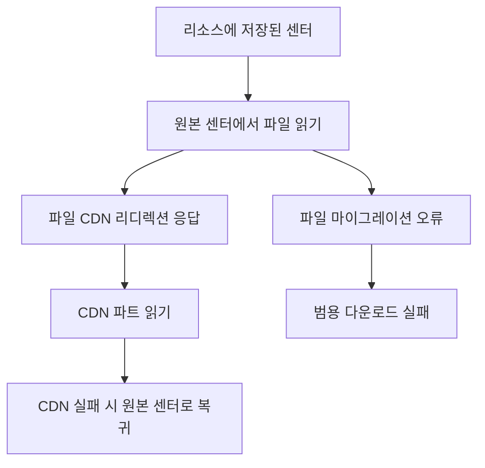

# FILE_MIGRATE의 최후 대비책(폴백) 경로

웹: /docs/system/33-file-migrate/ · Markdown: /docs/system/33-file-migrate.md

> 고정 커밋에서 파일 마이그레이션 오류는 범용 데이터 센터 전환이나 새 DC에서의 재전송을 일으키지 않아요.

> 시스템 설계 · 검증과 보충 · 보충 33 · 도표 1 · 코드 발췌 5 · 인용 25 · 소스 기준선: [TelegramMessenger/Telegram-iOS@f1dd7a2d](https://github.com/TelegramMessenger/Telegram-iOS/tree/f1dd7a2dbd02cbbf513e75d5695d8d36d1cf5838), [overtake/TelegramSwift@579cebbf](https://github.com/overtake/TelegramSwift/tree/579cebbf0c01fd41b712eff3647fa7f69db9665d)
>
> 검증 대상: [인증 키와 다중 데이터 센터](/docs/system/04-auth-keys-datacenters/)

## 파일 마이그레이션의 실제 결론 [#파일-마이그레이션의-실제-결론]

이 보충은 「인증 키와 다중 데이터 센터」 장의 마이그레이션, 미디어, 권한 부여 부분만 보완해요. 센터 간 키와 권한 부여 토큰의 기본 메커니즘은 여전히 그 장을 참고하세요.

결론부터 말하면, 업스트림 고정 커밋 `f1dd7a2dbd02cbbf513e75d5695d8d36d1cf5838`에는 `FILE_MIGRATE_X`에 대한 클라이언트 폴백 경로가 없어요. 구체적으로는 이래요.

- `MtProtoKit`은 RPC 오류를 범용 `MTRpcError`로 해석해요.
- `TelegramCore`의 V1, V2 다운로드 및 업로드 경로는 어느 것도 오류 텍스트에서 대상 DC(데이터 센터)를 꺼내지 않아요.
- 새 worker를 만들지 않고, 권한 전이(한 DC에서 받은 권한을 다른 DC로 옮기는 일)도 일으키지 않아요.
- 새 DC에서 원래의 `upload.getFile`, `upload.saveFilePart`, `upload.saveBigFilePart` 요청을 재전송하지도 않아요. [\[4\]](https://github.com/TelegramMessenger/Telegram-iOS/blob/f1dd7a2dbd02cbbf513e75d5695d8d36d1cf5838/submodules/MtProtoKit/Sources/MTInternalMessageParser.m#L211-L222) [\[5\]](https://github.com/TelegramMessenger/Telegram-iOS/blob/f1dd7a2dbd02cbbf513e75d5695d8d36d1cf5838/submodules/MtProtoKit/Sources/MTRequestMessageService.m#L849-L1063)

이 결론은 `Download.swift`에 문자열 매칭이 없다는 사실만으로 나온 게 아니에요. `MTInternalMessageParser`는 오류 코드와 TL 문자열을 읽은 뒤 곧바로 `MTRpcError`를 구성해요. 이 계층에는 마이그레이션 유형 열거형도, DC 선택 로직도 없어요.

```objc
case (int32_t)0x2144ca19:
{
    int32_t errorCode = 0;
    if (![reader readInt32:&errorCode])
        return nil;
    
    NSString *errorDescription = @"";
    if (![reader readTLString:&errorDescription])
        return nil;
    
    return [[MTRpcError alloc] initWithErrorCode:errorCode errorDescription:errorDescription];
}
```
[\[4\]](https://github.com/TelegramMessenger/Telegram-iOS/blob/f1dd7a2dbd02cbbf513e75d5695d8d36d1cf5838/submodules/MtProtoKit/Sources/MTInternalMessageParser.m#L211-L222)

`303 FILE_MIGRATE_X`는 MtProtoKit 안에서 목적지 DC를 고쳐 쓰거나 재전송하지 않고, 실패로서 상위 계층에 넘어가요. `MTRequestMessageService`가 `restartRequest`를 설정하는 분기는 다음뿐이에요.

- `401`
- `500`
- 대기 관련 `400` 또는 `500`
- `420`과 FLOOD_WAIT 등

나머지 RPC 오류는 같은 메서드의 끝에서 요청 완료 콜백을 호출해요. [\[5\]](https://github.com/TelegramMessenger/Telegram-iOS/blob/f1dd7a2dbd02cbbf513e75d5695d8d36d1cf5838/submodules/MtProtoKit/Sources/MTRequestMessageService.m#L849-L1063)

로그인은 마이그레이션 텍스트를 파싱하는 유일한 지점이에요. `sendAuthorizationCode`는 `PHONE_`, `USER_`, `NETWORK_` 세 가지 접두사만 받아들이고, 이 접두사가 오면 미인증 계정을 재구성해 `auth.sendCode`를 재전송해요. 이 정규식은 `FILE_`과 `STATS_`를 명시적으로 제외해요. [\[6\]](https://github.com/TelegramMessenger/Telegram-iOS/blob/f1dd7a2dbd02cbbf513e75d5695d8d36d1cf5838/submodules/TelegramCore/Sources/Authorization.swift#L195-L228)

```swift
case Regex("(PHONE_|USER_|NETWORK_)MIGRATE_(\\d+)"):
    let range = error.errorDescription.range(of: "MIGRATE_")!
    let updatedMasterDatacenterId = Int32(error.errorDescription[range.upperBound ..< error.errorDescription.endIndex])!
    let updatedAccount = account.changedMasterDatacenterId(accountManager: accountManager, masterDatacenterId: updatedMasterDatacenterId)
    return updatedAccount
    |> mapToSignalPromotingError { updatedAccount -> Signal<(SendCodeResult, UnauthorizedAccount), MTRpcError> in
        return updatedAccount.network.request(sendCode, automaticFloodWait: false)
```
[\[6\]](https://github.com/TelegramMessenger/Telegram-iOS/blob/f1dd7a2dbd02cbbf513e75d5695d8d36d1cf5838/submodules/TelegramCore/Sources/Authorization.swift#L195-L228)

업스트림 Rust 엔진의 고정 서브모듈도 이 사실을 테스트 제약으로 삼고 있어요. 테스트는 `FILE_MIGRATE_3`, `STATS_MIGRATE_1` 등의 오류를 열거하고, 엔진이 원본 그대로의 실패 이벤트를 내며 인증이나 소프트 리셋 이벤트는 내지 않는다고 단언해요. 이 테스트는 이 엔진이 RPC 계층에서 호스트 대신 마이그레이션 대상을 고르지 않는다는 걸 증명해요. 다만 이 엔진은 macOS fork에 없어서 fork의 증거로 쓸 수 없어요. [\[7\]](https://github.com/macosswift/mtproto-engine/blob/0de759a36cbb50c1e98560c1ffa38590d317b0fc/crates/mtproto-core/src/rpc/tests.rs#L793-L810) [\[25\]](https://github.com/overtake/Telegram-iOS/blob/a24bbe45f9861f736a79916a50898512f751e0dc/submodules/TelegramCore/BUILD#L3-L31)

## macOS fork 검증 [#macos-fork-검증]

`TelegramSwift`의 `submodules/telegram-ios`는 고정 커밋 `a24bbe45f9861f736a79916a50898512f751e0dc`로 체크아웃되어 있어요. fork의 `TelegramCore`에서 마이그레이션 텍스트를 매칭하는 곳은 `sendAuthorizationCode` 하나뿐이고, `PHONE_`, `USER_`, `NETWORK_` 접두사만 받아들여요. `FILE_`이나 `STATS_`와는 매칭하지 않아요. [\[18\]](https://github.com/overtake/Telegram-iOS/blob/a24bbe45f9861f736a79916a50898512f751e0dc/submodules/TelegramCore/Sources/Authorization.swift#L195-L224)

fork에서 나머지 계층은 이렇게 동작해요.

- `MTInternalMessageParser`: RPC 오류를 `MTRpcError`로만 구성해요.
- `MTRequestMessageService`: 303에 대해 DC 간 재전송을 설정하지 않아요.
- V1과 V2 다운로드: 각각 식별되지 않은 오류를 범용 실패로 분류해요.
- 업로드: 기존 네트워크의 데이터 센터를 고정해서 쓰고, 파트 오류를 범용 오류로 분류해요. [\[19\]](https://github.com/overtake/Telegram-iOS/blob/a24bbe45f9861f736a79916a50898512f751e0dc/submodules/MtProtoKit/Sources/MTInternalMessageParser.m#L210-L221) [\[20\]](https://github.com/overtake/Telegram-iOS/blob/a24bbe45f9861f736a79916a50898512f751e0dc/submodules/MtProtoKit/Sources/MTRequestMessageService.m#L845-L1060) [\[21\]](https://github.com/overtake/Telegram-iOS/blob/a24bbe45f9861f736a79916a50898512f751e0dc/submodules/TelegramCore/Sources/Network/MultipartFetch.swift#L343-L382) [\[22\]](https://github.com/overtake/Telegram-iOS/blob/a24bbe45f9861f736a79916a50898512f751e0dc/submodules/TelegramCore/Sources/Network/FetchV2.swift#L850-L940) [\[23\]](https://github.com/overtake/Telegram-iOS/blob/a24bbe45f9861f736a79916a50898512f751e0dc/submodules/TelegramCore/Sources/Network/Download.swift#L106-L130) [\[24\]](https://github.com/overtake/Telegram-iOS/blob/a24bbe45f9861f736a79916a50898512f751e0dc/submodules/TelegramCore/Sources/Network/MultipartUpload.swift#L411-L488)

따라서 고정된 macOS fork에도 `FILE_MIGRATE_X`에 대한 범용 DC 간 폴백 재전송은 없어요. 아래 세 가지는 이 오류와 별개로 남아 있는 독립된 경로예요. 이 오류가 이들을 일으키지 않아요.

- 알려진 리소스의 예방적 경로 선택
- 권한 전이
- CDN 리디렉션

## 알려진 미디어 DC의 예방적 라우팅 [#알려진-미디어-dc의-예방적-라우팅]

파일을 읽을 때는 보통 오류에서 DC를 알아낼 필요가 없어요. 클라우드 리소스는 `datacenterId`를 저장하고, `fetchResource`는 이 값을 `fetchCloudMediaLocation`에 전달해요. 그래서 첫 `upload.getFile`부터 이미 리소스 기록의 센터로 가요. [\[1\]](https://github.com/TelegramMessenger/Telegram-iOS/blob/f1dd7a2dbd02cbbf513e75d5695d8d36d1cf5838/submodules/TelegramCore/Sources/State/Fetch.swift#L104-L117)

```swift
} else if let cloudResource = resource as? TelegramMultipartFetchableResource {
    return .single(.dataPart(resourceOffset: 0, data: Data(), range: 0 ..< 0, complete: false))
    |> then(fetchCloudMediaLocation(
        accountPeerId: accountPeerId,
        postbox: postbox,
        network: network,
        mediaReferenceRevalidationContext: mediaReferenceRevalidationContext,
        networkStatsContext: networkStatsContext,
        resource: cloudResource,
        datacenterId: cloudResource.datacenterId,
        size: resource.size == 0 ? nil : resource.size,
```
[\[1\]](https://github.com/TelegramMessenger/Telegram-iOS/blob/f1dd7a2dbd02cbbf513e75d5695d8d36d1cf5838/submodules/TelegramCore/Sources/State/Fetch.swift#L104-L117)

다운로드 경로마다 DC를 받는 방식은 이래요.

- V1: 전달받은 DC를 `DownloadWrapper`에 기록해요.
- V2: `.main(sourceDatacenterId)`에 대해 `upload.getFile`을 보내요.

두 경로 모두 입력은 원래 리소스의 DC이고, `MTRpcError`에서 파싱해 낸 값이 아니에요. [\[2\]](https://github.com/TelegramMessenger/Telegram-iOS/blob/f1dd7a2dbd02cbbf513e75d5695d8d36d1cf5838/submodules/TelegramCore/Sources/Network/FetchV2.swift#L871-L1100) [\[3\]](https://github.com/TelegramMessenger/Telegram-iOS/blob/f1dd7a2dbd02cbbf513e75d5695d8d36d1cf5838/submodules/TelegramCore/Sources/Network/MultipartFetch.swift#L337-L391)



알려진 대상 DC의 worker는 미리 권한 전이를 마쳐요. 이건 마이그레이션 오류에 대한 보상이 아니에요. MtProtoKit worker는 다음 두 조건이 모두 맞을 때 대상 ID를 `requiredAuthToken`에 넣어요.

- 대상이 CDN이 아닌 DC예요.
- 대상이 메인 DC와 달라요.

`MTProto`는 토큰이 일치하지 않는 걸 발견하면 대기 상태에서 멈추고 `MTContext`에 토큰 전이를 요구해요. [\[8\]](https://github.com/TelegramMessenger/Telegram-iOS/blob/f1dd7a2dbd02cbbf513e75d5695d8d36d1cf5838/submodules/TelegramCore/Sources/Network/MtProtoKitEngine.swift#L351-L369) [\[9\]](https://github.com/TelegramMessenger/Telegram-iOS/blob/f1dd7a2dbd02cbbf513e75d5695d8d36d1cf5838/submodules/MtProtoKit/Sources/MTProto.m#L339-L359)

`MTContext`는 대상 DC별로 중복을 제거하며 `MTDatacenterTransferAuthAction`을 생성해요. 이 액션은 순서대로 이렇게 움직여요.

1. 원본 DC에서 `auth.exportAuthorization`을 실행해요.
2. 대상 DC에서 `auth.importAuthorization`을 실행해요.
3. 성공하면 이 대상 DC의 권한 토큰을 저장해요. [\[10\]](https://github.com/TelegramMessenger/Telegram-iOS/blob/f1dd7a2dbd02cbbf513e75d5695d8d36d1cf5838/submodules/MtProtoKit/Sources/MTContext.m#L1634-L1648) [\[11\]](https://github.com/TelegramMessenger/Telegram-iOS/blob/f1dd7a2dbd02cbbf513e75d5695d8d36d1cf5838/submodules/MtProtoKit/Sources/MTDatacenterTransferAuthAction.m#L99-L180)

```objc
NSData *importAuthRequestData = [_context.serialization importAuthorization:dataId bytes:authData];

[request setPayload:importAuthRequestData metadata:@"importAuthorization" shortMetadata:@"importAuthorization" responseParser:^id (NSData *data)
{
    return @true;
}];
[MTDatacenterTransferAuthAction applyRetryPolicyToRequest:request];
// ...
if (error == nil)
{
    [context updateAuthTokenForDatacenterWithId:destinationDatacenterId authToken:authToken];
    
    [strongSelf complete];
}
```
[\[11\]](https://github.com/TelegramMessenger/Telegram-iOS/blob/f1dd7a2dbd02cbbf513e75d5695d8d36d1cf5838/submodules/MtProtoKit/Sources/MTDatacenterTransferAuthAction.m#L99-L180)

그래서 요청을 보내는 쪽 코드(비즈니스 호출자)가 이미 대상 DC를 알고 있다면, worker는 요청을 보내기 전에 먼저 권한을 가져와요.

추론: 파일 마이그레이션에 폴백을 추가하려면 호출자가 다음을 차례로 해야 해요.

1. 대상 DC를 명시적으로 해석해요.
2. 대상 worker를 만들어요.
3. 권한 전이가 성공하길 기다려요.
4. 멱등성 규칙에 따라 끝나지 않은 파트를 다시 제출해요.

현재 소스에는 이런 호출자가 없어요.

## 다운로드, 업로드, CDN의 경계 [#다운로드-업로드-cdn의-경계]

다운로드는 V1과 V2 모두 `FILE_MIGRATE_X`에 전용 처리를 두지 않아요.

- V1: `FILEREF_INVALID`, `FILE_REFERENCE_`, `WEBFILE_NOT_AVAILABLE`만 전용 결과로 매핑해요. 다른 오류는 모두 `.generic`으로 매핑돼요.
- V2: 파일 참조 오류 두 종류(`FILEREF_INVALID`, `FILE_REFERENCE_`)만 참조 갱신으로 매핑하고, 나머지 오류는 `.failure`가 돼요. 이어서 가져오기 상태를 `.failed`로 설정해요. [\[3\]](https://github.com/TelegramMessenger/Telegram-iOS/blob/f1dd7a2dbd02cbbf513e75d5695d8d36d1cf5838/submodules/TelegramCore/Sources/Network/MultipartFetch.swift#L337-L391) [\[2\]](https://github.com/TelegramMessenger/Telegram-iOS/blob/f1dd7a2dbd02cbbf513e75d5695d8d36d1cf5838/submodules/TelegramCore/Sources/Network/FetchV2.swift#L871-L1100)

`networkRequestErrorPolicy`는 FLOOD_WAIT와 내부 서버 오류 횟수만 관찰해요. 오류 코드나 오류 텍스트를 받지 않아서, 이 정책 계층에서 `FILE_MIGRATE_X`를 식별하는 건 불가능해요. [\[12\]](https://github.com/TelegramMessenger/Telegram-iOS/blob/f1dd7a2dbd02cbbf513e75d5695d8d36d1cf5838/submodules/TelegramCore/Sources/Network/Network.swift#L1366-L1378)

```swift
func networkRequestErrorPolicy(automaticFloodWait: Bool, onFloodWaitError: ((String) -> Void)?, failOnServerErrors: Bool) -> (NetworkEngineErrorContext) -> Bool {
    return { errorContext in
        if let onFloodWaitError, errorContext.floodWaitSeconds > 0, let errorText = errorContext.floodWaitErrorText {
            onFloodWaitError(errorText)
        }
        if errorContext.floodWaitSeconds > 0 && !automaticFloodWait {
            return false
        }
        if errorContext.internalServerErrorCount > 0 && failOnServerErrors {
            return false
        }
        return true
    }
}
```
[\[12\]](https://github.com/TelegramMessenger/Telegram-iOS/blob/f1dd7a2dbd02cbbf513e75d5695d8d36d1cf5838/submodules/TelegramCore/Sources/Network/Network.swift#L1366-L1378)

같은 DC에서의 범용 재시도와 DC 간 재전송을 구분해야 해요.

- `Download.part`를 직접 호출하는 옛 인터페이스는 실패하면 `retryRequest`가 이어져요. 이 연산은 같은 `Download`를 다시 구독하고, 그 `datacenterId`와 worker는 이미 고정되어 있어요. 그래서 같은 청크 요청을 원래 센터로 다시 보낼 수는 있지만, `FILE_MIGRATE_X`로부터 다른 센터를 얻을 수는 없어요.
- V1의 `MultipartFetch`는 이 인터페이스를 호출하지 않고, 멀티플렉서 매니저를 통해 기존 대상에게 요청을 제출해요. 이 매니저는 오류를 구독자에게 그대로 전달해요.

그러므로 같은 센터로의 재시도라는 예외는 파일 마이그레이션 폴백이 되지 않아요. [\[3\]](https://github.com/TelegramMessenger/Telegram-iOS/blob/f1dd7a2dbd02cbbf513e75d5695d8d36d1cf5838/submodules/TelegramCore/Sources/Network/MultipartFetch.swift#L337-L391) [\[12\]](https://github.com/TelegramMessenger/Telegram-iOS/blob/f1dd7a2dbd02cbbf513e75d5695d8d36d1cf5838/submodules/TelegramCore/Sources/Network/Network.swift#L1366-L1378) [\[17\]](https://github.com/TelegramMessenger/Telegram-iOS/blob/f1dd7a2dbd02cbbf513e75d5695d8d36d1cf5838/submodules/TelegramCore/Sources/Network/Download.swift#L221-L269)

CDN 리디렉션은 RPC 마이그레이션 오류가 아니에요. 원본 DC가 `upload.getFile`에 대해 돌려주는 성공 생성자 `fileCdnRedirect`예요. V2는 이렇게 처리해요.

- 원본 DC, CDN ID, 토큰, 키를 저장한 뒤 요청 대상을 `.cdn(cdnData.id)`로 바꿔 `upload.getCdnFile`을 호출해요.
- `cdnFileReuploadNeeded`를 받으면 클라이언트는 원본 DC로 돌아가 `upload.reuploadCdnFile`을 호출해요.
- CDN 요청이 실패하면 V2가 되돌아가는 대상은 여전히 앞서 저장한 원본 DC예요. 오류 텍스트가 가리키는 다른 파일 DC가 아니에요. [\[2\]](https://github.com/TelegramMessenger/Telegram-iOS/blob/f1dd7a2dbd02cbbf513e75d5695d8d36d1cf5838/submodules/TelegramCore/Sources/Network/FetchV2.swift#L871-L1100) [\[13\]](https://github.com/TelegramMessenger/Telegram-iOS/blob/f1dd7a2dbd02cbbf513e75d5695d8d36d1cf5838/submodules/TelegramCore/Sources/Network/FetchV2.swift#L1228-L1309)

업로드에도 파일 마이그레이션 폴백은 없어요.

- `multipartUpload`는 `network.datacenterId`를 고정해서 쓰고, 이어서 `.main(datacenterId)`로 `saveFilePart` 또는 `saveBigFilePart`를 보내요.
- 이 두 업로드 진입점(`saveFilePart`, `saveBigFilePart`)은 `400`을 `.invalidMedia`로, 나머지 오류를 `.generic`으로 분류해요.

그래서 서버가 이 호출에 `303 FILE_MIGRATE_X`를 돌려줘도 현재 클라이언트는 업로드 센터를 바꾸거나 실패한 파트를 재전송하지 않아요. [\[14\]](https://github.com/TelegramMessenger/Telegram-iOS/blob/f1dd7a2dbd02cbbf513e75d5695d8d36d1cf5838/submodules/TelegramCore/Sources/Network/Download.swift#L94-L171) [\[15\]](https://github.com/TelegramMessenger/Telegram-iOS/blob/f1dd7a2dbd02cbbf513e75d5695d8d36d1cf5838/submodules/TelegramCore/Sources/Network/MultipartUpload.swift#L406-L489)

`NetworkTelemetry`는 303을 `.migrate`로 분류해요. 하지만 이 분류 함수는 텔레메트리 분류만 반환해요. 요청을 소유하지 않고, 연결을 만들거나 재시도를 호출하지도 않아요. [\[16\]](https://github.com/TelegramMessenger/Telegram-iOS/blob/f1dd7a2dbd02cbbf513e75d5695d8d36d1cf5838/submodules/TelegramCore/Sources/Network/NetworkTelemetry.swift#L396-L413)

## 원래 장에 대한 수정 [#원래-장에-대한-수정]

- `04-auth-keys-datacenters.md` 378행 수정
  - 원문: “이 버전의 파일 마이그레이션 폴백 경로는 미검증이에요”
  - 바꿀 내용: “고정 iOS 커밋에는 `FILE_MIGRATE_X`의 범용 폴백 경로가 없어요. MtProtoKit은 이를 `MTRpcError`로 위로 던져요. V1과 V2 다운로드는 이를 범용 실패로 분류해요. 업로드도 범용 오류로만 분류해요. 클라이언트는 이 오류를 근거로 새 DC를 고르거나, 권한을 가져오거나, 새 센터에서 파트를 재전송하지 않아요. `Download.part`를 직접 호출하는 범용 재시도는 여전히 원래 센터만 가리켜요. 고정 macOS fork에도 범용 DC 간 재전송은 없어요.”
  - 효과: 이로써 장 색인의 첫 번째 미검증 사항이 해결돼요.
  - 결과: 해결됨이에요. [\[2\]](https://github.com/TelegramMessenger/Telegram-iOS/blob/f1dd7a2dbd02cbbf513e75d5695d8d36d1cf5838/submodules/TelegramCore/Sources/Network/FetchV2.swift#L871-L1100) [\[3\]](https://github.com/TelegramMessenger/Telegram-iOS/blob/f1dd7a2dbd02cbbf513e75d5695d8d36d1cf5838/submodules/TelegramCore/Sources/Network/MultipartFetch.swift#L337-L391) [\[4\]](https://github.com/TelegramMessenger/Telegram-iOS/blob/f1dd7a2dbd02cbbf513e75d5695d8d36d1cf5838/submodules/MtProtoKit/Sources/MTInternalMessageParser.m#L211-L222) [\[5\]](https://github.com/TelegramMessenger/Telegram-iOS/blob/f1dd7a2dbd02cbbf513e75d5695d8d36d1cf5838/submodules/MtProtoKit/Sources/MTRequestMessageService.m#L849-L1063) [\[14\]](https://github.com/TelegramMessenger/Telegram-iOS/blob/f1dd7a2dbd02cbbf513e75d5695d8d36d1cf5838/submodules/TelegramCore/Sources/Network/Download.swift#L94-L171) [\[17\]](https://github.com/TelegramMessenger/Telegram-iOS/blob/f1dd7a2dbd02cbbf513e75d5695d8d36d1cf5838/submodules/TelegramCore/Sources/Network/Download.swift#L221-L269) [\[18\]](https://github.com/overtake/Telegram-iOS/blob/a24bbe45f9861f736a79916a50898512f751e0dc/submodules/TelegramCore/Sources/Authorization.swift#L195-L224) [\[19\]](https://github.com/overtake/Telegram-iOS/blob/a24bbe45f9861f736a79916a50898512f751e0dc/submodules/MtProtoKit/Sources/MTInternalMessageParser.m#L210-L221) [\[20\]](https://github.com/overtake/Telegram-iOS/blob/a24bbe45f9861f736a79916a50898512f751e0dc/submodules/MtProtoKit/Sources/MTRequestMessageService.m#L845-L1060) [\[21\]](https://github.com/overtake/Telegram-iOS/blob/a24bbe45f9861f736a79916a50898512f751e0dc/submodules/TelegramCore/Sources/Network/MultipartFetch.swift#L343-L382) [\[22\]](https://github.com/overtake/Telegram-iOS/blob/a24bbe45f9861f736a79916a50898512f751e0dc/submodules/TelegramCore/Sources/Network/FetchV2.swift#L850-L940) [\[23\]](https://github.com/overtake/Telegram-iOS/blob/a24bbe45f9861f736a79916a50898512f751e0dc/submodules/TelegramCore/Sources/Network/Download.swift#L106-L130) [\[24\]](https://github.com/overtake/Telegram-iOS/blob/a24bbe45f9861f736a79916a50898512f751e0dc/submodules/TelegramCore/Sources/Network/MultipartUpload.swift#L411-L488)

- `04-auth-keys-datacenters.md` 378행 보충 제안
  - 원문: “Download.swift는 이 오류 문자열을 직접 파싱하지 않아요” → 사실로 유지해요.
  - 제안: 바로 이어서 “원인은 빠진 저수준 문자열 분기에 있지 않아요. 오류 디코딩에서 요청 서비스, 미디어 상태 머신에 이르기까지 파일 마이그레이션 분기가 어디에도 없다는 데 있어요.”를 보충하자고 해요.
  - 효과: 국소적 관찰이 검증된 전체 체인 결론으로 넓어져요.
  - 결과: 해결됨이에요. [\[3\]](https://github.com/TelegramMessenger/Telegram-iOS/blob/f1dd7a2dbd02cbbf513e75d5695d8d36d1cf5838/submodules/TelegramCore/Sources/Network/MultipartFetch.swift#L337-L391) [\[4\]](https://github.com/TelegramMessenger/Telegram-iOS/blob/f1dd7a2dbd02cbbf513e75d5695d8d36d1cf5838/submodules/MtProtoKit/Sources/MTInternalMessageParser.m#L211-L222) [\[5\]](https://github.com/TelegramMessenger/Telegram-iOS/blob/f1dd7a2dbd02cbbf513e75d5695d8d36d1cf5838/submodules/MtProtoKit/Sources/MTRequestMessageService.m#L849-L1063)

- `04-auth-keys-datacenters.md` 388~405행의 추론 시퀀스 도표 보충 제안
  - 제안: 도표 뒤에 “이 시퀀스는 알려진 대상 DC의 권한 준비 모델이에요. 현재 `FILE_MIGRATE_X`의 실제 호출 체인이 아니에요.”를 추가하자고 해요.
  - 효과: 파일 오류가 자동으로 권한 전이에 들어가는 것처럼 오해할 수 있는 모호함이 사라져요.
  - 결과: 해결됨이에요. [\[8\]](https://github.com/TelegramMessenger/Telegram-iOS/blob/f1dd7a2dbd02cbbf513e75d5695d8d36d1cf5838/submodules/TelegramCore/Sources/Network/MtProtoKitEngine.swift#L351-L369) [\[9\]](https://github.com/TelegramMessenger/Telegram-iOS/blob/f1dd7a2dbd02cbbf513e75d5695d8d36d1cf5838/submodules/MtProtoKit/Sources/MTProto.m#L339-L359) [\[10\]](https://github.com/TelegramMessenger/Telegram-iOS/blob/f1dd7a2dbd02cbbf513e75d5695d8d36d1cf5838/submodules/MtProtoKit/Sources/MTContext.m#L1634-L1648) [\[11\]](https://github.com/TelegramMessenger/Telegram-iOS/blob/f1dd7a2dbd02cbbf513e75d5695d8d36d1cf5838/submodules/MtProtoKit/Sources/MTDatacenterTransferAuthAction.m#L99-L180)

## 참고 [#references]

- \[1\] [클라우드 미디어 리소스의 데이터 센터 선택](https://github.com/TelegramMessenger/Telegram-iOS/blob/f1dd7a2dbd02cbbf513e75d5695d8d36d1cf5838/submodules/TelegramCore/Sources/State/Fetch.swift#L104-L117)
- \[2\] [V2 파일 읽기와 실패 상태](https://github.com/TelegramMessenger/Telegram-iOS/blob/f1dd7a2dbd02cbbf513e75d5695d8d36d1cf5838/submodules/TelegramCore/Sources/Network/FetchV2.swift#L871-L1100)
- \[3\] [V1 파일 읽기와 CDN 리디렉션](https://github.com/TelegramMessenger/Telegram-iOS/blob/f1dd7a2dbd02cbbf513e75d5695d8d36d1cf5838/submodules/TelegramCore/Sources/Network/MultipartFetch.swift#L337-L391)
- \[4\] [RPC 오류 디코딩](https://github.com/TelegramMessenger/Telegram-iOS/blob/f1dd7a2dbd02cbbf513e75d5695d8d36d1cf5838/submodules/MtProtoKit/Sources/MTInternalMessageParser.m#L211-L222)
- \[5\] [요청 서비스 오류 분기와 완료 콜백](https://github.com/TelegramMessenger/Telegram-iOS/blob/f1dd7a2dbd02cbbf513e75d5695d8d36d1cf5838/submodules/MtProtoKit/Sources/MTRequestMessageService.m#L849-L1063)
- \[6\] [로그인 마이그레이션 매칭과 재전송](https://github.com/TelegramMessenger/Telegram-iOS/blob/f1dd7a2dbd02cbbf513e75d5695d8d36d1cf5838/submodules/TelegramCore/Sources/Authorization.swift#L195-L228)
- \[7\] [마이그레이션 오류 원본 상향 전달 테스트](https://github.com/macosswift/mtproto-engine/blob/0de759a36cbb50c1e98560c1ffa38590d317b0fc/crates/mtproto-core/src/rpc/tests.rs#L793-L810)
- \[8\] [worker의 외부 권한 토큰 설정](https://github.com/TelegramMessenger/Telegram-iOS/blob/f1dd7a2dbd02cbbf513e75d5695d8d36d1cf5838/submodules/TelegramCore/Sources/Network/MtProtoKitEngine.swift#L351-L369)
- \[9\] [토큰 불일치 시 transport 차단](https://github.com/TelegramMessenger/Telegram-iOS/blob/f1dd7a2dbd02cbbf513e75d5695d8d36d1cf5838/submodules/MtProtoKit/Sources/MTProto.m#L339-L359)
- \[10\] [대상 데이터 센터별 전이 액션 생성](https://github.com/TelegramMessenger/Telegram-iOS/blob/f1dd7a2dbd02cbbf513e75d5695d8d36d1cf5838/submodules/MtProtoKit/Sources/MTContext.m#L1634-L1648)
- \[11\] [권한 내보내기·가져오기와 토큰 기록](https://github.com/TelegramMessenger/Telegram-iOS/blob/f1dd7a2dbd02cbbf513e75d5695d8d36d1cf5838/submodules/MtProtoKit/Sources/MTDatacenterTransferAuthAction.m#L99-L180)
- \[12\] [범용 요청 오류 정책](https://github.com/TelegramMessenger/Telegram-iOS/blob/f1dd7a2dbd02cbbf513e75d5695d8d36d1cf5838/submodules/TelegramCore/Sources/Network/Network.swift#L1366-L1378)
- \[13\] [CDN 재업로드와 원본 센터 폴백](https://github.com/TelegramMessenger/Telegram-iOS/blob/f1dd7a2dbd02cbbf513e75d5695d8d36d1cf5838/submodules/TelegramCore/Sources/Network/FetchV2.swift#L1228-L1309)
- \[14\] [업로드 파트 오류 매핑](https://github.com/TelegramMessenger/Telegram-iOS/blob/f1dd7a2dbd02cbbf513e75d5695d8d36d1cf5838/submodules/TelegramCore/Sources/Network/Download.swift#L94-L171)
- \[15\] [업로드 센터 선택과 파트 호출](https://github.com/TelegramMessenger/Telegram-iOS/blob/f1dd7a2dbd02cbbf513e75d5695d8d36d1cf5838/submodules/TelegramCore/Sources/Network/MultipartUpload.swift#L406-L489)
- \[16\] [303 텔레메트리 분류](https://github.com/TelegramMessenger/Telegram-iOS/blob/f1dd7a2dbd02cbbf513e75d5695d8d36d1cf5838/submodules/TelegramCore/Sources/Network/NetworkTelemetry.swift#L396-L413)
- \[17\] [직접 파일 청크 읽기의 동일 센터 재시도](https://github.com/TelegramMessenger/Telegram-iOS/blob/f1dd7a2dbd02cbbf513e75d5695d8d36d1cf5838/submodules/TelegramCore/Sources/Network/Download.swift#L221-L269)
- \[18\] [Fork 로그인 마이그레이션 매칭과 재전송](https://github.com/overtake/Telegram-iOS/blob/a24bbe45f9861f736a79916a50898512f751e0dc/submodules/TelegramCore/Sources/Authorization.swift#L195-L224)
- \[19\] [Fork RPC 오류 디코딩](https://github.com/overtake/Telegram-iOS/blob/a24bbe45f9861f736a79916a50898512f751e0dc/submodules/MtProtoKit/Sources/MTInternalMessageParser.m#L210-L221)
- \[20\] [Fork 요청 서비스 오류 분기](https://github.com/overtake/Telegram-iOS/blob/a24bbe45f9861f736a79916a50898512f751e0dc/submodules/MtProtoKit/Sources/MTRequestMessageService.m#L845-L1060)
- \[21\] [Fork V1 다운로드 오류 매핑](https://github.com/overtake/Telegram-iOS/blob/a24bbe45f9861f736a79916a50898512f751e0dc/submodules/TelegramCore/Sources/Network/MultipartFetch.swift#L343-L382)
- \[22\] [Fork V2 다운로드 오류 매핑](https://github.com/overtake/Telegram-iOS/blob/a24bbe45f9861f736a79916a50898512f751e0dc/submodules/TelegramCore/Sources/Network/FetchV2.swift#L850-L940)
- \[23\] [Fork 업로드 파트 오류 매핑](https://github.com/overtake/Telegram-iOS/blob/a24bbe45f9861f736a79916a50898512f751e0dc/submodules/TelegramCore/Sources/Network/Download.swift#L106-L130)
- \[24\] [Fork 업로드 데이터 센터 선택](https://github.com/overtake/Telegram-iOS/blob/a24bbe45f9861f736a79916a50898512f751e0dc/submodules/TelegramCore/Sources/Network/MultipartUpload.swift#L411-L488)
- \[25\] [Fork TelegramCore 의존성](https://github.com/overtake/Telegram-iOS/blob/a24bbe45f9861f736a79916a50898512f751e0dc/submodules/TelegramCore/BUILD#L3-L31)
