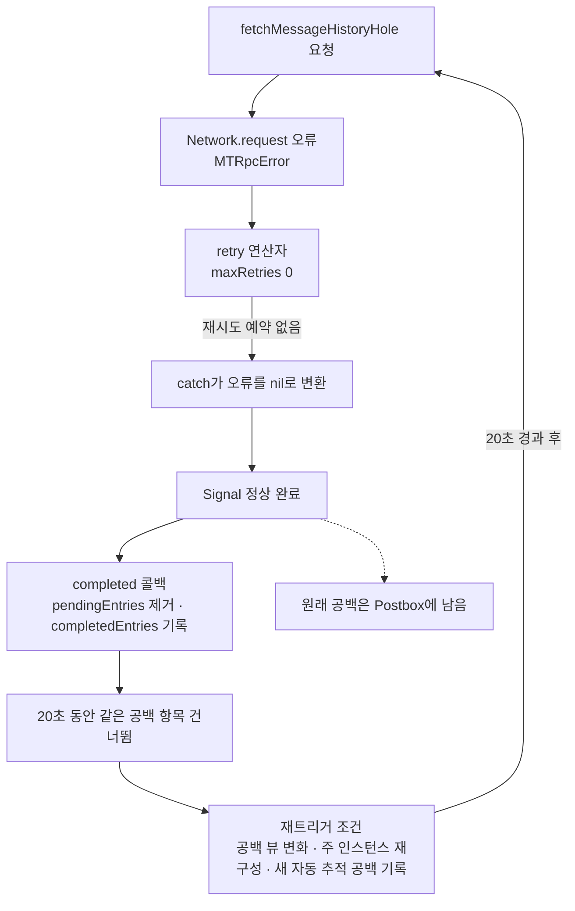
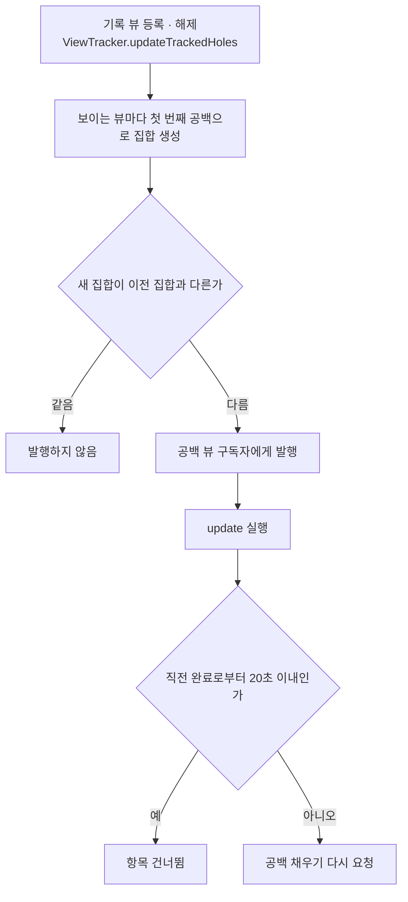
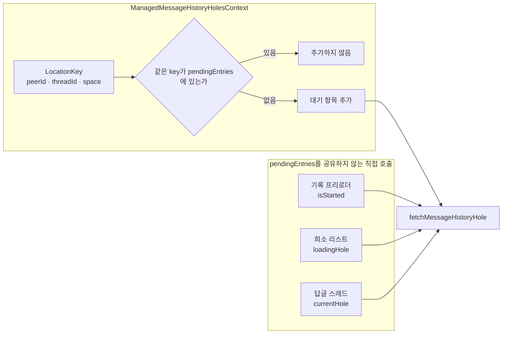

# 공백 채우기 실패 후의 재시도와 백오프

웹: /docs/system/34-hole-retry/ · Markdown: /docs/system/34-hole-retry.md

> 메시지 기록 공백(hole) 채우기가 실패한 뒤의 오류 경계, 백오프 파라미터, 재트리거 조건, 동시 중복 제거 범위를 검증해요.

> 시스템 설계 · 검증과 보충 · 보충 34 · 도표 0 · 코드 발췌 2 · 인용 13 · 소스 기준선: [TelegramMessenger/Telegram-iOS@f1dd7a2d](https://github.com/TelegramMessenger/Telegram-iOS/tree/f1dd7a2dbd02cbbf513e75d5695d8d36d1cf5838), [overtake/TelegramSwift@579cebbf](https://github.com/overtake/TelegramSwift/tree/579cebbf0c01fd41b712eff3647fa7f69db9665d)
>
> 검증 대상: [Postbox 뷰와 메시지 이력 모델](/docs/system/09-postbox-views/)
>
> 미검증 사항:
> - 같은 `LocationKey` 아래의 공백이 서로 다른 namespace, 방향 또는 `count`를 가질 때, 소스 코드는 안정적인 파라미터 병합 규칙이나 우선순위 규칙을 정의하지 않아요.

아래 도표는 공백 채우기 실패가 완료, 억제, 재트리거로 이어지는 전체 흐름을 보여 줘요.



## 기록 뷰에 보고되지 않는 공백 채우기 실패 [#기록-뷰에-보고되지-않는-공백-채우기-실패]

공백 채우기가 실패해도 그 사실은 `MessageHistoryView`에 전달되지 않아요. 실패가 공백 채우기 API 경계에서 “완료되었으나 결과 없음”으로 낮아지기 때문이에요.

먼저 오류가 생기는 쪽을 볼게요. `Network.request`는 엔진 실패를 `MTRpcError`로 바꿔서 구독자에게 넘겨요. [\[1\]](https://github.com/TelegramMessenger/Telegram-iOS/blob/f1dd7a2dbd02cbbf513e75d5695d8d36d1cf5838/submodules/TelegramCore/Sources/Network/Network.swift#L1306-L1341) 하지만 `fetchMessageHistoryHole`의 공개 반환 타입은 `Signal<FetchMessageHistoryHoleResult?, NoError>`예요. 이 함수는 먼저 인증이 끝난 계정 상태를 한 번 기다린 뒤 기록 요청을 보내요. [\[2\]](https://github.com/TelegramMessenger/Telegram-iOS/blob/f1dd7a2dbd02cbbf513e75d5695d8d36d1cf5838/submodules/TelegramCore/Sources/State/Holes.swift#L423-L458) 그래서 공백 채우기를 호출하는 쪽은 이 함수의 오류 채널로 RPC 오류를 받을 수 없어요.

오류가 사라지는 과정은 이래요.

1. 요청 파이프라인은 재시도 연산자 뒤에서 `catch`를 써서 종료 오류를 `nil` 값 하나로 바꿔요.
2. 그런 다음 함수는 정상적으로 완료돼요. [\[3\]](https://github.com/TelegramMessenger/Telegram-iOS/blob/f1dd7a2dbd02cbbf513e75d5695d8d36d1cf5838/submodules/TelegramCore/Sources/State/Holes.swift#L966-L989)
3. `ManagedMessageHistoryHolesContext`는 `completed` 콜백만 등록해요. 결과 값을 읽지 않고, 오류 콜백도 없어요.
4. 이 콜백은 대기 항목을 제거하고 해당 공백을 `completedEntries`에 기록해요. [\[5\]](https://github.com/TelegramMessenger/Telegram-iOS/blob/f1dd7a2dbd02cbbf513e75d5695d8d36d1cf5838/submodules/TelegramCore/Sources/State/ManagedMessageHistoryHoles.swift#L5-L210)

그래서 이 계층은 `MessageHistoryView`에 실패 이벤트를 내보내지 않고, 오류 코드를 공백 상태로 저장하지도 않아요.

```swift
return request
|> retry(retryOnError: { error in
    if error.errorDescription == "CHANNEL_PRIVATE" {
        switch peerInput {
        case let .direct(_, threadId):
            if threadId != nil {
                return false
            }
        case .threadFromChannel:
            return false
        }
    }
    return true
}, delayIncrement: 0.1, maxDelay: 2.0, maxRetries: 0, onQueue: .concurrentDefaultQueue())
|> map { result -> Api.messages.Messages? in
    return result
}
|> `catch` { _ -> Signal<Api.messages.Messages?, NoError> in
    return .single(nil)
}
```
[\[3\]](https://github.com/TelegramMessenger/Telegram-iOS/blob/f1dd7a2dbd02cbbf513e75d5695d8d36d1cf5838/submodules/TelegramCore/Sources/State/Holes.swift#L966-L989)

`nil` 분기는 바로 반환하고, 메시지를 쓰고 `transaction.removeHole`을 호출하는 트랜잭션 분기로 들어가지 않아요. 그래서 실패한 뒤에도 원래의 공백은 Postbox에 남아 있어요.

여기서 “완료”는 이번 Signal이 종료되었다는 뜻일 뿐, 공백이 다 채워졌다는 뜻이 아니에요. [\[3\]](https://github.com/TelegramMessenger/Telegram-iOS/blob/f1dd7a2dbd02cbbf513e75d5695d8d36d1cf5838/submodules/TelegramCore/Sources/State/Holes.swift#L966-L989)

## `maxRetries: 0`으로 무효가 되는 백오프 파라미터 [#maxretries-0으로-무효가-되는-백오프-파라미터]

공백 채우기는 `maxRetries`를 `0`으로 넘기기 때문에, 이름이 `retry`인 연산자의 백오프 파라미터가 실제로는 전혀 쓰이지 않아요.

먼저 연산자가 어떻게 동작하는지 볼게요. 이 연산자는 지수 백오프가 아니라 누적 지연 방식을 써요. 재시도할 수 있는 오류가 날 때마다 이렇게 처리해요.

1. 지연을 `delayIncrement`만큼 늘리고 `maxDelay`로 상한을 둬요.
2. 재시도 횟수가 상한에 도달했는지 판단해요.
3. 상한에 도달하지 않았을 때만 `asyncAfter`와 다음 구독을 예약해요. [\[4\]](https://github.com/TelegramMessenger/Telegram-iOS/blob/f1dd7a2dbd02cbbf513e75d5695d8d36d1cf5838/submodules/SSignalKit/SwiftSignalKit/Source/Signal_Catch.swift#L142-L188)

```swift
let (delay, count) = currentDelay.modify { value, count in
    return (min(maxDelay, value + delayIncrement), count + 1)
}

if let maxRetries, count >= maxRetries {
    subscriber.putError(error)
} else {
    let time: DispatchTime = DispatchTime.now() + Double(delay)
    queue.queue.asyncAfter(deadline: time, execute: {
        recurse()
    })
}
```
[\[4\]](https://github.com/TelegramMessenger/Telegram-iOS/blob/f1dd7a2dbd02cbbf513e75d5695d8d36d1cf5838/submodules/SSignalKit/SwiftSignalKit/Source/Signal_Catch.swift#L142-L188)

공백 채우기는 `maxRetries`를 `0`으로 넘겨요. [\[3\]](https://github.com/TelegramMessenger/Telegram-iOS/blob/f1dd7a2dbd02cbbf513e75d5695d8d36d1cf5838/submodules/TelegramCore/Sources/State/Holes.swift#L966-L989) 재시도할 수 있는 오류 분기에 처음 들어가면 카운터가 `0`에서 `1`이 되어 바로 `1 >= 0`을 만족해요. 그래서 연산자는 원래 오류를 그대로 전달하고, 0.1초 뒤의 재시도를 예약하지 않아요. `maxDelay: 2.0`도 마찬가지로 실제 대기에는 관여하지 않아요.

`CHANNEL_PRIVATE`는 예외처럼 보일 수 있어요. 이 오류 코드는 `threadId`가 있는 direct 입력과 `threadFromChannel` 입력에 대해서만 추가로 `false`를 돌려줘요. [\[3\]](https://github.com/TelegramMessenger/Telegram-iOS/blob/f1dd7a2dbd02cbbf513e75d5695d8d36d1cf5838/submodules/TelegramCore/Sources/State/Holes.swift#L966-L989) 하지만 이것이 위의 결론을 바꾸지는 않아요. 이 연산자에 도달할 수 있는 최초의 `MTRpcError`는 모두 이번 구현에서 종료돼요.

코드에는 다음이 구현되어 있지 않아요.

- 메시지 기록 공백을 위한 지속적 재시도
- 지수 백오프
- 최대 시도 횟수 이후의 영속적 실패 큐

## 포기 이후의 20초 억제와 재트리거 [#포기-이후의-20초-억제와-재트리거]

실패한 공백은 20초 동안 다시 요청되지 않고, 그 뒤에도 스스로 재시도하지 않아요. 외부 이벤트가 있어야 다시 시작돼요.

관리자는 Signal이 완료되면 `pendingEntries`에서 해당 항목을 삭제하고 완료 시각을 기록해요. 업스트림이 성공 결과를 전달했든, `nil`을 전달했든, `catch`가 삼킨 오류이든 모두 이 완료 콜백으로 이어져요. [\[5\]](https://github.com/TelegramMessenger/Telegram-iOS/blob/f1dd7a2dbd02cbbf513e75d5695d8d36d1cf5838/submodules/TelegramCore/Sources/State/ManagedMessageHistoryHoles.swift#L5-L210) 이후 공백 집합 업데이트가 20초 안에 동일한 완전한 `MessageHistoryHolesViewEntry`에 적중하면 관리자는 그 항목을 건너뛰어요. [\[5\]](https://github.com/TelegramMessenger/Telegram-iOS/blob/f1dd7a2dbd02cbbf513e75d5695d8d36d1cf5838/submodules/TelegramCore/Sources/State/ManagedMessageHistoryHoles.swift#L5-L210)

이 20초는 디바운스 문턱(짧은 시간 안의 반복 요청을 걸러내는 기준)이지 타이머 기반 재시도가 아니에요.

- `update`는 `messageHistoryHolesView`가 집합을 발행할 때만 실행돼요.
- 소스 코드에는 `completedEntries`의 만료 타이머가 없어요.
- 완료 콜백은 이어서 `update(entries: self.currentEntries)`를 호출하는데, 이 파일에서 `currentEntries`는 빈 집합으로만 초기화되고 `update`도 받은 인자를 여기에 대입하지 않아요. [\[5\]](https://github.com/TelegramMessenger/Telegram-iOS/blob/f1dd7a2dbd02cbbf513e75d5695d8d36d1cf5838/submodules/TelegramCore/Sources/State/ManagedMessageHistoryHoles.swift#L5-L210)

그래서 이 경로는 20초가 지났을 때 실패한 공백을 스스로 다시 제출하지 않아요.

기록 뷰를 등록하고 해제할 때는 모두 `ViewTracker.updateTrackedHoles`를 호출해요. [\[6\]](https://github.com/TelegramMessenger/Telegram-iOS/blob/f1dd7a2dbd02cbbf513e75d5695d8d36d1cf5838/submodules/Postbox/Sources/ViewTracker.swift#L75-L93) 이 메서드는 보이는 기록 뷰마다 첫 번째 공백을 골라 집합을 만들고, 새 집합과 이전 집합이 다를 때만 공백 뷰 구독자에게 발행해요. [\[7\]](https://github.com/TelegramMessenger/Telegram-iOS/blob/f1dd7a2dbd02cbbf513e75d5695d8d36d1cf5838/submodules/Postbox/Sources/ViewTracker.swift#L476-L519)

그러므로 실패한 뒤 뷰를 다시 열거나 이동하면 공백 채우기가 다시 트리거될 수 있지만, 두 조건을 동시에 만족해야 해요.

- 공백 집합이 실제로 바뀌어 발행되어야 해요.
- 직전 완료로부터 최소 20초가 지나 있어야 해요.

다른 뷰가 여전히 같은 공백을 추적하고 있다면 단순히 다시 구독하는 것만으로는 집합이 바뀌지 않을 수 있어요.

아래 도표는 기록 뷰 변화가 공백 채우기 재요청으로 이어지는 조건을 보여 줘요.



재트리거 경로는 기록 뷰 변화 외에 두 가지가 더 있어요.

**주 인스턴스 재구성.** 공백 채우기 관리자가 만들어지면 `messageHistoryHolesViewSignal`은 현재 공백 집합의 스냅샷을 바로 보내요. [\[8\]](https://github.com/TelegramMessenger/Telegram-iOS/blob/f1dd7a2dbd02cbbf513e75d5695d8d36d1cf5838/submodules/Postbox/Sources/ViewTracker.swift#L534-L555) 계정이 서비스 작업의 주 인스턴스가 되면 이 관리자를 새로 만들고, 주 인스턴스 자격을 잃으면 그 disposable을 해제해요. [\[9\]](https://github.com/TelegramMessenger/Telegram-iOS/blob/f1dd7a2dbd02cbbf513e75d5695d8d36d1cf5838/submodules/TelegramCore/Sources/Account/Account.swift#L1420-L1450) 그래서 주 인스턴스가 다시 세워질 때도 새 완료 기록을 바탕으로 현재 공백을 다시 평가해요. 이렇게 다시 만드는 경로는 네트워크 복구 리스너가 아니에요.

**새 자동 추적 공백 기록.** 계정의 자동 추적 경로에는 로컬 리셋이 하나 더 있어요. 새 peer의 전체 범위 공백을 추가하기 전에 `resetPeerHoleManagement`를 호출해요. [\[10\]](https://github.com/TelegramMessenger/Telegram-iOS/blob/f1dd7a2dbd02cbbf513e75d5695d8d36d1cf5838/submodules/TelegramCore/Sources/State/AccountViewTracker.swift#L2040-L2051) 이 호출은 해당 peer의 완료 항목 타임스탬프만 지워요. 바로 뒤따르는 `addHole` 트랜잭션이 추적 집합을 바꿀 때에 한해 새로운 공백 채우기 요청이 발생해요. [\[10\]](https://github.com/TelegramMessenger/Telegram-iOS/blob/f1dd7a2dbd02cbbf513e75d5695d8d36d1cf5838/submodules/TelegramCore/Sources/State/AccountViewTracker.swift#L2040-L2051)

반대로 네트워크 복구는 재트리거 조건이 아니에요. 공백 채우기 관리자와 `fetchMessageHistoryHole` 모두 `networkState`나 연결 복구 이벤트를 구독하지 않아요. 네트워크가 복구될 때 이 계층에는 전용 콜백으로 다시 보내는 동작이 없어요.

이미 보냈지만 아직 오류가 돌아오지 않은 네트워크 요청이 전송 계층에서 어떻게 이어지는지는 네트워크 계층이 맡아요. 요청이 이미 `MTRpcError`로 끝났다면 이 계층은 앞서 말한 공백 뷰 변화, 주 인스턴스 재구성, 또는 새로운 자동 추적 공백 기록으로 재시도가 이루어지기를 기다릴 수밖에 없어요.

## 동시 요청의 중복 제거 범위 [#동시-요청의-중복-제거-범위]

동시 요청을 막는 중복 제거는 관리자 컨텍스트 안에서만, 그리고 `peerId`, `threadId`, `space`가 같은 요청끼리만 적용돼요.

관리자는 `peerId`, `threadId`, `space`만으로 `LocationKey`를 구성해요. 대기 항목을 추가하기 전에 같은 key가 이미 `pendingEntries`에 있는지 확인해요. [\[5\]](https://github.com/TelegramMessenger/Telegram-iOS/blob/f1dd7a2dbd02cbbf513e75d5695d8d36d1cf5838/submodules/TelegramCore/Sources/State/ManagedMessageHistoryHoles.swift#L5-L210) 그래서 살아 있는 `ManagedMessageHistoryHolesContext` 하나 안에서는 같은 peer, thread, 공백 space에 대해 진행 중인 관리자 요청이 많아야 하나뿐이에요.

이 key에는 namespace, 방향, 요청 수량, `userId`가 들어 있지 않아요. 그래서 서로 다른 namespace나 윈도우 방향의 공백이라도 `peerId`, `threadId`, `space` 세 항목이 같으면 이 억제 키를 함께 써요. 소스 코드는 같은 key를 가진 항목들 사이에서 정렬하거나 파라미터를 병합하지 않아요. `Set`을 순회할 때 먼저 만나는 항목이 이번 라운드의 요청 파라미터를 정한다는 건 추론이에요. [\[5\]](https://github.com/TelegramMessenger/Telegram-iOS/blob/f1dd7a2dbd02cbbf513e75d5695d8d36d1cf5838/submodules/TelegramCore/Sources/State/ManagedMessageHistoryHoles.swift#L5-L210) 태그 space, thread, peer 중 하나라도 다르면 동시에 실행될 수 있어요.

이 중복 제거는 해당 관리자에만 적용돼요. `fetchMessageHistoryHole`을 직접 호출하는 지점은 이런 곳들이에요.

- 기록 프리로더: 자체 `isStarted` 플래그를 둔 뒤 호출해요.
- 희소 리스트: 인스턴스 필드 `loadingHole`로 호출해요.
- 답글 스레드: 독립적인 `currentHole`을 유지해요. [\[11\]](https://github.com/TelegramMessenger/Telegram-iOS/blob/f1dd7a2dbd02cbbf513e75d5695d8d36d1cf5838/submodules/TelegramCore/Sources/State/ChatHistoryPreloadManager.swift#L98-L121) [\[12\]](https://github.com/TelegramMessenger/Telegram-iOS/blob/f1dd7a2dbd02cbbf513e75d5695d8d36d1cf5838/submodules/TelegramCore/Sources/TelegramEngine/Messages/SparseMessageList.swift#L352-L381) [\[13\]](https://github.com/TelegramMessenger/Telegram-iOS/blob/f1dd7a2dbd02cbbf513e75d5695d8d36d1cf5838/submodules/TelegramCore/Sources/TelegramEngine/Messages/ReplyThreadHistory.swift#L295-L315)

이 호출 지점들은 `ManagedMessageHistoryHolesContext`의 `pendingEntries`를 공유하지 않아요. 그래서 소스 코드로 확인되는 중복 제거 경계는 “단일 관리자 컨텍스트”예요. 계정 전체에서 모든 공백 채우기 호출을 대상으로 하는 전역 single-flight(같은 요청을 한 번에 하나만 보내는 방식)가 아니에요.

아래 도표는 관리자 안의 중복 제거 범위와 그 밖의 직접 호출 지점을 보여 줘요.



## 미검증 사항 [#미검증-사항]

- 같은 `LocationKey` 아래의 공백이 서로 다른 namespace, 방향 또는 `count`를 가질 때, 소스 코드는 안정적인 파라미터 병합 규칙이나 우선순위 규칙을 정의하지 않아요. [\[5\]](https://github.com/TelegramMessenger/Telegram-iOS/blob/f1dd7a2dbd02cbbf513e75d5695d8d36d1cf5838/submodules/TelegramCore/Sources/State/ManagedMessageHistoryHoles.swift#L5-L210)

## 원래 장에 대한 수정 [#원래-장에-대한-수정]

- `09-postbox-views.md`, “공백으로 내려받지 않은 기록 표현하기”에서 “실패 시 해당 Signal은 완료 정리를 실행하지 않는다”로 시작하는 문장 → “최초의 `MTRpcError`는 `retry`를 거친 뒤 `maxRetries: 0` 때문에 즉시 `catch`에 도달하고, `nil`로 바뀌어 정상 완료돼요. 관리자는 대기 항목을 제거하고 20초 완료 억제를 기록하지만, 공백을 제거하지도 않고 오류를 뷰에 보고하지도 않아요.”로 바꿔요. 이로써 “공백 채우기 요청 실패 후의 장기 재시도와 백오프 전략”이 해결돼요. 결과: 원문과 모순, 해결됨. [\[3\]](https://github.com/TelegramMessenger/Telegram-iOS/blob/f1dd7a2dbd02cbbf513e75d5695d8d36d1cf5838/submodules/TelegramCore/Sources/State/Holes.swift#L966-L989) [\[4\]](https://github.com/TelegramMessenger/Telegram-iOS/blob/f1dd7a2dbd02cbbf513e75d5695d8d36d1cf5838/submodules/SSignalKit/SwiftSignalKit/Source/Signal_Catch.swift#L142-L188) [\[5\]](https://github.com/TelegramMessenger/Telegram-iOS/blob/f1dd7a2dbd02cbbf513e75d5695d8d36d1cf5838/submodules/TelegramCore/Sources/State/ManagedMessageHistoryHoles.swift#L5-L210)

- `09-postbox-views.md`, “설계 트레이드오프”의 “공백 채우기 요청 실패 후의 장기 전략은 이 장이 읽은 범위에서 미검증” → “이 커밋은 공백 채우기 RPC의 두 번째 시도를 예약하지 않아요. `retry`의 0.1초~2초 누적 백오프는 `maxRetries: 0` 때문에 스케줄되지 않아요. 실패한 공백은 남고, 20초 동안 같은 공백 항목을 억제하며, 이후에는 공백 뷰 변화, 주 인스턴스 재구성, 새 자동 추적 공백 기록으로 재트리거되어야 해요.”로 바꿔요. 이로써 원래 장의 유일한 미검증 사항이 해결돼요. 결과: 해결됨. [\[3\]](https://github.com/TelegramMessenger/Telegram-iOS/blob/f1dd7a2dbd02cbbf513e75d5695d8d36d1cf5838/submodules/TelegramCore/Sources/State/Holes.swift#L966-L989) [\[4\]](https://github.com/TelegramMessenger/Telegram-iOS/blob/f1dd7a2dbd02cbbf513e75d5695d8d36d1cf5838/submodules/SSignalKit/SwiftSignalKit/Source/Signal_Catch.swift#L142-L188) [\[5\]](https://github.com/TelegramMessenger/Telegram-iOS/blob/f1dd7a2dbd02cbbf513e75d5695d8d36d1cf5838/submodules/TelegramCore/Sources/State/ManagedMessageHistoryHoles.swift#L5-L210) [\[6\]](https://github.com/TelegramMessenger/Telegram-iOS/blob/f1dd7a2dbd02cbbf513e75d5695d8d36d1cf5838/submodules/Postbox/Sources/ViewTracker.swift#L75-L93) [\[7\]](https://github.com/TelegramMessenger/Telegram-iOS/blob/f1dd7a2dbd02cbbf513e75d5695d8d36d1cf5838/submodules/Postbox/Sources/ViewTracker.swift#L476-L519) [\[9\]](https://github.com/TelegramMessenger/Telegram-iOS/blob/f1dd7a2dbd02cbbf513e75d5695d8d36d1cf5838/submodules/TelegramCore/Sources/Account/Account.swift#L1420-L1450) [\[10\]](https://github.com/TelegramMessenger/Telegram-iOS/blob/f1dd7a2dbd02cbbf513e75d5695d8d36d1cf5838/submodules/TelegramCore/Sources/State/AccountViewTracker.swift#L2040-L2051)

- `09-postbox-views.md`, “공백으로 내려받지 않은 기록 표현하기”에서 “같은 공백의 관찰 업데이트가 반복해서 동시에 요청을 시작한다”는 개괄 → “중복 제거 키는 peer, thread, space이고 namespace, 방향, count는 포함하지 않으며, 관리자 컨텍스트에만 작용해요. `fetchMessageHistoryHole`을 직접 호출하는 다른 경로는 이 집합에 속하지 않아요.”를 보충해요. 동시 중복 제거 경계를 검증한 거예요. 결과: 부분 해결. [\[5\]](https://github.com/TelegramMessenger/Telegram-iOS/blob/f1dd7a2dbd02cbbf513e75d5695d8d36d1cf5838/submodules/TelegramCore/Sources/State/ManagedMessageHistoryHoles.swift#L5-L210) [\[11\]](https://github.com/TelegramMessenger/Telegram-iOS/blob/f1dd7a2dbd02cbbf513e75d5695d8d36d1cf5838/submodules/TelegramCore/Sources/State/ChatHistoryPreloadManager.swift#L98-L121) [\[12\]](https://github.com/TelegramMessenger/Telegram-iOS/blob/f1dd7a2dbd02cbbf513e75d5695d8d36d1cf5838/submodules/TelegramCore/Sources/TelegramEngine/Messages/SparseMessageList.swift#L352-L381) [\[13\]](https://github.com/TelegramMessenger/Telegram-iOS/blob/f1dd7a2dbd02cbbf513e75d5695d8d36d1cf5838/submodules/TelegramCore/Sources/TelegramEngine/Messages/ReplyThreadHistory.swift#L295-L315)

## 참고 [#references]

- \[1\] [Network request error delivery](https://github.com/TelegramMessenger/Telegram-iOS/blob/f1dd7a2dbd02cbbf513e75d5695d8d36d1cf5838/submodules/TelegramCore/Sources/Network/Network.swift#L1306-L1341)
- \[2\] [Message history hole signal boundary](https://github.com/TelegramMessenger/Telegram-iOS/blob/f1dd7a2dbd02cbbf513e75d5695d8d36d1cf5838/submodules/TelegramCore/Sources/State/Holes.swift#L423-L458)
- \[3\] [Hole request retry and error conversion](https://github.com/TelegramMessenger/Telegram-iOS/blob/f1dd7a2dbd02cbbf513e75d5695d8d36d1cf5838/submodules/TelegramCore/Sources/State/Holes.swift#L966-L989)
- \[4\] [Retry counter and delayed recursion](https://github.com/TelegramMessenger/Telegram-iOS/blob/f1dd7a2dbd02cbbf513e75d5695d8d36d1cf5838/submodules/SSignalKit/SwiftSignalKit/Source/Signal_Catch.swift#L142-L188)
- \[5\] [Managed hole deduplication and completion gate](https://github.com/TelegramMessenger/Telegram-iOS/blob/f1dd7a2dbd02cbbf513e75d5695d8d36d1cf5838/submodules/TelegramCore/Sources/State/ManagedMessageHistoryHoles.swift#L5-L210)
- \[6\] [History view registration updates tracked holes](https://github.com/TelegramMessenger/Telegram-iOS/blob/f1dd7a2dbd02cbbf513e75d5695d8d36d1cf5838/submodules/Postbox/Sources/ViewTracker.swift#L75-L93)
- \[7\] [Tracked hole set publication](https://github.com/TelegramMessenger/Telegram-iOS/blob/f1dd7a2dbd02cbbf513e75d5695d8d36d1cf5838/submodules/Postbox/Sources/ViewTracker.swift#L476-L519)
- \[8\] [Hole view initial snapshot](https://github.com/TelegramMessenger/Telegram-iOS/blob/f1dd7a2dbd02cbbf513e75d5695d8d36d1cf5838/submodules/Postbox/Sources/ViewTracker.swift#L534-L555)
- \[9\] [Managed services master lifecycle](https://github.com/TelegramMessenger/Telegram-iOS/blob/f1dd7a2dbd02cbbf513e75d5695d8d36d1cf5838/submodules/TelegramCore/Sources/Account/Account.swift#L1420-L1450)
- \[10\] [Reset completion gate before adding peer hole](https://github.com/TelegramMessenger/Telegram-iOS/blob/f1dd7a2dbd02cbbf513e75d5695d8d36d1cf5838/submodules/TelegramCore/Sources/State/AccountViewTracker.swift#L2040-L2051)
- \[11\] [Preload manager direct hole fetch](https://github.com/TelegramMessenger/Telegram-iOS/blob/f1dd7a2dbd02cbbf513e75d5695d8d36d1cf5838/submodules/TelegramCore/Sources/State/ChatHistoryPreloadManager.swift#L98-L121)
- \[12\] [Sparse list direct hole fetch](https://github.com/TelegramMessenger/Telegram-iOS/blob/f1dd7a2dbd02cbbf513e75d5695d8d36d1cf5838/submodules/TelegramCore/Sources/TelegramEngine/Messages/SparseMessageList.swift#L352-L381)
- \[13\] [Reply thread direct hole fetch](https://github.com/TelegramMessenger/Telegram-iOS/blob/f1dd7a2dbd02cbbf513e75d5695d8d36d1cf5838/submodules/TelegramCore/Sources/TelegramEngine/Messages/ReplyThreadHistory.swift#L295-L315)
