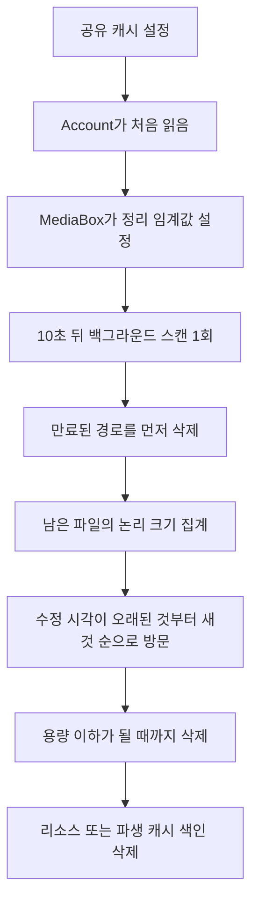

# 미디어 캐시의 용량 상한과 축출 순서

웹: /docs/system/35-cache-eviction/ · Markdown: /docs/system/35-cache-eviction.md

> iOS 미디어 캐시의 용량 설정, 지연 스캔, 수정 시각 정렬, 활성 리소스 보호 경계를 따라가 봐요.

> 시스템 설계 · 검증과 보충 · 보충 35 · 도표 1 · 코드 발췌 2 · 인용 17 · 소스 기준선: [TelegramMessenger/Telegram-iOS@f1dd7a2d](https://github.com/TelegramMessenger/Telegram-iOS/tree/f1dd7a2dbd02cbbf513e75d5695d8d36d1cf5838), [overtake/TelegramSwift@579cebbf](https://github.com/overtake/TelegramSwift/tree/579cebbf0c01fd41b712eff3647fa7f69db9665d)
>
> 검증 대상: [미디어 리소스, 다운로드/업로드, 캐시](/docs/system/10-media-cache/)
>
> 미검증 사항:
> - macOS 툴체인에서 TelegramSwift를 아직 빌드하지 않았어요. `FetchManager`와 `TelegramMedia`의 패키지 그래프 해석과 컴파일 결과는 여전히 미검증이에요.

## 계정 공유 설정이지만 바로 적용되지 않는 용량 상한 [#계정-공유-설정이지만-바로-적용되지-않는-용량-상한]

10장에서 내린 대화별 보존 기간 결론은 여전히 유효해요. 이 보충 문서는 용량 기반 축출(캐시가 상한을 넘으면 파일을 지우는 것)만 채워요.

iOS는 용량 상한을 `CacheStorageSettings.defaultCacheStorageLimitGigabytes`에 저장해요.

- `Int32` 기가바이트 값 하나예요. peer(채팅 상대), 미디어 유형, 콘텐츠 유형별로 나눈 할당량이 아니에요.
- 기본값은 `Int32.max`로, 용량 무제한이라는 뜻이에요.
- 분류별 설정과 peer별 설정에는 보존 기간(초 단위)만 저장돼요. [\[1\]](https://github.com/TelegramMessenger/Telegram-iOS/blob/f1dd7a2dbd02cbbf513e75d5695d8d36d1cf5838/submodules/TelegramCore/Sources/SyncCore/SyncCore_CacheStorageSettings.swift#L17-L42)

설정 화면은 기기 총 용량에 따라 네 가지 단계를 보여줘요.

- 총 용량이 100 GiB보다 크면 5, 20, 50 GiB와 무제한이에요.
- 총 용량이 24 GiB 이하이면 1, 4, 8 GiB와 무제한이에요.

화면은 사용자가 고른 값을 계정 관리자의 공유 데이터에 다시 기록해요. [\[2\]](https://github.com/TelegramMessenger/Telegram-iOS/blob/f1dd7a2dbd02cbbf513e75d5695d8d36d1cf5838/submodules/TelegramUI/Components/StorageUsageScreen/Sources/StorageKeepSizeComponent.swift#L16-L44) [\[3\]](https://github.com/TelegramMessenger/Telegram-iOS/blob/f1dd7a2dbd02cbbf513e75d5695d8d36d1cf5838/submodules/TelegramUI/Components/StorageUsageScreen/Sources/StorageUsageScreen.swift#L1971-L1987)

계정을 구성할 때 공유 설정을 한 번 읽어요. `take(1)`이 이 구독을 첫 항목 뒤에 끝내요. 이어서 다음 값을 `MediaBox`에 넘겨요.

- 기본 보존 기간
- 한 시간으로 고정된 short cache 보존 기간
- 용량 값

이 체크아웃에서 프로덕션 코드가 `setMaxStoreTimes`를 부르는 곳은 여기 한 군데뿐이에요. 그래서 설정 화면이 새 용량을 기록해도, 이미 있는 `MediaBox`의 용량 스캔이 바로 다시 설정되지는 않아요. 추정: 계정이 다시 구성되거나, 읽지 않은 다른 프로세스 생명주기 이벤트가 있어야 새 값이 정리기에 들어가요. [\[4\]](https://github.com/TelegramMessenger/Telegram-iOS/blob/f1dd7a2dbd02cbbf513e75d5695d8d36d1cf5838/submodules/TelegramCore/Sources/Account/Account.swift#L1558-L1567)

`submodules/TelegramCore/Sources/Account/Account.swift` 1558–1567행 발췌.

```swift
if !supplementary {
    let mediaBox = postbox.mediaBox
    let _ = (accountManager.sharedData(keys: [SharedDataKeys.cacheStorageSettings])
    |> take(1)).start(next: { [weak mediaBox] sharedData in
        guard let mediaBox = mediaBox else {
            return
        }
        let settings: CacheStorageSettings = sharedData.entries[SharedDataKeys.cacheStorageSettings]?.get(CacheStorageSettings.self) ?? CacheStorageSettings.defaultSettings
        mediaBox.setMaxStoreTimes(general: settings.defaultCacheStorageTimeout, shortLived: 60 * 60, gigabytesLimit: settings.defaultCacheStorageLimitGigabytes)
    })
}
```
[\[4\]](https://github.com/TelegramMessenger/Telegram-iOS/blob/f1dd7a2dbd02cbbf513e75d5695d8d36d1cf5838/submodules/TelegramCore/Sources/Account/Account.swift#L1558-L1567)

`MediaBox`는 경로를 이렇게 나눠요.

- 일반 파생 캐시: `cache`와 `animation-cache`로 한정해요.
- 단명 경로: `short-cache`예요.
- 리소스 주 파일: `basePath` 루트 디렉터리에 있고, 이 루트를 용량 스캔 경로로 써요. [\[5\]](https://github.com/TelegramMessenger/Telegram-iOS/blob/f1dd7a2dbd02cbbf513e75d5695d8d36d1cf5838/submodules/Postbox/Sources/MediaBox.swift#L185-L258)

다시 말해 용량 상한에는 리소스 주 파일, 부분 파일, 파생 캐시, short cache가 모두 들어가요. StorageBox가 이미 색인한 채팅 미디어만 제한하는 게 아니에요.



## 스캔 시점, 집계 기준, 경로 범위 [#스캔-시점-집계-기준-경로-범위]

`setMaxStoreTimes`는 세 임계값 중 하나라도 바뀔 때만 `resetScan`을 불러요. `resetScan`은 이렇게 동작해요.

- 세 임계값이 모두 무제한이면 대기 중인 스캔을 취소해요.
- 그렇지 않으면 정리기가 `scanOnce` 시그널을 만들고, 10초 뒤에 백그라운드 스캔을 한 번 시작해요.

스캔을 주기적으로 반복하는 로직은 없어요. 미디어를 쓸 때마다 총량을 확인하지도 않아요. [\[6\]](https://github.com/TelegramMessenger/Telegram-iOS/blob/f1dd7a2dbd02cbbf513e75d5695d8d36d1cf5838/submodules/Postbox/Sources/TimeBasedCleanup.swift#L367-L465)

용량이 제한돼 있으면 스캔은 이 순서로 진행돼요.

1. 디렉터리 통계와 루트 디렉터리의 파일 속성으로 총량을 추정해요.
2. 추정값이 바이트 상한을 넘지 않으면 `performSizeMapping`은 거짓이에요. 이번 회차에서는 시간 기준 용량 후보 표를 만들지 않아요.
3. 추정값이 상한을 넘으면 short cache, `cache`, `animation-cache`를 재귀적으로 스캔하고, 루트의 직접 파일도 스캔해요.
4. 그다음에야 스캔으로 얻은 총량을 보고 파일을 삭제할지 정해요. [\[7\]](https://github.com/TelegramMessenger/Telegram-iOS/blob/f1dd7a2dbd02cbbf513e75d5695d8d36d1cf5838/submodules/Postbox/Sources/TimeBasedCleanup.swift#L475-L558)

용량을 판단하는 항목별 기준은 파일의 논리 길이예요. 스캐너는 일반 파일마다 이렇게 처리해요.

- 크기는 `stat`의 `st_size`를 써요.
- 수정 시각은 `Int32` 초로 줄여요.
- 파일 경로와 논리 크기는 임시 SQLite 표에 저장하고, 수정 시각과 늘어나는 번호로 키를 만들어요. [\[8\]](https://github.com/TelegramMessenger/Telegram-iOS/blob/f1dd7a2dbd02cbbf513e75d5695d8d36d1cf5838/submodules/Postbox/Sources/TimeBasedCleanup.swift#L192-L303)

이 논리 길이는 `MediaBox.fileSizeForId`가 부분 파일에 쓰는, 할당된 블록 수가 아니에요. 스파스 부분 파일(빈 구간을 디스크에 할당하지 않는 파일)에서는 두 기준이 달라질 수 있어요.

short cache(단명 경로)에는 놓치기 쉬운 조건이 하나 있어요.

- 용량이 무제한이면 `resetScan`은 short cache의 시한을 무제한으로 바꿔요.
- 용량이 제한돼 있을 때만 계정이 넘긴 한 시간을 써요.

이건 채팅별 보존 기간을 구현한 게 아니라, 파생 단명 캐시에 적용하는 파일 시스템 정책이에요. [\[6\]](https://github.com/TelegramMessenger/Telegram-iOS/blob/f1dd7a2dbd02cbbf513e75d5695d8d36d1cf5838/submodules/Postbox/Sources/TimeBasedCleanup.swift#L367-L465)

`submodules/Postbox/Sources/TimeBasedCleanup.swift` 475–551행 발췌.

```swift
let oldestShortLivedTimestamp = timestamp - shortLived
let oldestGeneralTimestamp = timestamp - general

var totalLimitSize: UInt64 = 0

for path in shortLivedPaths {
    let scanResult = scanFiles(at: path, olderThan: oldestShortLivedTimestamp, includeSubdirectories: true, performSizeMapping: performSizeMapping, tempDatabase: tempDatabase, reportMemoryUsageInterval: reportMemoryUsageInterval, reportMemoryUsageRemaining: &reportMemoryUsageRemaining, seenLinkedInodes: &seenLinkedInodes, isCancelled: isCancelled, didUnlink: didUnlinkCacheFile)
    // ...
    totalLimitSize += scanResult.totalSize
}

if totalLimitSize > bytesLimit && !isCancelled() {
    var remainingSize = Int64(totalLimitSize)
    var unlinkedResourceIdSet = Set<Data>()
    tempDatabase.topByAccessTime { size, filePaths in
        if isCancelled() {
            return false
        }
        remainingSize -= size
        // ...
        if remainingSize <= Int64(bytesLimit) {
            return false
        }

        return true
    }
}
```
[\[7\]](https://github.com/TelegramMessenger/Telegram-iOS/blob/f1dd7a2dbd02cbbf513e75d5695d8d36d1cf5838/submodules/Postbox/Sources/TimeBasedCleanup.swift#L475-L558)

용량 스캔은 시간 임계값에 따른 삭제를 먼저 하고, 그래도 상한을 넘는 만큼 파일을 삭제해요. 어떤 파일이 용량 후보 집합에 들어가는지는 용량 설정에 따라 달라요.

- 용량이 제한돼 있으면: 루트의 리소스 파일은 기본 보존 기간이 무제한이어도 용량 후보 집합에 들어가요. 파생 캐시도 같은 후보 집합에 들어가요.
- 용량이 무제한이면: 루트 리소스는 이 파일 시스템 연령 스캔에 참여하지 않고, 파생 캐시는 일반 보존 기간에 따라서만 처리돼요. [\[6\]](https://github.com/TelegramMessenger/Telegram-iOS/blob/f1dd7a2dbd02cbbf513e75d5695d8d36d1cf5838/submodules/Postbox/Sources/TimeBasedCleanup.swift#L367-L465) [\[7\]](https://github.com/TelegramMessenger/Telegram-iOS/blob/f1dd7a2dbd02cbbf513e75d5695d8d36d1cf5838/submodules/Postbox/Sources/TimeBasedCleanup.swift#L475-L558)

## 크기, 유형, 대화와 상관없는 축출 순서 [#크기-유형-대화와-상관없는-축출-순서]

임시 표의 `topByAccessTime`은 수정 시각이 가장 작은 것부터 방문해요. 같은 초 안에서는 키의 두 번째 부분, 곧 스캔할 때 매긴 증가 번호가 순서를 정해요. 이 번호는 같은 타임스탬프를 순회하는 순서만 정할 뿐, 접근 횟수나 리소스 우선순위를 뜻하지 않아요. [\[9\]](https://github.com/TelegramMessenger/Telegram-iOS/blob/f1dd7a2dbd02cbbf513e75d5695d8d36d1cf5838/submodules/Postbox/Sources/TimeBasedCleanup.swift#L89-L185)

상한을 넘었을 때 축출은 이렇게 진행돼요.

- 후보 하나를 방문하자마자 그 크기를 남은 총량에서 빼고, 그 후보의 모든 경로를 삭제해요.
- 남은 양이 이미 임계값 이하가 되면 클로저가 false를 반환해요.

그래서 큰 파일을 먼저 고르지 않아요. 초과분이 가장 적게 되도록 고르거나 최적으로 채우는 규칙도 없어요. 파일 크기는 어디서 삭제를 멈출지만 정해요. [\[7\]](https://github.com/TelegramMessenger/Telegram-iOS/blob/f1dd7a2dbd02cbbf513e75d5695d8d36d1cf5838/submodules/Postbox/Sources/TimeBasedCleanup.swift#L475-L558)

단위 테스트도 1 GiB 상한에서 가장 오래된 600 MiB 파일을 먼저 삭제하고, 더 새로운 500 MiB와 300 MiB 파일을 남기는 것을 명시적으로 검증해요. [\[10\]](https://github.com/TelegramMessenger/Telegram-iOS/blob/f1dd7a2dbd02cbbf513e75d5695d8d36d1cf5838/submodules/Postbox/Tests/TimeBasedCleanupTests.swift#L334-L349)

다운로드가 끝나면 완전한 경로와 `_partial` 경로가 같은 inode(파일의 실체를 가리키는 파일 시스템 번호)를 가리킬 수 있어요. 스캐너는 장치 번호와 inode로 이 둘을 합쳐요.

- 크기는 한 번만 세요.
- 삭제할 때는 모든 하드 링크를 해제해요.

덕분에 같은 저장소를 두 번 세거나, 디렉터리 항목 하나만 해제하고 공간은 확보하지 못하는 일이 없어요. [\[8\]](https://github.com/TelegramMessenger/Telegram-iOS/blob/f1dd7a2dbd02cbbf513e75d5695d8d36d1cf5838/submodules/Postbox/Sources/TimeBasedCleanup.swift#L192-L303) [\[9\]](https://github.com/TelegramMessenger/Telegram-iOS/blob/f1dd7a2dbd02cbbf513e75d5695d8d36d1cf5838/submodules/Postbox/Sources/TimeBasedCleanup.swift#L89-L185)

그래서 용량 축출은 스캔한 모든 경로를 가로지르는 전역 수정 시각 순서예요. 용량 경로가 다음을 보지 않기 때문이에요.

- `StorageBox.Reference`, `MediaResourceUserContentType`, peer 범주, 메시지 범주를 읽지 않아요.
- 빈도를 기준으로 한 카운터도 없어요.

peer와 story 유형은 보존 기간이 이끄는 또 다른 `AutomaticCacheEviction` 경로에만 참여해요. [\[11\]](https://github.com/TelegramMessenger/Telegram-iOS/blob/f1dd7a2dbd02cbbf513e75d5695d8d36d1cf5838/submodules/TelegramCore/Sources/Utils/AutomaticCacheEviction.swift#L118-L252)

이 구현은 엄밀한 LRU(가장 오래 쓰지 않은 것부터 지우는 방식)가 아니에요. `MediaBox`는 완전한 파일 읽기, 완전한 경로 얻기, 상태 조회, 파일 컨텍스트 만들기 같은 경로에서 touch(파일 시각 갱신 요청)를 등록해요. 하지만 엄밀하지 않은 이유가 있어요.

- touch는 먼저 집합에 쌓였다가 10초 뒤에 비동기로 `utime`을 불러요.
- 같은 배치의 접근은 같은 초 단위 타임스탬프를 받아서 스캔 순서로 되돌아갈 수 있어요.
- 용량 검사도 접근이나 쓰기마다 일어나지 않아요. [\[6\]](https://github.com/TelegramMessenger/Telegram-iOS/blob/f1dd7a2dbd02cbbf513e75d5695d8d36d1cf5838/submodules/Postbox/Sources/TimeBasedCleanup.swift#L367-L465) [\[12\]](https://github.com/TelegramMessenger/Telegram-iOS/blob/f1dd7a2dbd02cbbf513e75d5695d8d36d1cf5838/submodules/Postbox/Sources/MediaBox.swift#L396-L635)

더 정확히 말하면, 한 번의 스캔 안에서 최근 사용 시각에 가깝게 축출하는 방식이에요. 소스가 접근 횟수를 기록하거나 비교하지 않으니 LFU(접근 횟수가 적은 것부터 지우는 방식)도 아니에요.

## 인용, 열린 리소스, 색인의 일관성 경계 [#인용-열린-리소스-색인의-일관성-경계]

peer별 자동 보존 기간 정리는 이 순서로 진행돼요.

1. `StorageBox`에서 리소스 식별자를 먼저 찾아요.
2. `removeCachedResourcesWithResult`를 불러요. 이 API는 기본 모드에서 `fileContexts`나 `keepResourceContexts`가 있는 리소스를 건너뛰고, 실제로 삭제에 성공한 식별자의 색인만 지워요. [\[11\]](https://github.com/TelegramMessenger/Telegram-iOS/blob/f1dd7a2dbd02cbbf513e75d5695d8d36d1cf5838/submodules/TelegramCore/Sources/Utils/AutomaticCacheEviction.swift#L118-L252) [\[13\]](https://github.com/TelegramMessenger/Telegram-iOS/blob/f1dd7a2dbd02cbbf513e75d5695d8d36d1cf5838/submodules/Postbox/Sources/MediaBox.swift#L909-L939)

용량 정리는 이 API를 타지 않아요. `TimeBasedCleanupImpl`은 StorageBox 두 개와 경로 배열만 갖고 있어요. 용량 경로는 이렇게 지워요.

- 임시 표가 내놓은 경로에 `unlink`를 바로 불러요.
- 마지막에 StorageBox에서 루트 리소스의 식별자를, 또는 cacheStorageBox에서 파생 캐시 경로를 삭제해요. [\[7\]](https://github.com/TelegramMessenger/Telegram-iOS/blob/f1dd7a2dbd02cbbf513e75d5695d8d36d1cf5838/submodules/Postbox/Sources/TimeBasedCleanup.swift#L475-L558)

그래서 용량 정리에는 활성 다운로드, 플레이어 읽기, `keepResource`를 명시적으로 제외하는 항목이 없어요.

새로 만든 파일 컨텍스트는 완전한 파일, 부분 파일, meta 파일을 touch해요. 그래서 최근에 쓴 것은 보통 순서가 뒤로 밀리지만, 이건 순서로 줄여 주는 것일 뿐 삭제를 막는 보호가 아니에요. [\[12\]](https://github.com/TelegramMessenger/Telegram-iOS/blob/f1dd7a2dbd02cbbf513e75d5695d8d36d1cf5838/submodules/Postbox/Sources/MediaBox.swift#L396-L635) [\[13\]](https://github.com/TelegramMessenger/Telegram-iOS/blob/f1dd7a2dbd02cbbf513e75d5695d8d36d1cf5838/submodules/Postbox/Sources/MediaBox.swift#L909-L939)

이 차이는 두 정리 경로의 장애 경계가 서로 다른 이유도 설명해요.

- peer별 삭제: `MediaBox`가 실제로 삭제한 집합을 돌려받고, 그 뒤에 비즈니스 색인을 갱신해요.
- 용량 삭제: 파일 시스템에서 먼저 unlink하고 나서 색인을 지워요.

용량 스캔이 아직 쓰는 중이지만 아주 오래된 리소스를 만나도, 코드는 삭제 전에 그 인용 상태를 조회하지 않아요. 소스는 이럴 때 더 강한 보호를 주지 않아요.

macOS 애플리케이션 계층의 `AccountClearCache`는 또 다른 수동 작업이에요. 이 작업은 이 순서로 진행돼요.

1. 활성 `fileContexts`와 경로를 먼저 얻어요.
2. `removeCachedResources`를 불러요.
3. 이어지는 파일 열거에서 그 경로들을 빼요.

이 작업은 용량 임계값을 받지 않고, 시간 순서로 도는 용량 루프도 없어요. [\[14\]](https://github.com/overtake/TelegramSwift/blob/579cebbf0c01fd41b712eff3647fa7f69db9665d/Telegram-Mac/ClearCache.swift#L42-L119)

TelegramSwift가 고정한 `a24bbe45` fork는 체크아웃되어 있고 `TimeBasedCleanup`을 포함해요. 여기서도 계정이 설정을 처음 읽을 때 트리거되고, 10초 뒤에 스캔을 한 번 실행해요. [\[15\]](https://github.com/overtake/Telegram-iOS/blob/a24bbe45f9861f736a79916a50898512f751e0dc/submodules/Postbox/Sources/TimeBasedCleanup.swift#L338-L513) [\[17\]](https://github.com/overtake/Telegram-iOS/blob/a24bbe45f9861f736a79916a50898512f751e0dc/submodules/TelegramCore/Sources/Account/Account.swift#L1334-L1343)

하지만 지금 iOS 구현과는 달라요. fork는 이래요.

- short cache의 스캔 결과를 `totalLimitSize`에 더하지 않아요.
- `general`이 무제한이면 general cache를 스캔하지도 않아요.
- 용량 루프는 남은 크기가 여전히 임계값 이상이면 false를 반환해요. 반면 지금 iOS는 남은 크기가 임계값 이하가 되면 멈춰요. [\[15\]](https://github.com/overtake/Telegram-iOS/blob/a24bbe45f9861f736a79916a50898512f751e0dc/submodules/Postbox/Sources/TimeBasedCleanup.swift#L338-L513) [\[16\]](https://github.com/overtake/Telegram-iOS/blob/a24bbe45f9861f736a79916a50898512f751e0dc/submodules/Postbox/Sources/TimeBasedCleanup.swift#L78-L129)

그래서 iOS에서 내린 “한 번 스캔하면 설정 값 아래까지 삭제한다”는 결론을 이 fork에 그대로 적용하면 안 돼요.

## 미검증 사항 [#미검증-사항]

- macOS 툴체인에서 TelegramSwift를 아직 빌드하지 않았어요. `FetchManager`와 `TelegramMedia`의 패키지 그래프 해석과 컴파일 결과는 여전히 미검증이에요.

## 원본 장에 대한 수정 [#원본-장에-대한-수정]

`10-media-cache.md`의 “캐시 용량, 보존 기간, 축출” 소절 마지막 문장 “이 장은 용량 축출의 정렬 구현을 행 단위로 추적하지 않았으므로 엄밀한 LRU나 엄밀한 LFU라고 주장하지 않는다.”를 “고정 업스트림에서 용량 정리는 `TimeBasedCleanup`이 한 번의 지연 스캔 안에서 해요. 파일 수정 시각이 오래된 것부터 새것 순으로 삭제하고, 크기는 멈출 지점을 판단하는 데만 써요. peer, 유형, 접근 횟수는 읽지 않아요. 최근 사용 시각에 가까운 축출이고, 엄밀한 LRU도 LFU도 아니에요.”로 고쳐요.

이렇게 하면 “용량 상한이 트리거될 때의 정렬과 축출 구현을 행 단위로 추적하지 않았다”는 미검증 사항이 풀려요.

상태: 해결됨. [\[6\]](https://github.com/TelegramMessenger/Telegram-iOS/blob/f1dd7a2dbd02cbbf513e75d5695d8d36d1cf5838/submodules/Postbox/Sources/TimeBasedCleanup.swift#L367-L465) [\[7\]](https://github.com/TelegramMessenger/Telegram-iOS/blob/f1dd7a2dbd02cbbf513e75d5695d8d36d1cf5838/submodules/Postbox/Sources/TimeBasedCleanup.swift#L475-L558) [\[9\]](https://github.com/TelegramMessenger/Telegram-iOS/blob/f1dd7a2dbd02cbbf513e75d5695d8d36d1cf5838/submodules/Postbox/Sources/TimeBasedCleanup.swift#L89-L185)

`10-media-cache.md`의 “캐시 용량, 보존 기간, 축출” 소절에서 위와 같은 단락에 있는 “용량 정책이 상한을 지킬 수 있다”를 “용량 스캔은 한 번 실행하는 동안 스캔한 논리 크기를 설정 값 이하로 삭제할 수 있지만, 쓰기 시점의 하드 할당량은 아니에요.”로 고쳐요.

원래 문장은 지연 스캔 한 번을 바로 적용되는 상한으로 오해하게 만들기 쉬워요. 고친 뒤에는 10초 지연, 첫 설정 읽기, 비주기 스캔을 설명해요. 이 결론은 고정 업스트림에만 해당해요. 체크아웃한 macOS fork에는 다른 용량 경로가 있어요.

상태: 원문의 강한 표현과 완전히 일치하지는 않음. [\[4\]](https://github.com/TelegramMessenger/Telegram-iOS/blob/f1dd7a2dbd02cbbf513e75d5695d8d36d1cf5838/submodules/TelegramCore/Sources/Account/Account.swift#L1558-L1567) [\[6\]](https://github.com/TelegramMessenger/Telegram-iOS/blob/f1dd7a2dbd02cbbf513e75d5695d8d36d1cf5838/submodules/Postbox/Sources/TimeBasedCleanup.swift#L367-L465) [\[7\]](https://github.com/TelegramMessenger/Telegram-iOS/blob/f1dd7a2dbd02cbbf513e75d5695d8d36d1cf5838/submodules/Postbox/Sources/TimeBasedCleanup.swift#L475-L558) [\[15\]](https://github.com/overtake/Telegram-iOS/blob/a24bbe45f9861f736a79916a50898512f751e0dc/submodules/Postbox/Sources/TimeBasedCleanup.swift#L338-L513) [\[16\]](https://github.com/overtake/Telegram-iOS/blob/a24bbe45f9861f736a79916a50898512f751e0dc/submodules/Postbox/Sources/TimeBasedCleanup.swift#L78-L129) [\[17\]](https://github.com/overtake/Telegram-iOS/blob/a24bbe45f9861f736a79916a50898512f751e0dc/submodules/TelegramCore/Sources/Account/Account.swift#L1334-L1343)

`10-media-cache.md`의 “LRU만이 아니라 비즈니스 귀속으로 관리하기” 소절에 “peer별 보존 기간 축출은 활성 파일 컨텍스트와 명시적으로 보존된 리소스를 건너뛰어요. 용량 축출은 파일을 바로 unlink하고, 갱신 시각이라는 간접 보호만 있어요.”를 추가해요.

이렇게 하면 인용되거나 사용 중인 리소스를 어떻게 보호하는가라는 문제가 풀려요.

상태: 해결됨. [\[7\]](https://github.com/TelegramMessenger/Telegram-iOS/blob/f1dd7a2dbd02cbbf513e75d5695d8d36d1cf5838/submodules/Postbox/Sources/TimeBasedCleanup.swift#L475-L558) [\[11\]](https://github.com/TelegramMessenger/Telegram-iOS/blob/f1dd7a2dbd02cbbf513e75d5695d8d36d1cf5838/submodules/TelegramCore/Sources/Utils/AutomaticCacheEviction.swift#L118-L252) [\[13\]](https://github.com/TelegramMessenger/Telegram-iOS/blob/f1dd7a2dbd02cbbf513e75d5695d8d36d1cf5838/submodules/Postbox/Sources/MediaBox.swift#L909-L939)

## 참고 [#references]

- \[1\] [캐시 용량과 분류별 시한 설정](https://github.com/TelegramMessenger/Telegram-iOS/blob/f1dd7a2dbd02cbbf513e75d5695d8d36d1cf5838/submodules/TelegramCore/Sources/SyncCore/SyncCore_CacheStorageSettings.swift#L17-L42)
- \[2\] [용량 선택 단계](https://github.com/TelegramMessenger/Telegram-iOS/blob/f1dd7a2dbd02cbbf513e75d5695d8d36d1cf5838/submodules/TelegramUI/Components/StorageUsageScreen/Sources/StorageKeepSizeComponent.swift#L16-L44)
- \[3\] [용량 설정 기록](https://github.com/TelegramMessenger/Telegram-iOS/blob/f1dd7a2dbd02cbbf513e75d5695d8d36d1cf5838/submodules/TelegramUI/Components/StorageUsageScreen/Sources/StorageUsageScreen.swift#L1971-L1987)
- \[4\] [계정 초기화 용량 정리기](https://github.com/TelegramMessenger/Telegram-iOS/blob/f1dd7a2dbd02cbbf513e75d5695d8d36d1cf5838/submodules/TelegramCore/Sources/Account/Account.swift#L1558-L1567)
- \[5\] [MediaBox 정리 경로와 리소스 크기](https://github.com/TelegramMessenger/Telegram-iOS/blob/f1dd7a2dbd02cbbf513e75d5695d8d36d1cf5838/submodules/Postbox/Sources/MediaBox.swift#L185-L258)
- \[6\] [정리 트리거와 용량 추정](https://github.com/TelegramMessenger/Telegram-iOS/blob/f1dd7a2dbd02cbbf513e75d5695d8d36d1cf5838/submodules/Postbox/Sources/TimeBasedCleanup.swift#L367-L465)
- \[7\] [스캔, 용량 축출, 색인 제거](https://github.com/TelegramMessenger/Telegram-iOS/blob/f1dd7a2dbd02cbbf513e75d5695d8d36d1cf5838/submodules/Postbox/Sources/TimeBasedCleanup.swift#L475-L558)
- \[8\] [파일 스캔, 시각과 크기 수집](https://github.com/TelegramMessenger/Telegram-iOS/blob/f1dd7a2dbd02cbbf513e75d5695d8d36d1cf5838/submodules/Postbox/Sources/TimeBasedCleanup.swift#L192-L303)
- \[9\] [임시 표의 가장 오래된 것 우선 순회](https://github.com/TelegramMessenger/Telegram-iOS/blob/f1dd7a2dbd02cbbf513e75d5695d8d36d1cf5838/submodules/Postbox/Sources/TimeBasedCleanup.swift#L89-L185)
- \[10\] [용량 축출 순서 테스트](https://github.com/TelegramMessenger/Telegram-iOS/blob/f1dd7a2dbd02cbbf513e75d5695d8d36d1cf5838/submodules/Postbox/Tests/TimeBasedCleanupTests.swift#L334-L349)
- \[11\] [대화와 스토리별 보존 기간 정리](https://github.com/TelegramMessenger/Telegram-iOS/blob/f1dd7a2dbd02cbbf513e75d5695d8d36d1cf5838/submodules/TelegramCore/Sources/Utils/AutomaticCacheEviction.swift#L118-L252)
- \[12\] [리소스 접근 touch와 파일 컨텍스트](https://github.com/TelegramMessenger/Telegram-iOS/blob/f1dd7a2dbd02cbbf513e75d5695d8d36d1cf5838/submodules/Postbox/Sources/MediaBox.swift#L396-L635)
- \[13\] [명시적 리소스 보존](https://github.com/TelegramMessenger/Telegram-iOS/blob/f1dd7a2dbd02cbbf513e75d5695d8d36d1cf5838/submodules/Postbox/Sources/MediaBox.swift#L909-L939)
- \[14\] [macOS 수동 정리 작업](https://github.com/overtake/TelegramSwift/blob/579cebbf0c01fd41b712eff3647fa7f69db9665d/Telegram-Mac/ClearCache.swift#L42-L119)
- \[15\] [fork 지연 스캔과 용량 루프](https://github.com/overtake/Telegram-iOS/blob/a24bbe45f9861f736a79916a50898512f751e0dc/submodules/Postbox/Sources/TimeBasedCleanup.swift#L338-L513)
- \[16\] [fork 수정 시각 후보 표](https://github.com/overtake/Telegram-iOS/blob/a24bbe45f9861f736a79916a50898512f751e0dc/submodules/Postbox/Sources/TimeBasedCleanup.swift#L78-L129)
- \[17\] [fork 계정의 캐시 설정 첫 읽기](https://github.com/overtake/Telegram-iOS/blob/a24bbe45f9861f736a79916a50898512f751e0dc/submodules/TelegramCore/Sources/Account/Account.swift#L1334-L1343)
