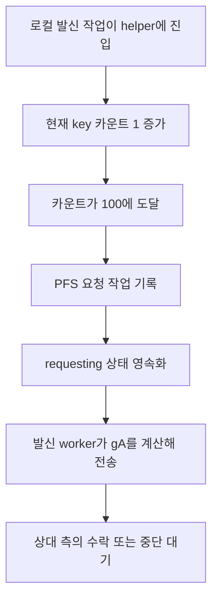
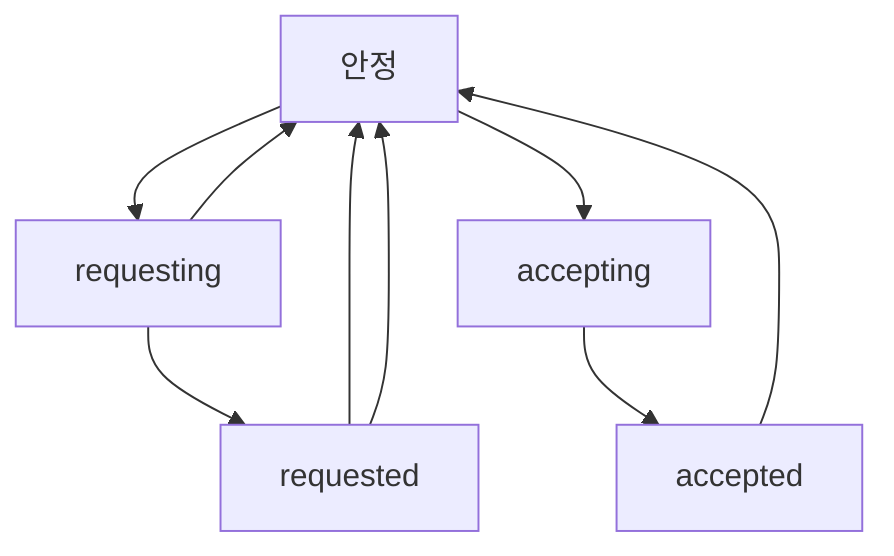

# 비밀 채팅 자동 키 교체의 트리거 지점

웹: /docs/system/36-auto-pfs/ · Markdown: /docs/system/36-auto-pfs.md

> 고정 iOS 및 macOS fork의 자동 PFS 키 교체는 로컬 발신 작업 카운트가 트리거하며, 1주일 타이머가 트리거하지 않아요.

> 시스템 설계 · 검증과 보충 · 보충 36 · 도표 2 · 코드 발췌 2 · 인용 17 · 소스 기준선: [TelegramMessenger/Telegram-iOS@f1dd7a2d](https://github.com/TelegramMessenger/Telegram-iOS/tree/f1dd7a2dbd02cbbf513e75d5695d8d36d1cf5838), [overtake/TelegramSwift@579cebbf](https://github.com/overtake/TelegramSwift/tree/579cebbf0c01fd41b712eff3647fa7f69db9665d)
>
> 검증 대상: [종단 간 암호화와 로컬 보안](/docs/system/11-secret-chats-security/)
>
> 미검증 사항:
> - `overtake/Telegram-iOS` 고정 커밋은 체크아웃했지만, 이 fork의 PasscodeCore 전체 호출 경로가 업스트림 iOS의 로컬 보호 경로와 일치하는지는 여전히 미검증이에요.

## 자동 트리거의 실제 호출 지점 [#자동-트리거의-실제-호출-지점]

고정 iOS `TelegramCore`는 PFS(전방 비밀성) 키 교체를 실제로 자동 시작해요. 시작을 판단하는 트리거 함수는 `secretChatInitiateRekeySessionIfNeeded`이고, 상수 `keyUseCountThreshold`의 값은 `100`이에요. 이 함수는 다음 순서로 동작해요.

1. 시퀀스 레이어 채팅만 받아들여요.
2. 이미 `rekeyState`가 있으면 즉시 반환해요.
3. 현재 사용 가능한 key를 가져와요.
4. 그 key의 `useCount`(key를 쓴 횟수)가 100 이상이면 `.pfsRequestKey` 발신 작업을 기록하고, 상태를 `.requesting`으로 설정해요. [\[1\]](https://github.com/TelegramMessenger/Telegram-iOS/blob/f1dd7a2dbd02cbbf513e75d5695d8d36d1cf5838/submodules/TelegramCore/Sources/SecretChats/SecretChatRekeySession.swift#L7-L29)

macOS fork의 같은 함수도 동일한 임계값과 상태 전이를 유지해요. [\[15\]](https://github.com/overtake/Telegram-iOS/blob/a24bbe45f9861f736a79916a50898512f751e0dc/submodules/TelegramCore/Sources/SecretChats/SecretChatRekeySession.swift#L7-L29)

```swift
private let keyUseCountThreshold: Int32 = 100

func secretChatInitiateRekeySessionIfNeeded(transaction: Transaction, peerId: PeerId, state: SecretChatState) -> SecretChatState {
    switch state.embeddedState {
        case let .sequenceBasedLayer(sequenceState):
            if let _ = sequenceState.rekeyState {
                return state
            }
            let tagLocalIndex = transaction.operationLogGetNextEntryLocalIndex(peerId: peerId, tag: OperationLogTags.SecretOutgoing)
            let canonicalIndex = sequenceState.canonicalOutgoingOperationIndex(tagLocalIndex)
            if let key = state.keychain.latestKey(validForSequenceBasedCanonicalIndex: canonicalIndex), key.useCount >= keyUseCountThreshold {
                let sessionId = Int64.random(in: Int64.min ... Int64.max)
                let aBytes = malloc(256)!
                let _ = SecRandomCopyBytes(nil, 256, aBytes.assumingMemoryBound(to: UInt8.self))
```
[\[1\]](https://github.com/TelegramMessenger/Telegram-iOS/blob/f1dd7a2dbd02cbbf513e75d5695d8d36d1cf5838/submodules/TelegramCore/Sources/SecretChats/SecretChatRekeySession.swift#L7-L29)

트리거 함수를 호출하는 곳도 소스 코드에서 확인돼요. 발신 작업을 기록하는 helper `addSecretChatOutgoingOperation`이 다음 순서로 일해요.

1. 현재 key의 `useCount`에 1을 더해요.
2. 전달받은 발신 작업을 기록해요.
3. 마지막에 위 트리거 함수를 호출해요. [\[2\]](https://github.com/TelegramMessenger/Telegram-iOS/blob/f1dd7a2dbd02cbbf513e75d5695d8d36d1cf5838/submodules/TelegramCore/Sources/State/ManagedSecretChatOutgoingOperations.swift#L8-L24)

`SecretChatKey`는 카운트를 필드 `u`로 인코딩하므로 카운트는 재시작 후에도 복원돼요. [\[3\]](https://github.com/TelegramMessenger/Telegram-iOS/blob/f1dd7a2dbd02cbbf513e75d5695d8d36d1cf5838/submodules/TelegramCore/Sources/SyncCore/SyncCore_SecretChatKeychain.swift#L48-L77) 그래서 helper를 100번째로 거치는 로컬 작업은 먼저 카운트를 99에서 100으로 올린 다음, 같은 트랜잭션 안에서 임계값을 검사하고 키 교체 요청을 추가해요.

카운트 단위는 `addSecretChatOutgoingOperation`을 거치는 로컬 `SecretOutgoing` 작업이에요. 엄밀한 의미의 사용자 텍스트 메시지 100건이 아니에요. 다음 서비스 작업이 모두 이 helper를 호출할 수 있어요.

- 메시지 전송
- 읽음 확인
- 삭제
- 스크린샷
- 레이어 공지
- 재전송

`pfsRequestKey` 자체는 트리거 함수가 작업 로그에 직접 기록하므로 helper를 다시 호출하지 않아요. [\[1\]](https://github.com/TelegramMessenger/Telegram-iOS/blob/f1dd7a2dbd02cbbf513e75d5695d8d36d1cf5838/submodules/TelegramCore/Sources/SecretChats/SecretChatRekeySession.swift#L7-L29) [\[2\]](https://github.com/TelegramMessenger/Telegram-iOS/blob/f1dd7a2dbd02cbbf513e75d5695d8d36d1cf5838/submodules/TelegramCore/Sources/State/ManagedSecretChatOutgoingOperations.swift#L8-L24)

실제 전송은 worker(작업 로그를 구독하다가 항목이 생기면 처리하는 쪽)가 맡아요. 계정이 시작될 때 `SecretOutgoing` 병합 작업 로그를 지속적으로 구독하는 worker가 만들어지고, 이 worker는 `pfsRequestKey` 작업에 대해 전용 `pfsRequestKey` 함수를 호출해요. [\[4\]](https://github.com/TelegramMessenger/Telegram-iOS/blob/f1dd7a2dbd02cbbf513e75d5695d8d36d1cf5838/submodules/TelegramCore/Sources/Account/Account.swift#L1453-L1463) [\[5\]](https://github.com/TelegramMessenger/Telegram-iOS/blob/f1dd7a2dbd02cbbf513e75d5695d8d36d1cf5838/submodules/TelegramCore/Sources/State/ManagedSecretChatOutgoingOperations.swift#L113-L161)

그래서 오프라인일 때도 요청은 먼저 영속화(저장)돼요. 네트워크를 쓸 수 있게 되면 worker가 이렇게 이어서 처리해요.

1. 검증된 DH 구성을 가져와요.
2. `gA`를 계산하고 검증해요.
3. `.requesting`을 `.requested`로 바꿔요.
4. 암호화된 서비스 액션을 전송해요. [\[6\]](https://github.com/TelegramMessenger/Telegram-iOS/blob/f1dd7a2dbd02cbbf513e75d5695d8d36d1cf5838/submodules/TelegramCore/Sources/State/ManagedSecretChatOutgoingOperations.swift#L296-L375)



## macOS fork의 동일한 호출 체인 [#macos-fork의-동일한-호출-체인]

macOS fork도 iOS와 호출 체인이 같아요. `overtake/Telegram-iOS`의 고정 커밋 `a24bbe45f9861f736a79916a50898512f751e0dc`를 보면 다음과 같아요.

- `keyUseCountThreshold`를 `100`으로 정의해요.
- `useCount`가 임계값에 도달하면 곧바로 `.pfsRequestKey`를 기록하고 `.requesting`으로 설정해요. [\[15\]](https://github.com/overtake/Telegram-iOS/blob/a24bbe45f9861f736a79916a50898512f751e0dc/submodules/TelegramCore/Sources/SecretChats/SecretChatRekeySession.swift#L7-L29)
- fork의 `addSecretChatOutgoingOperation`도 먼저 현재 key의 카운트를 증가시킨 뒤 `secretChatInitiateRekeySessionIfNeeded`를 호출해요. [\[16\]](https://github.com/overtake/Telegram-iOS/blob/a24bbe45f9861f736a79916a50898512f751e0dc/submodules/TelegramCore/Sources/State/ManagedSecretChatOutgoingOperations.swift#L8-L24)
- `useCount` 역시 필드 `u`로 인코딩되므로 카운트는 재시작 후에도 유지돼요. [\[17\]](https://github.com/overtake/Telegram-iOS/blob/a24bbe45f9861f736a79916a50898512f751e0dc/submodules/TelegramCore/Sources/SyncCore/SyncCore_SecretChatKeychain.swift#L48-L77)

fork를 정적으로 검색해 보니 `secretChatInitiateRekeySessionIfNeeded`를 호출하는 곳은 이 helper뿐이었어요. 그래서 보충 32의 “fork에서는 임계값을 시작 작업으로 바꾸는 스케줄링 지점을 찾지 못했다”는 결론은 이번 검증으로 뒤집혔어요. [macOS fork 장별 검증(08–15장)](/docs/system/32-fork-verify-08-15/) fork의 로컬 발신 작업이 100에 도달하면 PFS 요청이 자동으로 추가돼요.

## iOS 경로에 없는 1주일 스케줄 [#ios-경로에-없는-1주일-스케줄]

iOS `TelegramCore`와 macOS fork의 자동 시작 체인에는 1주일 임계값도, 유휴 시계 트리거도 없어요. 이번 정적 추적에서 확인한 근거는 이래요.

- 두 경로 모두 자동 시작 체인의 호출자는 `addSecretChatOutgoingOperation` 하나뿐이었어요.
- 트리거 함수는 `rekeyState`, 발신 작업 인덱스, `useCount`만 읽어요.
- `SecretChatKey`는 지문, key, 유효 구간, `useCount`를 저장하며 마지막 키 교체 시각은 저장하지 않아요.

그래서 일주일 동안 새로운 로컬 발신 작업이 없으면, 이 경로들은 시간이 흘렀다는 이유만으로 `.pfsRequestKey`를 만들지 않아요. [\[1\]](https://github.com/TelegramMessenger/Telegram-iOS/blob/f1dd7a2dbd02cbbf513e75d5695d8d36d1cf5838/submodules/TelegramCore/Sources/SecretChats/SecretChatRekeySession.swift#L7-L29) [\[2\]](https://github.com/TelegramMessenger/Telegram-iOS/blob/f1dd7a2dbd02cbbf513e75d5695d8d36d1cf5838/submodules/TelegramCore/Sources/State/ManagedSecretChatOutgoingOperations.swift#L8-L24) [\[3\]](https://github.com/TelegramMessenger/Telegram-iOS/blob/f1dd7a2dbd02cbbf513e75d5695d8d36d1cf5838/submodules/TelegramCore/Sources/SyncCore/SyncCore_SecretChatKeychain.swift#L48-L77) [\[15\]](https://github.com/overtake/Telegram-iOS/blob/a24bbe45f9861f736a79916a50898512f751e0dc/submodules/TelegramCore/Sources/SecretChats/SecretChatRekeySession.swift#L7-L29) [\[16\]](https://github.com/overtake/Telegram-iOS/blob/a24bbe45f9861f736a79916a50898512f751e0dc/submodules/TelegramCore/Sources/State/ManagedSecretChatOutgoingOperations.swift#L8-L24) [\[17\]](https://github.com/overtake/Telegram-iOS/blob/a24bbe45f9861f736a79916a50898512f751e0dc/submodules/TelegramCore/Sources/SyncCore/SyncCore_SecretChatKeychain.swift#L48-L77)

여기서 “자동”은 이벤트 기반이며 백그라운드 타이머 작업이 아니에요.

- 계정 시작 시 만들어진 worker는 작업 로그 뷰를 구독하고, 로그에 entry가 있으면 이 네트워크 동작을 실행해요.
- 대화를 열거하지도, 키 교체 판정을 주기적으로 호출하지도 않아요.

따라서 새로운 로컬 발신 작업이 helper를 거칠 때만 카운트와 임계값이 다시 검사돼요. [\[2\]](https://github.com/TelegramMessenger/Telegram-iOS/blob/f1dd7a2dbd02cbbf513e75d5695d8d36d1cf5838/submodules/TelegramCore/Sources/State/ManagedSecretChatOutgoingOperations.swift#L8-L24) [\[4\]](https://github.com/TelegramMessenger/Telegram-iOS/blob/f1dd7a2dbd02cbbf513e75d5695d8d36d1cf5838/submodules/TelegramCore/Sources/Account/Account.swift#L1453-L1463) [\[5\]](https://github.com/TelegramMessenger/Telegram-iOS/blob/f1dd7a2dbd02cbbf513e75d5695d8d36d1cf5838/submodules/TelegramCore/Sources/State/ManagedSecretChatOutgoingOperations.swift#L113-L161)

저장소에는 TDLib의 또 다른 Secret Chat 구현도 들어 있어요. `SecretChatActor::run_pfs`는 다음 중 하나에 해당하는 경우를 실제로 검사해요.

- 메시지 ID가 마지막 키 교체 이후 100을 넘었어요.
- `last_timestamp`가 현재 시각으로부터 7일을 넘었어요.

코드는 엄격한 less-than 부호를 쓰므로, 메시지 ID 조건은 차이가 101이 되었을 때 성립해요. [\[11\]](https://github.com/tdlib/td/blob/e894536b2f46caad93f997448d2daff9431b19dd/td/telegram/SecretChatActor.cpp#L573-L624)

```cpp
if (pfs_state_.state == PfsState::Empty &&
    (pfs_state_.last_message_id + 100 < seq_no_state_.message_id ||
     pfs_state_.last_timestamp + 60 * 60 * 24 * 7 < Time::now()) &&
    pfs_state_.other_auth_key.empty()) {
  LOG(INFO) << "Request new key";
  request_new_key();
}
```
[\[11\]](https://github.com/tdlib/td/blob/e894536b2f46caad93f997448d2daff9431b19dd/td/telegram/SecretChatActor.cpp#L573-L624)

이 TDLib 조건은 이 장의 iOS 주 경로에 대한 증거가 될 수 없어요. 이유는 이래요.

- iOS Bazel 규칙은 `libtde2e.a`와 `libtdutils.a`만 내보내요. [\[12\]](https://github.com/TelegramMessenger/Telegram-iOS/blob/f1dd7a2dbd02cbbf513e75d5695d8d36d1cf5838/third-party/td/BUILD#L14-L17)
- `tde2e`의 소스 파일 목록에는 `td/e2e` 파일만 있으며, `tdutils`, OpenSSL, zlib만 private으로 링크해요. [\[13\]](https://github.com/tdlib/td/blob/e894536b2f46caad93f997448d2daff9431b19dd/tde2e/CMakeLists.txt#L17-L76)
- 반대로 `SecretChatActor.cpp`는 `tdcore`의 `TDLIB_SOURCE` 목록에 속해요. [\[14\]](https://github.com/tdlib/td/blob/e894536b2f46caad93f997448d2daff9431b19dd/CMakeLists.txt#L586-L593)

따라서 고정 커밋 안의 TDLib 7일 조건은 저장소와 함께 들어왔지만 이 iOS TD 라이브러리로는 내보내지지 않는 또 다른 구현이에요. `TelegramCore`에 1주일 트리거가 없다는 위의 결론은 바뀌지 않아요.

## 영속 상태와 키 교체 진행 [#영속-상태와-키-교체-진행]

`SecretChatRekeySessionData`는 진행 중인 키 교체 세션을 `requesting`, `requested`, `accepting`, `accepted` 네 가지 상태로 나타내요. 이 중 두 상태는 값을 저장해요.

- `requested`: private `a`와 검증된 DH 구성을 저장해요.
- `accepted`: 후보 key와 fingerprint를 저장해요.

이 값들은 `PostboxCoding`을 통해 `SecretChatSequenceBasedLayerState.rekeyState`에 기록돼요. [\[7\]](https://github.com/TelegramMessenger/Telegram-iOS/blob/f1dd7a2dbd02cbbf513e75d5695d8d36d1cf5838/submodules/TelegramCore/Sources/SyncCore/SyncCore_SecretChatState.swift#L310-L352)

인바운드 복호화기(받은 메시지를 푸는 쪽)는 네트워크로 오가는 네 가지 wire action을 `SecretChatRekeyServiceAction`으로 매핑해요. 같은 처리 트랜잭션 안에서 그 액션을 `secretChatAdvanceRekeySessionIfNeeded`에 넘겨요. [\[8\]](https://github.com/TelegramMessenger/Telegram-iOS/blob/f1dd7a2dbd02cbbf513e75d5695d8d36d1cf5838/submodules/TelegramCore/Sources/State/ProcessSecretChatIncomingDecryptedOperations.swift#L242-L283) 상태는 이렇게 전진해요.

- 로컬 요청이 전송될 때에야 `.requesting`에서 `.requested`로 전진해요.
- 수락 측이 `gB`를 보낼 때에야 `.accepting`에서 `.accepted`로 전진해요. [\[6\]](https://github.com/TelegramMessenger/Telegram-iOS/blob/f1dd7a2dbd02cbbf513e75d5695d8d36d1cf5838/submodules/TelegramCore/Sources/State/ManagedSecretChatOutgoingOperations.swift#L296-L375)

세션이 끝나는 과정은 시작 측(키 교체를 먼저 요청한 쪽)과 수락 측(요청을 받은 쪽)이 달라요.

- 시작 측: 세션 ID가 일치하는 `AcceptKey`를 받으면 `gB`와 fingerprint를 검증해요. 검증에 성공하면 `CommitKey`를 추가하고 `rekeyState`를 지운 다음, 커밋 작업 이후의 표준 발신 인덱스로 새 key를 만들어요.
- 수락 측: 일치하는 `CommitKey`를 받으면 후보 fingerprint를 확인하고, 같은 인덱스 규칙으로 새 key를 저장하며, 상태를 지우고 `noop`을 추가해요. [\[9\]](https://github.com/TelegramMessenger/Telegram-iOS/blob/f1dd7a2dbd02cbbf513e75d5695d8d36d1cf5838/submodules/TelegramCore/Sources/SecretChats/SecretChatRekeySession.swift#L40-L102)

새 key의 `useCount` 초깃값은 0이에요. [\[9\]](https://github.com/TelegramMessenger/Telegram-iOS/blob/f1dd7a2dbd02cbbf513e75d5695d8d36d1cf5838/submodules/TelegramCore/Sources/SecretChats/SecretChatRekeySession.swift#L40-L102)



도표에서 시작 측이 `AcceptKey`를 받은 이후의 상태를 `Stable`로 표기한 건, 소스 코드가 이 시점에 이미 `rekeyState`를 지우기 때문이에요. 이 표기가 네트워크상의 `CommitKey`가 확인되었다는 뜻은 아니에요. 새 key의 유효 하한은 이 커밋 작업 이후에 놓이므로, `CommitKey`는 여전히 이전 key로 보호돼요. [\[9\]](https://github.com/TelegramMessenger/Telegram-iOS/blob/f1dd7a2dbd02cbbf513e75d5695d8d36d1cf5838/submodules/TelegramCore/Sources/SecretChats/SecretChatRekeySession.swift#L40-L102)

## 양측이 동시에 시작했을 때의 판정 [#양측이-동시에-시작했을-때의-판정]

이 구현에서는 더 작은 세션 ID가 이겨요. iOS `TelegramCore`는 부호 있는 64비트 `rekeySessionId`를 수치로 비교해 판정하는데, 로컬 상태가 `.requesting` 또는 `.requested`일 때만 비교해요.

- 인바운드(상대가 보낸) 세션 ID가 로컬 ID보다 작으면: 코드는 로컬 세션에 `AbortKey`를 추가한 뒤, 더 작은 ID를 가진 원격 세션을 수락해요.
- 인바운드 ID가 로컬 ID보다 크거나 같으면: 코드는 `acceptSession`을 거짓으로 설정해 그 원격 요청을 수락하지 않아요. 두 ID가 같은 경우는 랜덤 ID 충돌 확률이 극히 낮지만, 코드는 이때도 거부 분기를 타요. [\[10\]](https://github.com/TelegramMessenger/Telegram-iOS/blob/f1dd7a2dbd02cbbf513e75d5695d8d36d1cf5838/submodules/TelegramCore/Sources/SecretChats/SecretChatRekeySession.swift#L109-L138)

판정은 두 `RequestKey`의 전송 확인을 기다리지 않아요. 인바운드 서비스 액션을 처리하는 Postbox 트랜잭션 안에서 결정하고 후속 작업을 기록해요. [\[8\]](https://github.com/TelegramMessenger/Telegram-iOS/blob/f1dd7a2dbd02cbbf513e75d5695d8d36d1cf5838/submodules/TelegramCore/Sources/State/ProcessSecretChatIncomingDecryptedOperations.swift#L242-L283) [\[10\]](https://github.com/TelegramMessenger/Telegram-iOS/blob/f1dd7a2dbd02cbbf513e75d5695d8d36d1cf5838/submodules/TelegramCore/Sources/SecretChats/SecretChatRekeySession.swift#L109-L138)

이 규칙은 두 세션이 모두 로컬 시작 단계에 있을 때만 적용돼요. 로컬이 이미 `.accepting` 또는 `.accepted`에 있으면 이 분기는 ID를 비교하지 않고 기존 상태를 유지해요. [\[10\]](https://github.com/TelegramMessenger/Telegram-iOS/blob/f1dd7a2dbd02cbbf513e75d5695d8d36d1cf5838/submodules/TelegramCore/Sources/SecretChats/SecretChatRekeySession.swift#L109-L138)

## 원래 장에 대한 수정 [#원래-장에-대한-수정]

- `11-secret-chats-security.md`의 `## 키 교체와 전방 비밀성` 마지막 문단 중 “100개 메시지 또는 1주일 임계값을 자동 PFS 시작으로 직접 스케줄링하는 호출 지점을 찾지 못했어요” → “고정 iOS 및 macOS fork의 `TelegramCore`는 모두 `addSecretChatOutgoingOperation`을 거칠 때마다 현재 key의 영속 `useCount`를 검사해요. 카운트가 100에 도달하면 `.pfsRequestKey`를 큐에 넣고 `.requesting`으로 진입해요. 이 카운트는 사용자 텍스트만이 아니라 로컬 발신 작업을 대상으로 해요. 이 경로에는 1주일 타이머 트리거가 없어요.”로 바꿔요. 이것으로 `chapters.json`의 첫 번째 미검증 사항이 해결돼요. 결과는 해결됨이에요. [\[1\]](https://github.com/TelegramMessenger/Telegram-iOS/blob/f1dd7a2dbd02cbbf513e75d5695d8d36d1cf5838/submodules/TelegramCore/Sources/SecretChats/SecretChatRekeySession.swift#L7-L29) [\[2\]](https://github.com/TelegramMessenger/Telegram-iOS/blob/f1dd7a2dbd02cbbf513e75d5695d8d36d1cf5838/submodules/TelegramCore/Sources/State/ManagedSecretChatOutgoingOperations.swift#L8-L24) [\[3\]](https://github.com/TelegramMessenger/Telegram-iOS/blob/f1dd7a2dbd02cbbf513e75d5695d8d36d1cf5838/submodules/TelegramCore/Sources/SyncCore/SyncCore_SecretChatKeychain.swift#L48-L77) [\[15\]](https://github.com/overtake/Telegram-iOS/blob/a24bbe45f9861f736a79916a50898512f751e0dc/submodules/TelegramCore/Sources/SecretChats/SecretChatRekeySession.swift#L7-L29) [\[16\]](https://github.com/overtake/Telegram-iOS/blob/a24bbe45f9861f736a79916a50898512f751e0dc/submodules/TelegramCore/Sources/State/ManagedSecretChatOutgoingOperations.swift#L8-L24) [\[17\]](https://github.com/overtake/Telegram-iOS/blob/a24bbe45f9861f736a79916a50898512f751e0dc/submodules/TelegramCore/Sources/SyncCore/SyncCore_SecretChatKeychain.swift#L48-L77)

- `11-secret-chats-security.md`의 `## 키 교체와 전방 비밀성` 첫 문단 중 “공식 규격은 Layer 20부터 PFS 지원을 요구해요. 이 규격은 key로 암복호화한 메시지가 100개를 넘거나, 1주일 넘게 사용되고 메시지를 암호화한 적이 있을 때 재협상을 시작하도록 권해요” → 그 뒤에 “고정 iOS `TelegramCore`의 실제 자동 시작 정책은 로컬 발신 작업 카운트 임계값만 구현해요. 저장소 내 TDLib의 독립적인 `SecretChatActor`에는 1주일 조건이 있지만, iOS Bazel 규칙은 이를 포함한 `tdcore`를 내보내지 않아요.”를 추가해요. 이것으로 프로토콜 권고와 앱 경로 사이의 모호함이 해소돼요. 결과는 해결됨이에요. [\[11\]](https://github.com/tdlib/td/blob/e894536b2f46caad93f997448d2daff9431b19dd/td/telegram/SecretChatActor.cpp#L573-L624) [\[12\]](https://github.com/TelegramMessenger/Telegram-iOS/blob/f1dd7a2dbd02cbbf513e75d5695d8d36d1cf5838/third-party/td/BUILD#L14-L17) [\[13\]](https://github.com/tdlib/td/blob/e894536b2f46caad93f997448d2daff9431b19dd/tde2e/CMakeLists.txt#L17-L76) [\[14\]](https://github.com/tdlib/td/blob/e894536b2f46caad93f997448d2daff9431b19dd/CMakeLists.txt#L586-L593)

- `11-secret-chats-security.md`의 `## 키 교체와 전방 비밀성` 중 양측이 동시에 시작할 때의 문단 → “더 작은 ID가 이긴다”는 결론은 유지하고, “로컬이 `.requesting` 또는 `.requested`일 때만 비교해요. 원격 ID가 더 크거나 같으면 현재 코드는 원격 세션의 `AbortKey`를 추가하지 않고 원격 요청을 거부해요.”를 보충해요. 이것으로 이미 검증된 결론이 구체화돼요. 결과는 해결됨이에요. [\[10\]](https://github.com/TelegramMessenger/Telegram-iOS/blob/f1dd7a2dbd02cbbf513e75d5695d8d36d1cf5838/submodules/TelegramCore/Sources/SecretChats/SecretChatRekeySession.swift#L109-L138)

- `11-secret-chats-security.md`의 macOS 공유 코어 버전 및 PasscodeCore 호출 경로 설명 → “fork 미체크아웃”이라는 전제를 삭제해요. fork는 체크아웃했지만, 이 보충에서는 PasscodeCore 호출 체인 전체를 구간별로 추적하지는 않았어요. 결과는 여전히 미검증이에요.

## 아직 검증되지 않은 문제 [#아직-검증되지-않은-문제]

- `overtake/Telegram-iOS` 고정 커밋은 체크아웃했지만, 이 fork의 PasscodeCore 전체 호출 경로가 업스트림 iOS의 로컬 보호 경로와 일치하는지는 여전히 미검증이에요.

## 참고 [#references]

- \[1\] [iOS 자동 키 교체 임계값과 큐 삽입](https://github.com/TelegramMessenger/Telegram-iOS/blob/f1dd7a2dbd02cbbf513e75d5695d8d36d1cf5838/submodules/TelegramCore/Sources/SecretChats/SecretChatRekeySession.swift#L7-L29)
- \[2\] [발신 작업 카운트와 트리거 호출](https://github.com/TelegramMessenger/Telegram-iOS/blob/f1dd7a2dbd02cbbf513e75d5695d8d36d1cf5838/submodules/TelegramCore/Sources/State/ManagedSecretChatOutgoingOperations.swift#L8-L24)
- \[3\] [영속 key 사용 카운트](https://github.com/TelegramMessenger/Telegram-iOS/blob/f1dd7a2dbd02cbbf513e75d5695d8d36d1cf5838/submodules/TelegramCore/Sources/SyncCore/SyncCore_SecretChatKeychain.swift#L48-L77)
- \[4\] [계정 시작 시 SecretOutgoing worker](https://github.com/TelegramMessenger/Telegram-iOS/blob/f1dd7a2dbd02cbbf513e75d5695d8d36d1cf5838/submodules/TelegramCore/Sources/Account/Account.swift#L1453-L1463)
- \[5\] [SecretOutgoing 작업 디스패치](https://github.com/TelegramMessenger/Telegram-iOS/blob/f1dd7a2dbd02cbbf513e75d5695d8d36d1cf5838/submodules/TelegramCore/Sources/State/ManagedSecretChatOutgoingOperations.swift#L113-L161)
- \[6\] [PFS request와 accept의 발신 진행](https://github.com/TelegramMessenger/Telegram-iOS/blob/f1dd7a2dbd02cbbf513e75d5695d8d36d1cf5838/submodules/TelegramCore/Sources/State/ManagedSecretChatOutgoingOperations.swift#L296-L375)
- \[7\] [영속 키 교체 세션 상태](https://github.com/TelegramMessenger/Telegram-iOS/blob/f1dd7a2dbd02cbbf513e75d5695d8d36d1cf5838/submodules/TelegramCore/Sources/SyncCore/SyncCore_SecretChatState.swift#L310-L352)
- \[8\] [인바운드 서비스 액션에 의한 키 교체 진행](https://github.com/TelegramMessenger/Telegram-iOS/blob/f1dd7a2dbd02cbbf513e75d5695d8d36d1cf5838/submodules/TelegramCore/Sources/State/ProcessSecretChatIncomingDecryptedOperations.swift#L242-L283)
- \[9\] [AcceptKey와 CommitKey 상태 전이](https://github.com/TelegramMessenger/Telegram-iOS/blob/f1dd7a2dbd02cbbf513e75d5695d8d36d1cf5838/submodules/TelegramCore/Sources/SecretChats/SecretChatRekeySession.swift#L40-L102)
- \[10\] [동시 키 교체 세션 ID 판정](https://github.com/TelegramMessenger/Telegram-iOS/blob/f1dd7a2dbd02cbbf513e75d5695d8d36d1cf5838/submodules/TelegramCore/Sources/SecretChats/SecretChatRekeySession.swift#L109-L138)
- \[11\] [TDLib의 메시지 및 7일 PFS 트리거](https://github.com/tdlib/td/blob/e894536b2f46caad93f997448d2daff9431b19dd/td/telegram/SecretChatActor.cpp#L573-L624)
- \[12\] [iOS가 내보내는 TD 라이브러리](https://github.com/TelegramMessenger/Telegram-iOS/blob/f1dd7a2dbd02cbbf513e75d5695d8d36d1cf5838/third-party/td/BUILD#L14-L17)
- \[13\] [tde2e 소스와 링크 의존성](https://github.com/tdlib/td/blob/e894536b2f46caad93f997448d2daff9431b19dd/tde2e/CMakeLists.txt#L17-L76)
- \[14\] [SecretChatActor는 TDLib 코어 소스에 속한다](https://github.com/tdlib/td/blob/e894536b2f46caad93f997448d2daff9431b19dd/CMakeLists.txt#L586-L593)
- \[15\] [fork 자동 키 교체 임계값과 큐 삽입](https://github.com/overtake/Telegram-iOS/blob/a24bbe45f9861f736a79916a50898512f751e0dc/submodules/TelegramCore/Sources/SecretChats/SecretChatRekeySession.swift#L7-L29)
- \[16\] [fork 발신 작업 카운트와 트리거 호출](https://github.com/overtake/Telegram-iOS/blob/a24bbe45f9861f736a79916a50898512f751e0dc/submodules/TelegramCore/Sources/State/ManagedSecretChatOutgoingOperations.swift#L8-L24)
- \[17\] [fork 영속 key 사용 카운트](https://github.com/overtake/Telegram-iOS/blob/a24bbe45f9861f736a79916a50898512f751e0dc/submodules/TelegramCore/Sources/SyncCore/SyncCore_SecretChatKeychain.swift#L48-L77)
