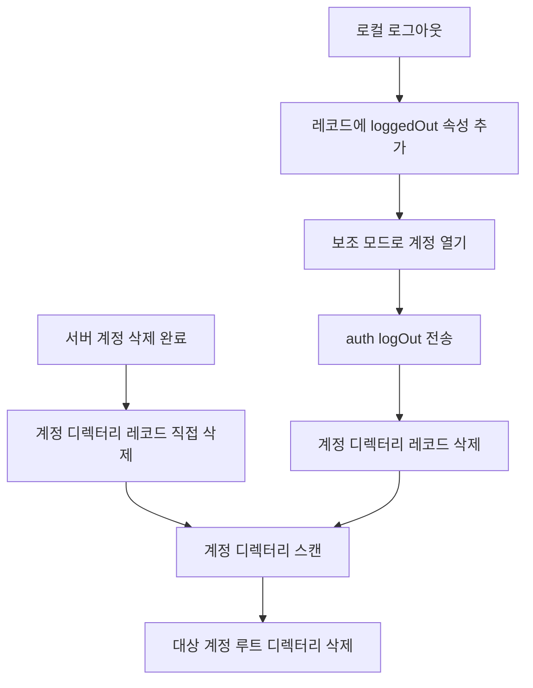

# 계정 로그아웃 cleanupAccount 정리 단계

웹: /docs/system/37-cleanup-account/ · Markdown: /docs/system/37-cleanup-account.md

> iOS와 고정 macOS fork에서 계정을 로그아웃하거나 삭제할 때의 레코드, 파일, 논리 키체인, 푸시, 확장 데이터 처리를 행 단위로 설명해요.

> 시스템 설계 · 검증과 보충 · 보충 37 · 도표 1 · 코드 발췌 3 · 인용 19 · 소스 기준선: [TelegramMessenger/Telegram-iOS@f1dd7a2d](https://github.com/TelegramMessenger/Telegram-iOS/tree/f1dd7a2dbd02cbbf513e75d5695d8d36d1cf5838), [overtake/TelegramSwift@579cebbf](https://github.com/overtake/TelegramSwift/tree/579cebbf0c01fd41b712eff3647fa7f69db9665d)
>
> 검증 대상: [다중 계정, 로그인, 구성 동기화](/docs/system/14-accounts-auth-config/)
>
> 미검증 사항:
> - 서버가 `auth.logOut`을 받은 뒤 이 계정의 APS와 VoIP `registerDevice` 등록을 자동으로 삭제하는지 여부.
> - 미인증이거나 끝내 열 수 없는 `.loggedOut` 레코드가 이 파일 밖의 시작 복구 경로에서 재시도되거나 제거되는지 여부.

## 로그아웃 표시, 원격 로그아웃과 로컬 삭제 [#로그아웃-표시-원격-로그아웃과-로컬-삭제]

로컬 로그아웃은 파일을 바로 삭제하지 않고, 계정 레코드에 로그아웃 표시만 남겨요. `logoutFromAccount`는 `AccountManager` 트랜잭션에서 대상 레코드를 찾아 `.loggedOut` 속성만 추가해요. 반복 호출해도 기존 표시는 유지돼요. 이와 함께 임시 세션 ID를 `nil`로 설정해요. 따라서 로그아웃 버튼을 누르는 일과 `auth.logOut` RPC는 같은 동기 연산이 아니에요. [\[1\]](https://github.com/TelegramMessenger/Telegram-iOS/blob/f1dd7a2dbd02cbbf513e75d5695d8d36d1cf5838/submodules/TelegramCore/Sources/Account/AccountManager.swift#L368-L391)

`submodules/TelegramCore/Sources/Account/AccountManager.swift` 368–391행 발췌.

```swift
public func logoutFromAccount(id: AccountRecordId, accountManager: AccountManager<TelegramAccountManagerTypes>, alreadyLoggedOutRemotely: Bool) -> Signal<Void, NoError> {
    Logger.shared.log("AccountManager", "logoutFromAccount \(id)")
    return accountManager.transaction { transaction -> Void in
        transaction.updateRecord(id, { current in
            if alreadyLoggedOutRemotely {
                return nil
            } else if let current = current {
                var found = false
                for attribute in current.attributes {
                    if case .loggedOut = attribute {
                        found = true
                        break
                    }
                }
                if found {
                    return current
                } else {
                    return AccountRecord(id: current.id, attributes: current.attributes + [.loggedOut(LoggedOutAccountAttribute())], temporarySessionId: nil)
                }
            } else {
                return nil
            }
        })
    }
}
```
[\[1\]](https://github.com/TelegramMessenger/Telegram-iOS/blob/f1dd7a2dbd02cbbf513e75d5695d8d36d1cf5838/submodules/TelegramCore/Sources/Account/AccountManager.swift#L368-L391)

정리 작업은 `managedCleanupAccounts`가 맡아요. 이 함수는 공유 계정 컨텍스트가 초기화될 때 시작되어 계정 레코드를 계속 구독해요.

- `.loggedOut`이 있는 레코드마다 `MetaDisposable` 하나를 유지해요. 그래서 레코드당 정리 신호는 최대 하나만 시작돼요.
- 시작할 때 이전 프로세스에 속한 임시 레코드를 삭제해요. [\[2\]](https://github.com/TelegramMessenger/Telegram-iOS/blob/f1dd7a2dbd02cbbf513e75d5695d8d36d1cf5838/submodules/TelegramCore/Sources/Account/AccountManager.swift#L394-L479)

한편 메인 앱의 계정 집합은 `.loggedOut`이 붙은 레코드를 무시하고 그 계정 컨텍스트를 해제해요. 따라서 정리기가 동작할 때 그 계정은 이미 활성 계정이 아니에요. [\[9\]](https://github.com/TelegramMessenger/Telegram-iOS/blob/f1dd7a2dbd02cbbf513e75d5695d8d36d1cf5838/submodules/TelegramUI/Sources/SharedAccountContext.swift#L589-L604) [\[10\]](https://github.com/TelegramMessenger/Telegram-iOS/blob/f1dd7a2dbd02cbbf513e75d5695d8d36d1cf5838/submodules/TelegramUI/Sources/SharedAccountContext.swift#L776-L815)

`cleanupAccount`는 네트워크 로그아웃이 실패해도 로컬 레코드 삭제를 막지 않아요. 순서는 이래요.

1. 레코드 속성에서 테스트 환경과 지원 계정 표시를 복원해요.
2. `supplementary: true`로 이 계정을 열어요.
3. 인증된 분기에서만 `auth.logOut`을 보내요.
4. 요청이 성공하면 선택적 future auth token을 저장해요. 요청이 실패하면 `catch`가 오류를 `nil`로 바꿔요.
5. 두 경우 모두 서비스 작업의 주도권을 멈추고, 계정 디렉터리 트랜잭션에서 레코드를 삭제해요.

소스에는 여기서 `auth.logOut`을 재시도하는 코드가 없어요. [\[3\]](https://github.com/TelegramMessenger/Telegram-iOS/blob/f1dd7a2dbd02cbbf513e75d5695d8d36d1cf5838/submodules/TelegramCore/Sources/Account/AccountManager.swift#L483-L530)

이 보충의 정리 결론은 고정 macOS fork에도 그대로 적용돼요. `overtake/Telegram-iOS` 고정 커밋 `a24bbe45f9861f736a79916a50898512f751e0dc`를 대조했어요. 이 fork의 `logoutFromAccount`, `managedCleanupAccounts`, `cleanupAccount`는 iOS와 같은 흐름을 유지해요. 표시를 남기고, 오류를 삼키는 로그아웃을 하고, 레코드를 삭제한 뒤, 비동기로 디렉터리를 스캔해요. fork는 `loggedOut` 응답을 두 연관 값의 패턴 매칭으로 썼을 뿐, 정리 의미론은 바꾸지 않았어요. [\[19\]](https://github.com/overtake/Telegram-iOS/blob/a24bbe45f9861f736a79916a50898512f751e0dc/submodules/TelegramCore/Sources/Account/AccountManager.swift#L356-L517)

`submodules/TelegramCore/Sources/Account/AccountManager.swift` 505–527행 발췌.

```swift
            case let .authorized(account):
                account.shouldBeServiceTaskMaster.set(.single(.always))
                return account.network.request(Api.functions.auth.logOut())
                |> map(Optional.init)
                |> `catch` { _ -> Signal<Api.auth.LoggedOut?, NoError> in
                    return .single(nil)
                }
                |> mapToSignal { result -> Signal<Void, NoError> in
                    switch result {
                    case let .loggedOut(loggedOutData):
                        let futureAuthToken = loggedOutData.futureAuthToken
                        if let futureAuthToken = futureAuthToken {
                            storeFutureLoginToken(accountManager: accountManager, token: futureAuthToken.makeData())
                        }
                    default:
                        break
                    }
                    account.shouldBeServiceTaskMaster.set(.single(.never))
                    return accountManager.transaction { transaction -> Void in
                        transaction.updateRecord(id, { _ in
                            return nil
                        })
                    }
```
[\[3\]](https://github.com/TelegramMessenger/Telegram-iOS/blob/f1dd7a2dbd02cbbf513e75d5695d8d36d1cf5838/submodules/TelegramCore/Sources/Account/AccountManager.swift#L483-L530)

계정이 미인증 상태로만 열리면 `cleanupAccount`는 레코드를 삭제하지 않고 곧바로 완료돼요. 이 경우는 두 갈래예요.

- 열기 과정이 계속 업그레이드되는 중이면, 이후의 인증된 이벤트가 여전히 로그아웃 분기에 들어갈 수 있어요.
- 끝내 인증된 이벤트가 없으면, 소스에는 검증 가능한 재시도나 강제 레코드 삭제 단계가 없어요. 이것이 로컬 잔여물의 명확한 경계예요. [\[3\]](https://github.com/TelegramMessenger/Telegram-iOS/blob/f1dd7a2dbd02cbbf513e75d5695d8d36d1cf5838/submodules/TelegramCore/Sources/Account/AccountManager.swift#L483-L530)

서버 쪽 계정 삭제는 로그아웃과 다른 경로를 타요.

- `TelegramEngine.Auth.deleteAccount`는 비밀번호가 있으면 먼저 SRP 증명을 구성한 뒤 `account.deleteAccount`를 호출해요. [\[17\]](https://github.com/TelegramMessenger/Telegram-iOS/blob/f1dd7a2dbd02cbbf513e75d5695d8d36d1cf5838/submodules/TelegramCore/Sources/TelegramEngine/Auth/TelegramEngineAuth.swift#L105-L139)
- iOS `ApplicationContext`의 삭제 콜백은 RPC가 끝난 뒤에만 `alreadyLoggedOutRemotely: true`로 `logoutFromAccount`를 호출해요.
- 이 호출은 `.loggedOut`을 붙이지 않고 디렉터리 레코드를 즉시 삭제해요. 그래서 이 경로는 `cleanupAccount`의 `auth.logOut`을 다시 호출하지 않아요.
- 이후 디렉터리 스캔이 이 폴더를 처리해요. [\[16\]](https://github.com/TelegramMessenger/Telegram-iOS/blob/f1dd7a2dbd02cbbf513e75d5695d8d36d1cf5838/submodules/TelegramUI/Sources/ApplicationContext.swift#L562-L579) [\[1\]](https://github.com/TelegramMessenger/Telegram-iOS/blob/f1dd7a2dbd02cbbf513e75d5695d8d36d1cf5838/submodules/TelegramCore/Sources/Account/AccountManager.swift#L368-L391) [\[2\]](https://github.com/TelegramMessenger/Telegram-iOS/blob/f1dd7a2dbd02cbbf513e75d5695d8d36d1cf5838/submodules/TelegramCore/Sources/Account/AccountManager.swift#L394-L479)



## 계정 전용 파일과 논리 키체인 [#계정-전용-파일과-논리-키체인]

계정 데이터는 계정마다 따로 만든 루트 디렉터리 하나에 모여 있어요. 이름은 사용자 ID가 아니에요. `accountRecordIdPathName`은 `account-`에 `AccountRecordId`의 부호 없는 64비트 표현을 붙여 만들어요. `accountWithId`는 이 이름으로 계정 루트 디렉터리를 구성하고 그 아래에서 `postbox`를 열어요. [\[4\]](https://github.com/TelegramMessenger/Telegram-iOS/blob/f1dd7a2dbd02cbbf513e75d5695d8d36d1cf5838/submodules/TelegramCore/Sources/Account/Account.swift#L258-L282)

App Group의 논리 루트는 `telegram-data`이에요. 따라서 이 계정의 데이터 경계는 `telegram-data/account-레코드ID`이며, 전화번호나 Telegram 사용자 ID로 이름 붙이지 않아요. [\[18\]](https://github.com/TelegramMessenger/Telegram-iOS/blob/f1dd7a2dbd02cbbf513e75d5695d8d36d1cf5838/submodules/TelegramCore/Sources/Account/AccountManager.swift#L260-L262)

계정 루트 디렉터리 아래에는 두 종류의 데이터가 있어요.

- 데이터베이스: `openPostbox`가 데이터베이스 디렉터리를 `postbox/db`로 지정해요. `SqliteValueBox`는 그 안에서 `db_sqlite`, `db_sqlite-wal`, `db_sqlite-shm`을 사용해요.
- 미디어: `Postbox`가 `postbox/media`로 `MediaBox`를 만들어요. [\[5\]](https://github.com/TelegramMessenger/Telegram-iOS/blob/f1dd7a2dbd02cbbf513e75d5695d8d36d1cf5838/submodules/Postbox/Sources/Postbox.swift#L1463-L1507) [\[6\]](https://github.com/TelegramMessenger/Telegram-iOS/blob/f1dd7a2dbd02cbbf513e75d5695d8d36d1cf5838/submodules/Postbox/Sources/Postbox.swift#L4700-L4707)

그래서 정리기는 데이터베이스, WAL, SHM, 미디어 파일을 따로 삭제하지 않아요. 계정 루트 디렉터리 전체를 삭제해서 이 두 종류를 간접적으로 지워요. 데이터베이스와 미디어의 완전한 내부 레이아웃은 「Postbox 스토리지 엔진」과 「미디어 리소스, 다운로드·업로드와 캐시」를 참고해요.

소스가 보장하는 것은 최선 노력(best-effort)의 재귀 디렉터리 삭제뿐이에요. 완료 확인이나 안전한 지우기는 아니에요. 계정 레코드가 디렉터리 뷰에서 사라지면 정리기는 여전히 유효한 디렉터리 이름을 다시 계산해요. 동작은 이래요.

- 현재 레코드 전체와 현재 인증 레코드를 보존해요.
- 루트 디렉터리의 1단계 항목만 열거하고, `account-` 접두사만 처리하며, 유효 집합에 없는 이름만 삭제해요.
- 삭제는 utility 큐에서 비동기로 실행돼요.
- 디렉터리 열거 실패와 `removeItem` 실패는 모두 `try?`로 무시돼요. [\[2\]](https://github.com/TelegramMessenger/Telegram-iOS/blob/f1dd7a2dbd02cbbf513e75d5695d8d36d1cf5838/submodules/TelegramCore/Sources/Account/AccountManager.swift#L394-L479)

`submodules/TelegramCore/Sources/Account/AccountManager.swift` 451–472행 발췌.

```swift
            var validPaths = Set<String>()
            for record in view.records {
                if let temporarySessionId = record.temporarySessionId, temporarySessionId != currentTemporarySessionId {
                    continue
                }
                validPaths.insert("\(accountRecordIdPathName(record.id))")
            }
            if let record = view.currentAuthAccount {
                validPaths.insert("\(accountRecordIdPathName(record.id))")
            }
            
            DispatchQueue.global(qos: .utility).async {
                if let files = try? FileManager.default.contentsOfDirectory(at: URL(fileURLWithPath: rootPath), includingPropertiesForKeys: [], options: []) {
                    for url in files {
                        if url.lastPathComponent.hasPrefix("account-") {
                            if !validPaths.contains(url.lastPathComponent) {
                                try? FileManager.default.removeItem(at: url)
                            }
                        }
                    }
                }
            }
```
[\[2\]](https://github.com/TelegramMessenger/Telegram-iOS/blob/f1dd7a2dbd02cbbf513e75d5695d8d36d1cf5838/submodules/TelegramCore/Sources/Account/AccountManager.swift#L394-L479)

여기서 `Keychain`은 계정 Postbox 위의 논리 어댑터예요(시스템 키체인이 아니라 계정 데이터베이스 안에 저장되는 키체인이에요). 읽기, 쓰기, 삭제 클로저는 각각 `postbox.keychainEntryForKey`, `setKeychainEntryForKey`, `removeKeychainEntryForKey`를 호출하며, 계정 레코드 ID에 따라 오래된 인스턴스를 무효화해요. [\[7\]](https://github.com/TelegramMessenger/Telegram-iOS/blob/f1dd7a2dbd02cbbf513e75d5695d8d36d1cf5838/submodules/TelegramCore/Sources/Account/Account.swift#L9-L52) `KeychainTable`은 항목을 `ValueBox` 테이블에 직접 써요. 단일 삭제는 `secure: false`를 사용해요. [\[8\]](https://github.com/TelegramMessenger/Telegram-iOS/blob/f1dd7a2dbd02cbbf513e75d5695d8d36d1cf5838/submodules/Postbox/Sources/KeychainTable.swift#L3-L25)

따라서 이 호출 체인에서 검증할 수 있는 것은 계정 데이터베이스 디렉터리와 함께 사라지는 논리 키체인 항목이에요. 정리기가 항목별로 삭제를 호출하지는 않으며, 시스템 Security 키체인 항목을 지운다는 증거도 없어요.

## 푸시 토큰과 확장 공유 데이터 [#푸시-토큰과-확장-공유-데이터]

`cleanupAccount`는 `unregisterNotificationToken`을 호출하지 않아요. 푸시 등록기에는 APS와 VoIP의 `account.unregisterDevice` 경로가 실제로 있으며, 이 RPC에 `retryRequest`를 사용해요. [\[12\]](https://github.com/TelegramMessenger/Telegram-iOS/blob/f1dd7a2dbd02cbbf513e75d5695d8d36d1cf5838/submodules/TelegramCore/Sources/TelegramEngine/AccountData/RegisterNotificationToken.swift#L12-L55) 그러나 이 등록기는 활성 계정 집합을 구독하고, 집합에 남아 있는 계정만 순회해요. 로그아웃 표시가 된 레코드는 활성 집합을 구성할 때 이미 제외돼요. [\[9\]](https://github.com/TelegramMessenger/Telegram-iOS/blob/f1dd7a2dbd02cbbf513e75d5695d8d36d1cf5838/submodules/TelegramUI/Sources/SharedAccountContext.swift#L589-L604) [\[11\]](https://github.com/TelegramMessenger/Telegram-iOS/blob/f1dd7a2dbd02cbbf513e75d5695d8d36d1cf5838/submodules/TelegramUI/Sources/SharedAccountContext.swift#L1669-L1742)

이 차이 때문에 계정 상태에 따라 토큰 처리가 달라져요.

- 알림을 받지 않도록 설정한 활성 계정은 토큰을 명시적으로 해제해요.
- 로그아웃한 계정은 먼저 활성 집합에서 제거되고, 이어서 `cleanupAccount`가 `auth.logOut`을 호출해요. 이번 고정 커밋에서는 이 두 단계를 이어 로그아웃한 계정에 `account.unregisterDevice`를 호출하는 경로를 찾지 못했어요.

서버가 `auth.logOut`을 받은 뒤 이 디바이스 토큰을 암묵적으로 철회하는지는 여전히 미검증이에요.

확장은 같은 App Group 루트 디렉터리와 계정 디렉터리를 사용해요. 위젯 설정에 저장되는 것은 계정 레코드 ID와 peer ID이에요.

- `WidgetDataContext`는 10초마다 설정을 읽고, 여전히 `activeAccounts`에 있는 계정에 대해서만 데이터를 생성해요. 로그아웃한 계정은 일치하지 않아 건너뛰며 위젯 타임라인 갱신을 일으켜요. [\[14\]](https://github.com/TelegramMessenger/Telegram-iOS/blob/f1dd7a2dbd02cbbf513e75d5695d8d36d1cf5838/submodules/TelegramUI/Sources/WidgetDataContext.swift#L169-L201)
- 위젯 확장이 이후에도 오래된 설정을 받으면 이 레코드 ID로 계정 Postbox를 열려고 시도하고, 열기 실패는 빈 결과로 바꿔요. [\[15\]](https://github.com/TelegramMessenger/Telegram-iOS/blob/f1dd7a2dbd02cbbf513e75d5695d8d36d1cf5838/Telegram/WidgetKitWidget/TodayViewController.swift#L132-L198)
- 소스는 WidgetKit 설정 자체를 삭제하지 않아요. 그래서 오래된 계정 ID가 시스템 설정에 남을 수 있지만, 더 이상 계정 데이터베이스나 미디어를 읽어 낼 수는 없어요.

메인 앱은 활성 계정의 peer ID 집합 변화도 관찰해요. 집합에서 사라진 peer ID마다 `deleteAllStoryDrafts`를 호출해요. 그 peer ID가 `IntentsSettings.account`이기도 하면 `deleteAllSendMessageIntents`를 호출하고 이 필드를 비워요. [\[13\]](https://github.com/TelegramMessenger/Telegram-iOS/blob/f1dd7a2dbd02cbbf513e75d5695d8d36d1cf5838/submodules/TelegramUI/Sources/AppDelegate.swift#L1492-L1523) 이것이 로그아웃 시 검증 가능한 Siri 초안과 전송 intent의 삭제예요.

반면 공유 디렉터리의 전역 표시 텍스트, 로그, 잠금 상태, 커스텀 알림음은 이 정리기의 계정별 디렉터리 스캔 범위에 들어 있지 않아요. 이 함수에는 그것들을 삭제하는 호출이 없어요.

## 다중 계정 보호와 실패 의미론 [#다중-계정-보호와-실패-의미론]

디렉터리 스캔은 현재 계정만이 아니라 전체 레코드 집합으로 허용 목록을 만들어요. 그래서 다른 계정의 데이터를 잘못 지우지 않아요.

- 현재 계정이 아닌 로그인된 계정도 집합에 남아 있으므로 그 `account-` 디렉터리는 보존돼요.
- 현재 미인증 계정도 따로 허용 목록에 추가돼요.
- 로그아웃한 계정은 원격 로그아웃이 끝나기 전까지 레코드가 남아 있으므로 그 디렉터리는 미리 삭제되지 않아요.

무작위 레코드 ID, 전체 허용 목록, 현재 인증 레코드 예외가 함께 작용해서 계정 전환이나 로그인 도중 다른 계정의 데이터를 잘못 지우는 일을 막아요. [\[2\]](https://github.com/TelegramMessenger/Telegram-iOS/blob/f1dd7a2dbd02cbbf513e75d5695d8d36d1cf5838/submodules/TelegramCore/Sources/Account/AccountManager.swift#L394-L479) [\[4\]](https://github.com/TelegramMessenger/Telegram-iOS/blob/f1dd7a2dbd02cbbf513e75d5695d8d36d1cf5838/submodules/TelegramCore/Sources/Account/Account.swift#L258-L282)

다만 삭제는 원자적인 도메인 간 트랜잭션이 아니에요. 레코드 삭제는 `AccountManager` 트랜잭션에서 커밋되고, 파일 삭제는 이후의 비동기 작업에서 일어나요.

추론: 프로세스가 두 단계 사이에 종료되면 다음 시작 때의 레코드 관찰이 고아 디렉터리를 다시 스캔해요. `removeItem`이 계속 실패하면 소스는 오류를 무시할 뿐이므로 잔여 파일도 계속 남아요.

이 구현은 보고 가능한 디스크 지우기의 완료를 기다리기보다, 계정이 즉시 로그아웃되어 목록에서 보이지 않게 하는 쪽을 우선해요. [\[2\]](https://github.com/TelegramMessenger/Telegram-iOS/blob/f1dd7a2dbd02cbbf513e75d5695d8d36d1cf5838/submodules/TelegramCore/Sources/Account/AccountManager.swift#L394-L479)

## 원래 장에 대한 수정 [#원래-장에-대한-수정]

- `/home/ubuntu/tgtricks/source-notes/system/14-accounts-auth-config.md`의 “로그아웃에는 두 겹의 의미론이 있다” 소절 160–164행 → 기존 결론 뒤에 이 보충의 「로그아웃 표시, 원격 로그아웃과 로컬 삭제」 및 「계정 전용 파일과 논리 키체인」 두 절을 추가해요. 이는 “cleanupAccount 내부에서 각 계정 데이터베이스와 미디어 디렉터리를 구체적으로 삭제하는 단계를 행 단위로 추적하지 않았다”는 점을 해결해요. 결과: 해결됨. 보충에는 로컬 로그아웃이 먼저 표시를 하고, RPC가 실패해도 레코드는 삭제되며, 이어서 계정 루트 디렉터리 전체를 비동기로 삭제한다는 점을 명시해야 해요.
- 같은 파일의 “로그아웃에는 두 겹의 의미론이 있다” 소절 160행 → 서버 계정 삭제에 대한 한정을 추가해요: `ApplicationContext`의 삭제 콜백은 `account.deleteAccount` 성공 후 레코드를 직접 삭제하므로 `auth.logOut`을 다시 보내지 않아요. 이는 원문의 두 가지 의미론 서술을 검증한 거예요. 결과: 해결됨, 원문과 모순되지 않음.
- 같은 파일 158행의 macOS fork 버전 제한 → fixed fork를 체크아웃하여 행 단위로 검증했다고 고쳐요. `logoutFromAccount`, `managedCleanupAccounts`, `cleanupAccount`의 정리 순서는 iOS와 같고, fork는 `loggedOut` 연관 값 패턴만 다르게 사용해요. 결과: 해결됨.
- 같은 파일 162–164행 → 푸시와 확장 데이터에 대한 한정을 추가해요: 이 체인은 로그아웃한 계정의 APS나 VoIP 토큰을 명시적으로 해제하지 않아요; 위젯 설정은 여기서 삭제되지 않으며, Siri 초안과 현재 전송 intent는 메인 앱의 계정 집합 관찰기에서 삭제돼요. 이는 원문이 다루지 않은 정리 대상을 보완해요. 결과: 부분 해결.

## 아직 검증이 필요한 문제 [#아직-검증이-필요한-문제]

- 서버가 `auth.logOut`을 받은 뒤 이 계정의 APS와 VoIP `registerDevice` 등록을 자동으로 삭제하는지 여부.
- 미인증이거나 끝내 열 수 없는 `.loggedOut` 레코드가 이 파일 밖의 시작 복구 경로에서 재시도되거나 제거되는지 여부.

## 참고 [#references]

- \[1\] [로그아웃 레코드 표시](https://github.com/TelegramMessenger/Telegram-iOS/blob/f1dd7a2dbd02cbbf513e75d5695d8d36d1cf5838/submodules/TelegramCore/Sources/Account/AccountManager.swift#L368-L391)
- \[2\] [정리기 디렉터리 스캔](https://github.com/TelegramMessenger/Telegram-iOS/blob/f1dd7a2dbd02cbbf513e75d5695d8d36d1cf5838/submodules/TelegramCore/Sources/Account/AccountManager.swift#L394-L479)
- \[3\] [cleanupAccount 원격 로그아웃](https://github.com/TelegramMessenger/Telegram-iOS/blob/f1dd7a2dbd02cbbf513e75d5695d8d36d1cf5838/submodules/TelegramCore/Sources/Account/AccountManager.swift#L483-L530)
- \[4\] [계정 디렉터리와 Postbox 경로](https://github.com/TelegramMessenger/Telegram-iOS/blob/f1dd7a2dbd02cbbf513e75d5695d8d36d1cf5838/submodules/TelegramCore/Sources/Account/Account.swift#L258-L282)
- \[5\] [Postbox 데이터베이스 디렉터리](https://github.com/TelegramMessenger/Telegram-iOS/blob/f1dd7a2dbd02cbbf513e75d5695d8d36d1cf5838/submodules/Postbox/Sources/Postbox.swift#L1463-L1507)
- \[6\] [MediaBox 디렉터리](https://github.com/TelegramMessenger/Telegram-iOS/blob/f1dd7a2dbd02cbbf513e75d5695d8d36d1cf5838/submodules/Postbox/Sources/Postbox.swift#L4700-L4707)
- \[7\] [계정 전용 논리 키체인](https://github.com/TelegramMessenger/Telegram-iOS/blob/f1dd7a2dbd02cbbf513e75d5695d8d36d1cf5838/submodules/TelegramCore/Sources/Account/Account.swift#L9-L52)
- \[8\] [논리 키체인 테이블](https://github.com/TelegramMessenger/Telegram-iOS/blob/f1dd7a2dbd02cbbf513e75d5695d8d36d1cf5838/submodules/Postbox/Sources/KeychainTable.swift#L3-L25)
- \[9\] [로그아웃 레코드는 활성 집합에 들어가지 않음](https://github.com/TelegramMessenger/Telegram-iOS/blob/f1dd7a2dbd02cbbf513e75d5695d8d36d1cf5838/submodules/TelegramUI/Sources/SharedAccountContext.swift#L589-L604)
- \[10\] [활성 계정 컨텍스트 제거](https://github.com/TelegramMessenger/Telegram-iOS/blob/f1dd7a2dbd02cbbf513e75d5695d8d36d1cf5838/submodules/TelegramUI/Sources/SharedAccountContext.swift#L776-L815)
- \[11\] [푸시 토큰 계정 집합](https://github.com/TelegramMessenger/Telegram-iOS/blob/f1dd7a2dbd02cbbf513e75d5695d8d36d1cf5838/submodules/TelegramUI/Sources/SharedAccountContext.swift#L1669-L1742)
- \[12\] [디바이스 토큰 등록과 해제](https://github.com/TelegramMessenger/Telegram-iOS/blob/f1dd7a2dbd02cbbf513e75d5695d8d36d1cf5838/submodules/TelegramCore/Sources/TelegramEngine/AccountData/RegisterNotificationToken.swift#L12-L55)
- \[13\] [Siri 초안과 전송 intent 정리](https://github.com/TelegramMessenger/Telegram-iOS/blob/f1dd7a2dbd02cbbf513e75d5695d8d36d1cf5838/submodules/TelegramUI/Sources/AppDelegate.swift#L1492-L1523)
- \[14\] [위젯 활성 계정 필터](https://github.com/TelegramMessenger/Telegram-iOS/blob/f1dd7a2dbd02cbbf513e75d5695d8d36d1cf5838/submodules/TelegramUI/Sources/WidgetDataContext.swift#L169-L201)
- \[15\] [위젯의 계정 Postbox 읽기](https://github.com/TelegramMessenger/Telegram-iOS/blob/f1dd7a2dbd02cbbf513e75d5695d8d36d1cf5838/Telegram/WidgetKitWidget/TodayViewController.swift#L132-L198)
- \[16\] [서버 삭제 후의 로컬 로그아웃](https://github.com/TelegramMessenger/Telegram-iOS/blob/f1dd7a2dbd02cbbf513e75d5695d8d36d1cf5838/submodules/TelegramUI/Sources/ApplicationContext.swift#L562-L579)
- \[17\] [계정 삭제 RPC](https://github.com/TelegramMessenger/Telegram-iOS/blob/f1dd7a2dbd02cbbf513e75d5695d8d36d1cf5838/submodules/TelegramCore/Sources/TelegramEngine/Auth/TelegramEngineAuth.swift#L105-L139)
- \[18\] [App Group 데이터 루트](https://github.com/TelegramMessenger/Telegram-iOS/blob/f1dd7a2dbd02cbbf513e75d5695d8d36d1cf5838/submodules/TelegramCore/Sources/Account/AccountManager.swift#L260-L262)
- \[19\] [fork cleanup chain](https://github.com/overtake/Telegram-iOS/blob/a24bbe45f9861f736a79916a50898512f751e0dc/submodules/TelegramCore/Sources/Account/AccountManager.swift#L356-L517)
