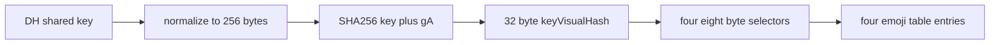

# 비공개 통화 키에서 네 개의 이모지로의 매핑

웹: /docs/system/38-call-emoji/ · Markdown: /docs/system/38-call-emoji.md

> 일대일 통화 시각 해시의 출처, 32바이트 분할, 333개 항목의 이모지 표, 그리고 iOS와 macOS 구현을 검증해요.

> 시스템 설계 · 검증과 보충 · 보충 38 · 도표 1 · 코드 발췌 5 · 인용 9 · 소스 기준선: [TelegramMessenger/Telegram-iOS@f1dd7a2d](https://github.com/TelegramMessenger/Telegram-iOS/tree/f1dd7a2dbd02cbbf513e75d5695d8d36d1cf5838), [overtake/TelegramSwift@579cebbf](https://github.com/overtake/TelegramSwift/tree/579cebbf0c01fd41b712eff3647fa7f69db9665d)
>
> 검증 대상: [통화 시스템](/docs/system/13-calls/)
>
> 미검증 사항:
> - 컨퍼런스 통화 `ConferenceCallE2EContextState`의 Td 계층 암호 프리미티브, 폴링 간격, 블록 보존 정책은 이 보충의 비공개(일대일) 통화 범위 밖이라서 여전히 미검증이에요.

## 시각 해시의 출처와 전달 [#시각-해시의-출처와-전달]

비공개 통화의 이모지 입력은 미디어 엔진이 만든 값이 아니에요. 아래 순서로 만들어져요.

1. `CallSessionManager`가 먼저 DH 공유값(양쪽이 같게 얻는 비밀 값) `key`를 얻어요.
2. 이 값을 256바이트로 자르거나 왼쪽을 0으로 채워요.
3. 받은 `gA`가 앞서 받은 `gAHash`와 대응하는지 검증해요.
4. 검증에 성공하면 `keyVisualHash = MTSha256(key + gA)`를 계산해요. [\[1\]](https://github.com/TelegramMessenger/Telegram-iOS/blob/f1dd7a2dbd02cbbf513e75d5695d8d36d1cf5838/submodules/TelegramCore/Sources/State/CallSessionManager.swift#L1372-L1403)

`MTSha256`은 CommonCrypto의 SHA256으로 다이제스트 버퍼를 채우고, 그 다이제스트 길이로 `NSData`를 만들어요. 아래쪽의 이모지 함수는 길이가 정확히 32인 데이터만 받아요. 그래서 일대일 통화의 `keyVisualHash`는 32바이트 입력이에요. 이 `keyVisualHash`는 SHA1에서 파생된 `keyId`가 아니에요. UI가 다시 계산하는 두 번째 해시도 아니에요. [\[1\]](https://github.com/TelegramMessenger/Telegram-iOS/blob/f1dd7a2dbd02cbbf513e75d5695d8d36d1cf5838/submodules/TelegramCore/Sources/State/CallSessionManager.swift#L1372-L1403) [\[3\]](https://github.com/TelegramMessenger/Telegram-iOS/blob/f1dd7a2dbd02cbbf513e75d5695d8d36d1cf5838/submodules/MtProtoKit/Sources/MTEncryption.m#L39-L45) [\[4\]](https://github.com/TelegramMessenger/Telegram-iOS/blob/f1dd7a2dbd02cbbf513e75d5695d8d36d1cf5838/submodules/TelegramCallsUI/CallsEmoji/Sources/CallsEmoji.m#L6-L53)

```swift
var key = MTExp(self.network.encryptionProvider, gA, b, p)!

if key.count > 256 {
    key.count = 256
} else  {
    while key.count < 256 {
        key.insert(0, at: 0)
    }
}

let keyHash = MTSha1(key)
// ...
if MTSha256(gA) != gAHash {
    return nil
}

let keyVisualHash = MTSha256(key + gA)

return (key, keyId, keyVisualHash)
```
[\[1\]](https://github.com/TelegramMessenger/Telegram-iOS/blob/f1dd7a2dbd02cbbf513e75d5695d8d36d1cf5838/submodules/TelegramCore/Sources/State/CallSessionManager.swift#L1372-L1403)

이 값이 화면까지 가는 길은 이래요.

- `CallSessionState.active`는 `keyVisualHash`를 연결 집합과 함께 공개해요.
- iOS의 `PresentationCall`은 이 상태에 들어 있는 값을 표시 상태에 넣어요.
- 새 비공개 통화 화면의 `CallControllerNodeV2`가 `keyVisualHash`로 `resolvedEmojiKey`를 호출해요.
- `resolvedEmojiKey`는 같은 `Data`를 캐시하고 `stringForEmojiHashOfData(data, 4)`를 직접 호출해요.

따라서 이 경로에서는 `dataForEmojiRawKey`를 호출하지 않고, 입력을 다시 해시하지도 않아요. [\[2\]](https://github.com/TelegramMessenger/Telegram-iOS/blob/f1dd7a2dbd02cbbf513e75d5695d8d36d1cf5838/submodules/TelegramCore/Sources/State/CallSessionManager.swift#L190-L212) [\[5\]](https://github.com/TelegramMessenger/Telegram-iOS/blob/f1dd7a2dbd02cbbf513e75d5695d8d36d1cf5838/submodules/TelegramCallsUI/Sources/CallControllerNodeV2.swift#L443-L496)

이모지를 만드는 이 호출은 통화가 표시할 수 있는 단계에서만 일어나요.

- 새 화면: 표시 상태가 `active`이거나 타이머가 이미 시작된 `reconnecting`일 때만 호출해요. 연결 중의 `keyData`는 상위 상태에서 계속 흘러가지만, 비공개 통화 화면은 먼저 연결 상태를 보여 줘요.
- 구 버전 컨트롤러: `active` 또는 `reconnecting` 분기에서만 키 버튼의 제목을 설정해요.

그래서 코드로 확인할 수 있는 건, 통화가 표시할 수 있는 단계에 들어선 뒤의 네 가지 시각 검증값이에요. 호출음이 울리는 단계나 요청 단계의 UI 값이 아니에요. [\[5\]](https://github.com/TelegramMessenger/Telegram-iOS/blob/f1dd7a2dbd02cbbf513e75d5695d8d36d1cf5838/submodules/TelegramCallsUI/Sources/CallControllerNodeV2.swift#L443-L496)

이 흐름은 네 개의 이모지가 통화를 맺는 입력이 아니라는 점도 보여 줘요.

1. 제어 평면(키와 통화 상태를 다루는 쪽)이 먼저 키를 계산해요.
2. 커밋먼트(`gAHash`)를 검사해요.
3. `active`를 발행해요.
4. 그 뒤에 표시 계층이 안정된 `Data`를 그래픽 기호로 바꿔 보여 줘요.

매핑 함수가 잘못된 길이를 받으면 빈 배열을 돌려줘요. 호출 지점은 0으로 채우거나 자르거나 키를 다시 협상하려 하지 않고, 빈 배열을 그대로 화면에 넘겨요. [\[1\]](https://github.com/TelegramMessenger/Telegram-iOS/blob/f1dd7a2dbd02cbbf513e75d5695d8d36d1cf5838/submodules/TelegramCore/Sources/State/CallSessionManager.swift#L1372-L1403) [\[4\]](https://github.com/TelegramMessenger/Telegram-iOS/blob/f1dd7a2dbd02cbbf513e75d5695d8d36d1cf5838/submodules/TelegramCallsUI/CallsEmoji/Sources/CallsEmoji.m#L6-L53) [\[5\]](https://github.com/TelegramMessenger/Telegram-iOS/blob/f1dd7a2dbd02cbbf513e75d5695d8d36d1cf5838/submodules/TelegramCallsUI/Sources/CallControllerNodeV2.swift#L443-L496)

```swift
private func resolvedEmojiKey(data: Data) -> [String] {
    if let emojiKey = self.emojiKey, emojiKey.data == data {
        return emojiKey.resolvedKey
    }
    let resolvedKey = stringForEmojiHashOfData(data, 4) ?? []
    self.emojiKey = (data, resolvedKey)
    return resolvedKey
}
```
[\[5\]](https://github.com/TelegramMessenger/Telegram-iOS/blob/f1dd7a2dbd02cbbf513e75d5695d8d36d1cf5838/submodules/TelegramCallsUI/Sources/CallControllerNodeV2.swift#L443-L496)



## 32바이트가 네 개의 이모지가 되는 방식 [#32바이트가-네-개의-이모지가-되는-방식]

> 인터랙티브 그림(call-emoji)은 웹 페이지에서 볼 수 있어요.

이모지 함수는 32바이트가 아닌 입력을 거부해요. 호출한 쪽은 개수 4를 넘겨요. 그래서 함수는 네 번 반복해요. `i`번째 반복은 이렇게 해요.

1. 오프셋 `i * 8`부터 8바이트를 읽어요.
2. 첫 바이트의 최상위 비트를 0으로 지운 뒤 빅 엔디언(상위 바이트부터 읽는 순서)으로 조립해서 음수가 아닌 63비트 정수를 만들어요.
3. 이 정수를 이모지 표의 길이로 나눈 나머지를 취해요.

네 번의 반복은 바이트 0부터 31까지를 정확히 덮어요. 겹치는 바이트도, 쓰이지 않는 꼬리 바이트도 없어요. [\[4\]](https://github.com/TelegramMessenger/Telegram-iOS/blob/f1dd7a2dbd02cbbf513e75d5695d8d36d1cf5838/submodules/TelegramCallsUI/CallsEmoji/Sources/CallsEmoji.m#L6-L53)

```objc
static int32_t positionExtractor(uint8_t *bytes, int32_t i, int32_t count) {
    int offset = i * 8;
    int64_t num = (((int64_t)bytes[offset] & 0x7F) << 56) | (((int64_t)bytes[offset+1] & 0xFF) << 48) | (((int64_t)bytes[offset+2] & 0xFF) << 40) | (((int64_t)bytes[offset+3] & 0xFF) << 32) | (((int64_t)bytes[offset+4] & 0xFF) << 24) | (((int64_t)bytes[offset+5] & 0xFF) << 16) | (((int64_t)bytes[offset+6] & 0xFF) << 8) | (((int64_t)bytes[offset+7] & 0xFF));
    return num % count;
}
```
[\[4\]](https://github.com/TelegramMessenger/Telegram-iOS/blob/f1dd7a2dbd02cbbf513e75d5695d8d36d1cf5838/submodules/TelegramCallsUI/CallsEmoji/Sources/CallsEmoji.m#L6-L53)

```objc
NSArray<NSString *> *stringForEmojiHashOfData(NSData *data, NSInteger count) {
    if (data.length != 32) {
        return @[];
    }

    uint8_t bytes[32];
    [data getBytes:bytes length:32];

    NSArray *emojis = emojisArray();
    NSMutableArray *result = [[NSMutableArray alloc] init];
    for (int32_t i = 0; i < count; i++)
    {
        int32_t position = positionExtractor(bytes, i, (int32_t)emojis.count);
        NSString *emoji = emojis[position];
        [result addObject:emoji];
    }

    return result;
}
```
[\[4\]](https://github.com/TelegramMessenger/Telegram-iOS/blob/f1dd7a2dbd02cbbf513e75d5695d8d36d1cf5838/submodules/TelegramCallsUI/CallsEmoji/Sources/CallsEmoji.m#L6-L53)

`emojisArray`는 소스 파일 안의 고정 리터럴 표예요. 이 배열의 리터럴을 세면 333개 항목이에요. 표의 첫 항목은 😉이고 마지막 항목은 🔷이에요. 순서가 있는 네 항목의 출력이 만들 수 있는 조합은 333 × 333 × 333 × 333 = 12,296,370,321가지이고, 약 33.52비트의 조합 공간이에요. 이 수치는 고정된 표와 네 인덱스의 조합 수를 설명할 뿐이에요. 소스는 균등성을 선언하지 않고, 이 수치를 프로토콜의 보안 매개변수로 내세우지도 않아요. [\[4\]](https://github.com/TelegramMessenger/Telegram-iOS/blob/f1dd7a2dbd02cbbf513e75d5695d8d36d1cf5838/submodules/TelegramCallsUI/CallsEmoji/Sources/CallsEmoji.m#L6-L53)

네 선택자의 경계는 고정되어 있어요.

- 첫 번째: 바이트 0~7
- 두 번째: 바이트 8~15
- 세 번째: 바이트 16~23
- 네 번째: 바이트 24~31

각 항목은 해당 구간 첫 바이트의 최상위 비트를 지워요. 이렇게 하면 `int64_t`를 조립할 때 음수가 나오는 걸 막아요. 이어지는 나머지 연산이 값을 0~332의 표 인덱스로 제한해요. 그러므로 표의 순서는 클라이언트 간 프로토콜 호환성의 일부예요. 유지보수하는 사람이 한쪽 클라이언트의 표 순서만 바꾸면, 같은 해시가 서로 다른 이모지로 표시될 수 있어요. [\[4\]](https://github.com/TelegramMessenger/Telegram-iOS/blob/f1dd7a2dbd02cbbf513e75d5695d8d36d1cf5838/submodules/TelegramCallsUI/CallsEmoji/Sources/CallsEmoji.m#L6-L53)

표 항목은 유니코드 코드 포인트로 계산한 인덱스가 아니에요. 함수가 보관하는 건 `NSArray` 안의 문자열 항목이에요. 일부 항목은 변형 선택자, 국기, 키캡 시퀀스를 포함해요. 그래도 한 번의 반복은 여전히 배열 항목 하나만 가져와요. 따라서 “이모지 4개”는 구현상 문자열 배열 원소 4개예요. Swift `Character` 수나 UTF8 바이트 수로 바꿔 세면 안 돼요. [\[4\]](https://github.com/TelegramMessenger/Telegram-iOS/blob/f1dd7a2dbd02cbbf513e75d5695d8d36d1cf5838/submodules/TelegramCallsUI/CallsEmoji/Sources/CallsEmoji.m#L6-L53)

구 버전 iOS 통화 컨트롤러도 `keyVisualHash`를 같은 함수에 직접 넘기고, 네 항목을 이어 붙여 제목으로 만들어요. 따라서 신구 iOS 비공개 통화 화면은 같은 입력과 이모지 선택 규칙을 함께 써요. [\[4\]](https://github.com/TelegramMessenger/Telegram-iOS/blob/f1dd7a2dbd02cbbf513e75d5695d8d36d1cf5838/submodules/TelegramCallsUI/CallsEmoji/Sources/CallsEmoji.m#L6-L53) [\[5\]](https://github.com/TelegramMessenger/Telegram-iOS/blob/f1dd7a2dbd02cbbf513e75d5695d8d36d1cf5838/submodules/TelegramCallsUI/Sources/CallControllerNodeV2.swift#L443-L496)

## macOS 비교와 고정 fork의 차이 [#macos-비교와-고정-fork의-차이]

macOS는 이렇게 이모지를 표시해요.

1. `PCallSession`이 공유 코어의 `CallSessionState.active`에서 `keyVisualHash`를 꺼내요.
2. 연결됨 및 재연결 상태에서 이 `Data`를 로컬 `CallState`에 기록해요.
3. macOS의 `CallScreenController`가 `ObjcUtils.callEmojies(data)`를 호출해요.

이 컨트롤러는 최종 표시 직전에 공백만 끼워 넣어요. 공백은 이모지 선택을 바꾸지 않아요. [\[7\]](https://github.com/overtake/TelegramSwift/blob/579cebbf0c01fd41b712eff3647fa7f69db9665d/Telegram-Mac/PCallSession.swift#L838-L865) [\[8\]](https://github.com/overtake/TelegramSwift/blob/579cebbf0c01fd41b712eff3647fa7f69db9665d/Telegram-Mac/CallScreenController.swift#L22-L60)

macOS는 iOS의 `CallsEmoji` 모듈을 호출하지 않아요. `ObjcUtils`에 중복 구현을 따로 유지해요. 이 구현은 이래요.

- 32바이트를 요구해요.
- 같은 순서의 333개 항목 리터럴 표를 포함해요.
- 개수 4로 같은 8바이트 빅 엔디언 나머지 공식을 호출해요.

고정 커밋의 표 세 개를 항목별로 비교한 결과, iOS의 `CallsEmoji.m`, macOS fork 안의 같은 이름 파일, macOS `ObjcUtils`의 333개 항목 순서가 모두 같았어요. 따라서 이 작업에서 지정한 커밋 기준으로 iOS와 macOS의 비공개 통화 이모지 매핑은 일치해요. [\[4\]](https://github.com/TelegramMessenger/Telegram-iOS/blob/f1dd7a2dbd02cbbf513e75d5695d8d36d1cf5838/submodules/TelegramCallsUI/CallsEmoji/Sources/CallsEmoji.m#L6-L53) [\[8\]](https://github.com/overtake/TelegramSwift/blob/579cebbf0c01fd41b712eff3647fa7f69db9665d/Telegram-Mac/CallScreenController.swift#L22-L60) [\[9\]](https://github.com/overtake/TelegramSwift/blob/579cebbf0c01fd41b712eff3647fa7f69db9665d/packages/ObjcUtils/Sources/ObjcUtils/ObjcUtils.m#L650-L700)

두 플랫폼의 오류 반환 타입은 달라요.

- iOS 함수: 길이가 틀리면 빈 배열을 돌려줘요.
- macOS `ObjcUtils`: 길이가 틀리면 빈 문자열을 돌려줘요.

어느 쪽도 32바이트에 못 미치는 값에서 일부 이모지만 고르지 않아요. 이 차이는 유효하지 않은 입력의 표시값에만 영향을 줘요. 유효한 `keyVisualHash`의 네 구간 분할이나 표 항목 선택은 바꾸지 않아요. [\[4\]](https://github.com/TelegramMessenger/Telegram-iOS/blob/f1dd7a2dbd02cbbf513e75d5695d8d36d1cf5838/submodules/TelegramCallsUI/CallsEmoji/Sources/CallsEmoji.m#L6-L53) [\[9\]](https://github.com/overtake/TelegramSwift/blob/579cebbf0c01fd41b712eff3647fa7f69db9665d/packages/ObjcUtils/Sources/ObjcUtils/ObjcUtils.m#L650-L700)

macOS의 구 윈도우 컨트롤러도 `visual`을 `ObjcUtils.callEmojies`에 직접 넘겨요. 그래서 AppKit의 비공개 통화 화면 두 경로가 같은 매핑 진입점을 가져요. 현재의 비공개 통화 화면은 `CallScreenController`에서 이모지 사이에 공백을 추가로 끼워 넣어요. 구 윈도우는 연결한 뒤의 문자열을 그대로 표시해요. 두 경우 모두 매핑이 끝난 뒤에 텍스트를 레이아웃하기 때문에, 레이아웃 차이는 네 항목의 내용에 영향을 주지 않아요. [\[8\]](https://github.com/overtake/TelegramSwift/blob/579cebbf0c01fd41b712eff3647fa7f69db9665d/Telegram-Mac/CallScreenController.swift#L22-L60) [\[9\]](https://github.com/overtake/TelegramSwift/blob/579cebbf0c01fd41b712eff3647fa7f69db9665d/packages/ObjcUtils/Sources/ObjcUtils/ObjcUtils.m#L650-L700)

```objc
+(NSString *)callEmojies:(NSData *)keySha256 {
    return [self stringForEmojiHashOfData:keySha256 count:4 positionExtractor:^int32_t(uint8_t *bytes, int32_t i, int32_t count) {
        int offset = i * 8;
        int64_t num = (((int64_t)bytes[offset] & 0x7F) << 56) | (((int64_t)bytes[offset+1] & 0xFF) << 48) | (((int64_t)bytes[offset+2] & 0xFF) << 40) | (((int64_t)bytes[offset+3] & 0xFF) << 32) | (((int64_t)bytes[offset+4] & 0xFF) << 24) | (((int64_t)bytes[offset+5] & 0xFF) << 16) | (((int64_t)bytes[offset+6] & 0xFF) << 8) | (((int64_t)bytes[offset+7] & 0xFF));
        return num % count;
    }];
}
```
[\[9\]](https://github.com/overtake/TelegramSwift/blob/579cebbf0c01fd41b712eff3647fa7f69db9665d/packages/ObjcUtils/Sources/ObjcUtils/ObjcUtils.m#L650-L700)

고정 fork의 시각 해시 공식은 iOS와 같아요. 마찬가지로 이렇게 해요.

1. `key`를 정규화해요.
2. `MTSha256(gA) == gAHash`를 검사해요.
3. `MTSha256(key + gA)`를 계산해요.

다만 이 fork의 `makeSessionEncryptionKey`에는 iOS 현재 커밋이 함수 시작부에서 실행하는 `MTCheckIsSafeGAOrB`가 없어요. 이모지 매핑과 시각 해시 공식은 이미 일치해요. 하지만 iOS의 키 사전 검증 동작 전체를 macOS에서 검증된 사실로 볼 수는 없어요. [\[1\]](https://github.com/TelegramMessenger/Telegram-iOS/blob/f1dd7a2dbd02cbbf513e75d5695d8d36d1cf5838/submodules/TelegramCore/Sources/State/CallSessionManager.swift#L1372-L1403) [\[6\]](https://github.com/overtake/Telegram-iOS/blob/a24bbe45f9861f736a79916a50898512f751e0dc/submodules/TelegramCore/Sources/State/CallSessionManager.swift#L1351-L1376)

## 원래 장에 대한 수정 [#원래-장에-대한-수정]

- `system/13-calls.md`의 “DH 커밋먼트, 지문, 이모지 검증” 마지막 단락을 고칠 것을 제안해요.
  - 현재 문장: “여기의 코드는 스스로 네 개의 이모지를 선택하지 않으므로, 이모지 매핑 위치는 이 장에서 확인하지 못했다”
  - 제안 문장: “`keyVisualHash`는 `TelegramCallsUI`의 `CallsEmoji` 매핑으로 들어간다. 함수는 32바이트를 요구하며, 연속된 네 개의 8바이트 빅 엔디언 선택자로 고정된 333개 항목의 표에서 네 항목을 고른다. 신구 iOS 비공개 통화 화면 모두 이 매핑을 직접 사용한다.”
  - 효과: 열린 문제 “비공개 통화 keyVisualHash에서 네 개의 이모지로 가는 구체적 매핑 코드를 확인하지 못했다”가 풀려요.
  - 결과는 해결됨이에요. [\[4\]](https://github.com/TelegramMessenger/Telegram-iOS/blob/f1dd7a2dbd02cbbf513e75d5695d8d36d1cf5838/submodules/TelegramCallsUI/CallsEmoji/Sources/CallsEmoji.m#L6-L53) [\[5\]](https://github.com/TelegramMessenger/Telegram-iOS/blob/f1dd7a2dbd02cbbf513e75d5695d8d36d1cf5838/submodules/TelegramCallsUI/Sources/CallControllerNodeV2.swift#L443-L496)

- `system/13-calls.md`의 “macOS 비교”는 서브모듈 상태 제약 때문에 행 단위 검증을 하지 못했어요. 이제 다음과 같이 바꿔요.
  - `a24bbe45f9861f736a79916a50898512f751e0dc`에 고정된 fork를 읽을 수 있어요.
  - 비공개 통화 시각 해시는 여전히 `MTSha256(key + gA)`예요.
  - `PCallSession`이 이 값을 넘기고, macOS `ObjcUtils`가 같은 333개 항목 표와 네 구간 선택 공식으로 결과를 표시해요.
  - 이 fork의 키 함수에서는 iOS 현재 커밋의 함수 내 `MTCheckIsSafeGAOrB` 검사가 보이지 않아요.
  - 이 부분은 열린 문제 “fork 코어의 차이를 행 단위로 검증할 수 없다”를 풀어요. 이 보충이 비공개 통화 키와 이모지 경로만 대조했기 때문에 결과는 부분 해결이에요. [\[6\]](https://github.com/overtake/Telegram-iOS/blob/a24bbe45f9861f736a79916a50898512f751e0dc/submodules/TelegramCore/Sources/State/CallSessionManager.swift#L1351-L1376) [\[7\]](https://github.com/overtake/TelegramSwift/blob/579cebbf0c01fd41b712eff3647fa7f69db9665d/Telegram-Mac/PCallSession.swift#L838-L865) [\[8\]](https://github.com/overtake/TelegramSwift/blob/579cebbf0c01fd41b712eff3647fa7f69db9665d/Telegram-Mac/CallScreenController.swift#L22-L60) [\[9\]](https://github.com/overtake/TelegramSwift/blob/579cebbf0c01fd41b712eff3647fa7f69db9665d/packages/ObjcUtils/Sources/ObjcUtils/ObjcUtils.m#L650-L700)

- `system/13-calls.md`의 “설계 트레이드오프”를 고칠 것을 제안해요.
  - 현재 문장: “올바른 이모지 매핑은 모든 클라이언트에서 일치해야 한다”
  - 제안 문장: “이 작업에서 지정한 iOS와 macOS 고정 커밋은 동일한 비공개 통화 이모지 표, 분할 순서, 인덱스 공식을 이미 사용한다.”
  - 효과: 두 클라이언트의 일관성에 관한 그 대목의 결론이 검증돼요.
  - 결과는 해결됨이에요. [\[4\]](https://github.com/TelegramMessenger/Telegram-iOS/blob/f1dd7a2dbd02cbbf513e75d5695d8d36d1cf5838/submodules/TelegramCallsUI/CallsEmoji/Sources/CallsEmoji.m#L6-L53) [\[8\]](https://github.com/overtake/TelegramSwift/blob/579cebbf0c01fd41b712eff3647fa7f69db9665d/Telegram-Mac/CallScreenController.swift#L22-L60) [\[9\]](https://github.com/overtake/TelegramSwift/blob/579cebbf0c01fd41b712eff3647fa7f69db9665d/packages/ObjcUtils/Sources/ObjcUtils/ObjcUtils.m#L650-L700)

컨퍼런스 통화 `ConferenceCallE2EContextState`의 Td 계층 암호 프리미티브, 폴링 간격, 블록 보존 정책은 이 보충의 비공개(일대일) 통화 범위 밖이라서 여전히 미검증이에요.

## 참고 [#references]

- \[1\] [iOS call visual hash derivation](https://github.com/TelegramMessenger/Telegram-iOS/blob/f1dd7a2dbd02cbbf513e75d5695d8d36d1cf5838/submodules/TelegramCore/Sources/State/CallSessionManager.swift#L1372-L1403)
- \[2\] [iOS public call session state](https://github.com/TelegramMessenger/Telegram-iOS/blob/f1dd7a2dbd02cbbf513e75d5695d8d36d1cf5838/submodules/TelegramCore/Sources/State/CallSessionManager.swift#L190-L212)
- \[3\] [iOS SHA256 helper](https://github.com/TelegramMessenger/Telegram-iOS/blob/f1dd7a2dbd02cbbf513e75d5695d8d36d1cf5838/submodules/MtProtoKit/Sources/MTEncryption.m#L39-L45)
- \[4\] [iOS call emoji table and mapping](https://github.com/TelegramMessenger/Telegram-iOS/blob/f1dd7a2dbd02cbbf513e75d5695d8d36d1cf5838/submodules/TelegramCallsUI/CallsEmoji/Sources/CallsEmoji.m#L6-L53)
- \[5\] [iOS private call emoji rendering](https://github.com/TelegramMessenger/Telegram-iOS/blob/f1dd7a2dbd02cbbf513e75d5695d8d36d1cf5838/submodules/TelegramCallsUI/Sources/CallControllerNodeV2.swift#L443-L496)
- \[6\] [macOS fork call visual hash derivation](https://github.com/overtake/Telegram-iOS/blob/a24bbe45f9861f736a79916a50898512f751e0dc/submodules/TelegramCore/Sources/State/CallSessionManager.swift#L1351-L1376)
- \[7\] [macOS private call visual hash forwarding](https://github.com/overtake/TelegramSwift/blob/579cebbf0c01fd41b712eff3647fa7f69db9665d/Telegram-Mac/PCallSession.swift#L838-L865)
- \[8\] [macOS private call emoji display](https://github.com/overtake/TelegramSwift/blob/579cebbf0c01fd41b712eff3647fa7f69db9665d/Telegram-Mac/CallScreenController.swift#L22-L60)
- \[9\] [macOS call emoji table and mapping](https://github.com/overtake/TelegramSwift/blob/579cebbf0c01fd41b712eff3647fa7f69db9665d/packages/ObjcUtils/Sources/ObjcUtils/ObjcUtils.m#L650-L700)
