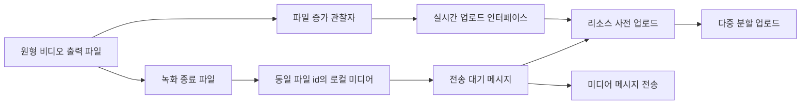

# 음성 녹음과 사전 업로드

웹: /docs/system/39-audio-preupload/ · Markdown: /docs/system/39-audio-preupload.md

> 음성 메시지와 원형 비디오의 녹음 데이터 흐름, 사전 업로드 재사용, 취소 정리 경로를 나눠서 살펴봐요.

> 시스템 설계 · 검증과 보충 · 보충 39 · 도표 1 · 코드 발췌 5 · 인용 18 · 소스 기준선: [TelegramMessenger/Telegram-iOS@f1dd7a2d](https://github.com/TelegramMessenger/Telegram-iOS/tree/f1dd7a2dbd02cbbf513e75d5695d8d36d1cf5838), [overtake/TelegramSwift@579cebbf](https://github.com/overtake/TelegramSwift/tree/579cebbf0c01fd41b712eff3647fa7f69db9665d)
>
> 검증 대상: [메시지 전송 파이프라인과 오프라인 작업 큐](/docs/system/07-message-send-pipeline/)
>
> 미검증 사항:
> - 음성 미리보기가 삭제된 뒤에도 `deleteMediaRecording`은 현재 파일에서 리소스 삭제를 직접 부르지 않아요. 이 초안의 `LocalFileMediaResource`가 디스크에 쓴 바이트를 MediaBox가 언제 회수하는지는 미검증이에요.
> - 원형 비디오가 `discardVideo`를 부른 뒤, 모든 표시 경로에서 컨트롤러와 노드가 언제 반드시 사라지는지는 미검증이에요. 그래서 interface가 사라질 때 하는 정리를, 취소 이벤트가 동기적으로 보장하는 동작이라고 말할 수 없어요.

## 녹음기와 사전 업로드의 실제 경계 [#녹음기와-사전-업로드의-실제-경계]

`MessageMediaPreuploadManager`(전송 전에 미디어를 미리 올리는 관리자, 이하 manager)를 모든 녹음기가 직접 부르는 건 아니에요. 이 보충 문서는 그 경계를 확인해요.

- **음성 메시지**: 녹음 경로가 `preUpload`를 부르지 않아요. 녹음을 멈추면 완전한 Ogg 데이터를 받아 `LocalFileMediaResource`에 쓰고, 그다음 `EnqueueMessage`를 만들어요. manager에는 그 뒤 전송 대기 메시지를 업로드하는 경로에서야 들어가요. 그래서 음성 메시지는 녹음하면서 업로드하는 방식이 아니에요. [\[1\]](https://github.com/TelegramMessenger/Telegram-iOS/blob/f1dd7a2dbd02cbbf513e75d5695d8d36d1cf5838/submodules/TelegramUI/Sources/ManagedAudioRecorder.swift#L585-L755) [\[2\]](https://github.com/TelegramMessenger/Telegram-iOS/blob/f1dd7a2dbd02cbbf513e75d5695d8d36d1cf5838/submodules/TelegramUI/Sources/Chat/ChatControllerMediaRecording.swift#L343-L397)
- **원형 비디오**: 채팅 컨트롤러가 대상이 비밀 채팅이 아닐 때만 `allowLiveUpload`를 참으로 설정해서 `VideoMessageCameraScreen`에 넘겨요. [\[3\]](https://github.com/TelegramMessenger/Telegram-iOS/blob/f1dd7a2dbd02cbbf513e75d5695d8d36d1cf5838/submodules/TelegramUI/Sources/Chat/ChatControllerMediaRecording.swift#L149-L235) 이 화면은 `LegacyLiveUploadInterface`로 실시간 파일 업로드를 감싸요. 이 인터페이스는 `TelegramEngine.Resources.preUpload`를 거쳐 계정의 `MessageMediaPreuploadManager.add`를 간접적으로 불러요. [\[4\]](https://github.com/TelegramMessenger/Telegram-iOS/blob/f1dd7a2dbd02cbbf513e75d5695d8d36d1cf5838/submodules/LegacyMediaPickerUI/Sources/LegacyLiveUploadInterface.swift#L45-L109) [\[5\]](https://github.com/TelegramMessenger/Telegram-iOS/blob/f1dd7a2dbd02cbbf513e75d5695d8d36d1cf5838/submodules/TelegramCore/Sources/TelegramEngine/Resources/TelegramEngineResources.swift#L237-L248)

그래서 원형 비디오 구현은 07장에서 설명한 manager를 실제로 다시 써요. 다만 manager를 부르는 쪽은 비디오 화면의 실시간 업로드 인터페이스이고, 음성 녹음기가 아니에요.

앞서 [채팅 화면 기법](/docs/ios/09-chat-screen/)에서 녹음 제스처와 전송 전환을 설명했어요. 이 보충 문서는 전송 수명 주기만 따라가요.

### 인코딩을 거쳐 전송 대기 미디어가 되는 음성 [#인코딩을-거쳐-전송-대기-미디어가-되는-음성]

`ManagedAudioRecorder`는 입력 버퍼를 60밀리초, 1,920바이트짜리 인코딩 패킷으로 이어 붙여 `TGOggOpusWriter`에 써요. 이 패킷은 녹음 인코딩의 입력 단위이고, MTProto 업로드 part(업로드를 나눈 조각)가 아니에요.

`takeData`는 호출한 쪽이 요청하면 쓰기를 끝내고, `dataItem` 안의 완전한 압축 데이터와 길이, 파형을 돌려줘요. [\[1\]](https://github.com/TelegramMessenger/Telegram-iOS/blob/f1dd7a2dbd02cbbf513e75d5695d8d36d1cf5838/submodules/TelegramUI/Sources/ManagedAudioRecorder.swift#L585-L755)

```swift
let millisecondsPerPacket = 60
let encoderPacketSizeInBytes = 16000 / 1000 * millisecondsPerPacket * 2

// ...

self.oggWriter.writeFrame(currentEncoderPacket.assumingMemoryBound(to: UInt8.self), frameByteCount: UInt(currentEncoderPacketSize))
```
[\[1\]](https://github.com/TelegramMessenger/Telegram-iOS/blob/f1dd7a2dbd02cbbf513e75d5695d8d36d1cf5838/submodules/TelegramUI/Sources/ManagedAudioRecorder.swift#L585-L755)

음성을 바로 보내는 분기는 이렇게 움직여요. [\[2\]](https://github.com/TelegramMessenger/Telegram-iOS/blob/f1dd7a2dbd02cbbf513e75d5695d8d36d1cf5838/submodules/TelegramUI/Sources/Chat/ChatControllerMediaRecording.swift#L343-L397)

1. `stop`을 부른 다음 `takenRecordedData`를 받아요.
2. 무작위 로컬 파일 id를 만들고, `storeResourceData`로 완전한 `compressedData`를 써요.
3. 이 리소스와 `.Audio(isVoice: true, ...)`를 `sendMessages`의 `EnqueueMessage`에 넣어요.

미리보기 후 전송도 마찬가지예요. 이미 있는 초안 리소스를 같은 종류의 전송 대기 파일로 감싸서 `enqueueMessages`를 불러요. [\[6\]](https://github.com/TelegramMessenger/Telegram-iOS/blob/f1dd7a2dbd02cbbf513e75d5695d8d36d1cf5838/submodules/TelegramUI/Sources/Chat/ChatControllerMediaRecording.swift#L697-L764)

```swift
let resource = LocalFileMediaResource(fileId: randomId)
strongSelf.context.engine.resources.storeResourceData(
    id: EngineMediaResource.Id(resource.id),
    data: data.compressedData
)

strongSelf.sendMessages([.message(
    text: "",
    attributes: attributes,
    inlineStickers: [:],
    mediaReference: .standalone(media: TelegramMediaFile(
// ...
```
[\[2\]](https://github.com/TelegramMessenger/Telegram-iOS/blob/f1dd7a2dbd02cbbf513e75d5695d8d36d1cf5838/submodules/TelegramUI/Sources/Chat/ChatControllerMediaRecording.swift#L343-L397)

이 경로를 보면 “녹음이 끝난 뒤에야 업로드한다”는 경계가 분명해요. 전송 대기 파일은 이후에 `messageMediaPreuploadManager.upload`로 업로드되지만, 이때 원본 리소스는 이미 완전해요. 그래서 음성은 녹음하는 동안 네트워크 작업을 겹쳐 실행할 수 없어요. [\[7\]](https://github.com/TelegramMessenger/Telegram-iOS/blob/f1dd7a2dbd02cbbf513e75d5695d8d36d1cf5838/submodules/TelegramCore/Sources/PendingMessages/PendingMessageUploadedContent.swift#L1332-L1343)

## 원형 비디오의 녹화 중 업로드 [#원형-비디오의-녹화-중-업로드]

### 파일이 커지면서 공유 업로드를 움직이는 구조 [#파일이-커지면서-공유-업로드를-움직이는-구조]

최신 원형 비디오 카메라는 0.09초마다 같은 출력 파일의 경로를 알려줘요. 비디오 화면은 첫 보고를 받으면 `setupLiveUpload`를 부르고, 1.5초 뒤에 그 경로로 `LegacyLiveUploadInterface`를 만들어요. [\[8\]](https://github.com/TelegramMessenger/Telegram-iOS/blob/f1dd7a2dbd02cbbf513e75d5695d8d36d1cf5838/submodules/TelegramUI/Components/VideoMessageCameraScreen/Sources/VideoMessageCameraScreen.swift#L404-L450)

이 인터페이스의 부모 클래스는 매초 파일 크기를 확인해요. 파일이 지난번보다 32 KiB 넘게 커지면 부모 클래스가 `fileUpdated(false)`를 일으켜요. [\[9\]](https://github.com/TelegramMessenger/Telegram-iOS/blob/f1dd7a2dbd02cbbf513e75d5695d8d36d1cf5838/submodules/LegacyComponents/Sources/TGMediaVideoConverter.m#L1075-L1128)

파일이 처음 커졌다는 알림이 오면 인터페이스는 무작위 id를 만들고, 그 id로 `preUpload`가 돌려준 disposable(구독을 해제하는 핸들)을 쥐고 있어요. 그리고 파일 경로와 현재 바이트 수를 `ResourceData`로 내보내되 `isComplete`는 거짓으로 둬요. 녹화가 끝나면 `fileUpdated(true)`가 같은 경로와 크기로 완료 상태를 내보내고, 이 id를 돌려줘요. [\[4\]](https://github.com/TelegramMessenger/Telegram-iOS/blob/f1dd7a2dbd02cbbf513e75d5695d8d36d1cf5838/submodules/LegacyMediaPickerUI/Sources/LegacyLiveUploadInterface.swift#L45-L109)

```swift
if strongSelf.path == nil {
    strongSelf.path = path
    strongSelf.preUploadDisposable = strongSelf.context.engine.resources.preUpload(
        id: strongSelf.id,
        encrypt: false,
        tag: nil,
        source: strongSelf.data.get()
    )
}

strongSelf.size = size
```
[\[4\]](https://github.com/TelegramMessenger/Telegram-iOS/blob/f1dd7a2dbd02cbbf513e75d5695d8d36d1cf5838/submodules/LegacyMediaPickerUI/Sources/LegacyLiveUploadInterface.swift#L45-L109)

`Resources.preUpload`는 업로더를 따로 만들지 않아요. 네트워크, Postbox, id, 계속 갱신되는 source(업로드할 데이터를 읽어 오는 원본)를 그대로 계정의 `MessageMediaPreuploadManager.add`에 넘겨요. [\[5\]](https://github.com/TelegramMessenger/Telegram-iOS/blob/f1dd7a2dbd02cbbf513e75d5695d8d36d1cf5838/submodules/TelegramCore/Sources/TelegramEngine/Resources/TelegramEngineResources.swift#L237-L248) 그래서 비디오 파일이 커지는 것, 사전 업로드 구독, 최종 전송 대기 메시지가 로컬 파일 id 하나로 이어져요.



### 카메라 프레임이 아닌 전송 part [#카메라-프레임이-아닌-전송-part]

`preUpload`가 넘기는 건 `.custom` source예요. `multipartUpload`는 이런 source에 1,024바이트짜리 header 표식을 설정하지만, 데이터를 읽는 일정은 여전히 `MultipartUploadManager`가 관리해요. [\[10\]](https://github.com/TelegramMessenger/Telegram-iOS/blob/f1dd7a2dbd02cbbf513e75d5695d8d36d1cf5838/submodules/TelegramCore/Sources/Network/MultipartUpload.swift#L442-L539)

part 크기는 이렇게 정해져요. [\[11\]](https://github.com/TelegramMessenger/Telegram-iOS/blob/f1dd7a2dbd02cbbf513e75d5695d8d36d1cf5838/submodules/TelegramCore/Sources/Network/MultipartUpload.swift#L146-L241)

- 크기 hint가 없으면 manager는 처음에 128 KiB 기본 part와 병렬 슬롯 3개를 써요.
- 업로드가 시작되기 전에 이미 완전한 파일을 받았다면, 보통 크기의 소형 파일은 16 KiB part로 바꿔 써요.
- 파일이 10 MiB보다 크면 512 KiB big part로 바꿔요.

스트리밍 중에는 manager가 기본 크기의 완전한 part만 보내요. header를 아직 제출할 수 없을 때는 첫 part 자리를 먼저 비워 두고, 뒤따르는 완전한 part가 먼저 진행되게 해요. source가 complete가 되면 상태 머신이 첫 part를 뒤늦게 보내서 `InputFile`을 완성해요. 그래서 실시간 업로드는 계속 커지는 MP4를 읽으면서도, 끝에는 쓸 수 있는 헤더 정보를 기다리게 돼요. [\[12\]](https://github.com/TelegramMessenger/Telegram-iOS/blob/f1dd7a2dbd02cbbf513e75d5695d8d36d1cf5838/submodules/TelegramCore/Sources/Network/MultipartUpload.swift#L260-L384)

```swift
let partOffset = nextOffset
let partSize = min(resourceData.size - partOffset, self.defaultPartSize)

if nextOffset < resourceData.size && partSize > 0 && (resourceData.complete || partSize == self.defaultPartSize) {
    let partIndex = Int(partOffset / self.defaultPartSize)
    let partData: Data?
    // ...
    if let partData = partData {
        let partData = self.state.transform(data: partData)
        // ...
```
[\[12\]](https://github.com/TelegramMessenger/Telegram-iOS/blob/f1dd7a2dbd02cbbf513e75d5695d8d36d1cf5838/submodules/TelegramCore/Sources/Network/MultipartUpload.swift#L260-L384)

## 녹화 종료 후의 메시지 연결 [#녹화-종료-후의-메시지-연결]

원형 비디오가 끝나면 화면은 클립 조정이 없을 때만 이렇게 해요. [\[13\]](https://github.com/TelegramMessenger/Telegram-iOS/blob/f1dd7a2dbd02cbbf513e75d5695d8d36d1cf5838/submodules/TelegramUI/Components/VideoMessageCameraScreen/Sources/VideoMessageCameraScreen.swift#L2037-L2089)

1. `LegacyLiveUploadInterfaceResult.id`로 `LocalFileMediaResource`를 만들고 최종 비디오 데이터를 동기적으로 저장해요.
2. `.instantRoundVideo` 속성이 붙은 `TelegramMediaFile`을 만들고, completion을 통해 채팅 컨트롤러가 큐에 넣게 해요.

채팅 컨트롤러는 답장과 연결 id를 채운 뒤 마지막으로 `sendMessages`를 불러요. [\[3\]](https://github.com/TelegramMessenger/Telegram-iOS/blob/f1dd7a2dbd02cbbf513e75d5695d8d36d1cf5838/submodules/TelegramUI/Sources/Chat/ChatControllerMediaRecording.swift#L149-L235)

전송 대기 미디어를 업로드할 때는 `.resource`로 manager를 불러요. manager는 리소스가 `LocalFileMediaResource`라는 것만 알아채면 그 file id를 꺼내 기존 upload context(업로드 하나의 진행 상태를 담은 객체)에 추가해요. 새 multipart 세션은 시작하지 않고, 둘 중 하나를 해요.

- 이미 알려진 진행률이나 완료 결과를 다시 보내 줘요.
- 아직 실행 중인 업로드를 구독해요. [\[7\]](https://github.com/TelegramMessenger/Telegram-iOS/blob/f1dd7a2dbd02cbbf513e75d5695d8d36d1cf5838/submodules/TelegramCore/Sources/PendingMessages/PendingMessageUploadedContent.swift#L1332-L1343) [\[14\]](https://github.com/TelegramMessenger/Telegram-iOS/blob/f1dd7a2dbd02cbbf513e75d5695d8d36d1cf5838/submodules/TelegramCore/Sources/State/MessageMediaPreuploadManager.swift#L7-L158)

```swift
if case let .resource(resource) = source,
   let id = localIdForResource(resource.resource),
   let context = strongSelf.uploadContexts[id] {
    strongSelf.cancelGrace(context)
    if let result = context.result {
        subscriber.putNext(.progress(1.0))
        subscriber.putNext(result)
        subscriber.putCompletion()
        // ...
```
[\[14\]](https://github.com/TelegramMessenger/Telegram-iOS/blob/f1dd7a2dbd02cbbf513e75d5695d8d36d1cf5838/submodules/TelegramCore/Sources/State/MessageMediaPreuploadManager.swift#L7-L158)

클립 편집, 여러 녹화 결과 이어 붙이기, 그 밖의 조정은 실시간 인터페이스의 id를 유지하지 않고 `LocalFileVideoMediaResource` 분기를 타요. [\[13\]](https://github.com/TelegramMessenger/Telegram-iOS/blob/f1dd7a2dbd02cbbf513e75d5695d8d36d1cf5838/submodules/TelegramUI/Components/VideoMessageCameraScreen/Sources/VideoMessageCameraScreen.swift#L2037-L2089) 반면 `localIdForResource`는 `LocalFileMediaResource`만 알아봐요. 그래서 이런 원형 비디오는 실시간 업로드 context를 찾지 못하고, 최종 리소스를 기준으로 업로드 경로를 처음부터 다시 거쳐야 해요. [\[14\]](https://github.com/TelegramMessenger/Telegram-iOS/blob/f1dd7a2dbd02cbbf513e75d5695d8d36d1cf5838/submodules/TelegramCore/Sources/State/MessageMediaPreuploadManager.swift#L7-L158)

서버가 확인해 주면 `applyUpdateMessage`가 로컬과 서버 `TelegramMediaFile`의 크기와 MIME 타입을 비교하고, 로컬 리소스 데이터를 서버 리소스 id로 옮겨요. 07장의 random id 매핑은 여전히 로컬 메시지를 클라우드 메시지로 다시 쓰는 식별 메커니즘이에요. [\[15\]](https://github.com/TelegramMessenger/Telegram-iOS/blob/f1dd7a2dbd02cbbf513e75d5695d8d36d1cf5838/submodules/TelegramCore/Sources/State/ApplyUpdateMessage.swift#L7-L54)

## 취소, 실패, 리소스 보존 [#취소-실패-리소스-보존]

**음성 녹음**을 취소하면 `deleteMediaRecording`이 이렇게 정리해요. [\[16\]](https://github.com/TelegramMessenger/Telegram-iOS/blob/f1dd7a2dbd02cbbf513e75d5695d8d36d1cf5838/submodules/TelegramUI/Sources/Chat/ChatControllerMediaRecording.swift#L557-L572)

- 녹음기를 해제하고 `recorderDataDisposable`을 취소해요.
- 녹음 초안 상태를 지워요.
- 입력 패널에 녹음 미디어를 삭제하라고 알려요.

녹음기가 사라질 때는 Audio Unit을 멈추고 오디오 세션과 tone renderer를 해제해요. 그래서 녹음 중이지만 아직 `LocalFileMediaResource`에 쓰지 않은 음성에는 취소할 사전 업로드 작업이 없어요. [\[17\]](https://github.com/TelegramMessenger/Telegram-iOS/blob/f1dd7a2dbd02cbbf513e75d5695d8d36d1cf5838/submodules/TelegramUI/Sources/ManagedAudioRecorder.swift#L359-L373)

**원형 비디오**는 달라요. 실시간 인터페이스가 `preUpload`의 disposable을 인스턴스 필드에 저장하고, 인터페이스가 사라질 때 이 필드를 dispose해요. [\[4\]](https://github.com/TelegramMessenger/Telegram-iOS/blob/f1dd7a2dbd02cbbf513e75d5695d8d36d1cf5838/submodules/LegacyMediaPickerUI/Sources/LegacyLiveUploadInterface.swift#L45-L109) manager는 마지막 holder(업로드를 구독 중인 쪽)가 떠났다는 걸 받으면 1초 동안 기다려요. 그때까지도 구독자가 없으면 multipart upload를 dispose하고, 그 id의 context를 지워요. [\[14\]](https://github.com/TelegramMessenger/Telegram-iOS/blob/f1dd7a2dbd02cbbf513e75d5695d8d36d1cf5838/submodules/TelegramCore/Sources/State/MessageMediaPreuploadManager.swift#L7-L158) “원형 비디오 화면을 닫으면 실시간 업로드를 해제한다”는 동작에서, 소스 코드로 확인된 네트워크 정리 경로는 이거예요.

하지만 원형 비디오의 `cancelVideoRecording` 자체는 화면 밝기만 되돌려요. `discardVideo`는 취소를 일으키고 컨트롤러를 닫아 달라고 요청하지만, `liveUploadInterface`를 직접 dispose하지는 않아요. [\[18\]](https://github.com/TelegramMessenger/Telegram-iOS/blob/f1dd7a2dbd02cbbf513e75d5695d8d36d1cf5838/submodules/TelegramUI/Components/VideoMessageCameraScreen/Sources/VideoMessageCameraScreen.swift#L500-L506) 그래서 실시간 업로드는 화면 노드와 인터페이스가 소멸 단계에 들어가야 멈춰요. 취소 동작이 곧바로 내보내는 전용 네트워크 취소 호출로 멈추는 게 아니에요.

사용자가 1초 유예 안에 같은 id에 다시 관심을 만들면 manager는 context를 재사용해요. 지금 원형 비디오 UI에는 이렇게 다시 연결하는 경로가 보이지 않아요. [\[14\]](https://github.com/TelegramMessenger/Telegram-iOS/blob/f1dd7a2dbd02cbbf513e75d5695d8d36d1cf5838/submodules/TelegramCore/Sources/State/MessageMediaPreuploadManager.swift#L7-L158)

### 미검증 문제 [#미검증-문제]

- 음성 미리보기가 삭제된 뒤에도 `deleteMediaRecording`은 현재 파일에서 리소스 삭제를 직접 부르지 않아요. 이 초안의 `LocalFileMediaResource`가 디스크에 쓴 바이트를 MediaBox가 언제 회수하는지는 미검증이에요.
- 원형 비디오가 `discardVideo`를 부른 뒤, 모든 표시 경로에서 컨트롤러와 노드가 언제 반드시 사라지는지는 미검증이에요. 그래서 interface가 사라질 때 하는 정리를, 취소 이벤트가 동기적으로 보장하는 동작이라고 말할 수 없어요.

## 원래 장에 대한 수정 [#원래-장에-대한-수정]

- `07-message-send-pipeline.md`의 “녹음이나 편집이 아직 정식으로 전송되지 않았을 때” 문단을 “원형 비디오 녹화는 `LegacyLiveUploadInterface`를 거쳐 `Resources.preUpload`를 불러요. 음성 녹음은 멈춘 뒤에야 로컬 리소스에 써요. 리치 텍스트 초안과 편집도 media-level 사전 업로드를 쓸 수 있어요.”로 바꿔요. 이렇게 하면 “오디오 녹음기가 manager를 직접 부르는가”라는 미검증 사항이 풀려요. 결과는 해결됨이에요. [\[2\]](https://github.com/TelegramMessenger/Telegram-iOS/blob/f1dd7a2dbd02cbbf513e75d5695d8d36d1cf5838/submodules/TelegramUI/Sources/Chat/ChatControllerMediaRecording.swift#L343-L397) [\[4\]](https://github.com/TelegramMessenger/Telegram-iOS/blob/f1dd7a2dbd02cbbf513e75d5695d8d36d1cf5838/submodules/LegacyMediaPickerUI/Sources/LegacyLiveUploadInterface.swift#L45-L109) [\[5\]](https://github.com/TelegramMessenger/Telegram-iOS/blob/f1dd7a2dbd02cbbf513e75d5695d8d36d1cf5838/submodules/TelegramCore/Sources/TelegramEngine/Resources/TelegramEngineResources.swift#L237-L248)
- `07-message-send-pipeline.md`의 “사전 업로드는 공유 로컬 리소스 전송을 통해 녹화 완료 후의 지연을 줄인다”를 “비밀 채팅이 아닌 곳에서 조정하지 않은 원형 비디오는 실시간 업로드의 file id를 공유할 수 있어요. 클립 편집, 다중 구간 이어 붙이기, 음성 녹음에는 이런 녹화 중 업로드 경로가 없어요.”로 한정해요. 원래 문장은 지나치게 일반화했고, 결과는 원문과 모순돼요. [\[3\]](https://github.com/TelegramMessenger/Telegram-iOS/blob/f1dd7a2dbd02cbbf513e75d5695d8d36d1cf5838/submodules/TelegramUI/Sources/Chat/ChatControllerMediaRecording.swift#L149-L235) [\[13\]](https://github.com/TelegramMessenger/Telegram-iOS/blob/f1dd7a2dbd02cbbf513e75d5695d8d36d1cf5838/submodules/TelegramUI/Components/VideoMessageCameraScreen/Sources/VideoMessageCameraScreen.swift#L2037-L2089) [\[14\]](https://github.com/TelegramMessenger/Telegram-iOS/blob/f1dd7a2dbd02cbbf513e75d5695d8d36d1cf5838/submodules/TelegramCore/Sources/State/MessageMediaPreuploadManager.swift#L7-L158)
- `07-message-send-pipeline.md`의 사전 업로드 취소 설명에 “마지막 holder를 해제한 뒤 1초 유예가 있어요. 원형 비디오 취소는 인터페이스가 사라지면서 holder를 해제하는 데 기대고 있어요. 초안 리소스 파일을 디스크에서 회수하는 일은 여전히 미검증이에요.”를 보충해요. 이렇게 하면 취소 의미론이 풀려요. 결과는 부분 해결이에요. [\[4\]](https://github.com/TelegramMessenger/Telegram-iOS/blob/f1dd7a2dbd02cbbf513e75d5695d8d36d1cf5838/submodules/LegacyMediaPickerUI/Sources/LegacyLiveUploadInterface.swift#L45-L109) [\[14\]](https://github.com/TelegramMessenger/Telegram-iOS/blob/f1dd7a2dbd02cbbf513e75d5695d8d36d1cf5838/submodules/TelegramCore/Sources/State/MessageMediaPreuploadManager.swift#L7-L158) [\[18\]](https://github.com/TelegramMessenger/Telegram-iOS/blob/f1dd7a2dbd02cbbf513e75d5695d8d36d1cf5838/submodules/TelegramUI/Components/VideoMessageCameraScreen/Sources/VideoMessageCameraScreen.swift#L500-L506)

## 참고 [#references]

- \[1\] [ManagedAudioRecorder 인코딩과 완전한 데이터 출력](https://github.com/TelegramMessenger/Telegram-iOS/blob/f1dd7a2dbd02cbbf513e75d5695d8d36d1cf5838/submodules/TelegramUI/Sources/ManagedAudioRecorder.swift#L585-L755)
- \[2\] [ChatController의 음성 직접 전송](https://github.com/TelegramMessenger/Telegram-iOS/blob/f1dd7a2dbd02cbbf513e75d5695d8d36d1cf5838/submodules/TelegramUI/Sources/Chat/ChatControllerMediaRecording.swift#L343-L397)
- \[3\] [ChatController의 원형 비디오 진입점](https://github.com/TelegramMessenger/Telegram-iOS/blob/f1dd7a2dbd02cbbf513e75d5695d8d36d1cf5838/submodules/TelegramUI/Sources/Chat/ChatControllerMediaRecording.swift#L149-L235)
- \[4\] [LegacyLiveUploadInterface 실시간 업로드](https://github.com/TelegramMessenger/Telegram-iOS/blob/f1dd7a2dbd02cbbf513e75d5695d8d36d1cf5838/submodules/LegacyMediaPickerUI/Sources/LegacyLiveUploadInterface.swift#L45-L109)
- \[5\] [Resources preUpload 위임](https://github.com/TelegramMessenger/Telegram-iOS/blob/f1dd7a2dbd02cbbf513e75d5695d8d36d1cf5838/submodules/TelegramCore/Sources/TelegramEngine/Resources/TelegramEngineResources.swift#L237-L248)
- \[6\] [ChatController의 미리보기 음성 큐 삽입](https://github.com/TelegramMessenger/Telegram-iOS/blob/f1dd7a2dbd02cbbf513e75d5695d8d36d1cf5838/submodules/TelegramUI/Sources/Chat/ChatControllerMediaRecording.swift#L697-L764)
- \[7\] [전송 대기 파일의 사전 업로드 관리자 호출](https://github.com/TelegramMessenger/Telegram-iOS/blob/f1dd7a2dbd02cbbf513e75d5695d8d36d1cf5838/submodules/TelegramCore/Sources/PendingMessages/PendingMessageUploadedContent.swift#L1332-L1343)
- \[8\] [원형 비디오의 실시간 업로드 생성](https://github.com/TelegramMessenger/Telegram-iOS/blob/f1dd7a2dbd02cbbf513e75d5695d8d36d1cf5838/submodules/TelegramUI/Components/VideoMessageCameraScreen/Sources/VideoMessageCameraScreen.swift#L404-L450)
- \[9\] [비디오 파일 증가 관찰자](https://github.com/TelegramMessenger/Telegram-iOS/blob/f1dd7a2dbd02cbbf513e75d5695d8d36d1cf5838/submodules/LegacyComponents/Sources/TGMediaVideoConverter.m#L1075-L1128)
- \[10\] [커스텀 데이터 소스와 업로드 취소](https://github.com/TelegramMessenger/Telegram-iOS/blob/f1dd7a2dbd02cbbf513e75d5695d8d36d1cf5838/submodules/TelegramCore/Sources/Network/MultipartUpload.swift#L442-L539)
- \[11\] [분할 크기와 병렬 슬롯](https://github.com/TelegramMessenger/Telegram-iOS/blob/f1dd7a2dbd02cbbf513e75d5695d8d36d1cf5838/submodules/TelegramCore/Sources/Network/MultipartUpload.swift#L146-L241)
- \[12\] [스트리밍 part 스케줄링](https://github.com/TelegramMessenger/Telegram-iOS/blob/f1dd7a2dbd02cbbf513e75d5695d8d36d1cf5838/submodules/TelegramCore/Sources/Network/MultipartUpload.swift#L260-L384)
- \[13\] [원형 비디오의 최종 미디어와 메시지](https://github.com/TelegramMessenger/Telegram-iOS/blob/f1dd7a2dbd02cbbf513e75d5695d8d36d1cf5838/submodules/TelegramUI/Components/VideoMessageCameraScreen/Sources/VideoMessageCameraScreen.swift#L2037-L2089)
- \[14\] [공유 업로드 context와 유예 취소](https://github.com/TelegramMessenger/Telegram-iOS/blob/f1dd7a2dbd02cbbf513e75d5695d8d36d1cf5838/submodules/TelegramCore/Sources/State/MessageMediaPreuploadManager.swift#L7-L158)
- \[15\] [확인 후 로컬 미디어 리소스 이전](https://github.com/TelegramMessenger/Telegram-iOS/blob/f1dd7a2dbd02cbbf513e75d5695d8d36d1cf5838/submodules/TelegramCore/Sources/State/ApplyUpdateMessage.swift#L7-L54)
- \[16\] [녹음 미디어 삭제](https://github.com/TelegramMessenger/Telegram-iOS/blob/f1dd7a2dbd02cbbf513e75d5695d8d36d1cf5838/submodules/TelegramUI/Sources/Chat/ChatControllerMediaRecording.swift#L557-L572)
- \[17\] [녹음기 소멸 정리](https://github.com/TelegramMessenger/Telegram-iOS/blob/f1dd7a2dbd02cbbf513e75d5695d8d36d1cf5838/submodules/TelegramUI/Sources/ManagedAudioRecorder.swift#L359-L373)
- \[18\] [원형 비디오 취소 동작](https://github.com/TelegramMessenger/Telegram-iOS/blob/f1dd7a2dbd02cbbf513e75d5695d8d36d1cf5838/submodules/TelegramUI/Components/VideoMessageCameraScreen/Sources/VideoMessageCameraScreen.swift#L500-L506)
