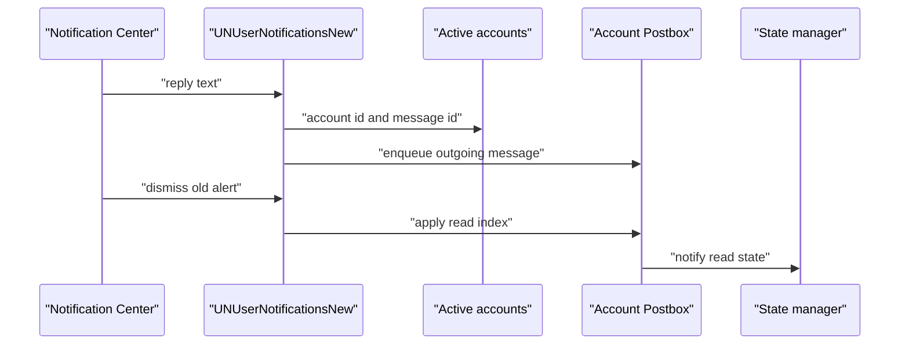

# macOS 알림 동작과 Dock 배지

웹: /docs/system/40-mac-notification-badge/ · Markdown: /docs/system/40-mac-notification-badge.md

> TelegramSwift의 알림 답장과 읽음 환류, Dock 미읽음 공식, 앱 잠금 경계를 추적해요.

> 시스템 설계 · 검증과 보충 · 보충 40 · 도표 1 · 코드 발췌 3 · 인용 23 · 소스 기준선: [TelegramMessenger/Telegram-iOS@f1dd7a2d](https://github.com/TelegramMessenger/Telegram-iOS/tree/f1dd7a2dbd02cbbf513e75d5695d8d36d1cf5838), [overtake/TelegramSwift@579cebbf](https://github.com/overtake/TelegramSwift/tree/579cebbf0c01fd41b712eff3647fa7f69db9665d)
>
> 검증 대상: [macOS 클라이언트의 시스템 계층](/docs/system/15-macos-system-layer/)
>
> 미검증 사항:
> - 실제 macOS 잠금 화면 환경에서 리액션 알림이 유지하는 답장 동작을 실행할 수 있는지는 미검증이에요.

## 알림 동작의 실제 환류 [#알림-동작의-실제-환류]

알림 동작은 macOS 알림 API 버전에 따라 경로가 달라요. 15장의 알림 개요는 여전히 유효하지만, 동작 경로는 버전별로 나누어 설명해야 해요.

이 보충에서 읽은 `telegram-ios` 서브모듈 작업 트리는 Gitlink(서브모듈이 가리키는 커밋)가 가리키는 `a24bbe45f9861f736a79916a50898512f751e0dc`에 있어요. 그래서 아래의 코어 호출은 TelegramSwift 고정 fork의 것으로 바로 볼 수 있어요.

macOS 10.14 이후의 새 알림 API `UNUserNotificationsNew`는 동작을 이렇게 다뤄요.

- 등록하는 동작: 식별자 `reply`인 텍스트 입력 동작 하나뿐이에요.
- 기본 클릭: 대화로 이동해요.
- 알림 닫기: 콜백이 곧바로 끝나요.

소스에는 별도의 “읽음으로 표시” `UNNotificationAction`이 등록되어 있지 않아요. [\[1\]](https://github.com/overtake/TelegramSwift/blob/579cebbf0c01fd41b712eff3647fa7f69db9665d/Telegram-Mac/UNUserNotifications.swift#L86-L129)[\[2\]](https://github.com/overtake/TelegramSwift/blob/579cebbf0c01fd41b712eff3647fa7f69db9665d/Telegram-Mac/UNUserNotifications.swift#L258-L285)

답장 동작은 이 순서로 처리돼요.

1. 알림 페이로드에서 `reply` 메시지 ID와 `accountId`를 꺼내요.
2. `activeAccounts`에서 그 계정을 찾아요.
3. 코어의 공개 함수 `enqueueMessages`를 호출해요.

이 과정은 현재 키 윈도우에 의존하지 않고, 채팅 입력창도 거치지 않아요. 토픽 메시지라면 코드는 `threadId`를 알림 메시지 ID로 설정해요. 개인 채팅이 아닌 경우에는 그 메시지를 답장 대상으로 삼아요. [\[1\]](https://github.com/overtake/TelegramSwift/blob/579cebbf0c01fd41b712eff3647fa7f69db9665d/Telegram-Mac/UNUserNotifications.swift#L86-L129)

```swift
            if let text = replyText {
                if let sourceMessageId = getNotificationMessageId(userInfo: userInfo, for: "source") {
                    var replyToMessageId:MessageId?
                    if sourceMessageId.peerId.namespace != Namespaces.Peer.CloudUser {
                        replyToMessageId = sourceMessageId
                    }
                    _ = enqueueMessages(account: account, peerId: sourceMessageId.peerId, messages: [EnqueueMessage.message(text: text, attributes: [], inlineStickers: [:], mediaReference: nil, threadId: Int64(messageId.id), replyToMessageId: replyToMessageId.flatMap { .init(messageId: $0, quote: nil, todoItemId: nil) }, replyToStoryId: nil, localGroupingKey: nil, correlationId: nil, bubbleUpEmojiOrStickersets: [])]).start()
// ...
```
[\[1\]](https://github.com/overtake/TelegramSwift/blob/579cebbf0c01fd41b712eff3647fa7f69db9665d/Telegram-Mac/UNUserNotifications.swift#L86-L129)

고정 fork의 `enqueueMessages`는 선택적 미디어 변환을 먼저 처리한 다음, 해당 계정의 `postbox.transaction` 안에서 큐에 넣어요. 그래서 알림 답장은 먼저 로컬의 전송 대기 메시지가 되고, 네트워크 전송은 이후의 전송 파이프라인이 맡아요. 알림 delegate가 RPC를 직접 보내는 게 아니에요. [\[3\]](https://github.com/overtake/Telegram-iOS/blob/a24bbe45f9861f736a79916a50898512f751e0dc/submodules/TelegramCore/Sources/PendingMessages/EnqueueMessage.swift#L361-L374)

구형 `NSUserNotificationCenter` 경로는 달라요. 사용자가 alert를 닫을 때 `didDismissAlert`가 알림의 메시지 ID와 타임스탬프로 `applyMaxReadIndexInteractively`를 호출해요. 소스에서 볼 수 있는 “읽음으로 표시” 동작이 바로 이거예요. 반면 구형 알림을 클릭할 때의 `didActivate`는 이미 전달된 알림을 제거할 뿐, 메시지를 읽음으로 만들지는 않아요. [\[4\]](https://github.com/overtake/TelegramSwift/blob/579cebbf0c01fd41b712eff3647fa7f69db9665d/Telegram-Mac/UNUserNotifications.swift#L187-L199)

여기에는 다중 계정 경계의 빈틈이 있어요. `SharedNotificationBindings`가 읽음 클로저를 설치할 때는 `self.contextValue?.context`에 대해서만 `engine.messages.applyMaxReadIndexInteractively`를 호출해요. 클로저는 알림의 `accountId`를 읽지 않아요. 그래서 구형 API의 읽음 동작은 알림을 보낸 계정이 아니라 현재 메인 화면의 계정에 적용돼요. 원래 장이 말한 알림 계정별 라우팅을 증명하지 못해요. [\[5\]](https://github.com/overtake/TelegramSwift/blob/579cebbf0c01fd41b712eff3647fa7f69db9665d/Telegram-Mac/AppDelegate.swift#L914-L925)

코어의 읽기 동작은 해당 계정의 Postbox 트랜잭션에서 `applyInteractiveReadMaxIndex`를 호출해요. 일반 클라우드 대화에서는 이어서 `AccountStateManager`에 읽음 상태 동기화를 알려요. [\[6\]](https://github.com/overtake/Telegram-iOS/blob/a24bbe45f9861f736a79916a50898512f751e0dc/submodules/TelegramCore/Sources/TelegramEngine/Messages/ApplyMaxReadIndexInteractively.swift#L7-L68)



이 도표의 뒷부분(alert 닫기에서 읽음 색인 적용까지)은 구형 알림 API에만 적용돼요. 새 API의 dismiss 분기에는 메시지를 읽는 호출이 없어요. [\[2\]](https://github.com/overtake/TelegramSwift/blob/579cebbf0c01fd41b712eff3647fa7f69db9665d/Telegram-Mac/UNUserNotifications.swift#L258-L285)[\[4\]](https://github.com/overtake/TelegramSwift/blob/579cebbf0c01fd41b712eff3647fa7f69db9665d/Telegram-Mac/UNUserNotifications.swift#L187-L199)[\[6\]](https://github.com/overtake/Telegram-iOS/blob/a24bbe45f9861f736a79916a50898512f751e0dc/submodules/TelegramCore/Sources/TelegramEngine/Messages/ApplyMaxReadIndexInteractively.swift#L7-L68)

## Dock 배지 공식과 갱신 시점 [#dock-배지-공식과-갱신-시점]

Dock 배지는 모든 계정의 합계가 아니라 계정 하나의 미읽음 수만 보여 줘요. `TabBadgeItem`이 만드는 `GlobalBadgeNode`에는 `dockTile: true`가 전달되고, 이 노드는 자기 `context.account`의 `renderedTotalUnreadCount`를 구독해요. 현재 호출은 `collectAllAccounts: true`를 넘기지 않아서, 이 프로세스에 있는 모든 계정이 아니라 단일 `Account`의 Postbox를 읽어요. 계정 메뉴의 `TabAllBadgeItem`만 다중 계정 합산을 쓰고, Dock에는 쓰지 않아요. [\[7\]](https://github.com/overtake/TelegramSwift/blob/579cebbf0c01fd41b712eff3647fa7f69db9665d/Telegram-Mac/GlobalBadgeNode.swift#L118-L205)[\[8\]](https://github.com/overtake/TelegramSwift/blob/579cebbf0c01fd41b712eff3647fa7f69db9665d/Telegram-Mac/TabBadgeItem.swift#L77-L94)

단일 계정의 원시 카운트는 다음과 같아요.

`C = Sroot.count(style.category, category.statsType, K)`

- `Sroot`: 루트 채팅 그룹의 `ChatListTotalUnreadState`예요.
- `K`: 설정의 태그 집합이에요.
- `C`: 채팅 수 또는 메시지 수예요.

각 설정은 이렇게 읽어요.

- `style`이 `raw`이면 `absoluteCounters`를, `filtered`이면 `filteredCounters`를 읽어요.
- `category`가 `chats`이면 미읽음이 있는 대화 수를, `messages`이면 미읽음 메시지 수를 누적해요.
- 카운트 함수는 `K`에 있는 각 태그의 카운트를 하나씩 누적해요.

[\[9\]](https://github.com/overtake/TelegramSwift/blob/579cebbf0c01fd41b712eff3647fa7f69db9665d/packages/InAppSettings/Sources/InAppSettings/RenderedTotalUnreadCount.swift#L11-L68)[\[10\]](https://github.com/overtake/Telegram-iOS/blob/a24bbe45f9861f736a79916a50898512f751e0dc/submodules/Postbox/Sources/GroupMessageStatsTable.swift#L80-L141)

기본 설정은 `filtered`, `chats`, `all`, 배지 활성화예요. 기본 `all`에는 연락처, 비연락처, 그룹, 봇, 채널이 들어가요. 그래서 채널은 기본으로 집계돼요. 알림 환경설정 화면의 “Include Groups”와 “Include Channels”는 각각 `.group`과 `.channel`을 추가하거나 빼요. 음소거된 대화를 포함하는 독립 스위치는 없어요. [\[11\]](https://github.com/overtake/TelegramSwift/blob/579cebbf0c01fd41b712eff3647fa7f69db9665d/packages/InAppSettings/Sources/InAppSettings/InAppNotificationSettings.swift#L99-L118)[\[12\]](https://github.com/overtake/TelegramSwift/blob/579cebbf0c01fd41b712eff3647fa7f69db9665d/Telegram-Mac/NotificationPreferencesController.swift#L340-L364)

음소거는 `K`가 아니라 `style`에서 처리돼요. `TelegramPeerNotificationSettings.isRemovedFromTotalUnreadCount`는 `.muted`에 대해 참을 반환해요. 채팅 색인을 갱신할 때 이 값이 참이면 코드는 필터링된 카운트의 메시지 수와 채팅 수를 모두 0으로 만들어요. 그래서 기본 `filtered`는 음소거된 대화를 세지 않아요. 표시 스타일을 `raw`로 바꾸면 절대 카운트는 여전히 음소거된 대화를 유지해요. [\[13\]](https://github.com/overtake/Telegram-iOS/blob/a24bbe45f9861f736a79916a50898512f751e0dc/submodules/TelegramCore/Sources/SyncCore/SyncCore_TelegramPeerNotificationSettings.swift#L555-L574)[\[14\]](https://github.com/overtake/Telegram-iOS/blob/a24bbe45f9861f736a79916a50898512f751e0dc/submodules/Postbox/Sources/ChatListIndexTable.swift#L551-L564)

보관함은 이 Dock 공식에 들어가지 않아요. 렌더러는 루트 그룹의 총 미읽음을 명시적으로 읽고, 코어는 보관함을 다른 `Namespaces.PeerGroup.archive`로 매핑해요. 채팅 색인도 `groupId`별로 `totalStates`를 따로 유지해요. 그래서 보관함 설정 항목이 없고, “기본으로 보관함을 포함”하지 않아요. [\[9\]](https://github.com/overtake/TelegramSwift/blob/579cebbf0c01fd41b712eff3647fa7f69db9665d/packages/InAppSettings/Sources/InAppSettings/RenderedTotalUnreadCount.swift#L11-L68)[\[15\]](https://github.com/overtake/Telegram-iOS/blob/a24bbe45f9861f736a79916a50898512f751e0dc/submodules/TelegramCore/Sources/TelegramEngine/Messages/ChatList.swift#L424-L442)[\[16\]](https://github.com/overtake/Telegram-iOS/blob/a24bbe45f9861f736a79916a50898512f751e0dc/submodules/Postbox/Sources/ChatListIndexTable.swift#L737-L782)

최종적으로 기록되는 Dock 문자는 다음과 같아요.

- `badgeEnabled`가 거짓이면 빈 값이에요.
- 그렇지 않고 해당 계정의 카운트가 0보다 크면 십진수 문자열이에요.

노드는 `badgeEnabled`를 한 번 더 확인하고, 같은 문자열을 상태 표시줄 아이콘 생성 흐름에도 써요. `combineLatest`는 미읽음 뷰, 공유 알림 설정, 폴더 설정을 구독해요. 그래서 아래 변화가 모두 다시 계산되어 `NSDockTile.badgeLabel`에 바로 기록돼요. [\[7\]](https://github.com/overtake/TelegramSwift/blob/579cebbf0c01fd41b712eff3647fa7f69db9665d/Telegram-Mac/GlobalBadgeNode.swift#L118-L205)[\[9\]](https://github.com/overtake/TelegramSwift/blob/579cebbf0c01fd41b712eff3647fa7f69db9665d/packages/InAppSettings/Sources/InAppSettings/RenderedTotalUnreadCount.swift#L11-L68)

- 메시지 읽음 또는 도착
- 음소거 상태 변화
- 채널이나 그룹 스위치 변화
- 카운트 범주 변화
- 배지 전체 스위치 변화

```swift
                    var dockText: String?
                    let totalValue = !inAppSettings.badgeEnabled  ? 0 : (collectAllAccounts && !inAppSettings.notifyAllAccounts ? 0 : max(0, counts.reduce(0, { $0 + $1.0 })))
                    if totalValue > 0 {
                        dockText = "\(max(0, totalValue))"
                    }
// ...
                if dockTile {
                    NSApplication.shared.dockTile.badgeLabel = result.dockText
                    forceUpdateStatusBarIconByDockTile(sharedContext: sharedContext)
                }
```
[\[7\]](https://github.com/overtake/TelegramSwift/blob/579cebbf0c01fd41b712eff3647fa7f69db9665d/Telegram-Mac/GlobalBadgeNode.swift#L118-L205)

`chatListFolderSettings`의 사이드바 조건은 노드 자신의 `total`만 0으로 만들어요. `dockText`는 그대로 둬요. 그래서 이 조건이 숨기는 건 탭 배지이고, Dock 숫자가 아니에요. [\[7\]](https://github.com/overtake/TelegramSwift/blob/579cebbf0c01fd41b712eff3647fa7f69db9665d/Telegram-Mac/GlobalBadgeNode.swift#L118-L205)

## 로컬 패스코드, Touch ID, 잠금 화면 가시성 [#로컬-패스코드-touch-id-잠금-화면-가시성]

로컬 패스코드는 두 곳에서 경계 역할을 해요. 하나는 콜드 스타트이고, 다른 하나는 실행 중의 자동 잠금이에요.

콜드 스타트에서 `AppDelegate`는 `AppEncryptionParameters.decrypt()`가 키와 솔트를 돌려준 뒤에야 `ValueBoxEncryptionParameters`를 구성하고 계정을 시작해요. 패스코드가 실패하면 콜드 스타트 잠금 화면 컨트롤러를 표시해요. 그래서 패스코드는 윈도우 가림막만이 아니라 데이터베이스 암호화 파라미터를 복원하는 일에도 관여해요. [\[17\]](https://github.com/overtake/TelegramSwift/blob/579cebbf0c01fd41b712eff3647fa7f69db9665d/Telegram-Mac/AppDelegate.swift#L519-L550)

실행 중의 자동 잠금은 10초마다 검사해요. 기본 타임아웃은 300초예요. 포커스를 잃은 뒤의 경과 시간과 `SystemIdleTime`을 함께 비교해요. 수동 `Command L`도 같은 잠금 흐름을 요청해요. 잠글 때 관리자는 이렇게 해요.

- 인스턴트 페이지와 갤러리를 닫아요.
- 오디오를 일시 중지해요.
- 오버레이를 표시해요.
- 각 계정 윈도우의 `SplitView`를 숨겨요.

정상적인 잠금 경로에서 로그아웃을 호출하거나 계정 객체를 해제하지는 않아요. [\[18\]](https://github.com/overtake/TelegramSwift/blob/579cebbf0c01fd41b712eff3647fa7f69db9665d/Telegram-Mac/SharedNotificationManager.swift#L133-L223)[\[19\]](https://github.com/overtake/TelegramSwift/blob/579cebbf0c01fd41b712eff3647fa7f69db9665d/Telegram-Mac/ApplicationContext.swift#L445-L466)[\[23\]](https://github.com/overtake/TelegramSwift/blob/579cebbf0c01fd41b712eff3647fa7f69db9665d/packages/InAppSettings/Sources/InAppSettings/PasscodeSettings.swift#L16-L25)

Touch ID는 이 앱 잠금 계층만 해제해요. 설정 화면은 `LAContext.canUseBiometric`이 참일 때만 스위치를 제공해요. 해제 컨트롤러는 먼저 `.applicationPolicy`를 쓰고, 실패하면 `.deviceOwnerAuthentication`으로 폴백해요. 성공하면 `doneValue`를 설정하고 잠금 화면 컨트롤러를 닫을 뿐이에요. Telegram에 다시 로그인하지 않고, 클라우드의 2단계 인증도 바꾸지 않아요. [\[18\]](https://github.com/overtake/TelegramSwift/blob/579cebbf0c01fd41b712eff3647fa7f69db9665d/Telegram-Mac/SharedNotificationManager.swift#L133-L223)[\[20\]](https://github.com/overtake/TelegramSwift/blob/579cebbf0c01fd41b712eff3647fa7f69db9665d/Telegram-Mac/PasscodeLockController.swift#L398-L437)

```swift
    func callTouchId(tryAnotherWay: Bool = false) {
        laContext.evaluatePolicy(tryAnotherWay ? .deviceOwnerAuthentication : .applicationPolicy, localizedReason: strings().passcodeUnlockTouchIdReason) { [weak self] (success, evaluateError) in
            if (success) {
                Queue.mainQueue().async {
                    self?._doneValue.set(.single(true))
                    self?.close()
                }
            } else if let evaluateError, !tryAnotherWay {
                self?.callTouchId(tryAnotherWay: true)
            }
        }
    }
```
[\[20\]](https://github.com/overtake/TelegramSwift/blob/579cebbf0c01fd41b712eff3647fa7f69db9665d/Telegram-Mac/PasscodeLockController.swift#L398-L437)

잠긴 동안에는 메인 윈도우의 내용이 보이지 않아요. 채팅 컨트롤러는 `canRead`를 잠금 상태의 반전으로 취해요. 그래서 가려진 채팅이 여전히 화면에 있다는 이유로 알림을 지우거나 읽음 위치를 진행시키지 않아요. [\[21\]](https://github.com/overtake/TelegramSwift/blob/579cebbf0c01fd41b712eff3647fa7f69db9665d/Telegram-Mac/ChatController.swift#L3453-L3483)

시스템 알림에는 더 세밀한 경계가 있어요. `screenIsLocked`가 참이면 일반 메시지 알림은 이렇게 바뀌어요.

- 제목은 앱 이름으로 바꿔요.
- 본문은 일반적인 잠금 미리보기로 바꿔요.
- 부제목, 이미지, 소리는 제거해요.

Dock 배지 계산은 잠금 상태를 읽지 않아서 미읽음 숫자는 여전히 보여요. [\[7\]](https://github.com/overtake/TelegramSwift/blob/579cebbf0c01fd41b712eff3647fa7f69db9665d/Telegram-Mac/GlobalBadgeNode.swift#L118-L205)[\[22\]](https://github.com/overtake/TelegramSwift/blob/579cebbf0c01fd41b712eff3647fa7f69db9665d/Telegram-Mac/SharedNotificationManager.swift#L505-L633)

그런데 리액션 알림에는 소스로 증명되는 예외가 있어요. 잠금 분기가 먼저 제목을 앱 이름으로 설정한 뒤, reaction 분기가 제목을 메시지가 속한 대화 이름으로 다시 써요. 잠금 분기는 여전히 본문과 이미지를 숨겨요. 그룹 경로는 `canSendMessage`로 처음의 답장 불가 상태를 다시 쓰기도 해요. 알림 delegate 자체는 답장하기 전에 `isLocked`를 확인하지 않아요.

따라서 추정: 시스템 알림 센터가 잠금 화면에서 이 동작을 실행하도록 허용한다면, 애플리케이션 코드는 로컬 패스코드 문턱을 더 이상 걸지 않아요. 실제 macOS 버전이 이런 상호작용을 허용하는지는 런타임에서 검증하지 않았어요. [\[2\]](https://github.com/overtake/TelegramSwift/blob/579cebbf0c01fd41b712eff3647fa7f69db9665d/Telegram-Mac/UNUserNotifications.swift#L258-L285)[\[22\]](https://github.com/overtake/TelegramSwift/blob/579cebbf0c01fd41b712eff3647fa7f69db9665d/Telegram-Mac/SharedNotificationManager.swift#L505-L633)

## 미검증 사항 [#미검증-사항]

- 실제 macOS 잠금 화면 환경에서 리액션 알림이 유지하는 답장 동작을 실행할 수 있는지는 미검증이에요.

## 원본 장에 대한 수정 [#원본-장에-대한-수정]

- `system/15-macos-system-layer.md`의 “시스템 알림, Dock 배지, 동작 환류” 298행, 원문 “동작이 해석된 뒤에는 올바른 AccountRecordId를 먼저 찾아야 해요”. → “답장 경로는 실제로 `accountId`로 계정을 골라 큐에 넣어요. 구형 알림 API에서 alert를 닫는 읽음 경로는 이 ID를 쓰지 않고 현재 메인 화면 계정의 엔진을 호출해요.”로 고치자고 제안해요. 이 수정은 “동작에서 코어까지의 전체 경로” 항목을 해결해요. 결과는 부분 해결이고, 원문의 일반화된 서술과 모순돼요. [\[1\]](https://github.com/overtake/TelegramSwift/blob/579cebbf0c01fd41b712eff3647fa7f69db9665d/Telegram-Mac/UNUserNotifications.swift#L86-L129)[\[4\]](https://github.com/overtake/TelegramSwift/blob/579cebbf0c01fd41b712eff3647fa7f69db9665d/Telegram-Mac/UNUserNotifications.swift#L187-L199)[\[5\]](https://github.com/overtake/TelegramSwift/blob/579cebbf0c01fd41b712eff3647fa7f69db9665d/Telegram-Mac/AppDelegate.swift#L914-L925)

- 같은 절 290행, 원문 “답장, 읽음 표시, 알림 클릭 시 delegate는 MessageId를 다시 얻을 수 있어요”. → macOS 10.14 이후에는 `reply` 동작만 등록하고, 기본 클릭은 이동하며, dismiss는 메시지를 읽지 않는다고 명확히 쓰자고 제안해요. “읽음으로 표시” 버튼과 alert 닫기 의미는 구형 `NSUserNotificationCenter` 객체 속성과 delegate에만 나와요. 이 수정은 알림 동작 의미 항목을 해결해요. 결과는 해결됨이에요. [\[2\]](https://github.com/overtake/TelegramSwift/blob/579cebbf0c01fd41b712eff3647fa7f69db9665d/Telegram-Mac/UNUserNotifications.swift#L258-L285)[\[4\]](https://github.com/overtake/TelegramSwift/blob/579cebbf0c01fd41b712eff3647fa7f69db9665d/Telegram-Mac/UNUserNotifications.swift#L187-L199)[\[22\]](https://github.com/overtake/TelegramSwift/blob/579cebbf0c01fd41b712eff3647fa7f69db9665d/Telegram-Mac/SharedNotificationManager.swift#L505-L633)

- 같은 절 300행, 원문 “구체적인 배지 카운트 공식과 음소거된 대화의 포함 여부는 이번에 검증하지 않았어요”. → 이 보충의 공식을 넣고, 기본 필터링 카운트는 음소거를 제외하고, 기본으로 채널을 포함하고, 보관함은 루트 그룹을 읽기 때문에 집계되지 않으며, `raw`는 음소거된 대화를 되살린다고 설명하자고 제안해요. 이 수정은 Dock 배지 공식 항목을 해결해요. 결과는 해결됨이에요. [\[9\]](https://github.com/overtake/TelegramSwift/blob/579cebbf0c01fd41b712eff3647fa7f69db9665d/packages/InAppSettings/Sources/InAppSettings/RenderedTotalUnreadCount.swift#L11-L68)[\[10\]](https://github.com/overtake/Telegram-iOS/blob/a24bbe45f9861f736a79916a50898512f751e0dc/submodules/Postbox/Sources/GroupMessageStatsTable.swift#L80-L141)[\[13\]](https://github.com/overtake/Telegram-iOS/blob/a24bbe45f9861f736a79916a50898512f751e0dc/submodules/TelegramCore/Sources/SyncCore/SyncCore_TelegramPeerNotificationSettings.swift#L555-L574)[\[14\]](https://github.com/overtake/Telegram-iOS/blob/a24bbe45f9861f736a79916a50898512f751e0dc/submodules/Postbox/Sources/ChatListIndexTable.swift#L551-L564)[\[15\]](https://github.com/overtake/Telegram-iOS/blob/a24bbe45f9861f736a79916a50898512f751e0dc/submodules/TelegramCore/Sources/TelegramEngine/Messages/ChatList.swift#L424-L442)

- `패스코드와 Touch ID` 소절 481–483행, 원문 “Touch ID의 활성화 여부, 키가 어디에 저장되는지, 잠금이 디스크 데이터베이스를 보호하는지는 모두 미검증이에요”. → “소스에서 확인되는 건 이래요. 생체 인식을 쓸 수 있을 때 Touch ID 스위치가 표시되고, LocalAuthentication으로 오버레이를 해제해요. 콜드 스타트에서는 패스코드로 ValueBox 암호화 파라미터를 복원해야 해요. 실행 중의 잠금은 윈도우 내용을 숨기고 자동 읽음을 억제하지만 로그아웃하지는 않아요. 잠금 화면 알림은 보통 메시지 내용을 숨기지만, 리액션 알림은 대화 제목을 노출해요.”로 고치자고 제안해요. 이 수정은 잠금 경계 항목을 해결해요. 결과는 부분 해결이에요. 잠금 화면 알림 동작에 대한 macOS의 런타임 권한 부여는 여전히 미검증이에요. [\[17\]](https://github.com/overtake/TelegramSwift/blob/579cebbf0c01fd41b712eff3647fa7f69db9665d/Telegram-Mac/AppDelegate.swift#L519-L550)[\[18\]](https://github.com/overtake/TelegramSwift/blob/579cebbf0c01fd41b712eff3647fa7f69db9665d/Telegram-Mac/SharedNotificationManager.swift#L133-L223)[\[20\]](https://github.com/overtake/TelegramSwift/blob/579cebbf0c01fd41b712eff3647fa7f69db9665d/Telegram-Mac/PasscodeLockController.swift#L398-L437)[\[21\]](https://github.com/overtake/TelegramSwift/blob/579cebbf0c01fd41b712eff3647fa7f69db9665d/Telegram-Mac/ChatController.swift#L3453-L3483)[\[22\]](https://github.com/overtake/TelegramSwift/blob/579cebbf0c01fd41b712eff3647fa7f69db9665d/Telegram-Mac/SharedNotificationManager.swift#L505-L633)

- `설계 트레이드오프` 497행, 원문 “시스템 콜백은 모두 계정 신원을 먼저 가져온 뒤 코어로 들어가므로, 다중 계정에서 알림 조작이 현재 보이는 계정으로 잘못 전달되는 것을 피해요”. → “답장 알림”으로 한정하자고 제안해요. 구형 alert의 읽음 클로저는 `accountId`로 계정을 고르지 않으니 이 포괄적 결론은 정정이 필요해요. 결과는 원문과 모순돼요. [\[5\]](https://github.com/overtake/TelegramSwift/blob/579cebbf0c01fd41b712eff3647fa7f69db9665d/Telegram-Mac/AppDelegate.swift#L914-L925)

## 참고 [#references]

- \[1\] [알림 페이로드 파싱, 계정 선택, 답장 큐잉](https://github.com/overtake/TelegramSwift/blob/579cebbf0c01fd41b712eff3647fa7f69db9665d/Telegram-Mac/UNUserNotifications.swift#L86-L129)
- \[2\] [새 알림 API의 동작 delegate와 유일한 카테고리](https://github.com/overtake/TelegramSwift/blob/579cebbf0c01fd41b712eff3647fa7f69db9665d/Telegram-Mac/UNUserNotifications.swift#L258-L285)
- \[3\] [코어 발신 메시지 큐잉 트랜잭션](https://github.com/overtake/Telegram-iOS/blob/a24bbe45f9861f736a79916a50898512f751e0dc/submodules/TelegramCore/Sources/PendingMessages/EnqueueMessage.swift#L361-L374)
- \[4\] [구형 알림 API에서 alert를 닫을 때의 읽음 동작](https://github.com/overtake/TelegramSwift/blob/579cebbf0c01fd41b712eff3647fa7f69db9665d/Telegram-Mac/UNUserNotifications.swift#L187-L199)
- \[5\] [알림 바인딩의 현재 계정 읽음 호출](https://github.com/overtake/TelegramSwift/blob/579cebbf0c01fd41b712eff3647fa7f69db9665d/Telegram-Mac/AppDelegate.swift#L914-L925)
- \[6\] [코어 읽음 트랜잭션과 상태 관리자 알림](https://github.com/overtake/Telegram-iOS/blob/a24bbe45f9861f736a79916a50898512f751e0dc/submodules/TelegramCore/Sources/TelegramEngine/Messages/ApplyMaxReadIndexInteractively.swift#L7-L68)
- \[7\] [배지 집계, 조건 필터링, Dock 기록](https://github.com/overtake/TelegramSwift/blob/579cebbf0c01fd41b712eff3647fa7f69db9665d/Telegram-Mac/GlobalBadgeNode.swift#L118-L205)
- \[8\] [Dock 단일 계정 노드와 다중 계정 메뉴 노드](https://github.com/overtake/TelegramSwift/blob/579cebbf0c01fd41b712eff3647fa7f69db9665d/Telegram-Mac/TabBadgeItem.swift#L77-L94)
- \[9\] [루트 그룹 미읽음 상태의 렌더링 공식](https://github.com/overtake/TelegramSwift/blob/579cebbf0c01fd41b712eff3647fa7f69db9665d/packages/InAppSettings/Sources/InAppSettings/RenderedTotalUnreadCount.swift#L11-L68)
- \[10\] [원시 카운트와 필터링 카운트의 태그 누적](https://github.com/overtake/Telegram-iOS/blob/a24bbe45f9861f736a79916a50898512f751e0dc/submodules/Postbox/Sources/GroupMessageStatsTable.swift#L80-L141)
- \[11\] [기본 배지 설정](https://github.com/overtake/TelegramSwift/blob/579cebbf0c01fd41b712eff3647fa7f69db9665d/packages/InAppSettings/Sources/InAppSettings/InAppNotificationSettings.swift#L99-L118)
- \[12\] [채널과 그룹 배지 설정 화면](https://github.com/overtake/TelegramSwift/blob/579cebbf0c01fd41b712eff3647fa7f69db9665d/Telegram-Mac/NotificationPreferencesController.swift#L340-L364)
- \[13\] [음소거된 대화를 총 미읽음에서 제외](https://github.com/overtake/Telegram-iOS/blob/a24bbe45f9861f736a79916a50898512f751e0dc/submodules/TelegramCore/Sources/SyncCore/SyncCore_TelegramPeerNotificationSettings.swift#L555-L574)
- \[14\] [필터링 미읽음 카운트 0으로 초기화](https://github.com/overtake/Telegram-iOS/blob/a24bbe45f9861f736a79916a50898512f751e0dc/submodules/Postbox/Sources/ChatListIndexTable.swift#L551-L564)
- \[15\] [루트 채팅 그룹과 보관함 채팅 그룹 매핑](https://github.com/overtake/Telegram-iOS/blob/a24bbe45f9861f736a79916a50898512f751e0dc/submodules/TelegramCore/Sources/TelegramEngine/Messages/ChatList.swift#L424-L442)
- \[16\] [채팅 그룹별 총 미읽음 상태 유지](https://github.com/overtake/Telegram-iOS/blob/a24bbe45f9861f736a79916a50898512f751e0dc/submodules/Postbox/Sources/ChatListIndexTable.swift#L737-L782)
- \[17\] [콜드 스타트 시 ValueBox 암호화 파라미터 복원](https://github.com/overtake/TelegramSwift/blob/579cebbf0c01fd41b712eff3647fa7f69db9665d/Telegram-Mac/AppDelegate.swift#L519-L550)
- \[18\] [잠금 오버레이와 자동 잠금 조건](https://github.com/overtake/TelegramSwift/blob/579cebbf0c01fd41b712eff3647fa7f69db9665d/Telegram-Mac/SharedNotificationManager.swift#L133-L223)
- \[19\] [Command L 수동 잠금](https://github.com/overtake/TelegramSwift/blob/579cebbf0c01fd41b712eff3647fa7f69db9665d/Telegram-Mac/ApplicationContext.swift#L445-L466)
- \[20\] [패스코드 검증과 LocalAuthentication 해제](https://github.com/overtake/TelegramSwift/blob/579cebbf0c01fd41b712eff3647fa7f69db9665d/Telegram-Mac/PasscodeLockController.swift#L398-L437)
- \[21\] [잠금 중 읽음 위치 진행 금지](https://github.com/overtake/TelegramSwift/blob/579cebbf0c01fd41b712eff3647fa7f69db9665d/Telegram-Mac/ChatController.swift#L3453-L3483)
- \[22\] [잠금 화면 알림 내용, 리액션 제목, 동작 속성](https://github.com/overtake/TelegramSwift/blob/579cebbf0c01fd41b712eff3647fa7f69db9665d/Telegram-Mac/SharedNotificationManager.swift#L505-L633)
- \[23\] [패스코드 자동 잠금 기본값](https://github.com/overtake/TelegramSwift/blob/579cebbf0c01fd41b712eff3647fa7f69db9665d/packages/InAppSettings/Sources/InAppSettings/PasscodeSettings.swift#L16-L25)
